# Sim-to-Real 前沿技术路线综述：可执行场景生成、视觉真实性、物理可靠性与轨迹多样性（2025—2026）

> **更新日期：2026-11-20** · 研究范围：机器人操作、VLA、可交互数字孪生和仿真数据生成。本文为独立 Sim-to-Real 调研，不以某个具体 WAM 项目为研究前提。  

## 摘要

Sim-to-Real Gap 不只是像素外观的差异，而是机器人策略训练和真实部署之间的多层次分布偏移：仿真观测与真实相机不一致，仿真接触/控制与真实动力学不一致，脚本专家的任务与动作覆盖不足，以及大量模拟轨迹与少量真实示教的混合训练不一定有益。2025—2026 年的前沿路线表现为：自动从文本/图像/实景视频生成 Sim-Ready 可执行场景、使用 3DGS 和物理引擎构建可执行数字孪生、用机器人条件视频生成补足视觉域、用真实交互校准物理或学习残差、通过自动专家/生成式模型/数据筛选改善有效轨迹覆盖，再将模拟数据的**真实任务效用**作为选择与共同训练的依据。

## 阅读导航

- [1. Sim-to-Real 总体问题](#1-sim-to-real-领域总体存在什么问题)
- [2. 视觉与 Sim-Ready 场景：GSWorld / RE³SIM / RoboRender / TabletopGen / EmbodiedGen V2 / SimFoundry](#2-视觉真实性从逼真图像到可执行可监督的数字世界)
- [3. 物理可靠性：SPARR / SoMA / PIN-WM](#3-物理可靠性从理想引擎到真机交互校准)
- [4. 轨迹多样性：RoboTwin 2.0 / RoboDream / Real2Render2Real / SCIZOR / Digital Cousins 交叉阅读](#4-轨迹多样性从扰动已有轨迹到主动构造有价值的行为数据)
- [5. Sim/Real 数据协同：MetaGenSim / Co-training](#5-真实数据与仿真数据如何协同配比之外的选择)
- [6. 物理真实性与动力学可信度：14 篇新增论文](#6-物理真实性与动力学可信度从可执行资产到真实交互对齐)
- [7—9. 路线比较、开放问题与图源说明](#7-四条主路线与数据协同的综合比较)

**按主题阅读：** [视觉](chapters/02-visual.md) · [物理](chapters/03-physics.md) · [轨迹](chapters/04-diversity.md) · [Sim/Real](chapters/05-sim-real.md) · [物理真实性前沿](chapters/06-physical-realism.md)

---

## 1. Sim-to-Real 领域总体存在什么问题？

### 1.1 从“观测—动作—结果”理解现实差异

机器人策略与环境相互作用可以抽象为：

$$
\begin{aligned}
a_t &\sim \pi_\theta(a_t \mid o_{\le t}, \ell),\\
s_{t+1} &\sim P_{\mathrm{env}}(s_{t+1} \mid s_t,a_t),\\
o_t &\sim P_{\mathrm{sensor}}(o_t \mid s_t).
\end{aligned}
$$

其中 $\ell$ 为任务/语言条件，$s_t$ 是不一定可直接观测的物理状态，$o_t$ 是 RGB、深度、本体感觉等传感器观测。即使模拟策略学习得非常成功，真实执行时也可能同时出现下表所列变化：

| 主要问题 | 具体来源 | 为什么会影响 VLA/控制策略 | 代表性缓解路线 |
|---|---|---|---|
| **视觉与几何真实性** | 材质/照明/透明反射、遮挡、相机内外参、物体尺度与机器人位置配准 | 同一个任务在训练和部署时的像素—动作对应关系不同 | 3DGS Real-to-Sim、可交互数字孪生、条件视频渲染 |
| **物理可靠性** | 接触摩擦/刚度、碰撞模型、柔性物体、关节滞后、控制延迟、夹爪误差 | 相似动作造成不同真实结果，尤其精细接触 | 可微系统辨识、神经软体动力学、真机残差 RL |
| **轨迹多样性** | 专家模板、任务和初态覆盖少、成功偏置、极少失败恢复/替代路径 | 模型把特定轨迹模式当成普遍规律，遇到新状态失效 | MLLM 程序生成、生成式行为扩增、轨迹筛选 |
| **数据源不一致** | 模拟轨迹与真实示教在采样率、动作坐标、质量、风格和任务难度方面不同 | 大量模拟数据会掩盖稀缺真实信息，甚至发生负迁移 | Task-aware Digital Cousins、Sim-Real Co-training、主动生成 |

### 1.2 三个问题不是互相独立的

- **视觉外观好，不保证接触对**：3DGS 解决渲染与场景表达，不自动求出准确摩擦与微小接触。
- **接触模拟准，不保证策略会成功**：真实视觉可能使抓取点估计偏移，导致本来准确的物理模型没有被正确调用。
- **Episode 数多，不保证有效行为多**：重复相同成功路径增加频率但不增加覆盖；生成式视频换场景不等于产生新的接触策略。
- **失败轨迹不一定是坏数据**：行为克隆需要高质量动作；世界动力学预测或恢复学习却可能需要失败数据。数据筛选必须与训练目标匹配。

### 1.3 评价指标应与研究目标对应

| 指标 | 能回答什么 | 不能替代什么 |
|---|---|---|
| PSNR / SSIM / LPIPS | 图片或视频渲染与真实图像相似吗？ | 不能回答物理执行是否正确 |
| 轨迹位置误差、接触时间误差 | 模拟动力学与真实交互是否吻合？ | 不能独自回答策略成功率 |
| 仿真任务成功率 | 策略在设定模型内是否有效？ | 不能直接作为真实成功率 |
| 真实机器人成功率（注明测试次数） | 对论文验证任务的真实迁移是否有效？ | 不能证明跨本体普适泛化 |
| 新增数据的边际真实收益 | 多生成的模拟数据是否值得保留？ | 不意味着图像或物理质量一定最好 |

### 1.4 2025—2026 年技术路线速览

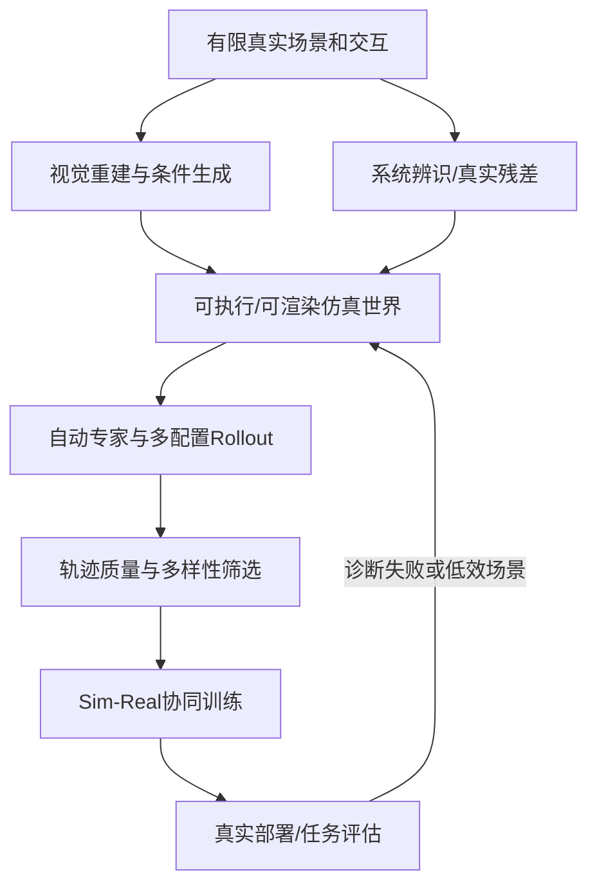

**阅读顺序**：第 2 章分析“如何构造可视的世界”，第 3 章分析“真实交互怎么接近正确”，第 4 章分析“如何获得更多不同且有效的行为”，第 5 章分析“这些数据如何真正用于策略训练”，第 6 章深入介绍物理真实性的 14 篇新研究。下文每篇均附作者链接及中文图示。

---

## 2. 视觉真实性：从“逼真图像”到可执行、可监督的数字世界

视觉域差异既包括纹理/光照/遮挡这样的外观差异，也包括相机内外参、物体尺度、几何遮挡和机器人与场景配准这样的结构差异。视觉 Sim-to-Real 的训练对象并非静态图片，而是观测—动作序列，因此还必须检查**跨视角一致性、时间连续性、运动几何与动作标签的一致性**。本章按“可交互数字孪生 → 实景重建数据生产 → 生成式视频渲染 → 自动化可执行世界构建”的技术发展展开。

### 2.0 技术路线总览：代表工作与核心差异

**本章研究主线。** 视觉 Sim-to-Real 的目标并非单纯提高图像的照片级真实感，而是使真实相机观测与仿真中的**物体位置、机器人构型和动作监督**形成一致的对应关系。可以把这一问题拆为两层：第一层是“场景几何与坐标是否正确”，第二层是“从相同几何和机器人运动出发，RGB 图像是否足够接近真实环境”。前者决定像素观测能否对应正确的抓取/操作位置，后者影响视觉策略对材质、照明和背景变化的泛化。

本章先以三篇论文说明实景数字孪生和条件视频渲染，再补充三篇 Sim-Ready 场景生成工作：

| 技术路线 | 代表论文 | 核心思路与方法流程 | 主要解决的问题 | 适用边界 |
|---|---|---|---|---|
| **可交互照片级数字孪生** | **GSWorld（§2.1）** | 多视角实景采集 → 3DGS/GSDF 资产与机器人几何配准 → 物理引擎闭环执行、照片级渲染 | 同时得到接近真实的观测和可交互的仿真状态，用于策略训练、DAgger 与评测 | 仍需场景标定、碰撞资产和物理参数；图像逼真不自动代表接触精确 |
| **结构化 Real-to-Sim 数据生成** | **RE³SIM（§2.2）** | 前景可碰撞 Mesh + 背景 3DGS → 相机与机器人坐标对齐 → 仿真专家轨迹采集 → 模仿学习 | 在真实场景几何约束下批量生成可直接用于视觉操作策略的训练数据 | 依赖目标场景重建与配准；特权专家和物理引擎仍可能引入动作偏差 |
| **几何约束的生成式视觉迁移** | **RoboRender（§2.3）** | 先在模拟器采集深度、机器人 Mask 和动作 → 条件视频生成器合成真实感多视角 RGB → 与原动作标签配对训练 | 在保持仿真运动轨迹的同时扩大纹理、背景和真实视觉分布覆盖 | 生成器使用真实视频训练；需检验生成画面与原动作、接触状态的一致性 |
| **可执行三维世界自动生成** | **TabletopGen / EmbodiedGen V2 / SimFoundry（§2.4）** | 图像/任务/视频 → 生成或重建逐实例三维资产 → 几何与物理约束 → 形成 Sim-Ready 场景并扩增 | 自动化产出可以执行任务、采集轨迹及评测策略的仿真世界 | 视觉逼真和场景稳定不能替代真实接触参数辨识 |

**前三篇的关键区别是“修改哪一部分”。** GSWorld 和 RE³SIM 优先构建与真实环境对齐的**可执行场景**，前者更强调统一的闭环数字孪生系统，后者更强调从真实场景重建到可用示教的生产链路；RoboRender 则通常**保留模拟器的几何和动作，仅改变渲染外观**。因此，它们是不同层面的能力，可以组合使用，却不能单凭 PSNR 或照片真实感判断哪条路线的真机操作性能更好。

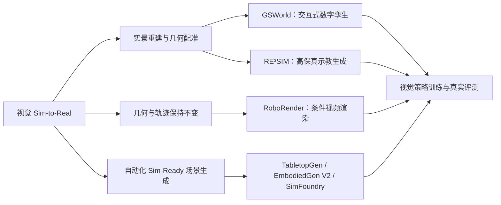

**阅读重点：** 下文重点关注每篇论文的视觉输入来源、空间标定方式、可交互性、生成图像与动作标签的对应关系，以及真机评测是否真正证明迁移有效；这几项比笼统的“渲染质量更高”更有区分力。


---

### 2.1 GSWorld：闭环照片级机器人模拟器

#### ① 论文基本信息
- **原题**：GSWorld: Closed-Loop Photo-Realistic Simulation Suite for Robotic Manipulation
- **作者/机构**：Guangqi Jiang 等；UC San Diego、UCLA、Meta。
- **发表**：ICRA 2026；[论文（arXiv）](https://arxiv.org/abs/2510.20813)｜[IEEE 记录](https://doi.org/10.1109/ICRA57385.2026.11697084)｜[官方项目](https://3dgsworld.github.io/)｜[GitHub](https://github.com/luccachiang/GSWorld)。

#### ② 论文概述 
GSWorld 提出一种把三维高斯泼溅（3DGS）与物理引擎结合的照片级机器人操作模拟器。作者强调建立一个闭环开发环境：一方面，对从真实机器人数据学到的策略进行可复现评估；另一方面，在不额外使用真实机器人训练数据的情况下，直接生成可用于 Sim-to-Real 的数据。为兼顾渲染、机器人结构与物体几何，工作提出 GSDF（Gaussian Scene Description File）资产格式，将 Gaussian-on-Mesh、机器人 URDF 与场景物体统一管理；同时形成涵盖三类机器人本体、四十余种物体的资产库。作者展示了视觉模仿学习的零样本迁移、DAgger 自动纠错、仿真基准评测、虚拟遥操作以及视觉强化学习等应用。

#### ③ 研究动机与核心问题
纯 3DGS 重建可以让相机图片接近真实世界，但无法提供碰撞、物体可操作状态和下一步动作反馈；传统物理仿真虽可交互，却又存在明显的纹理、光照和场景几何偏差。因此，论文追求的不是“渲染最美”的静态场景，而是**照片级反馈和真实动作接口在同一个模拟系统内闭环运行**。它在研究对象上更接近可执行数字孪生，而非单纯的数据增强器。

#### ④ 方法总览与原论文截图

下列图片均是从[原论文 PDF](https://3dgsworld.github.io/resources/gsworld.pdf)直接裁切的**原始论文图**，已保存于本仓库，非 AI 生成或重新绘制。引用时请注明论文 Figure 编号。

**主图｜Figure 1：可执行 3DGS 数字孪生的总体能力**


*原论文 Figure 1，PDF 第 1 页。[查看原文对应页](https://3dgsworld.github.io/resources/gsworld.pdf#page=1)。*

**方法/架构图｜Figure 2：GSDF 场景资产及物理仿真接口**


*原论文 Figure 2，PDF 第 3 页。[查看原文对应页](https://3dgsworld.github.io/resources/gsworld.pdf#page=3)。*

**读图重点：** 主图显示实景场景重建和策略应用；第二张图展示 GSDF 与物理、视觉渲染的具体关系。

*图号、原论文 URL 及 PDF 截取坐标记录在 [截图来源清单](../assets/paper-screenshots/manifest.json)。详细中文 Pipeline 见下一节。*

#### ⑤ 核心技术与算法细节
**步骤一，真实场景尺度恢复。** 使用多视角采集、COLMAP 相机位姿估计和 ArUco 尺度基准，训练具有公制尺度的 3DGS；这一步解决“图片相似但实际米制尺寸不正确”的问题。官方脚本提供 COLMAP/GS 训练及资产导出接口。

**步骤二，机器人与环境联合表示。** 从 URDF 可视 Mesh 中采样有语义的机器人点云，将它与重建的场景点云对齐，先做人工初始配准，再使用 ICP 精调；通过机器人 link 信息保留可操纵部件语义。Gaussian 用于外观渲染，碰撞几何与关节约束仍交给物理系统处理，避免将 3DGS 本身当作可碰撞物理体。

**步骤三，GSDF 资产封装。** GSDF 在同一场景描述中组织 3DGS、Gaussian-on-Mesh、URDF/物体几何和坐标变换，使视觉渲染和物理交互能够持续同步。

**步骤四，闭环数据生产与策略学习。** 在模拟器中运行像素输入、动作输出的策略，实时产生下一帧观测；还支持将失败状态重置并重规划，在 DAgger 流程中采集纠正动作。它的“闭环”主要指训练、测试、定位失败与再采样都在可执行仿真内完成，并不等价于已经消除接触物理误差。

**数据接口与前提。** 需要真实场景的多视角扫描、机器人 URDF、机器人与物体的几何资产及校准结果。初始建模、相机/手眼标定和碰撞属性仍会影响最终精度。

#### ⑥ 完整 Pipeline
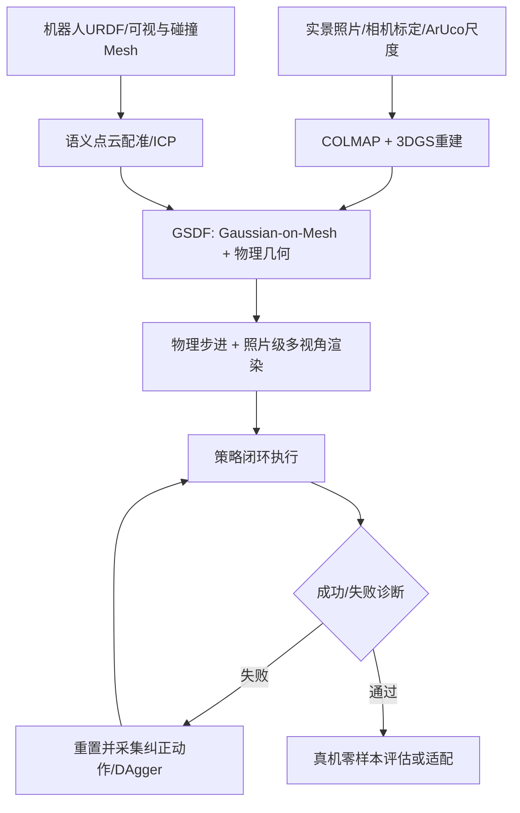

#### ⑦ 实验设计与主要结果
作者展示 FR3、xArm6 等设置下的模拟数据生产，以及零样本视觉模仿学习、视觉 RL、DAgger 和策略模拟评估。研究目标是说明一套系统可以同时支持多种训练/评测工作流，而不是通过统一的任务集证明它对所有接触任务都优于 PhysX、MuJoCo 或其他引擎。评价时应把图像外观、动作接口匹配、任务成功率和物理精度分别记录。

#### ⑧ 方法特点与局限性
**特点**：把几何/视觉资产与物理引擎连接成真正可执行的照片级场景；支持数据闭环，不仅输出离线图片。**局限**：每个目标场景仍有扫描、配准、资产清理与参数辨识成本；精细接触、摩擦和柔性物体的准确性不由 3DGS 保证；其优势在闭环系统能力，不能简单理解为 3DGS 提升了全部策略性能。

---

### 2.2 RE³SIM：前景几何与背景外观共同对齐

#### ① 论文基本信息
- **原题**：RE³SIM: Generating High-Fidelity Simulation Data via 3D-Photorealistic Real-to-Sim for Robotic Manipulation
- **作者/机构**：Xiaoshen Han 等；上海交通大学、上海人工智能实验室、香港大学。
- **发表**：ICRA 2026；[论文](https://arxiv.org/abs/2502.08645)｜[IEEE 记录](https://doi.org/10.1109/ICRA57385.2026.11695858)｜[官方项目](https://re3sim.github.io/)｜[GitHub](https://github.com/InternRobotics/Re3Sim)。

#### ② 论文概述 
机器人真实世界数据昂贵，需要有经验的操作人员和硬件；仿真具有规模优势，但几何与视觉失配常阻碍策略迁移。RE³SIM 为此提出照片级的 Real-to-Sim 系统，使用三维重建和神经渲染还原真实操作场景，使基于物理的模拟器能够实时渲染不同摄像机视角。作者借助仿真内的特权状态高效采集专家示教，并通过模仿学习训练策略，在多类机器人操作任务中验证 Real-to-Sim-to-Real 流程。仅利用合成训练数据，论文报告平均超过 58% 的真实机器人零样本成功率；进一步扩展模拟数据规模，在不同物体间训练更具泛化性的策略。

#### ③ 研究动机与核心问题
将真实环境的照片“贴”到模拟器背景上远远不够。机械臂/物体的几何大小、坐标系和相机视角只要有误差，就会造成训练时的抓取像素与真实操作位置不一致。RE³SIM 的研究重点是**将前景可碰撞几何与背景视觉重建分开处理、再统一配准到真实机器人的几何坐标系**。

#### ④ 方法总览与原论文截图

下列图片均是从[原论文 PDF](https://arxiv.org/pdf/2502.08645)直接裁切的**原始论文图**，已保存于本仓库，非 AI 生成或重新绘制。引用时请注明论文 Figure 编号。

**主图｜Figure 1：实景任务与 Real-to-Sim-to-Real 系统**


*原论文 Figure 1，PDF 第 1 页。[查看原文对应页](https://arxiv.org/pdf/2502.08645#page=1)。*

**方法/架构图｜Figure 2：前景 Mesh、背景 3DGS 和专家轨迹生产方法**


*原论文 Figure 2，PDF 第 3 页。[查看原文对应页](https://arxiv.org/pdf/2502.08645#page=3)。*

**读图重点：** 主图概括实景任务及仿真生成效果；方法图给出前景重建、背景渲染、真实坐标对齐和专家采样流程。

*图号、原论文 URL 及 PDF 截取坐标记录在 [截图来源清单](../assets/paper-screenshots/manifest.json)。详细中文 Pipeline 见下一节。*

#### ⑤ 核心技术与算法细节
**步骤一，场景解耦重建。** 将需要碰撞和抓取的操作对象恢复为显式 Mesh，将静态场景背景重建为 3DGS；这样不必用单一表示承担视觉和动力学两类相互矛盾的职责。

**步骤二，几何尺度与坐标对齐。** 利用真实机器人、相机内外参和标记物对目标场景配准；将前景 Mesh、背景 Gaussian、机器人模型映射到共同世界坐标系，必要时通过 ICP 等几何配准细化。偏差会直接转化为抓取与放置的坐标误差。

**步骤三，可执行仿真。** 在 NVIDIA Isaac Sim / PhysX 中保留真实的机器人结构、物体碰撞和运动学约束，使用 3DGS 合成多摄像机 RGB 观测。相同相机配置用于记录仿真动作与视觉观测，保障训练与部署的视觉接口尽量一致。

**步骤四，特权专家数据生成。** 使用仿真中精确可用的物体位姿、目标位姿和机器人状态，运行专家策略完成任务；保存成功的轨迹，过滤失败的 Rollout，再用这些带动作标签的数据训练模仿学习策略。这一设计通过“仿真特权状态生成专家、像素策略学习执行”降低真实遥操作需求。

**步骤五，扩增与联合训练。** 工作考察生成数据规模与成功率之间的关系，并对真实与仿真轨迹的轨迹长度、运动风格差异进行讨论。视觉接近并不等于动作统计分布完全一致。

#### ⑥ 完整 Pipeline
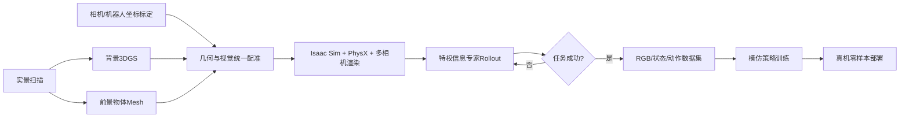

#### ⑦ 实验设计与主要结果
作者选取四类真实操作任务，报告仅使用仿真示教训练的平均零样本成功率超过 58%。项目页还展示 3DGS 背景的 PSNR/SSIM 对比、任务级数据采集效率（在 8 张 RTX 4090 上，按任务生成 100 条轨迹通常需数分钟至十余分钟），并分析扩大样本规模后的饱和效应。上述指标来自不同实验设置，不能将“重建质量好”直接等同于“动作动力学完美”。

#### ⑧ 方法特点与局限性
**特点**：系统性处理前景几何、背景外观、相机配准和示教采样流程；提供较直接的零样本真实测试。**局限**：固定场景依赖建模/校准；特权专家的成功轨迹不包含全部失败/纠错行为；每个新场景重建的人工与算力成本不能忽略；物理参数误差依旧会残留。

---

### 2.3 RoboRender：保持轨迹条件的生成式视觉 Sim-to-Real

#### ① 论文基本信息
- **原题**：RoboRender: Robot-Oriented Video Generation for Visual Sim-to-Real Transfer
- **作者/机构**：Huang Huang 等；Stanford University、NVIDIA、Microsoft Research。
- **状态**：2026 年 10 月 arXiv 预印本；[论文](https://arxiv.org/abs/2610.09254)｜[官网](https://robo-render.github.io/)｜[GitHub](https://github.com/robo-render/RoboRender-Video-Model)。

#### ② 论文概述 
仿真能够低成本产生大量机器人轨迹，但模拟图片与真实图片的视觉差异常导致策略部署失败。既有方法采用中间视觉表征可能损失语义，或者在部署时引入额外感知模块。RoboRender 提出将模拟轨迹直接转换为真实感 RGB 视频：模型以深度视频、语言指令及机器人 RGB Mask 为条件，尽量保持原模拟器几何、机器人运动和动作标签，同时生成逼真的材质、背景和干扰物；再将生成视频与模拟器的状态及动作配对训练策略。在视频生成测试中，它优于深度条件生成基线；在抓放、关节物体和移动操作的真实机器人测试中，生成数据训练的策略平均成功率达到 71%，分别约为原始仿真渲染和传统视觉随机化的 7.1 倍及 3.6 倍。增加每条模拟轨迹生成的视频数量还能继续提升开门类任务表现。

#### ③ 研究动机与核心问题
渲染器的真实感与模拟器的运动学/动作正确性可以拆开优化：模拟器负责“机器人在哪里、做了什么”，视频生成器负责“应该以怎样的真实 RGB 外观呈现”。不同于对每一帧独立做风格迁移，视频级生成必须保证**同一场景多摄像机视角一致、机器人外形不发生幻觉以及动作标签不因视觉合成而失效**。

#### ④ 方法总览与原论文截图

下列图片均是从[原论文 PDF](https://arxiv.org/pdf/2610.09254)直接裁切的**原始论文图**，已保存于本仓库，非 AI 生成或重新绘制。引用时请注明论文 Figure 编号。

**主图｜Figure 1：模拟视频转换成逼真机器人物理操作视频**


*原论文 Figure 1，PDF 第 1 页。[查看原文对应页](https://arxiv.org/pdf/2610.09254#page=1)。*

**方法/架构图｜Figure 2：深度、机器人 Mask 与多视角视频生成模型**


*原论文 Figure 2，PDF 第 3 页。[查看原文对应页](https://arxiv.org/pdf/2610.09254#page=3)。*

**读图重点：** 主图展示 Sim-to-Real 生成效果；模型图说明深度、机器人 Mask、语言和多视角条件的融合。

*图号、原论文 URL 及 PDF 截取坐标记录在 [截图来源清单](../assets/paper-screenshots/manifest.json)。详细中文 Pipeline 见下一节。*

#### ⑤ 核心技术与算法细节
**步骤一，建立机器人专用的视频生成器。** 项目将 Wan2.1-T2V-1.3B 适配成机器人视频渲染模型，并用约 13 万条真实机器人操作片段微调（官网列出 AgiBot-World-Alpha 和 DROID 来源）。真实样本用于**训练渲染器**，因此“策略零样本迁移”不代表整个系统没有使用任何真实数据。

**步骤二，定义强条件输入。** 模拟器先生成动作 (a_{1:T})、深度视频、机器人 RGB Mask，并提供语言描述；生成器围绕几何/本体条件改变材质、背景、干扰物等视觉因素。控制输入必须来自模拟轨迹，以避免在生成图片时顺带改动机器人动作。

**步骤三，多视角与长时程生成。** 项目采用多视角联合 latent，而非分别生成每个相机再拼接，减少跨相机物体身份不一致。长视频按片段自回归生成，后续片段条件化于前一片段的末帧，从而突破固定生成窗口。

**步骤四，合成监督数据。** 输出真实感 RGB 与原仿真动作/状态配对；动作标签不因新生成的场景外观而改变。评估应额外检查物体相对位置、接触状态、光学假影和长时漂移，因为“标签未改变”不保证“生成像素与标签严格一致”。

**步骤五，推理成本优化。** 项目提到通过 TeaCache 重用去噪特征，以及 DMD2 步数蒸馏加速多视角生成；这是扩大数据生产的工程关键，但它改变的是计算成本，不是物理仿真能力。

#### ⑥ 完整 Pipeline
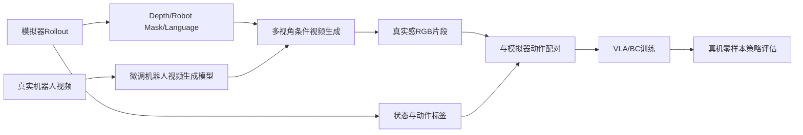

#### ⑦ 实验设计与主要结果
作者报告真实机器人抓放、关节物体操作及移动操作任务的平均成功率为 71%，与原始仿真渲染（约 10%）和视觉随机化（约 20%）比较，对应约 7.1× 与 3.6× 的相对改善。论文另有“增加每条模拟轨迹生成视频数量”的扩增消融，特定开门任务增加 65 个百分点。需区分视频模型生成质量与真实机器人任务成功率；两者不是同一指标。

#### ⑧ 方法特点与局限性
**特点**：可直接构造 RGB-动作配对数据；几何条件和多视角生成比无约束图像生成更适合机器人视频。**局限**：渲染器依赖真实视频预训练；扩散生成成本可观；接触瞬间、反射与遮挡可能造成视觉—动作标签不一致；目前是较新的工作，真实测试的任务覆盖尚不能代表通用结论。

---

### 2.4 生成式可交互仿真环境构建：从视觉三维内容到 Sim-Ready World

传统场景重建和生成式三维内容工具通常分别解决“外观是否像真实世界”和“能否生成一个三维模型”。机器人学习还要求另一组条件：**真实公制尺度、可碰撞几何、物理与关节属性、任务相关的可交互对象、可达的场景布局，以及能在模拟器中运行的观测—动作闭环**。因此，本节将 Simulation-Ready 3D Scene/World Generation 作为视觉真实感与物理可用性之间的一条**上游基础设施路线**，而非将它简单等同于“生成更漂亮的场景图”。

#### 2.4.0 技术路线总览：三篇论文分别解决哪一层

| 代表工作 | 关键输入 | 主攻问题 | 生成对象与技术路径 | 下游验证及边界 |
|---|---|---|---|---|
| **TabletopGen（§2.4.1）** | 文本或单张真实/合成图像 | 稠密桌面场景中，单实例三维资产和物体尺度/旋转/支撑关系如何同时正确 | 逐实例补全与 Image-to-3D → DRO 旋转优化 → TSA 俯视图与堆叠先验对齐 → Isaac Sim 场景 | 以自动化桌面操作数据和真实机械臂迁移验证；主要适用于典型桌面而非多层家具 |
| **EmbodiedGen V2（§2.4.2）** | 文本、图片、任务指令、增量编辑指令 | 生成的 3D 模型如何成为有交互语义、可导出、可编辑、可执行的世界 | 资产质量门控、碰撞网格/物性恢复、Affordance、Scene Graph、跨模拟器导出、Agent–Skill 编辑 | 场景可用率及 RL/真机迁移；多模块依赖生成/估计模型，不能由格式兼容性推断物理精度 |
| **SimFoundry（§2.4.3）** | 单段真实场景视频 | 如何低人工成本重建真实任务、扩增环境并让仿真评测预测真机表现 | 前景逐实例重建/配准 + 背景重建 + 可动关节/物性 → Object/Scene/Task Cousins → 策略评测与训练 | 真机—仿真相关性和零样本迁移证据较强；目前重点仍是桌面式任务配置 |

**三条路线的逻辑关系**：TabletopGen 重点解决“给定参考，自动把桌面摆对”；EmbodiedGen V2 重点解决“任意资产怎样进入任务可执行的通用场景系统”；SimFoundry 重点解决“给定真实任务，如何形成数字孪生、扩增成可训练的近邻环境，并验证策略预测能力”。它们都涉及视觉与物理，但主要贡献不是神经动力学方程辨识或视觉生成式视频迁移。

---

#### 2.4.1 TabletopGen：面向桌面操作的实例级场景生成与可执行布局

##### ① 论文基本信息
- **原题**：TabletopGen: Tabletop Scene Generation and Interactive Simulation for Robotic Manipulation。
- **作者/机构**：Ziqian Wang 等；中国科学院自动化研究所、中国科学院大学、D-Robotics、地平线等。
- **来源**：[arXiv:2512.01204](https://arxiv.org/abs/2512.01204)（所读 PDF v4，2026-07-02）｜[项目主页](https://d-robotics-ai-lab.github.io/TabletopGen.project/)。
- **关键词**：3D Scene Generation、Instance-Level Interactivity、Pose & Scale Alignment、Manipulation Data Synthesis。

##### ② 论文概述（根据 Abstract 中文译述）
大规模机器人操作数据采集可以借助模拟器降本扩展，但已有三维场景生成往往仅保证观感，难以提供实例级可交互性和物理合理性。TabletopGen 是无需额外训练的自动化桌面场景生成与仿真引擎。它从文本或单张图像出发，首先提取并生成相互独立的三维物体，再通过可微旋转优化和俯视图空间对齐恢复无碰撞布局，最后在物理引擎中配置碰撞几何，生成稳定且可以交互的场景。作者报告在视觉保真度、布局准确性和物理合理性上的优越性，并通过仅用生成示教训练、直接在真机执行的 Real-to-Sim-to-Real 实验证明其实际数据价值。

##### ③ 研究动机与核心问题
文本驱动房间生成往往依赖固定模型库，难以满足桌面密集小物体和功能性摆放约束；单图像三维重建又可能把遮挡物体生成成粘连 Mesh，或出现悬空、相互穿透、尺度失真等问题。机器人的运动规划需要每个对象具有**独立可碰撞实体、正确支撑关系及公制位置**，不能直接使用只有渲染真实感的完整场景网格。本工作的关键不是训练一个新 VLA，而是把单图像/语言重建结果转化为**可直接采集操作轨迹的模拟器场景**。

##### ④ 方法总览与原论文截图

**原论文 Figure 1｜生成可交互桌面场景、场内编辑和数据合成**（上传 PDF 第 2 页）：


*来源：[TabletopGen 原 PDF，第 2 页](https://arxiv.org/pdf/2512.01204#page=2)。*

**原论文 Figure 2｜实例提取—姿态尺度对齐—交互仿真的完整架构**（上传 PDF 第 6 页）：


*来源：[TabletopGen 原 PDF，第 6 页](https://arxiv.org/pdf/2512.01204#page=6)。*

**读图重点**：Figure 2 中 DRO 估计绕竖直轴的旋转，TSA 从俯视图与物体堆叠先验恢复平移和尺度，二者共同决定生成物体能否真正摆入物理场景。

##### ⑤ 核心技术与算法细节
**步骤一，生成式实例提取（Generative Instance Extraction）。** 若输入是文字，先由 LLM 丰富场景描述并通过文生图生成参考图像；若是图片则直接使用。用 MLLM 识别物体类别、GroundedSAM-v2 分割实例，对遮挡部分补全后分别执行 Image-to-3D，并对每个资产做 Z-up 坐标系规范化。这种“实例先生成、再对齐”有利于生成独立碰撞体，但资产几何仍会继承生成模型的误差。

**步骤二，DRO 优化旋转。** 在估计相机视角下对候选物体做可微渲染，联合匹配目标实例的轮廓 IoU、边缘 Chamfer 距离和 DINOv2 外观特征，求出绕竖直轴的较优角度。论文先按 5° 搜索候选，再对低损失角度做梯度优化。DRO 优先保证几何/视觉朝向一致，不负责处理物体之间的支撑和实际尺度。

**步骤三，TSA 约束平移与尺度。** 生成俯视视图，获得各实例俯视包围框；MLLM 推断物体的合理物理尺寸和“哪个物体放在哪个物体上”的堆叠关系。RMA-Score 综合俯视区域面积及物体长宽比误差选取尺度锚点，从而估计共同米/像素比例、各物体 XY 位置和 Z 支撑高度。该约束避免了完全依赖单目深度估计造成的堆叠、穿透和边界错误，但来自生成俯视图和常识尺寸的误差仍会传播。

**步骤四，可执行资产装配和数据生产。** 将实例导入 Isaac Sim，使用凸分解生成碰撞几何，配置重力和摩擦；给定人工或 LLM 生成的任务，调用运动规划器生成避碰轨迹并记录 RGB、关节状态和动作。支持对象增删、替换、重排，以低成本构建场景变体。这里的“物理合理性”主要体现在场景稳定、布局及碰撞有效；不能据此断言摩擦系数和接触动力学已与现实准确一致。

##### ⑥ 完整 Pipeline（中文重绘）
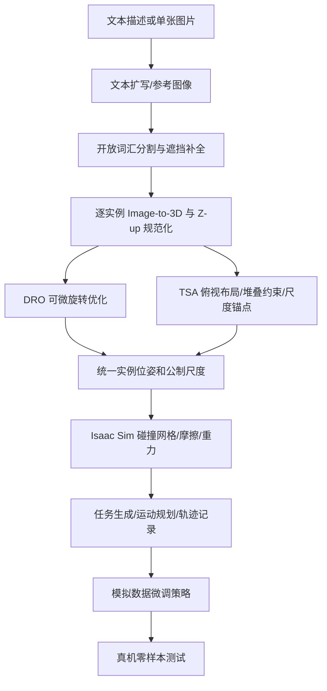

[查看独立中文方法流程 SVG](../assets/methods/TabletopGen.svg)。

##### ⑦ 实验设计与主要结果
论文用 **78 组参考图像**评估重建，包含真实照片与生成图片；另以 **30 组文本场景**评估生成，并进行 **128 人**用户研究。对图像输入，TabletopGen 报告对象对碰撞率 **0.42%**、包含碰撞的场景比例 **7.69%**（论文 Table 1），但两项均不为零。Real-to-Sim-to-Real 实验对三项桌面操作任务**每项合成 2,000 条轨迹**并微调 π0.5，在 AgileX PiPER 上不使用真实微调数据，真机成功率分别为 **84%、80%、68%**，仿真对应 **98%、92%、90%**（论文 Figure 6）。最后一项堆叠任务下降明显，恰好说明稳定摆放与真实接触仍存在差距。不同测试任务、轨迹规模与对照条件不能直接与其他两篇的成功率作横向排行榜。

##### ⑧ 方法特点与局限性
**价值**：完整连接图片/文字、实例建模、布局校正、可碰撞场景与操作示教；特别适合桌面合成数据生产。**局限**：主要针对单层典型桌面，作者明确指出多层架子和柜体仍待扩展；俯视图、物体尺度常识、生成 Mesh 都可能失准；凸碰撞体与默认摩擦模型不能保证精密插入、柔性或长时接触任务的真实性。它在**场景自动化、空间可执行性**方面的结果比“单纯提高光照真实感”更值得引用。

---

#### 2.4.2 EmbodiedGen V2：任务驱动、跨模拟器、可增量编辑的 Sim-Ready World Engine

##### ① 论文基本信息
- **原题**：EmbodiedGen V2: An Agentic, Simulation-Ready 3D World Engine for Embodied AI。
- **作者/机构**：Xinjie Wang 等；Horizon Robotics、WuwenAI。
- **来源**：[arXiv:2607.07459](https://arxiv.org/abs/2607.07459)（所读 PDF v3，2026-08-18）｜[项目主页](https://horizonrobotics.github.io/EmbodiedGen/)｜[代码](https://github.com/HorizonRobotics/EmbodiedGen)。
- **关键词**：Sim-Ready Asset、Affordance、Scene Graph、Cross-Simulator、Agentic World Editing。

##### ② 论文概述（根据 Abstract 中文译述）
生成三维资产已取得明显进展，但从单个资产自动组装成能供机器人策略训练的任务环境仍有大量人工劳动。EmbodiedGen V2 通过统一的 Sim-Ready 表示连接跨模拟器资产、交互可供性、任务驱动场景、多房间结构与有状态的自然语言编辑，使环境可生成、可复用、可修改，并可用于导航、操作、移动操作及策略学习。论文报告生成资产的人工可接受率 **96.5%**、碰撞测试成功率 **98.6%**，任务驱动生成场景的直接可用率 **83.3%**。论文还引用其生成环境支持的在线强化学习实验：仿真成功率由 **9.7% 提升至 79.8%**，真机成功率由 **21.7% 提升至 75.0%**。这些指标对应不同实验环节，不能解释为同一基准的单个综合得分。

##### ③ 研究动机与核心问题
通用 Image-to-3D 生成的 Mesh 往往缺失米制尺度、质量、摩擦、碰撞体、可操作部件及仿真器标准接口。仅将模型以 URDF/USD 导出仍未回答“机械臂能否抓这里”“物体是否放得稳”“任务中哪个对象是目标”“多房间能否通行”。论文提出一种两层统一表示：**资产层**携带几何、物理属性与 Affordance；**场景层**以带任务角色和空间关系的 Scene Graph 组织实体。自然语言 Agent 调度可验证的工具，而不是让 LLM 凭文字直接生成不可检查的三维坐标。

##### ④ 方法总览与原论文截图

**原论文 Figure 1｜任务驱动生成、多房间世界与 Vibe Coding**（PDF 第 1 页）：


*来源：[EmbodiedGen V2 原 PDF，第 1 页](https://arxiv.org/pdf/2607.07459#page=1)。*

**原论文 Figure 2｜Sim-Ready 三维资产生成、检查与跨模拟器导出**（PDF 第 4 页）：


*来源：[EmbodiedGen V2 原 PDF，第 4 页](https://arxiv.org/pdf/2607.07459#page=4)。*

**读图重点**：Figure 1 交代全系统如何由任务扩展到世界；Figure 2 是其中**资产生产分支**的详细 Pipeline，并非整个 Agent 编辑引擎的唯一结构图。任务布局与 Vibe Coding 的补充图分别见原文 Figure 5、Figure 8。

##### ⑤ 核心技术与算法细节
**步骤一，生成 Sim-Ready 资产。** 统一接入 TRELLIS、SAM3D、Hunyuan3D 等图生三维模块；在输入分割、生成模型输出、纹理、网格几何等处设置质量门控及失败重试。几何清理和简化后用 CoACD 做近似凸分解，再将三维高斯外观烘焙到显式纹理；利用 VLM 从类别与多视图推测米制尺度、质量和摩擦。以 URDF 为中间表示导出 SAPIEN、Bullet、Isaac Gym、MuJoCo、Genesis、Isaac Sim 所需格式。**跨引擎可加载**与**跨引擎接触行为完全一致**仍是不同性质的要求。

**步骤二，自动标注部件级 Affordance。** P3-SAM 生成物体功能部件分割；借助几何后处理与 VLM 合并过细部件，对各区域标注名称、功能、抓取可行性和操作场景。GraspGen 给出 6-DoF 抓取候选，再在 SAPIEN 内做闭合、提升、扰动与放下等物理验证。这样从“杯子是一个模型”推进到“杯子哪个部位能以什么动作交互”。

**步骤三，从任务描述编译场景。** 将语言任务拆为 ROBOT、BACKGROUND、CONTEXT、TARGETS、DISTRACTORS 等角色，组成带 ON、IN、FLOOR 等关系的 Scene Graph。逐节点生成/检索资产，再按广度优先顺序放置父物体与子物体，用支撑、IoU 碰撞和机械臂可达性约束筛选位置，最终让物体在 SAPIEN 中重力沉降，生成稳定布局。

**步骤四，大规模世界生成。** 任务若需要跨房间活动，则显式生成房间拓扑、连通门洞及单独可寻址的家具；通过场景复杂度分档控制家具密度、障碍物及细节层次。生成结果不再只是不可编辑的背景大 Mesh，而可以逐实例替换、扩增并导出。

**步骤五，Agent–Skill–Harness 增量编辑。** Agent 理解自然语言、选择 Skill；Skill 将操作交给确定性布局求解器和仿真运行器；Harness 维护 Scene Graph、资产、位姿和编辑历史。通过 Parse–Ground–Invoke–Commit 过程，每次只提交通过物理与几何约束的状态变更，失败时保留原状态。这是“Vibe Coding”背后的工程含义，而非直接依赖语言模型自由生成模型文件。

##### ⑥ 完整 Pipeline（中文重绘）
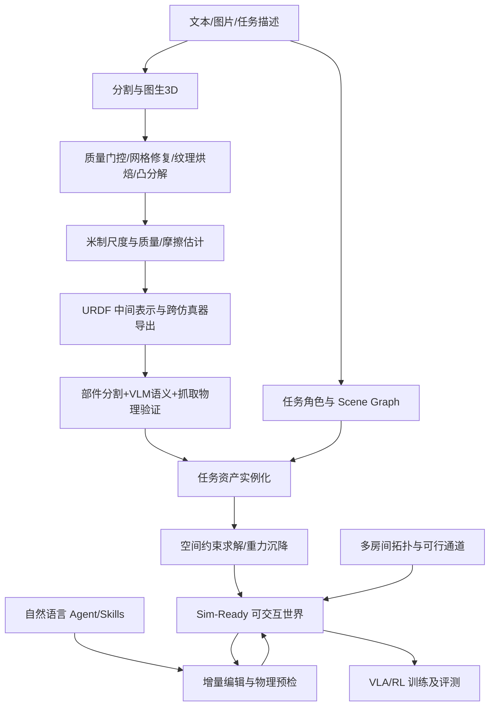

[查看独立中文方法流程 SVG](../assets/methods/EmbodiedGenV2.svg)。

##### ⑦ 实验设计与主要结果
资产管线对 **200 个未见资产**测试：完整版本人类接受率 96.5%、脚本抓取提升测试的碰撞成功率 98.6%，平均每资产处理 **2.6±0.4 分钟**；去掉 Mesh fixing 后平均耗时大幅增加，说明仿真适用性也关系到计算工程可用性。Affordance 级联实验中完整模块端到端通过率为 **50.0%**，不能把“标注语义合法率 99.3%”当作完整物体交互成功率。任务驱动环境使用 **150 条语言操作任务**，其中 **83.3%** 的场景可不经人工修改进入后续仿真，平均约 **47.7±5.4 分钟/场景**。在线 RL 真机迁移数字属于论文所报告的下游策略验证，和资产/世界生产质量统计口径不同。

##### ⑧ 方法特点与局限性
**价值**：把生成资产、交互语义、任务条件、场景规模、跨平台接口和迭代编辑整合成较完整的工具链，适合批量制造不同任务的可执行训练世界。**局限**：规模化场景生成仍有明显计算成本；物理参数由视觉语言模型估计而非真机系统辨识；部件标注、抓取验证和复杂空间求解的失败可能累积；对柔性/接触丰富任务的跨引擎一致性不能由格式统一和基础成功率自动保证。

---

#### 2.4.3 SimFoundry：从单段实景视频到数字孪生、数字近邻及策略验证闭环

##### ① 论文基本信息
- **原题**：SimFoundry: Modular and Automated Scene Generation for Policy Learning and Evaluation。
- **作者/机构**：Nadun Ranawaka 等；NVIDIA、Stanford、Georgia Tech、UT Austin、University of Toronto 等。
- **来源**：[arXiv:2606.28276](https://arxiv.org/abs/2606.28276)（所读 PDF v4，2026-08-05）｜[NVIDIA 项目主页](https://research.nvidia.com/labs/gear/simfoundry/)。
- **关键词**：Real-to-Sim、Digital Twins/Cousins、Robot Policy Evaluation、Sim-to-Real Policy Training。

##### ② 论文概述（根据 Abstract 中文译述）
在真机上训练与系统性比较机器人策略成本高，手工搭建逐场景仿真环境又难以规模化。SimFoundry 提出从**单段真实视频**自动生成可交互的 Sim-Ready 数字孪生，并支持对象、空间布局、任务三种“数字近邻”变化，从一个真实任务生成更丰富的训练环境。论文在多步操作、关节物体和双臂交互的真机任务上验证了仅由仿真数据训练的策略可以迁移；在 **7 项操作任务、5 类策略架构**上，仿真成功率与真实成功率的平均 Pearson 相关系数达到 **0.911**，Mean Maximum Rank Violation（MMRV）为 **0.018**。文章还报告 Object/Scene/Task Cousins 对真实任务成功率分别带来平均 17%、21%、40% 的改善；这些是其各自实验设置中的统计结果，并不代表三种增益可相加。

##### ③ 研究动机与核心问题
只构造一个非常像真实桌面的数字孪生，无法覆盖真实部署时的物体外形、布局与目标任务变化；只随机增添道具又可能破坏“任务是否还能执行”这一关键前提。更进一步，**场景重建得相似不等于模拟评测的策略排序与真机一致**。SimFoundry 要把实景重建、结构化扩增、仿真策略测试和真机迁移放到同一闭环中，并用量化的策略排序相关性检验这个闭环是否可信。

##### ④ 方法总览与原论文截图

**原论文 Figure 1｜真实视频到仿真数字孪生与三种 Digital Cousins**（PDF 第 1 页）：


*来源：[SimFoundry 原 PDF，第 1 页](https://arxiv.org/pdf/2606.28276#page=1)。*

**原论文 Figure 2｜实景提取、仿真场景生成与 Object/Scene/Task 扩增**（PDF 第 4 页）：

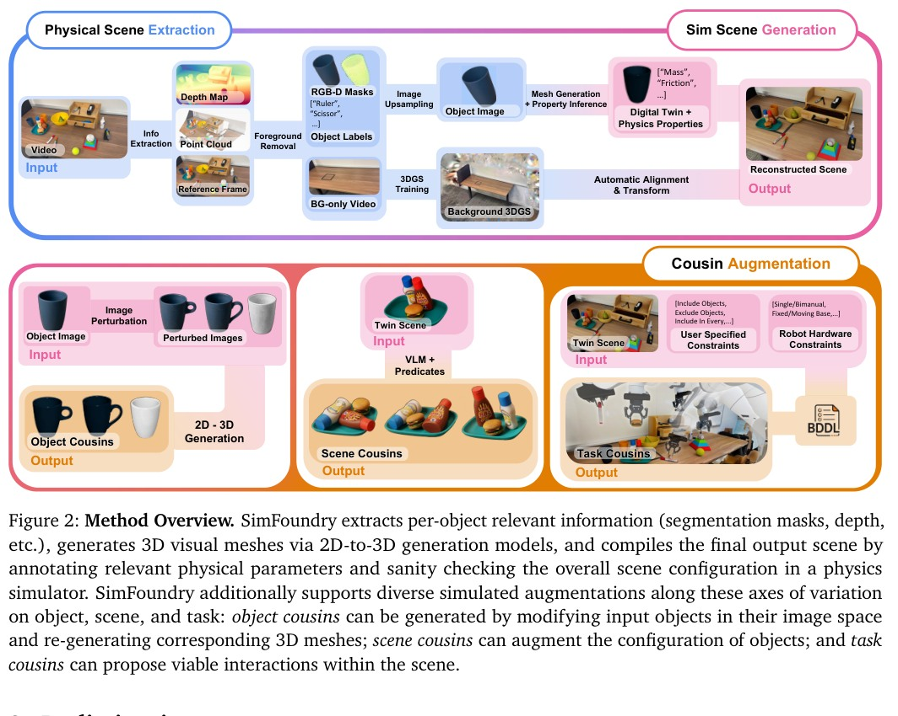

*来源：[SimFoundry 原 PDF，第 4 页](https://arxiv.org/pdf/2606.28276#page=4)。*

**读图重点**：Figure 2 上半部分是 Real-to-Sim 资产重建，下半部分是数字近邻扩增；其中 Task Cousins 不只是更换模型外观，而是生成新的可执行操作目标。第四章 §4.6 对这一点作专门交叉讨论。

##### ⑤ 核心技术与算法细节
**步骤一，从单段实景视频提取对象与几何。** 选择参考图，估计公制深度并结合相机内参建立 RGB-D/点云；利用视觉模型识别对象、迭代提取分割掩码并修补移除区域，形成逐对象的 RGB-D 裁剪。静态背景可采用与同一视频配准的 **3D Gaussian Splatting**，为渲染提供较真实的纹理与遮挡；但需要注意 3DGS 背景并不是直接用于准确刚体碰撞求解的 Mesh。

**步骤二，实例模型、位姿与关节状态重建。** 使用图生三维生成物体可视 Mesh，结合场景 RGB-D、Mask、点云和姿态估计进行实例尺度与位姿对齐。对抽屉、柜子等可动对象另外推断部件与关节参数，使它们能够在仿真里打开或滑动。用 CoACD 生成碰撞体，并用 VLM 推测质量、摩擦等物性；在 PyBullet 中消除穿透与不稳定摆放，之后可导出到 IsaacLab 等训练环境。这里的参数仍有“视觉合理”与“动力学真实”之间的差距。

**步骤三，生成三种 Digital Cousins。** **Object Cousins** 改变物体形状、纹理或几何但保留任务相关的抓取/容纳等 Affordance；**Scene Cousins** 依据 OnTop、RightOf 等空间谓词重新布置物体，添加合理的干扰项；**Task Cousins** 根据当前场景对象及其可操作性提出新操作任务，并转为可执行的目标与示教收集条件。这三种变化并非彼此排斥，可组合使用。

**步骤四，评测与训练双用途。** Real-to-Sim Evaluation 把已有真实策略在重建环境中进行不依赖针对该模拟器微调的测试，比较模拟/真实成功率与策略排名；Sim-to-Real Training 则在数字孪生与近邻场景中自动生成示教，训练或微调策略后真机直接评估，也包含 Sim+Real 混合训练实验。这样才能验证一个“可生成场景”工具到底是否对真实策略研发有用。

##### ⑥ 完整 Pipeline（中文重绘）
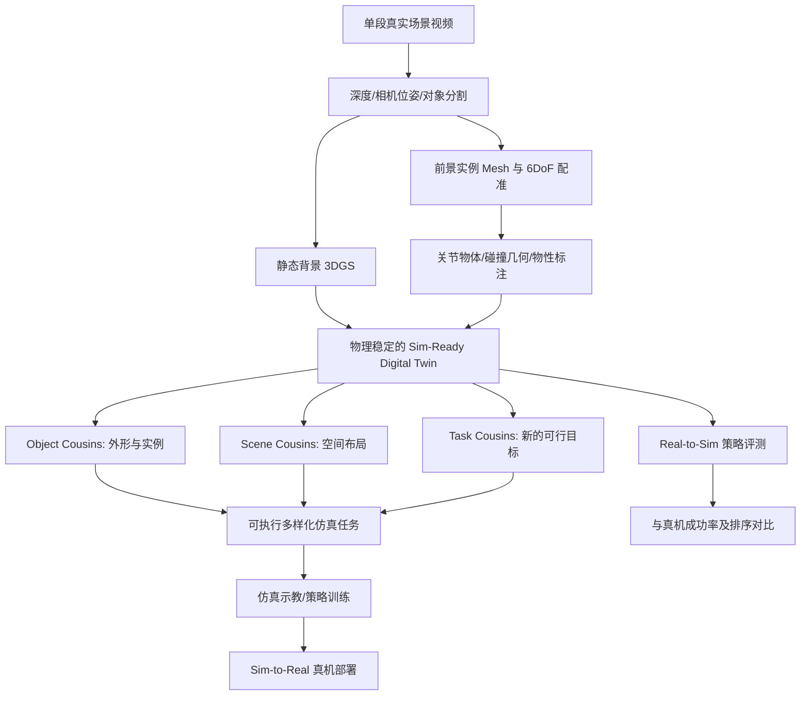

[查看独立中文方法流程 SVG](../assets/methods/SimFoundry.svg)。

##### ⑦ 实验设计与主要结果
**仿真评测可信度**：论文跨 **7 项任务、5 类策略**报告平均 Pearson **0.911** 和 MMRV **0.018**；在多步骤任务中细化至子任务级评估后，相关性从约 **0.90 上升到 0.95**。这一发现直接回应“模拟成绩是否能指导真机模型选择”的问题。

**真实策略训练增益**：作者展示仅靠仿真生成数据训练的策略可以直接在 DROID、YAM 等真机平台执行，包括多步、双臂与关节物体交互；不同单任务案例成功率差异较大，不应择取其中的最高百分比代表通用性能。Object、Scene、Task 三种 Cousins 分别测试对象泛化、布局泛化和相关任务泛化；摘要的 **17%、21%、40%** 属于不同比较集合，不能进行统一因果加总。作者还考察合成与真实示教协同训练。

**重建质量与人工代价**：在 12 个重建场景上，自动重建 F1 范围 **0.81–0.92**，经过少量对象级人工调整可提升至 **0.93–0.99**；这提醒我们“全自动”和“高精确”存在成本与精度权衡。

##### ⑧ 方法特点与局限性
**价值**：把真实世界任务作为锚点，一次视频采集既支持可执行重建，也支持语义受约束的场景/任务扩展；尤其强调用**真实成功率相关性**而不只是画面指标证明仿真评测价值。**局限**：系统依赖多种现成视觉、生成和几何模型，错误可能级联；论文明确提到当前 pipeline 主要依赖桌面式布局假设，多层和非平面环境仍待扩展；VLM 推断物性与真实接触摩擦可能不符。对长时精密接触和软体任务的可迁移性不能直接从已有双臂/关节实验外推。

---

#### 2.4.4 三篇论文横向判断与复用建议

| 判断维度 | TabletopGen | EmbodiedGen V2 | SimFoundry |
|---|---|---|---|
| 场景生成模式 | 图片/文本生成桌面布局 | 任务驱动、多房间、自然语言交互式生成 | 真实视频重建 + 数字近邻扩增 |
| 物体可交互性的来源 | 独立 Mesh + 碰撞和简单物性 | 统一物性、部件 Affordance、抓取物理筛选 | 数字孪生几何、关节部件、碰撞与物性 |
| 主要几何约束 | DRO+TSA 旋转/尺度/支撑 | Scene Graph、空间求解器与重力沉降 | RGB-D/位姿配准与仿真稳定化 |
| 最强的下游证据 | 三项桌面任务 Sim-to-Real | 大规模环境直接可用率、RL 迁移 | 仿真与真机策略表现相关性 + 多样化训练 |
| 当前应用边界 | 典型单层桌面 | 复杂系统工程、模块误差和生产成本 | 实景依赖、桌面布局与预测物性误差 |

**综合判断**：这三篇适合作为第二章的**“可执行场景生成”子路线**，与 GSWorld、RE³SIM 的实景照片级数字孪生以及 RoboRender 的条件视频渲染并列。对于实际系统，可从 EmbodiedGen V2 复用资产数据结构和跨引擎输出思想，从 TabletopGen 复用姿态/尺度约束和桌面重建策略，再借鉴 SimFoundry 对 Digital Cousins 和策略排序相关性的真实验证。这里是基于论文的跨工作综合建议，不是作者验证过的联合系统。

### 2.5 视觉路线的横向比较

| 研究路线 | 视觉来源 | 谁决定动作和接触 | 真实数据在哪里使用 | 主要使用场景 |
|---|---|---|---|---|
| GSWorld | 已校准真实环境的 3DGS | 物理引擎 | 场景扫描；部分策略有真实示教 | 可执行数字孪生、DAgger、评测 |
| RE³SIM | 前景 Mesh + 背景 3DGS | Isaac Sim/PhysX | 建模和校准实景 | 固定任务/场景高保真示教生成 |
| RoboRender | 真实视频训练的生成式渲染器 | 模拟器，生成器负责视觉 | 视频生成器训练 | 大规模 RGB 视频扩增 |
| TabletopGen | 文生图/真实单张图像与逐实例三维生成 | Isaac Sim 与运动规划器 | 可使用单张真实场景照片锚定 | 密集桌面重建、可执行示教合成 |
| EmbodiedGen V2 | 文本/图片驱动的生成式资产及多房间世界 | 物理沉降、抓取仿真与任务求解 | 可以完全从任务生成；VLM/生成模型有各自预训练依赖 | 任务世界生成、Affordance、跨引擎复用 |
| SimFoundry | 实景视频/逐实例 Mesh/可选 3DGS 背景 | 可动部件和物理引擎；训练/测试策略 | 真实视频是数字孪生锚点 | Real-to-Sim 评测、Digital Cousins 与策略训练 |

以上路线不互斥：实景重建提供几何与空间坐标，生成式 Sim-Ready 场景提供可规模化的交互资产，物理模拟负责可执行动作，生成式渲染提供更广的视觉域覆盖。但生成视频必须额外通过**动作—像素一致性**检查。

---

## 3. 物理可靠性：从理想引擎到真机交互校准

“物理可靠性”并不等价于用更昂贵的引擎求解接触方程。至少存在三种不同路径：**训练真实域误差补偿策略**，**直接从真实交互学习物体的神经动力学**，以及**利用少量真实观测辨识可微物理模型再生成参数邻域**。本章按这三类问题组织。

### 3.0 技术路线总览：代表工作与核心差异

**本章研究主线。** 物理 Sim-to-Real 的困难来自模拟运动学与真实执行结果之间的差异：摩擦、接触刚度、碰撞几何、柔性形变、执行器迟滞和控制延迟均可能影响下一状态。关键问题是**误差应该在哪一层被修正**——是让真实控制策略补偿失配，还是学习物体的状态演化规律，抑或从真实交互辨识一组更接近现实的物理参数？三者的技术目标、训练信号和适用对象不同。

本章使用三篇论文分别说明三条路线：

| 技术路线 | 代表论文 | 核心思路与方法流程 | 主要解决的问题 | 适用边界 |
|---|---|---|---|---|
| **真实策略残差补偿** | **SPARR（§3.1）** | 仿真预训练基础策略 → 在真机上收集成功行为 → 使用视觉与稀疏奖励学习残差动作 → 基础动作与残差联合执行 | 不要求模拟器完全准确，直接修正实际装配中的定位/接触误差 | 需要安全的真实交互和可产生部分成功的基础策略；属于仿真预训练后的真机适配 |
| **动作条件的神经动力学** | **SoMA（§3.2）** | 真实柔性物体交互视频与机器人动作 → 三维 Gaussian 物体表示 → 学习受动作/作用力驱动的形变状态演化 | 传统刚体或固定参数模型难以描述布料、绳索等可变形物体的长时变化 | 依赖真实交互与动作同步；重模拟质量不能直接等同于策略迁移成功率 |
| **可微物理辨识与数字近邻** | **PIN-WM（§3.3）** | 少量真实视觉交互 → 通过可微物理和渲染损失辨识参数 → 扰动得到 Digital Cousins → 在多个模拟物理条件下训练策略 | 减少手工设定物理参数的误差，同时覆盖难以精确辨识的不确定性 | 更适合有结构化刚体动力学与可观测交互的任务；物理参数可能不可唯一辨识 |

**对比这三条路线时，首先应区分“学习什么”。** SPARR 学习的是**动作修正量**，SoMA 学习的是**物体的状态转移模型**，PIN-WM 识别的是**物理规律中的参数及其合理变化范围**。因此，SPARR 的真机装配成功率、SoMA 的柔性重模拟误差、PIN-WM 的物理辨识和操作成功率各自回答不同问题，不能直接作为单一物理精度排行榜。

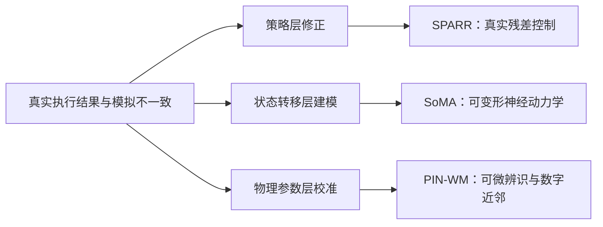

**阅读重点：** 对每篇论文分别检查真实交互是否用于训练、物理模型或策略在哪里被更新、有没有依赖仿真特权状态、如何处理未见接触，以及最终评价指标是否对应其声称解决的物理问题。


---

### 3.1 SPARR：真实残差强化学习补偿装配误差

#### ① 论文基本信息
- **原题**：SPARR: Simulation-based Policies with Asymmetric Real-world Residuals for Assembly
- **作者/机构**：Yijie Guo 等；NVIDIA Research。
- **发表**：ICRA 2026；[论文](https://arxiv.org/abs/2602.23253)｜[官方项目](https://research.nvidia.com/labs/srl/projects/sparr/)｜[GitHub](https://github.com/NVlabs/SPARR)。

#### ② 论文概述 
精密装配要求接触过程中保持非常准确的运动与力学配合。仿真训练虽然可以产生较好的装配策略，部署到现实后仍会因为 Sim-to-Real 差异退化；纯真实机器人强化学习又经常需要人工监督，且环境变化时泛化不足。SPARR 因此将仿真训练的基础策略与真实环境中学习的残差策略结合：前者用低维状态和密集奖励提供初始行为先验，后者使用视觉观测和稀疏奖励纠正真实动力学与传感器误差。作者在多类双部件真实装配中获得接近完全成功的结果；相较当时的零样本 Sim-to-Real 对照，成功率相对提升 38.4%、循环时间相对减少 29.7%，且不要求人工示教或在线人工干预。

#### ③ 研究动机与核心问题
直接把仿真策略放到真机，最大的问题是小的接触位置误差在插入/卡扣装配中会被放大；然而从零开始真机 RL 又因稀疏奖励缺乏成功探索。SPARR 的关键假设是：**仿真策略虽不完美，仍能提供足够接近成功的行为和少量真实成功轨迹**，让残差策略在可行区域中学习，而不用从随机动作探索。

#### ④ 方法总览与原论文截图

下列图片均是从[原论文 PDF](https://arxiv.org/pdf/2602.23253)直接裁切的**原始论文图**，已保存于本仓库，非 AI 生成或重新绘制。引用时请注明论文 Figure 编号。

**主图｜Figure 1：仿真基础策略与真机残差学习路线**


*原论文 Figure 1，PDF 第 1 页。[查看原文对应页](https://arxiv.org/pdf/2602.23253#page=1)。*

**方法/架构图｜Figure 3：非对称基础策略与残差策略的动作组合**


*原论文 Figure 3，PDF 第 4 页。[查看原文对应页](https://arxiv.org/pdf/2602.23253#page=4)。*

**读图重点：** Fig.1 描述模拟预训练、真机成功轨迹和残差强化学习；Fig.3 解释两级策略的不同观测及动作叠加。

*图号、原论文 URL 及 PDF 截取坐标记录在 [截图来源清单](../assets/paper-screenshots/manifest.json)。详细中文 Pipeline 见下一节。*

#### ⑤ 核心技术与算法细节
**步骤一，训练具备强先验的基础策略。** 作者在 Isaac Lab 中用低维机器人/物体状态及密集奖励预训练特定装配任务策略。相比仅由 RGB 决策，基础策略利用仿真可获得的低维状态更容易形成稳定的装配基本动作。

**步骤二，在真机零样本执行并自动建立示教池。** 将基础策略移植到真实机器人；即便成功率尚不理想，它通常能完成一部分装配。系统把真实成功执行写入示教池，作为后续 RL 探索和行为学习的正向信号，而不是要求人类专门遥操作采集示教。

**步骤三，引入非对称的观察与奖励机制。** 残差策略使用真实视觉/本体感觉，学习校正仿真策略感知不到的偏差；训练采用真实环境稀疏任务奖励。这里“非对称”体现在两级策略所观察的输入和训练方式不同，而不是要求真实环境复现仿真中的全部特权状态。

**步骤四，动作组合和在线回流。** 执行阶段可以概括为 $a_t=a_t^{\mathrm{base}}+\Delta a_t^{\mathrm{real}}$。新产生的在线轨迹进入 RL 缓冲区，成功且高质量的轨迹还可加入示教缓冲区，形成以成功先验为锚点的再训练闭环。该公式是算法层面的简化写法，具体残差尺度、动作参数化应以源码及论文为准。

**安全性前提。** 真机 RL 仍然需要限制动作范围、考虑碰撞与安全停机；“无需人工监督”不等于适合任意高风险装配现场。

#### ⑥ 完整 Pipeline
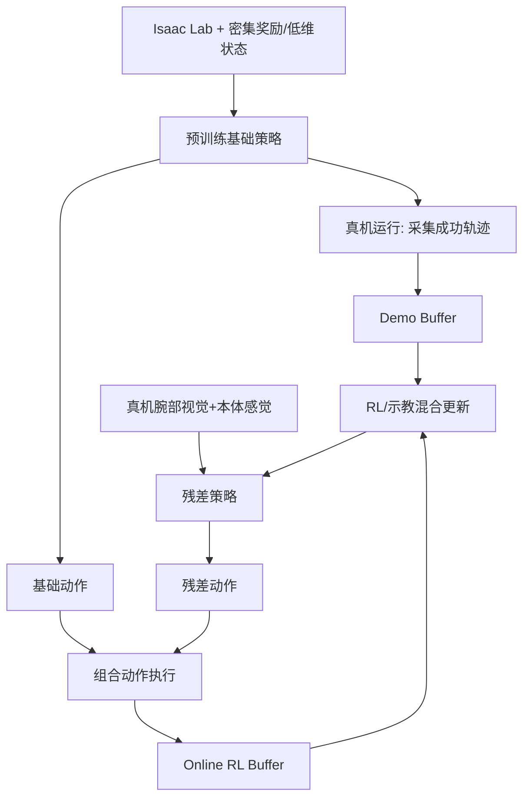

#### ⑦ 实验设计与主要结果
作者从 AutoMate 的 100 项装配任务中选取仿真成功率超过 99% 的 10 项开展真机实验，并比较 SERL、AutoMate 零样本策略与 SPARR。SPARR 在该组真实任务中达到 95%–100% 成功率，部分评估每任务 20 次试验；论文也考察了迁移到不在基础策略预训练范围内的 NIST 任务的适应表现。必须强调：**95%–100% 是真实残差学习完成后的性能，不是基础策略的零样本性能**。

#### ⑧ 方法特点与局限性
**特点**：直接以真实反馈修正物理/感知误差；避免为每类摩擦或装配公差重新标定整个模拟器；从基础策略自动挖掘示教降低人工成本。**局限**：依赖零样本策略已经能够在真实环境偶尔成功；仍需安全的真实探索预算；已验证场景主要是刚体精密装配，不能直接覆盖柔性材料、多步骤厨房操作等任务。

---

### 3.2 SoMA：动作条件神经软体动力学模拟

#### ① 论文基本信息
- **原题**：SoMA: A Real-to-Sim Neural Simulator for Robotic Soft-Body Manipulation
- **作者/机构**：Mu Huang 等；复旦大学、上海人工智能实验室、上海交通大学、香港中文大学、香港大学。
- **发表**：ICML 2026；[正式论文](https://proceedings.mlr.press/v306/huang26bh.html)｜[官方项目](https://city-super.github.io/SoMA/)｜[GitHub](https://github.com/Wrioste/SoMA)。

#### ② 论文概述 
在机器人与柔性物体频繁交互时，物体形变同时受到环境作用和机器人动作驱动，准确模拟非常困难。现有系统依赖预先定义的物理规律，或者采用未明确条件化于机器人控制的数据驱动动力学，因此在精度、稳定性及泛化性上受限。SoMA 提出基于 3D Gaussian Splatting 的软体操作模拟器：在统一神经潜空间中联合建模可变形动力学、环境力和机器人关节动作，实现端到端 Real-to-Sim。通过在学习得到的高斯表示上处理交互，它能够在不依赖预先设置的具体物理模型时支持可控、长时程的软体操作模拟，并对训练轨迹之外的交互泛化。作者报告真实操作重模拟的精度和泛化指标平均改善约 20%，并展示长时程布料折叠等复杂过程。

#### ③ 研究动机与核心问题
布料、线缆、毛绒玩具等软体具有大量连续自由度；用刚体关节模型描述并不自然，对真实材质的弹性参数、接触摩擦进行系统辨识也很困难。仅把视觉视频拟合得漂亮，不能预测机器人执行新动作后柔性物体会怎样变化。SoMA 的核心是**将动作条件和作用力机制直接写入学习式变形动力学**。

#### ④ 方法总览与原论文截图

下列图片均是从[原论文 PDF](https://raw.githubusercontent.com/mlresearch/v306/main/assets/huang26bh/huang26bh.pdf)直接裁切的**原始论文图**，已保存于本仓库，非 AI 生成或重新绘制。引用时请注明论文 Figure 编号。

**主图｜Figure 1：软体操作神经模拟总览**


*原论文 Figure 1，PDF 第 1 页。[查看原文对应页](https://raw.githubusercontent.com/mlresearch/v306/main/assets/huang26bh/huang26bh.pdf#page=1)。*

**方法/架构图｜Figure 2：分层高斯和粗细时间尺度动力学训练框架**


*原论文 Figure 2，PDF 第 3 页。[查看原文对应页](https://raw.githubusercontent.com/mlresearch/v306/main/assets/huang26bh/huang26bh.pdf#page=3)。*

**读图重点：** 总览展示真实机器人交互与长时重模拟；框架图展开物体高斯、动作条件以及两阶段学习。

*图号、原论文 URL 及 PDF 截取坐标记录在 [截图来源清单](../assets/paper-screenshots/manifest.json)。详细中文 Pipeline 见下一节。*

#### ⑤ 核心技术与算法细节
**步骤一，采集动作可追溯的真实视频。** 输入包括真实 RGB 观测及机器人关节空间动作（而非只有物体轨迹或无动作的视频）；多视角信息提供了对物体三维形变的观察约束。

**步骤二，分层高斯表示。** 使用可渲染的 Gaussian Splats 表示软体对象，对粒度不同的结构进行层级组织。与直接在像素空间做黑箱视频生成相比，这种表示保留了连续三维状态与跨视角投影的一致性。

**步骤三，学习力驱动的状态演化。** 网络在潜空间中结合机器人施加的交互、环境影响与物体已有变形，预测高斯点的下一步运动和形态。它并非声称恢复真实物体的全部材料参数，而是追求动作条件下可控的重模拟能力。

**步骤四，粗到细的两阶段训练。** 第一阶段用较大的帧间隔学习全局运动与长期趋势；第二阶段减小帧间隔，在接触、遮挡等复杂局部条件下优化细节。图像重建与动力学约束共同作用于训练，使模型既能还原视频，也能够被新动作驱动。

**步骤五，测试长时程/未见动作。** 给定不同的机器人动作序列，让模型预测物体随时间的形变；评价不仅要看某一帧的 PSNR/深度误差，还要看长时间累积误差和对未见接触方式的反应。

#### ⑥ 完整 Pipeline
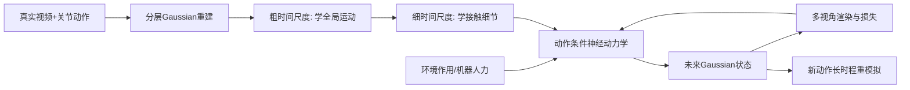

#### ⑦ 实验设计与主要结果
论文对布料、绳索与体积型柔性物体进行真实数据重模拟与泛化评估，比较 PhysTwin、GausSim 等方法，并检查不同视角的一致性。作者报告相对基线平均约 20% 的精度和泛化改善。**此处是模拟/重模拟指标，不能把 20% 直接写成真实机器人策略成功率提升**；因此将它定位为“物理/神经模拟能力”而非完整策略迁移算法更准确。

#### ⑧ 方法特点与局限性
**特点**：不要求把柔性物体简化成固定刚体；能处理机器人动作条件、三维可渲染表示和长时形变。**局限**：真实视频数据、相机标定和训练成本仍不低；接触力未必唯一可辨识；视觉重模拟效果与“真实控制闭环一定成功”之间仍存在验证距离。

---

### 3.3 PIN-WM：从真实视觉辨识物理模型，再生成 Digital Cousins

#### ① 论文基本信息
- **原题**：PIN-WM: Learning Physics-INformed World Models for Non-Prehensile Manipulation
- **作者/机构**：Wenxuan Li 等；国防科技大学、武汉大学、深圳大学等。
- **发表**：RSS 2025；[正式论文](https://roboticsproceedings.org/rss21/p153.html)｜[arXiv](https://arxiv.org/abs/2504.16693)｜[官网](https://pinwm.github.io/)｜[GitHub](https://github.com/XuAdventurer/PIN-WM)。

#### ② 论文概述 
推动、拨动物体等非抓取操作高度依赖摩擦和恢复系数等复杂物理交互，学习具备泛化能力的策略十分困难。作者采用模型驱动强化学习，提出用于三维刚体运动的 Physics-INformed World Model（PIN-WM），目标是根据视觉观测高效辨识动力学系统。该方法以可微物理仿真为基础，只需少量、与目标任务无关的真实交互轨迹；同时通过 Gaussian Splatting 产生的观测损失训练，无需精确的外部状态估计。为缩小 Sim-to-Real 差异，作者围绕辨识好的模型扰动物理和渲染参数，建立多个 Digital Cousins。仿真和真实机器人实验显示，该组合能够帮助学习更鲁棒的非抓取操作技能，优于论文中比较的 Real2Sim2Real 方法。

#### ③ 研究动机与核心问题
非抓取操作的结果取决于摩擦、惯性、碰撞和反弹；手工随机给定这些参数可能生成大量根本不对应真实任务的物理世界。PIN-WM 的问题是：能否先从少量真实交互中恢复一个**可解释、可微调的三维刚体动力学模型**，再围绕真实参数附近的合理变化训练策略？

#### ④ 方法总览与原论文截图

下列图片均是从[原论文 PDF](https://www.roboticsproceedings.org/rss21/p153.pdf)直接裁切的**原始论文图**，已保存于本仓库，非 AI 生成或重新绘制。引用时请注明论文 Figure 编号。

**主图｜Figure 1：真实推动数据与物理数字近邻训练**


*原论文 Figure 1，PDF 第 1 页。[查看原文对应页](https://www.roboticsproceedings.org/rss21/p153.pdf#page=1)。*

**方法/架构图｜Figure 2：Real2Sim 可微辨识与 Sim2Real 策略训练结构**


*原论文 Figure 2，PDF 第 4 页。[查看原文对应页](https://www.roboticsproceedings.org/rss21/p153.pdf#page=4)。*

**读图重点：** 总览展示少量真实数据、数字近邻和真机转移；方法图突出 Gaussian 观测损失、可微物理参数及 RL。

*图号、原论文 URL 及 PDF 截取坐标记录在 [截图来源清单](../assets/paper-screenshots/manifest.json)。详细中文 Pipeline 见下一节。*

#### ⑤ 核心技术与算法细节
**步骤一，真实视觉交互与可渲染状态。** 用少量推动/拨动物体的真实轨迹提供图像序列和机器人动作；通过 3DGS 构建能从不同视角投影的物体外观，以渲染误差为动力学辨识提供监督，减少对真实物体状态逐帧人工标注的依赖。

**步骤二，物理模型参数辨识。** 在显式刚体运动结构上使用可微物理求解，反向调整影响接触过程的参数（如摩擦、恢复性质等），使模拟运动渲染出的图像尽量与真实观测一致。网络学习的不是任意视频幻觉，而是受三维物理模型约束的运动。

**步骤三，构造 Digital Cousins。** 以辨识模型为中心，在物理参数与渲染参数空间做结构化扰动，形成一簇彼此不同但与真实操作机制相关的模拟环境。这能缓解参数无法被少量观测完全唯一确定的问题。

**步骤四，模型驱动强化学习。** 在一组数字近邻中生成运动轨迹并学习推动策略，使策略不依赖某一个估计参数的精确数值。最后部署到真实机器人评价新对象或物理扰动下的稳定性。

**损失与可辨识边界。** 可概括为最小化模拟渲染与真实图像的观测误差，并结合物理演化约束；具体权重和求导形式需要以论文公式为准。视觉对齐有时存在多个等价物理解释，这正是保留 Digital Cousins 的原因之一。

#### ⑥ 完整 Pipeline
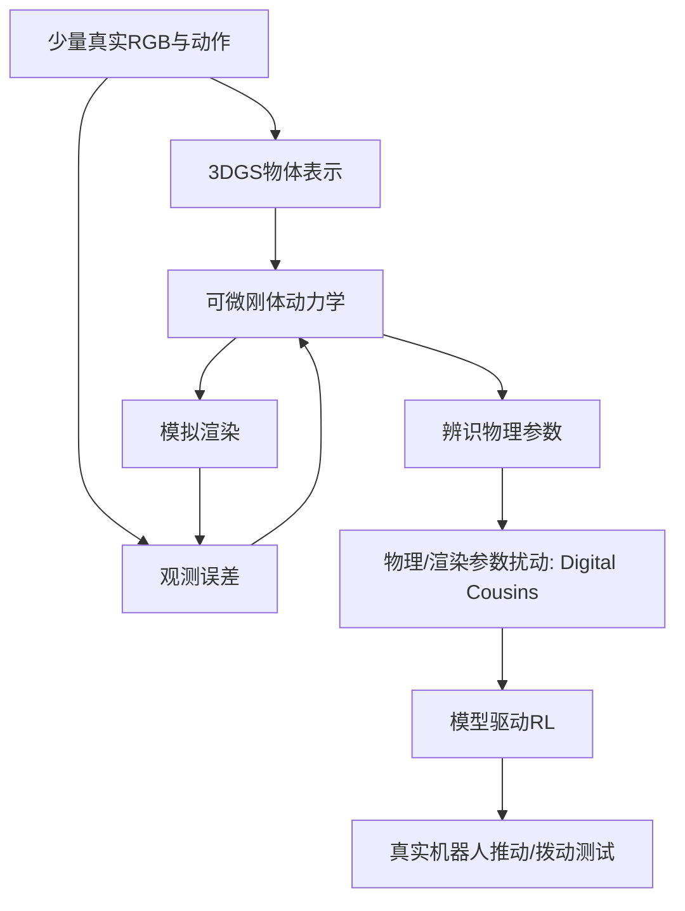

#### ⑦ 实验设计与主要结果
论文在仿真和真实机器人上的非抓取操作任务评估模型和迁移策略，重点与其他 Real-to-Sim-to-Real 方法比较。论文摘要未给出可跨任务直接使用的单一真实成功率，因此文档不虚构统一数字。应分别关注：少量交互辨识需求、可微物理精度、数字近邻策略泛化和真实推动成功率。

#### ⑧ 方法特点与局限性
**特点**：物理参数具有一定结构和解释性；学习依赖少量真实交互，且通过图像损失避免强状态标注；数字近邻把模型不确定性转为训练覆盖。**局限**：主要面向三维刚体推动/拨动，不是任意接触和柔性物体的通用模拟器；对遮挡严重、接触复杂的场景，辨识可能多解或出现明显估计误差。

---

### 3.4 物理路线对比与工程基础设施补充

| 工作 | 主要学习对象 | 真实交互起到什么作用 | 优先适用任务 |
|---|---|---|---|
| SPARR | 真实域**动作残差策略** | 在线 RL 的稀疏成功奖励与示教回流 | 刚体精密插入/装配 |
| SoMA | 柔性物体的**动作条件神经动力学** | 拟合真实交互与变形 | 布料、绳索、软体 |
| PIN-WM | **可微刚体参数+物理数字近邻** | 对物理参数进行视觉辨识 | 推动、拨动、非抓取接触 |

**Newton（NVIDIA / Google DeepMind / Disney Research）**是应持续关注的可微多物理场工程基础设施：[GitHub](https://github.com/newton-physics/newton)。它可以支持更高效的仿真、接触与梯度计算，但不应把“可微引擎的存在”直接当作真实机器人迁移算法的结果。以上三篇分别优化策略、神经模拟器、物理辨识，不能用同一个成功率排序替代技术比较。

---

## 4. 轨迹多样性：从扰动已有轨迹到主动构造有价值的行为数据

轨迹多样性至少包含**初始状态、物体与场景、机器人运动方式、动作结果、任务/指令语义**五个层次。同一轨迹变换出大量不同纹理的视频，只扩展视觉域，不一定增加动作分布覆盖；生成多个专家程序可以增加任务和运动差异，但自动专家也可能偏向短、平滑、近乎总是成功的轨迹。因此还必须讨论轨迹质量、冗余和后续真实任务增益。

### 4.0 技术路线总览：代表工作与核心差异

**本章研究主线。** 轨迹多样性不只是“Episode 数量更多”。一个有用的机器人训练集还应覆盖不同任务目标、物体与初始状态、机器人动作路径、执行结果及失败恢复。若仅替换一条既有轨迹的背景纹理，增加的是视觉域多样性，不一定增加动作空间覆盖；若只是重复相同专家程序的成功轨迹，也可能留下长尾状态与多解动作的空白。因而，本章把研究分成**生成新的可执行专家、复用动作生成新视觉演示、从人类示范导出机器人轨迹、以及筛选已有轨迹**四类。

| 技术路线 | 代表论文 | 核心思路与方法流程 | 主要增加或优化什么 | 核心限制 |
|---|---|---|---|---|
| **自动专家程序与仿真验证** | **RoboTwin 2.0（§4.1）** | MLLM 生成任务专家代码 → 仿真执行与失败反馈 → 自动修复 → 多配置批量采集 | 任务、环境及可执行专家行为的覆盖；降低人工逐任务编写脚本成本 | 可行性受物理引擎、成功条件和自动专家质量约束 |
| **动作锚定的组合式视频生成** | **RoboDream（§4.2）** | 复用已有机器人运动或空手遥操 → 加入物体/场景条件 → 生成多种真实感演示 | 相同或相近动作在新物体、背景、相机视角下的视觉与任务上下文覆盖 | 新对象与原动作的接触可行性未必由生成器保证 |
| **真实对象运动到机器人示教** | **Real2Render2Real（§4.3）** | 手机扫描 + 单段人类示范 → 恢复物体 6-DoF 运动 → 逆运动学生成机器人动作 → 批量渲染 | 不依赖机器人遥操作，扩展对象运动和机器人观察条件下的训练示教 | 不进行完整对象动力学求解，不能保证精密接触和碰撞正确 |
| **自监督细粒度数据策展** | **SCIZOR（§4.4）** | 对状态—动作片段估计任务进展 → 移除低效片段与冗余片段 → 训练模仿策略 | 不增加原始条数，而是提升有效样本密度与分布覆盖 | 删除标准必须与任务一致；等待、回退和失败恢复未必是无价值动作 |

**交叉路线提示**：第二章 §2.4.3 的 SimFoundry 从真实视频重建 Sim-Ready Digital Twin，并分别生成 Object、Scene 和 Task Cousins。它将第四章的初态/实例覆盖进一步扩展到任务语义，但不保证每个新场景都自动对应一条新动作轨迹；详见 §4.6。

**这些路线的差异首先在于“轨迹是否真的发生了变化”。** RoboTwin 2.0 主动生成并测试专家行为，最接近扩展可执行的任务与动作覆盖；Real2Render2Real 从真实对象运动重建新的机器人示教；RoboDream 更侧重把已有运动组合到新视觉情境；SCIZOR 不生成轨迹，而是消除重复与低价值的训练转移。将四者统称为“数据增强”容易掩盖其训练信号、物理约束和数据效用的根本区别。

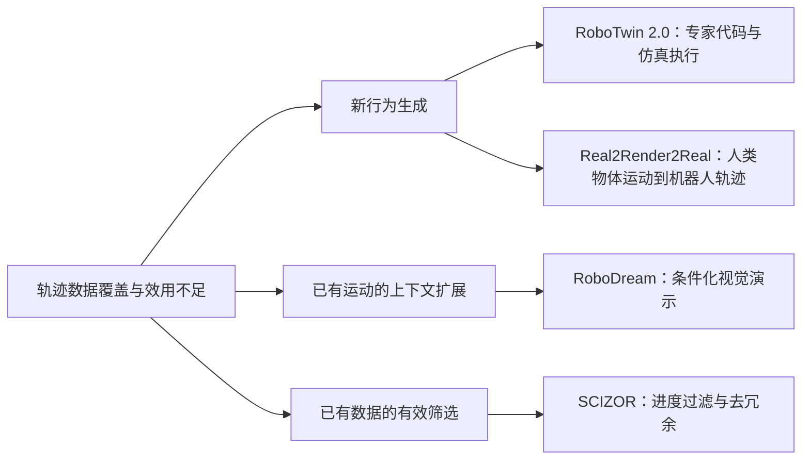

**阅读重点：** 下文应分别判断每篇论文扩展的是任务条件、视觉外观还是**动作序列本身**，并检查新增数据是否具有可执行性、是否保留动作标签一致性、是否包含非成功状态，以及最终能否提高真实策略表现。


---

### 4.1 RoboTwin 2.0：MLLM 专家程序生成与仿真闭环验证

#### ① 论文基本信息
- **原题**：RoboTwin 2.0: A Scalable Data Generator and Benchmark with Strong Domain Randomization for Robust Bimanual Robotic Manipulation
- **作者/机构**：Tianxing Chen 等；上海交通大学、上海人工智能实验室、香港大学等。
- **发表**：ICML 2026；[正式论文](https://proceedings.mlr.press/v306/chen26j.html)｜[项目](https://robotwin-platform.github.io/)｜[GitHub](https://github.com/RoboTwin-Platform/RoboTwin)。

#### ② 论文概述 
通过仿真合成数据增强真实操作已成为重要路径，但现有合成数据在复杂双臂任务中面临两类问题：专家动作在协同任务里失败后缺少自动纠错机制，以及跨场景泛化所需的视觉与空间变化仍不足。RoboTwin 2.0 因此提出面向双臂操作的大规模、闭环和自动化数据生成与统一评估框架。系统基于 RoboTwin-OD 资产库（147 类、731 个实例），将多模态大模型与仿真执行校验结合，建立能提升专家程序生成成功率的自动反馈循环。同时沿杂物干扰、光照、背景、桌面高度、语言指令五个维度进行结构化域随机化。作者实现了覆盖五种本体、50 个双臂任务的环境；合成数据预训练后，VLA 在特定真机实验中相对 10 条示教少样本基线提升至 3.6 倍，零样本泛化相对对照达到 2.2 倍。作者公开了数据生成器、基准、预采集数据及相关代码。

#### ③ 研究动机与核心问题
复杂双臂任务的成本瓶颈，不只是“示教数据条数少”，而是**为每个任务写一个稳健可执行专家程序耗费大量人工**。当物体位置或双手协作时序变化，脚本专家往往失败。RoboTwin 2.0 将专家程序本身变成可由 MLLM 生成、在模拟器运行、再通过失败反馈修改的对象，从而扩展任务和初始状态覆盖。

#### ④ 方法总览与原论文截图

下列图片均是从[原论文 PDF](https://raw.githubusercontent.com/mlresearch/v306/main/assets/chen26j/chen26j.pdf)直接裁切的**原始论文图**，已保存于本仓库，非 AI 生成或重新绘制。引用时请注明论文 Figure 编号。

**主图｜Figure 1：自动化双臂操作数据生产平台**


*原论文 Figure 1，PDF 第 2 页。[查看原文对应页](https://raw.githubusercontent.com/mlresearch/v306/main/assets/chen26j/chen26j.pdf#page=2)。*

**方法/架构图｜Figure 2：Code Agent 专家生成与仿真反馈纠错 Pipeline**


*原论文 Figure 2，PDF 第 4 页。[查看原文对应页](https://raw.githubusercontent.com/mlresearch/v306/main/assets/chen26j/chen26j.pdf#page=4)。*

**读图重点：** 主图展示任务和资产规模；方法图则详细展示 Code Agent 编写、模拟器验证和程序迭代闭环。

*图号、原论文 URL 及 PDF 截取坐标记录在 [截图来源清单](../assets/paper-screenshots/manifest.json)。详细中文 Pipeline 见下一节。*

#### ⑤ 核心技术与算法细节
**步骤一，资产与任务定义。** 基础资产库 RoboTwin-OD 提供丰富类别实例与语义信息；配置任务初态、参与对象、双臂本体和目标成功条件。对象变化不等于动作自动可行，专家程序仍需在新初态下被检查。

**步骤二，MLLM 辅助专家程序生成。** 模型综合文本任务、场景元素和可用机器人 API，编写能被模拟器调用的专家逻辑；复杂协作涉及双手先后动作、物体交接、相互避让与目标条件，不适合纯轨迹坐标扰动完成。

**步骤三，Simulation-in-the-Loop。** 在可执行仿真中运行程序，根据执行错误与任务是否达成，把失败信息反馈到程序修改过程；程序迭代至满足约束后才作为数据收集专家。这个机制的实质是**用执行反馈检验符号/程序生成，而不是相信 MLLM 的文本输出**。

**步骤四，结构化扰动与批量生产。** 对杂物干扰、光照、背景、台面高度、语言指令等五轴变化进行组合，配合位置与对象设定产生大量不同观测和操作条件，保存机器人状态、动作、相机数据与完成标志。

**步骤五，策略训练与跨域评估。** 使用合成数据预训练 VLA，按统一任务及真实设置比较零样本和少样本迁移；注意专家纠错、数据规模、环境随机化彼此耦合，单一成功率不能识别每个组件的贡献。

#### ⑥ 完整 Pipeline
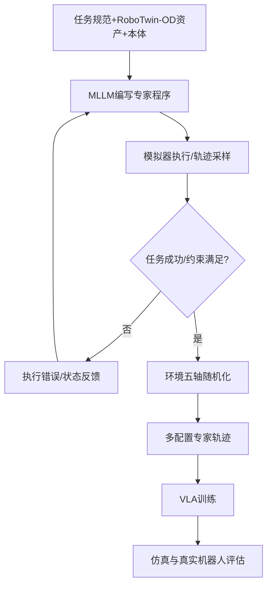

#### ⑦ 实验设计与主要结果
论文部署 50 个双臂任务、五种本体，资产库包含 731 个实例 / 147 类。作者报告在特定真机对照中，模拟预训练的 VLA 少样本表现为相应 10-demo 基线的 3.6×，零样本表现为对应基线的 2.2×。这里是**相对比值**，而非 3.6 倍的绝对成功率；并不能把所有收益只归因于 MLLM 程序生成。

#### ⑧ 方法特点与局限性
**特点**：主动生成新的可执行专家，拓展到双臂协作；程序可被仿真明确验证；物体/语言/环境变化丰富。**局限**：如果模拟器的成功判定或接触模型不准确，自动专家仍可能利用虚假的物理可行性；高质量任务程序也不能自动覆盖失败恢复、长尾状态与真实任务中的人工策略多样性。

---

### 4.2 RoboDream：运动锚定的组合式生成式机器人数据

#### ① 论文基本信息
- **原题**：RoboDream: Compositional World Models for Scalable Robot Data Synthesis
- **作者/机构**：Junjie Ye 等；USC Physical Superintelligence Lab、Toyota Research Institute 等。
- **状态**：2026 年 arXiv；作者仓库标注 IROS 2026；[论文](https://arxiv.org/abs/2606.02577)｜[项目](https://junjieye.com/RoboDream/)｜[GitHub](https://github.com/Jay-Ye/RoboDream)。

#### ② 论文概述 
机器人学习需要大规模多样化示教，但通过真实遥操作收集成本极高。视频扩散模型看似适合扩增数据，却常停留于外观变化，或凭空生成不符合机器人本体约束的动作。RoboDream 提出以机器人本体为中心的组合式世界模型，能够在新物体、新场景和新视角下合成真实感操作示教。方法以已渲染的机器人运动为锚点，并显式引入场景与物体先验，将动作轨迹执行与环境合成分开。这支持两类新能力：Retrieval and Rebirth，即把已有动作放入新的场景上下文；Prop-Free Teleoperation，即操作者先在没有实物的情况下操控机器人，再由生成模型补出目标物体及环境，从而减少摆放与复位时间。作者通过真实机器人实验发现生成数据能提升后续策略性能，并减少真实示教需求。

#### ③ 研究动机与核心问题
对扩散模型直接输入“机器人拿起某物”的文本，可能生成与真实机器人关节/夹爪运动不一致的视频。RoboDream 的关键是将**已经存在的机器人轨迹视为硬约束或强先验**，让生成模型改变对象和场景的视觉呈现，从而尽量保留动作配对关系。

#### ④ 方法总览与原论文截图

下列图片均是从[原论文 PDF](https://arxiv.org/pdf/2606.02577)直接裁切的**原始论文图**，已保存于本仓库，非 AI 生成或重新绘制。引用时请注明论文 Figure 编号。

**主图｜Figure 1：组合式世界模型扩增机器人示教**


*原论文 Figure 1，PDF 第 1 页。[查看原文对应页](https://arxiv.org/pdf/2606.02577#page=1)。*

**方法/架构图｜Figure 2：运动条件与场景/物体先验融合架构**


*原论文 Figure 2，PDF 第 3 页。[查看原文对应页](https://arxiv.org/pdf/2606.02577#page=3)。*

**读图重点：** 总览展示跨物体、场景和视角生成；架构图展示本体运动和多种视觉先验进入视频模型。

*图号、原论文 URL 及 PDF 截取坐标记录在 [截图来源清单](../assets/paper-screenshots/manifest.json)。详细中文 Pipeline 见下一节。*

#### ⑤ 核心技术与算法细节
**步骤一，获得可追溯运动。** 可从既有机器人数据中检索轨迹，也可从 prop-free teleoperation 中获取机械臂/末端执行器运动。与凭空生成整个动作序列不同，这些轨迹先确定机器人的可实现运动。

**步骤二，机器人运动条件渲染。** 在模拟器中渲染只有机器人本体的运动视频，保持机体运动和摄像机视角对应；同时准备场景、对象及文字任务先验，约束“新物体被放在什么环境、如何与原动作相配”。

**步骤三，组合式视频生成。** 生成模型把机器人运动视频、对象和场景先验及任务语义组合成新的高真实感示教。其可变因素包括新物体实例、不同背景、变化视角和相同运动下的任务上下文；任务动作并非由生成模型从零规划。

**步骤四，两条实际数据生产方式。** Retrieval and Rebirth 利用历史机器人轨迹配对新场景；Prop-Free Teleoperation 减少每次真实放置物体/恢复环境的时间。对于后者，物体是否真的沿着手的运动发生符合物理的接触，仍要通过检查，而不能仅凭合成视频的视觉合理性判断。

**步骤五，策略消费与部署。** 合成视频对齐原机器人轨迹/动作，并送入下游视觉策略或 VLA 训练，之后在真机执行以检验新增数据是否有用。作者仓库目前提供生成推理/演示与相关模块，开源范围随版本更新，应按当前 README 检查。

#### ⑥ 完整 Pipeline
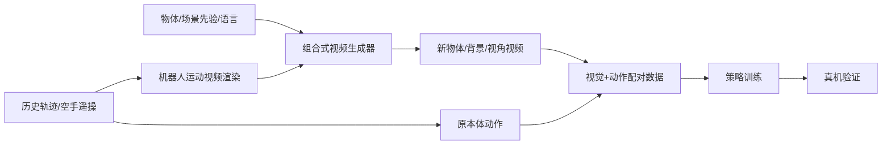

#### ⑦ 实验设计与主要结果
论文报告在多类真实操作任务上，合成数据能改善下游策略训练效果并减少真实样本需求。摘要没有给出可作为统一排名的单一成功率，因此本综述不臆造一个百分比。评估该路线时优先看：同一轨迹跨对象与跨背景产生的有效多样性、动作标签对齐程度、是否覆盖未见条件，以及真实策略的提升幅度。

#### ⑧ 方法特点与局限性
**特点**：把机器人运动可实现性与视觉数据扩增分离；能够减少真实环境复位成本；适合已有大规模动作数据二次利用。**局限**：新对象与原轨迹是否具有真实接触相容性无法仅由渲染保证；合成物体可能出现几何穿透、因果关系错误；更换本体/操作时仍需模型与任务匹配。

---

### 4.3 Real2Render2Real：不运行完整动力学也能规模化示教

#### ① 论文基本信息
- **原题**：Real2Render2Real: Scaling Robot Data Without Dynamics Simulation or Robot Hardware
- **作者/机构**：Justin Yu 等；UC Berkeley、Toyota Research Institute 等。
- **发表**：CoRL 2025；[正式论文](https://proceedings.mlr.press/v305/yu25a.html)｜[项目](https://real2render2real.com/)｜[GitHub](https://github.com/uynitsuj/real2render2real)。

#### ② 论文概述 
扩展机器人学习需要庞大且多样的示教，当前的人工遥操作方式费时昂贵，还依赖实体机器人。Real2Render2Real 提出无需对象动力学仿真、也无需使用机器人硬件遥操作的数据生产方案。输入只有手机拍摄的一组物体扫描图像和一段人类示范视频；系统恢复细致的三维对象几何与外观、追踪六自由度对象运动，从而渲染大量高视觉质量、与特定机器人本体无关的示教。它利用 3D Gaussian Splatting 构造刚体及关节物体资产，进一步转换为 Mesh 以兼容 Isaac Lab 等并行渲染环境，但关闭碰撞建模。合成的图像/本体状态/动作数据可被 VLA 和模仿学习策略使用。作者的实体机器人实验表明，单条人类示教衍生的数据可以达到约 150 条机器人遥操作示教训练模型的相近表现。

#### ③ 研究动机与核心问题
大量物体摆放、抓放类演示的核心监督可能是**物体位姿随时间变化、以及机器人应该如何跟随这个目标**。如果只为生成训练数据而强制运行复杂接触求解器，成本很高。R2R2R 有意将“动作运动学合理”和“需要完整动力学模拟”拆开，从一条真实人类示范重建目标运动，再反推机器人运动。

#### ④ 方法总览与原论文截图

下列图片均是从[原论文 PDF](https://raw.githubusercontent.com/mlresearch/v305/main/assets/yu25a/yu25a.pdf)直接裁切的**原始论文图**，已保存于本仓库，非 AI 生成或重新绘制。引用时请注明论文 Figure 编号。

**主图｜Figure 1：从手机扫描到机器人训练数据的完整流程**


*原论文 Figure 1，PDF 第 2 页。[查看原文对应页](https://raw.githubusercontent.com/mlresearch/v305/main/assets/yu25a/yu25a.pdf#page=2)。*

**第二张关键实验图｜Figure 2：数据生成效率与真实策略效果（关键实验图）**


*原论文 Figure 2，PDF 第 3 页。[查看原文对应页](https://raw.githubusercontent.com/mlresearch/v305/main/assets/yu25a/yu25a.pdf#page=3)。*

**读图重点：** Figure 1 已展示数据生产的主要步骤；Figure 2 是性能与效率对照，并非第二张架构图。

*图号、原论文 URL 及 PDF 截取坐标记录在 [截图来源清单](../assets/paper-screenshots/manifest.json)。详细中文 Pipeline 见下一节。*

#### ⑤ 核心技术与算法细节
**步骤一，从真实世界提取资产和目标动作。** 手机扫描对象以恢复 3D 几何/外观；从单条人类视频估计物体随时间的六自由度运动。对于可动部件，需保留对象整体与局部运动关系。

**步骤二，视觉表示和渲染资产转换。** 3DGS 用于灵活重建外观与对象结构；必要时转换为可导入模拟环境的 Mesh。引入几何资产主要用于画面渲染/可见性，而非为了完整求解真实接触。

**步骤三，运动学机器人轨迹生成。** 从对象目标运动及抓取/操作关系构造机器人的目标位姿序列，再利用逆运动学获得关节轨迹。需要处理运动学可达性与机器人配置，但**不调用完整对象动力学或真实碰撞闭环**。

**步骤四，并行合成数据。** 在 Isaac Lab 等高吞吐渲染环境中变更初始物体摆位、摄像机/场景条件，把一个人类示范变成大量可配对机器人动作与图像的示教片段。

**步骤五，策略训练与真实验证。** 使用合成数据训练能消费 RGB 和机器人本体状态的策略。结果证明对部分任务这种低成本监督足以有效，但不能据此认为“物理引擎对所有机器人操作都可省略”。

#### ⑥ 完整 Pipeline
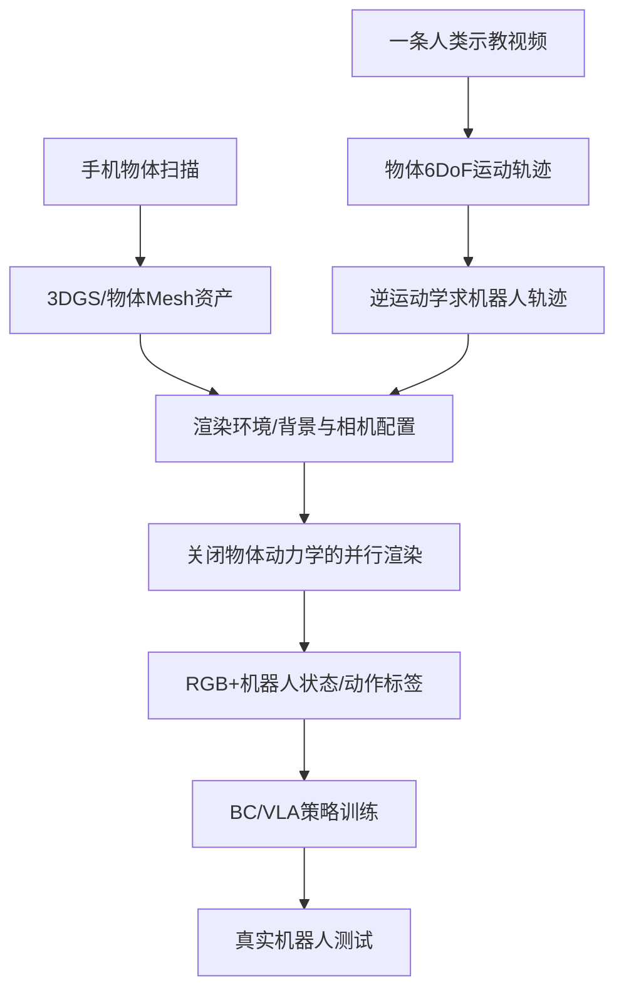

#### ⑦ 实验设计与主要结果
CoRL 正式论文报告，在论文测试的真实操作场景中，一条人类示教生成的数据训练得到的策略可以接近使用 150 条机器人遥操作示教训练的策略。这个结论与“1 条演示在任意任务等价于 150 条”不同；必须附带资产重建、适用任务以及运动学结构的限制。

#### ⑧ 方法特点与局限性
**特点**：对部分任务极具数据效率，不要求实体机器人遥操作与完整动力学；物体运动来自现实示范，监督目标明确。**局限**：面对插入、公差装配、强摩擦与复杂碰撞时，IK 合理不意味着物理可执行；可能存在没有显式建模的抓持稳定性与物体相互穿透。

---

### 4.4 SCIZOR：从“更多示教”转向状态—动作级数据筛选

#### ① 论文基本信息
- **原题**：SCIZOR: A Self-Supervised Approach to Data Curation for Large-Scale Imitation Learning
- **作者/机构**：Yu Zhang 等；UT Austin、NVIDIA。
- **发表**：ICRA 2026（Oral）；[官方论文链接](https://ut-austin-rpl.github.io/SCIZOR/)｜[GitHub](https://github.com/UT-Austin-RPL/SCIZOR)。

#### ② 论文概述 
模仿学习可以从大量人类演示中学习不同机器人行为，但大规模数据经常混合质量参差的动作，反而削弱策略训练。既有数据整理方法要么需要昂贵人工标签，要么仅在数据集/整条轨迹级别筛选，忽略了单个状态—动作样本的质量。SCIZOR 提出一种自监督、细粒度的数据筛选框架，移除两类低价值样本：一类是没有任务进展的次优转移，另一类是反复出现、信息冗余的转移。前者利用自监督任务进度预测，后者利用状态—动作联合表示去重。实验表明，减少数据量之后，模仿学习策略仍能取得更好的性能，在多个基准上平均提升约 15.4%。

#### ③ 研究动机与核心问题
同一长轨迹中可能同时包含关键操作、停顿、无效动作和完全重复的靠近过程。整条轨迹“一刀切”地保留或删除会损失有效部分。SCIZOR 的目标是让**监督数据的训练效用，而不是示教数量**成为优化对象；这属于“轨迹有效多样性”的数据策展路线。

#### ④ 方法总览与原论文截图

下列图片均是从[原论文 PDF](https://arxiv.org/pdf/2505.22626)直接裁切的**原始论文图**，已保存于本仓库，非 AI 生成或重新绘制。引用时请注明论文 Figure 编号。

**主图｜Figure 1：次优和冗余转移筛选的整体过程**


*原论文 Figure 1，PDF 第 2 页。[查看原文对应页](https://arxiv.org/pdf/2505.22626#page=2)。*

**方法/架构图｜Figure 2：任务进度模型和联合状态动作去重框架**


*原论文 Figure 2，PDF 第 4 页。[查看原文对应页](https://arxiv.org/pdf/2505.22626#page=4)。*

**读图重点：** Figure 1 说明筛选数据的目标；Figure 2 展示任务进度评价和聚类去冗余两个分支。

*图号、原论文 URL 及 PDF 截取坐标记录在 [截图来源清单](../assets/paper-screenshots/manifest.json)。详细中文 Pipeline 见下一节。*

#### ⑤ 核心技术与算法细节
**步骤一，统一状态—动作样本单元。** 从示教序列中取得观测、动作和连续时间片段，支持在整条轨迹内部做细粒度判断，而不是为每条 Episode 打单一好坏标签。

**步骤二，自监督任务进度预测。** 训练进度估计器，判断短时间窗口内的状态是否朝任务终点推进。当经过较长时间却几乎没有任务进展时，识别可能的停顿或偏离行为。这不要求手工提供每个动作的 reward，但依赖任务进度代理确实学得有意义。

**步骤三，状态—动作联合表示去冗余。** 把视觉状态与机器人动作编码为同一特征，结合聚类/相似性计算，降低高度重复片段的采样权重或删除部分重复样本。只看图像相似度会误把“同画面但不同动作”的数据判为冗余，因此联合动作表征很重要。

**步骤四，训练策略与验证。** 对比完整数据集、均匀采样减少数据、只剔次优、只去冗余、两者联合的模仿学习表现。合理筛选应在不损失关键多样性的前提下提升有效信息密度。

**重要适用边界。** 这项方法主要服务于学习**成功行为的模仿策略**；对于学习环境状态转移、错误诊断和失败预测的模型，“没有成功完成任务”不一定等于应被删除。

#### ⑥ 完整 Pipeline
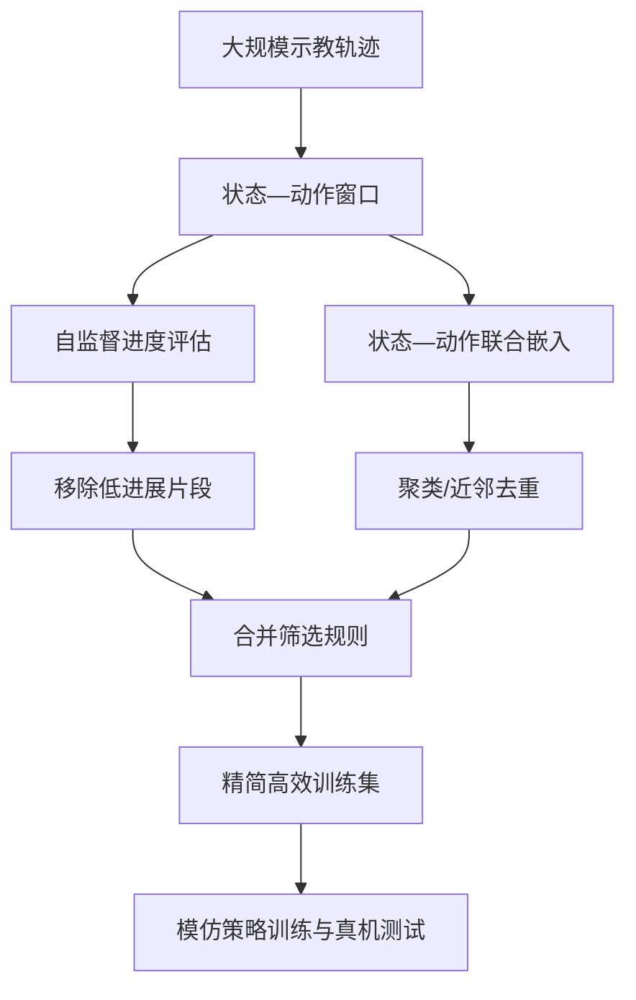

#### ⑦ 实验设计与主要结果
官方报告在 RoboMimic、Sirius-Fleet 和 Open-X 等数据设置中，筛选后的模型平均改善约 15.4%；项目页给出不同基准的进一步对照（如 Sirius-Fleet 真机任务上的明显增益）。这里要注意数据筛选率、保留分布及对照训练步数：若不控制这些变量，很容易把“训练更快/数据更少”与“策略本身更强”混为一谈。

#### ⑧ 方法特点与局限性
**特点**：低成本、自监督、细粒度处理；不需要生成新视频也能改善训练集质量；能和专家生成系统互补。**局限**：进度代理可能误删必要的等待、回退和安全调整动作；冗余判断对观测编码器敏感；筛选标准必须匹配下游学习目标。

---

### 4.5 轨迹路线横向比较

| 路线 | 新增的多样性从哪里来 | 是否需要可执行物理模拟 | 最主要的约束 |
|---|---|---|---|
| RoboTwin 2.0 | 不同任务、专家程序、本体和环境 | 是，执行验证为核心 | 仿真接触和成功判定的正确性 |
| RoboDream | 相同运动对应更多对象、场景、视角 | 运动锚定与生成结合 | 视频与原动作之间的条件忠实度 |
| Real2Render2Real | 人类对象轨迹+逆运动学+多场景渲染 | 对象动力学关闭 | 运动学合理不保证接触可行 |
| SCIZOR | 删除重复/低价值样本，改善有效覆盖 | 否 | 筛选标准与学习目标一致 |

因此，轨迹研究应区分：`数量扩增`、`可执行专家构建`、`视觉条件扩增`、`有效数据选择`。四种工作解决的不是同一个问题，不能简单用“生成 Episode 数”判断优劣。

---

### 4.6 交叉阅读：SimFoundry 的 Digital Cousins 如何扩增有效任务与轨迹覆盖

本节是对第二章 [SimFoundry（§2.4.3）](#243-simfoundry从单段实景视频到数字孪生数字近邻及策略验证闭环) 的**跨章节引用**，不重复将其统计为第四章另一篇独立论文。SimFoundry 先从单段实景视频生成 Sim-Ready Digital Twin，然后沿三个不同轴扩增保持关键交互可供性（Affordance）的数字近邻，供仿真数据生成与策略评测使用：[原论文 arXiv:2606.28276](https://arxiv.org/abs/2606.28276)；[原文 Figure 2](../assets/paper-screenshots/SimFoundry-architecture.jpg)。

| 扩增轴 | 什么被改变 | 可能增加的训练覆盖 | 是否一定生成新动作轨迹 | 关键风险 |
|---|---|---|---|---|
| **Object Cousins** | 物体外观、几何、拓扑与实例类型（保留任务相关功能） | 未见物体、抓取形态与视觉识别条件 | **不一定**；必须重规划/重执行才能保证动作可行 | 名义上同属“杯子”，把手、质量或摩擦变化仍可能改变抓取可行性 |
| **Scene Cousins** | 物体的空间布局、容器/支撑关系、干扰物 | 初始状态与空间关系、遮挡、可达性 | **不一定**；只换布局不等于已取得可执行示教 | 重排可能使目标不可达或造成隐性碰撞 |
| **Task Cousins** | 同一场景可执行的目标、对象关系、子任务 | 任务目标、技能顺序、不同操作轨迹 | **有潜力**；需任务求解和成功验证来确认 | 语言上合理的目标未必能由当前机器人实现 |

**核心区别**：传统 Domain Randomization 多数在固定任务下随机变化视觉或对象初态；SimFoundry 的 Cousins 尝试同时扩大 **对象分布、场景配置和任务语义分布**，尤其 Task Cousins 可从同一物理世界派生不同目标。与 RoboTwin 2.0 的区别在于：后者的重点是**自动编写、仿真调试可执行专家程序**；SimFoundry 的独特重点是**从真实任务锚定的数字孪生出发扩增场景和任务**。两者具备互补性，但不能把生成任务数量直接视为生成了同等数量的有效动作序列。

原文在不同实验设置下报告 Object/Scene/Task Cousins 的真实任务成功率平均改善分别为 **17%、21%、40%**，不能相加，也不应当把不同比较集合误写成固定的百分点提升。论文还通过 **7 项任务、5 类策略、平均 Pearson=0.911、MMRV=0.018** 检查仿真评测是否具有真机预测能力。这比仅汇报扩增了多少场景，提供了更强的下游证据。

**复用时建议分开统计五层指标**：生成场景数量、初态/对象/任务覆盖、物理可执行的示教成功率、观测—动作多样性、真机下游收益。具体来说，从 Digital Twin 派生 Cousin 后仍应运行碰撞/稳定性/任务成功检查，保存来源视频和场景随机种子，并区分“更换图像外观”与“策略真正采用不同接触/动作路径”。

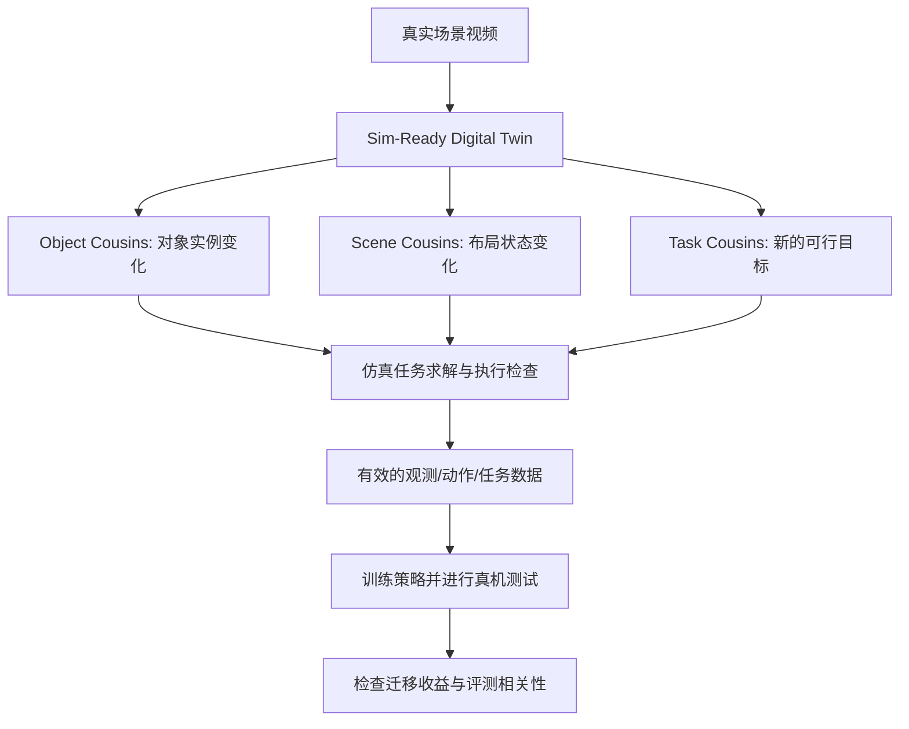

## 5. 真实数据与仿真数据如何协同：配比之外的选择

这是与前三个方向交叉但不相同的问题：即使仿真图像、接触和轨迹都“更好”，训练时如何采样、哪些仿真样本与目标真实任务有关，以及模型是否学到无关的域特征，仍然会造成负迁移。本章分别讨论**主动学习应生成什么数据**与**真实—仿真协同训练的基本机制与实践**。

### 5.1 MetaGenSim：主动优化仿真数据生成分布

#### ① 论文基本信息
- **原题**：Active Generative Simulation: Meta-Learning What to Simulate for Sim-and-Real Policy Co-Training
- **作者/机构**：Liqian Ma、Vaibhav Saxena 等；Georgia Institute of Technology。
- **状态**：作者项目页标注 CoRL 2026；[论文](https://arxiv.org/abs/2610.19479)｜[官方项目](https://meta-gensim.github.io/)｜**代码**：截至 2026-11-19，官网仍显示 `Code (coming soon)`，不可将其写为已完整开源。

#### ② 论文概述 
真实与仿真联合训练能够用大量模拟数据补充有限真实示教，但过去的方法通常把模拟器当作固定的数据提供者：要么均匀生成，要么从已有数据检索，或依赖专家手动对齐参数。本文提出主动生成式仿真（Active Generative Simulation）：直接优化模拟器生成参数的分布，以最大化后续真实机器人任务表现。MetaGenSim 通过元梯度训练辅助评分网络，在用户给定的参数空间中自动识别高效用的生成条件，而不必由人工制定每项对齐启发规则。仿真与真实任务实验中，该方法优于均匀生成及检索基线；真实任务的完整执行成功率相对于均匀生成提高约 150%，并接近专家手动对齐。作者还展示由轻量代理策略学得的数据分布可以迁移用于 VLA 微调，并能够利用原子技能拼接及物体—容器组合处理模拟与真实任务只有部分匹配的情况。

#### ③ 研究动机与核心问题
过去很多研究问“模拟数据与真实数据比例多少最佳”，MetaGenSim 更进一步问：**在固定生成预算下，应该主动生成哪些物体位置、场景配置、技能条件与运动难度，才能最有效提高真实域表现？** 均匀覆盖参数空间并不总有用；过多偏离真实目标任务的样本甚至会导致负迁移。

#### ④ 方法总览与原论文截图

下列图片均是从[原论文 PDF](https://arxiv.org/pdf/2610.19479)直接裁切的**原始论文图**，已保存于本仓库，非 AI 生成或重新绘制。引用时请注明论文 Figure 编号。

**主图｜Figure 1：主动优化模拟数据以提高真机表现的总览**


*原论文 Figure 1，PDF 第 1 页。[查看原文对应页](https://arxiv.org/pdf/2610.19479#page=1)。*

**方法/架构图｜Figure 2：元学习样本评分与模拟器参数分布优化**


*原论文 Figure 2，PDF 第 4 页。[查看原文对应页](https://arxiv.org/pdf/2610.19479#page=4)。*

**读图重点：** Figure 1 介绍数据效用思想；Figure 2 展示 Rater、KDE 和主动生成三阶段方法。

*图号、原论文 URL 及 PDF 截取坐标记录在 [截图来源清单](../assets/paper-screenshots/manifest.json)。详细中文 Pipeline 见下一节。*

#### ⑤ 核心技术与算法细节
**步骤一，定义可控的生成参数空间。** 用户指定模拟器可调的参数 (phi)，例如物体位置与任务组成；先随机或按探索策略生成一组探测样本 (D_{probe})，同时准备少量真实示教 (D_R)。

**步骤二，元学习 Rater。** 评分器 (R_eta(o,a)) 为训练样本生成效用权重。内层循环用模拟与真实样本加权更新策略；外层在保留的真实样本上计算策略训练之后的模仿误差，再将该误差反向传播到评分器参数。其核心思想不是用真实标签直接标“这条模拟轨迹好”，而是估计**它对策略在真实数据上的优化有多大帮助**。

**步骤三，建立参数效用地形。** 将探测数据的效用评分和生成时参数 (phi) 关联起来，再用核密度估计（KDE）近似得到高效用的参数区域 (U(phi))。此处 (U) 属于对真实下游性能的代理估计，而不是直接测得的真实成功率函数。

**步骤四，主动数据合成。** 从 (U(phi)) 优先抽样场景/任务配置，在物理模拟器中生成更多高效用轨迹，与少量真实示教共同训练最终策略。作者也用轻量级策略来学习采样分布，再迁移用于更大 VLA 的训练，以减少优化开销。

**步骤五，部分任务对齐。** 当真实任务与模拟环境不能完全同构时，采用原子技能拼接和物体—容器组合扩展可利用的模拟技能；不过这些组合是否可物理执行仍受模拟器和专家程序质量限制。

#### ⑥ 完整 Pipeline
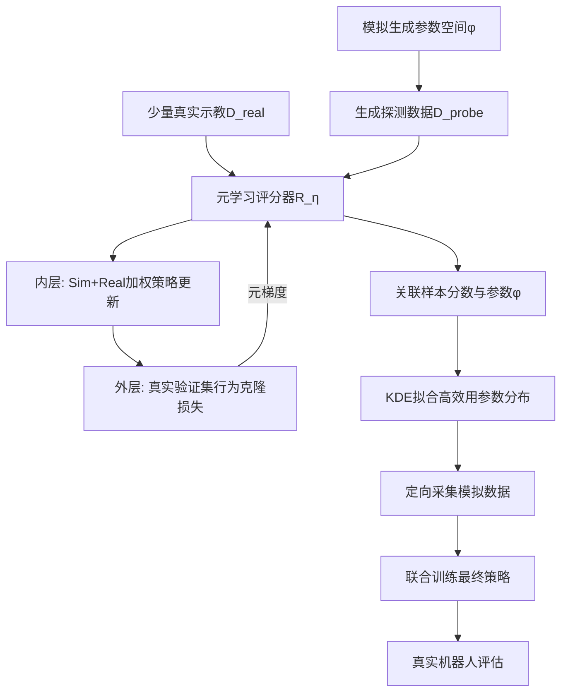

#### ⑦ 实验设计与主要结果
作者在四项真实操作任务中，每项只使用 10 条真实示教；项目报告 MetaGenSim 完整任务成功 58/80，而均匀生成成功 23/80，对应约 152% 的相对提升（论文概述简述为 150%）。工作还与检索、专家手动对齐作比较，讨论轻量策略学到的数据效用能否迁移到 VLA。需要注意 80 次真实试验有限，外推到更广任务族需要更多实验；结果也依赖参数空间是否包含真正有价值的生成条件。

#### ⑧ 方法特点与局限性
**特点**：优化“数据分布”而非简单扩大数据总量，主动学习可用于真实域的数据效用；和任何能够控制任务/场景生成参数的模拟器潜在互补。**局限**：元梯度和探测数据增加优化成本；真实验证集太小时评分可能过拟合；参数空间设计仍需工程知识；截至写作日期尚无公开完整复现代码。

---

### 5.2 Sim-and-Real Co-Training：任务感知数字近邻与混合策略学习

#### ① 论文基本信息
- **原题**：Sim-and-Real Co-Training: A Simple Recipe for Vision-Based Robotic Manipulation
- **作者/机构**：Abhiram Maddukuri 等；UT Austin、NVIDIA、UC Berkeley、NYU 等。
- **发表**：RSS 2025；[正式论文](https://roboticsproceedings.org/rss21/p109.html)｜[arXiv](https://arxiv.org/abs/2503.24361)｜[官方项目](https://co-training.github.io/)；**GitHub**：作者项目未明确提供对应完整方法仓库，故不填未经确认的链接。

#### ② 论文概述 
大规模真实机器人数据有望用于训练通用模型，但真实人工采集扩张缓慢且成本很高。随着生成式 AI 和自动数据生成工具的发展，仿真可以提供大规模机器人行为数据；然而只在模拟器训练再部署现实，仍通常需要大量人工处理差异。一种替代方式是把模拟和真实数据一起用于策略训练。已有初步研究显示共同训练可以优于只用少量真实数据，但社区仍缺乏系统认识，尚不清楚利用模拟数据究竟要满足哪些条件。本文通过多个仿真和真实数据集的系统实验，归纳出面向视觉机器人操作的简单有效配方，并在机器人单臂和人形机器人两种设置、多项任务中验证：即使模拟与现实仍有明显差别，加入模拟数据也可以使真实任务表现平均提升约 38%。

#### ③ 研究动机与核心问题
**问题不只是模拟环境像不像现实，而是模型能否从大量模拟数据提取与真实任务共享的动作结构。** 如果数字孪生要求每个材质、纹理、物理参数都一致，构建成本会非常高。作者提出 Task-Aware Digital Cousins：匹配任务语义、对象与容器关系、成功目标和合理初始条件，比追求每个像素完全相同更重要。

#### ④ 方法总览与原论文截图

下列图片均是从[原论文 PDF](https://www.roboticsproceedings.org/rss21/p109.pdf)直接裁切的**原始论文图**，已保存于本仓库，非 AI 生成或重新绘制。引用时请注明论文 Figure 编号。

**主图｜Figure 1：真实任务与仿真示教协同训练总览**


*原论文 Figure 1，PDF 第 1 页。[查看原文对应页](https://www.roboticsproceedings.org/rss21/p109.pdf#page=1)。*

**方法/架构图｜Figure 2：任务感知数字近邻构造和训练 Pipeline**


*原论文 Figure 2，PDF 第 4 页。[查看原文对应页](https://www.roboticsproceedings.org/rss21/p109.pdf#page=4)。*

**读图重点：** 总览解释真实任务、模拟数据及策略训练；方法图细分任务设置、数据准备与混合训练。

*图号、原论文 URL 及 PDF 截取坐标记录在 [截图来源清单](../assets/paper-screenshots/manifest.json)。详细中文 Pipeline 见下一节。*

#### ⑤ 核心技术与算法细节
**步骤一，选择模拟数据来源。** 作者使用两类数据：与目标真实任务相似的 Digital Cousins，以及以前就存在、与目标任务未必完全匹配的多任务模拟数据。前者任务语义更接近，后者在规模和复用上更有优势。

**步骤二，定义必须对齐的部分。** 重点对齐任务成功定义、操作对象与场景的组合关系、物体放置范围、摄像机视角大体相近等因素；研究强调不必让视觉和物理每个细节完美匹配。Digital Cousin 不是对真实环境逐像素的数字复制品。

**步骤三，组织 Sim-Real 混合采样。** 数据总量比并不等于训练批次比例。若 $D_s$、$D_r$ 分别为模拟与真实数据集合，可用 $\alpha\in[0,1]$ 描述模拟样本在训练目标中的权重：
$$
\mathcal L_{\mathrm{mix}}
=(1-\alpha)\,\mathbb E_{(o,a)\sim D_r}[\ell(\pi_\theta;o,a)]
+\alpha\,\mathbb E_{(o,a)\sim D_s}[\ell(\pi_\theta;o,a)].
$$
这里是共训练基本形式的概念公式，不宣称论文所有实验严格使用此唯一损失写法。需要对 $\alpha$、数据规模、训练步数及场景配置做消融，防止“模拟多”在训练中淹没少量真实样本。

**步骤四，真实任务直接验证。** 在机器人单臂与人形机器人任务上比较真实数据单独训练、加任务感知数字近邻、加历史模拟数据及其组合；分析何时混合数据增加真实成功率，何时不匹配的数据导致收益变小。

**步骤五，数据分布对齐不是单一目标。** 视觉对齐、对象位置多样性与动作统计分布互相关联。作者没有证明“某个固定的真实:仿真比例永远最佳”，研究强调需要结合任务与数据源调节采样比例。

#### ⑥ 完整 Pipeline
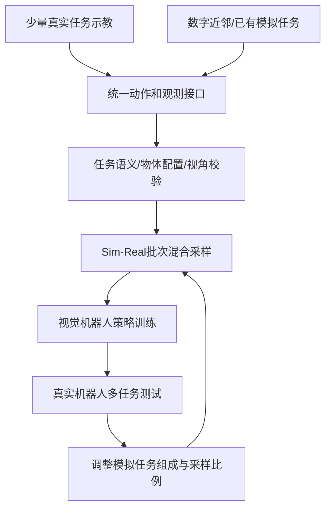

#### ⑦ 实验设计与主要结果
作者覆盖机械臂和人形机器人两大设置，真实任务包含抓放、开关门、倒液体等。论文报告引入模拟数据相对真实数据单独训练，平均提升真实任务表现约 38%。这是该论文任务集合上的统计结果，不能推广为所有 VLA/任务均提升 38%；同时需要留意真实任务演示数量、模拟比例和数字近邻的匹配程度。

#### ⑧ 方法特点与局限性
**特点**：为工业可扩展 Sim-Real 数据混合提供简单可检验的设计原则；不必建设完美数字孪生；对实际数据工程指导性较强。**局限**：不能直接给出跨任务通用的最佳混合权重；视角、动作坐标定义和任务语义仍需一致；与目标任务无关的海量模拟数据可能造成负迁移。

---

### 5.3 两条路线的差异

| 对比维度 | MetaGenSim | Sim-and-Real Co-Training |
|---|---|---|
| 主要问题 | **生成哪些模拟数据** | **如何混合现有模拟与真实数据** |
| 模拟数据分布 | 学习评分并主动修改 | 由数据资产与任务设计决定 |
| 真实数据用途 | 内外层元学习与最终共同训练 | 直接用于混合策略训练和验证 |
| 计算/工程代价 | 元学习、参数探测、定向生成 | 设计数字近邻、混合采样和消融 |
| 最适合研究场景 | 模拟器参数可编程、需要主动生成 | 已有多源数据、需要训练策略 |

**结论**：单一模拟数据数量比例不能替代对任务匹配和数据效用的分析。应该把数据源、采样权重、真实数据使用方式、任务覆盖和真实评估分别控制，才能识别真实的训练收益。

## 6. 物理真实性与动力学可信度：从可执行资产到真实交互对齐

> 研究范围：2025—2026 年机器人操作、接触动力学、物理资产、可变形物体、触觉仿真、物理感知世界模型与评价。资料核对日期：2026-11-20。本章新增 14 篇代表性工作；SPARR、SoMA、PIN-WM 已在第 3 章按八部分完整介绍，这里交叉引用而不重复抄写。

### 6.0 技术路线总览

#### 6.0.1 为什么要把“物理真实性”单独讨论？

视觉真实性与物理真实性并不等价。相机观察到的是 $o_t$，但机器人真正需要的是给定状态和动作后，真实环境会怎样转移：

$
s_{t+1}^{\mathrm{real}} \sim T_{\mathrm{real}}(\cdot\mid s_t,a_t),\qquad
s_{t+1}^{\mathrm{sim}} \sim T_{\mathrm{sim}}(\cdot\mid s_t,a_t).
$

物理真实性不是要求 $T_{\mathrm{sim}}$ 对整个世界完美，而是要求其对**目标任务关键的状态转移、接触事件、材料响应与控制反馈**足够准确。机器人仿真的 Physics Gap 具体可拆为：①资产层（几何尺度、碰撞、质量、惯性）；②场景层（支撑、穿透、关节拓扑）；③动力学层（接触切换、摩擦、柔性）；④传感反馈层（触觉与力）；⑤模型输出与验证层（物理世界模型与指标）。

另外需区分三种经常被混淆的目标：

| 层级 | 真正要证明什么 | 常见指标 | 不可直接替代的指标 |
|---|---|---|---|
| **Simulation readiness** | 模型能否被加载、碰撞、控制与执行 | URDF/MJCF可加载率、运动范围、运行稳定性 | 真实物理参数误差 |
| **Physical fidelity** | 在相同初态与动作下，模拟与现实的状态、接触力和形变是否接近 | 位姿/速度轨迹误差、接触事件F1、力/形变误差 | 真机策略成功率 |
| **Sim-to-Real validity** | 从仿真获得的策略能否迁移 | 真实成功率、性能差距、交互预算 | 物理模型全局准确性 |

#### 6.0.2 五条代表性路线

| 方向 | 代表论文 | 模型/资产实际被更新的部分 | 核心数据需求 | 主要边界 |
|---|---|---|---|---|
| **物理资产生成与Real-to-Sim** | PhysX-3D、PhysX-Anything、Scalable Real2Sim、Physics-Consistent Real-to-Sim | 质量/惯量/关节/物体和物体间接触 | 图像、RGB-D、机器人力矩 | 视觉预测的物理参数不一定唯一 |
| **接触动力学与可微校准** | Contact-Aware Neural Dynamics、Few-Shot Neural Differentiable Simulator | 接触模式、状态转移与模型梯度 | 少量真实接触或触觉轨迹 | 未见接触状态与非光滑优化 |
| **柔性和多材料仿真** | PhysTwin、Alloy；对照 SoMA | 形变结构、材料响应、跨材料耦合 | 柔性物体视频/物理引擎 | 计算代价与长时稳定性 |
| **触觉真实性** | TactileLab、TouchTwin | 触觉流、接触时间和施力 | 真实触觉/关节/视觉同步 | 昂贵传感器、接触隐变量 |
| **物理世界模型与评价** | RoboScape、ABot-PhysWorld、Principia、PVBench | 视频动力学表征、物理偏好和可量化诊断 | 动作视频、物理标注、物体追踪 | 视频合理不代表接触力精准 |

~~~mermaid
flowchart TD
  A["物理真实性研究"] --> B["物理资产和物理场景"]
  A --> C["接触/柔性/多材料动力学"]
  A --> D["触觉与真实交互标定"]
  A --> E["生成式物理世界模型"]
  B --> F["状态与动作可重放"]
  C --> F
  D --> F
  E --> G["物理规律与条件动作评测"]
  F --> H["真实任务验证"]
  G --> H
~~~

**本章组织原则**：正文每篇均按原先确认的八部分呈现。方法介绍优先说明输入、物理表示、训练/辨识、仿真输出与真实验证；对只在 arXiv 上发表的工作明确标明预印本；论文中的相对指标、绝对数值和实验范围不混用。

---

### 6.1 PhysX-3D：从几何资产生成走向带物理知识的三维资产

#### ① 论文基本信息

- **原题**：PhysX-3D: Physical-Grounded 3D Asset Generation
- **作者**：Ziang Cao、Zhaoxi Chen、Liang Pan、Ziwei Liu
- **发表信息**：NeurIPS 2025
- **研究侧重**：资产物理知识
- **论文**：[arXiv:2507.12465](https://arxiv.org/abs/2507.12465) · [原始 PDF](https://arxiv.org/pdf/2507.12465) · [项目主页](https://physx-3d.github.io/)
- **研究定位**：资产物理知识。本文不把“可以在模拟器运行”直接等同于“真实物理参数准确”。

#### ② 论文概述（根据原文 Abstract 忠实中文译述）

现有三维生成以外观与几何为核心，缺少面向机器人和仿真的物理属性。本文提出 PhysX-3D 范式：首先建立 PhysXNet，将绝对尺度、材质、可供性、运动学和功能描述五类信息系统标注到三维资产；再提出 PhysXGen，通过双分支前馈生成框架，将物理知识注入预训练的三维结构表示，在维持几何质量的同时预测合理的物理属性。作者以属性预测和三维生成实验验证该框架的性能与泛化能力。

#### ③ 研究动机与核心问题

三维外观相似不保证物体能在模拟器中正确交互。缺少公制尺度、部件材质和关节关系时，即使 Mesh 可导入，也难以构造合理的碰撞、质量与运动学约束。论文主要解决资产层面的物理语义与生成问题，而不是直接求解接触动力学。

#### ④ 方法总览与原论文主图

**原论文主图（Figure 1，PDF 第 1 页）**


**原论文第二张关键图（Figure 2，PDF 第 4 页）**


*图号、源 PDF 和裁切位置参见 [截图 Manifest](../assets/paper-screenshots/manifest.json)。*

**读图指引**：原论文主图通常说明应用任务与主要模块；第二张重点检查数据如何进入模型、哪个环节承担物理约束、是否使用真实交互。未必所有 Figure 2 都是网络结构图，请结合原图标题阅读。

#### ⑤ 核心技术与算法细节

1. **物理标签体系。** 将 PhysXNet 的信息划为五类：公制尺度、材质、可供性、关节运动学与功能描述；既包含对象级属性，也包含部件级语义。这使模型能够区分“看起来像抽屉”和“确实具有可移动关节”两种资产。

2. **数据构建。** 从已有 3D 资产出发，由 VLM 协助标注，并引入人工校核，建立可供训练和评价的物理属性数据。标注可看作物理建模先验，并不全部来自真实测量。

3. **双分支生成。** PhysXGen 在三维结构生成分支之外显式建模物理属性，学习几何结构与材质、尺度、关节信息的相关性，避免只在生成完成后做零散属性补丁。

4. **资产导出与使用。** 将生成的物体与属性导入仿真，需要进一步检查碰撞 Mesh、可动部件关节与物理引擎参数的对应关系，不能假设属性标签自动等于准确的接触力。

#### ⑥ 完整 Pipeline（中文梳理）

```mermaid
flowchart LR
  X0["现有3D资产"]
  X1["VLM/人工校核物理属性"]
  X2["PhysXNet标注数据"]
  X3["PhysXGen几何/属性双分支"]
  X4["带物理描述的3D资产"]
  X0 --> X1
  X1 --> X2
  X2 --> X3
  X3 --> X4
```

#### ⑦ 实验设计与主要结果

作者报告 PhysXNet 超过 2.6 万个具有物理属性标注的三维对象，并对生成质量、物理属性预测与泛化进行评估。需要区分生成属性的合理性与真实机器人操作中物理参数实测精度；论文的主要实证不等同于完整的真机动力学重放误差实验。

#### ⑧ 方法特点与局限性

提供了可扩展的物理资产数据表示和生成路线，但材质、质量等属性可能仍来自视觉推断与先验，不保证具有可辨识的真实数值；对接触摩擦、滑移和长期动力学的验证需要后续 Real-to-Sim 数据。

---

### 6.2 PhysX-Anything：单图生成仿真就绪的可动三维对象

#### ① 论文基本信息

- **原题**：PhysX-Anything: Simulation-Ready Physical 3D Assets from Single Image
- **作者**：Ziang Cao、Fangzhou Hong、Zhaoxi Chen、Liang Pan、Ziwei Liu
- **发表信息**：CVPR 2026
- **研究侧重**：可执行资产
- **论文**：[arXiv:2511.13648](https://arxiv.org/abs/2511.13648) · [原始 PDF](https://arxiv.org/pdf/2511.13648) · [项目主页](https://physx-anything.github.io/) · [代码仓库](https://github.com/ziangcao0312/PhysX-Anything)
- **研究定位**：可执行资产。本文不把“可以在模拟器运行”直接等同于“真实物理参数准确”。

#### ② 论文概述（根据原文 Abstract 忠实中文译述）

本文研究如何从单张自然图像直接生成能够参与物理仿真的三维对象，而不仅是静态视觉网格。作者提出基于视觉语言模型的物理三维生成框架，显式输出几何、关节结构与物理属性，并引入高效几何 token 表示，使几何 token 数减少约 193 倍。为增加训练覆盖，构建具有丰富物理标注、包含超过两千种常见物体的 PhysX-Mobility 数据集，并在生成质量、泛化和 MuJoCo 风格的接触操作任务中验证生成资产的可用性。

#### ③ 研究动机与核心问题

单图到三维的方法常缺乏运动学拓扑、关节约束和物理参数，导致生成资产虽可渲染，却无法直接驱动机器人学习。核心问题是把资产生产的终点从视觉几何扩展到具有结构约束的仿真文件。

#### ④ 方法总览与原论文主图

**原论文主图（Figure 1，PDF 第 1 页）**


**原论文第二张关键图（Figure 2，PDF 第 3 页）**


*图号、源 PDF 和裁切位置参见 [截图 Manifest](../assets/paper-screenshots/manifest.json)。*

**读图指引**：原论文主图通常说明应用任务与主要模块；第二张重点检查数据如何进入模型、哪个环节承担物理约束、是否使用真实交互。未必所有 Figure 2 都是网络结构图，请结合原图标题阅读。

#### ⑤ 核心技术与算法细节

1. **输入感知与物理结构推断。** 根据图像推断对象整体外形、可动部件、关节连接和物理属性；模型需要处理单视角固有的几何和遮挡歧义。

2. **紧凑显式几何编码。** 使用新的 tokenization 降低几何序列长度，使标准 VLM 上下文窗口能够承载显式几何监督；论文报告约 193 倍 token 降幅，此处是表示效率而非物理误差降幅。

3. **多轮物理资产生成。** 在 VLM 驱动的生成流程中联合输出结构与物理描述，并导出 URDF/XML 资产，使对象在物理引擎中有可解释的关节与碰撞接口。

4. **数据和下游验证。** PhysX-Mobility 增加真实物体类别与物理标注覆盖，再将生成对象用于模拟抓取等接触操作；该验证侧重 sim-ready 性质，而非自动证明参数与实物完全一致。

#### ⑥ 完整 Pipeline（中文梳理）

```mermaid
flowchart LR
  X0["单张真实物体图像"]
  X1["VLM多轮结构推断"]
  X2["紧凑几何与关节表示"]
  X3["物理属性生成/URDF导出"]
  X4["接触任务模拟器验证"]
  X0 --> X1
  X1 --> X2
  X2 --> X3
  X3 --> X4
```

#### ⑦ 实验设计与主要结果

论文报告几何 token 数约减少 193 倍、PhysX-Mobility 包含超过两千个日常物体，并展示生成资产在 MuJoCo 风格接触操作模拟中可直接使用。上述结果支持生成与可执行性，但不能将其理解为全部对象的摩擦、密度、惯量已由真实交互测定。

#### ⑧ 方法特点与局限性

规模化生成速度和可用性突出；单图推断质量、摩擦和隐藏关节存在多解性，尤其对透明、柔性和内部复杂物体。需要通过真实交互校验才能迈向高物理保真数字孪生。

---

### 6.3 Scalable Real2Sim：机器人交互驱动的物理资产测量与生成

#### ① 论文基本信息

- **原题**：Scalable Real2Sim: Physics-Aware Asset Generation Via Robotic Pick-and-Place Setups
- **作者**：Nicholas Pfaff、Evelyn Fu、Jeremy Binagia、Phillip Isola、Russ Tedrake
- **发表信息**：IROS 2025
- **研究侧重**：物理参数辨识
- **论文**：[arXiv:2503.00370](https://arxiv.org/abs/2503.00370) · [原始 PDF](https://arxiv.org/pdf/2503.00370) · [项目主页](https://scalable-real2sim.github.io/) · [代码仓库](https://github.com/nepfaff/scalable-real2sim)
- **研究定位**：物理参数辨识。本文不把“可以在模拟器运行”直接等同于“真实物理参数准确”。

#### ② 论文概述（根据原文 Abstract 忠实中文译述）

本文提出无需人工逐个建模的 Real-to-Sim 资产生产流程：机器人在常规抓放工作站中自动拾取对象、通过固定相机采集多角度外观，再结合关节力矩数据识别对象惯性等物理属性。方法引入针对前景遮挡的透明度感知几何重建，从 NeRF/3DGS 等表观重建中提取高质量物体 Mesh，得到视觉几何、碰撞几何和可模拟的动力学参数，最终构造仿真就绪资产。

#### ③ 研究动机与核心问题

仅靠单张图像很难确定质量、质心或惯量，而人工称重、扫描和标定难以扩展到大量新物体。这篇工作把机器人本体的力矩响应变成物理监督，是从“推测属性”到“主动测量属性”的路线。

#### ④ 方法总览与原论文主图

**原论文主图（Figure 1，PDF 第 1 页）**

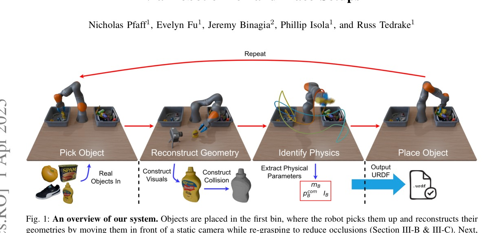

**原论文第二张关键图（Figure 2，PDF 第 3 页）**


*图号、源 PDF 和裁切位置参见 [截图 Manifest](../assets/paper-screenshots/manifest.json)。*

**读图指引**：原论文主图通常说明应用任务与主要模块；第二张重点检查数据如何进入模型、哪个环节承担物理约束、是否使用真实交互。未必所有 Figure 2 都是网络结构图，请结合原图标题阅读。

#### ⑤ 核心技术与算法细节

1. **自动物体采集。** 机器人从料箱抓取物体，在相机前执行多视角运动和重新抓取，尽量降低遮挡对几何重建的影响。

2. **对象中心视觉/碰撞重建。** 使用包含 alpha 透明训练和前景遮挡建模的图像重建方式，抽取适合仿真器的 Mesh，并区分渲染几何与碰撞用几何。

3. **激励式惯性辨识。** 机器人执行对惯性参数有信息量的运动，利用关节力矩和机器人运动学模型辨识质量分布相关参数。只有激励充分、传感器可靠，辨识才可能稳定。

4. **自动封装。** 将网格、几何尺度、惯性信息和材料/碰撞参数组合成完整资产，供数据生成或策略训练使用；对尚未真实测量的接触参数仍需后续校准。

#### ⑥ 完整 Pipeline（中文梳理）

```mermaid
flowchart LR
  X0["机器人自动抓取/再抓取"]
  X1["固定相机多视角观察"]
  X2["渲染/碰撞网格重建"]
  X3["力矩激励与惯性辨识"]
  X4["可仿真物理资产"]
  X0 --> X1
  X1 --> X2
  X2 --> X3
  X3 --> X4
```

#### ⑦ 实验设计与主要结果

论文在多种实物上验证了自动扫描、几何重建和惯性属性辨识的完整流程，强调无需针对每个对象的人为环境改造。比较时应分开记录重建几何误差、动力学参数误差和流水线吞吐，而不是把“自动可导入”视为真实操控成功率。

#### ⑧ 方法特点与局限性

真实机器人和力矩传感器成为必要条件；夹持状态误差、测量噪声和外部扰动会影响惯性辨识。其强项是标准刚体对象，不是无需改动便覆盖复杂多材质与柔性对象。

---

### 6.4 Physics-Consistent Real-to-Sim：面向杂乱接触场景的稳定重建

#### ① 论文基本信息

- **原题**：Real-to-Sim for Highly Cluttered Environments via Physics-Consistent Inter-Object Reasoning
- **作者**：Tianyi Xiang、Jiahang Cao、Sikai Guo、Guoyang Zhao、Andrew F. Luo、Jun Ma
- **发表信息**：2026 论文 / arXiv:2602.12633
- **研究侧重**：场景级物理约束
- **论文**：[arXiv:2602.12633](https://arxiv.org/abs/2602.12633) · [原始 PDF](https://arxiv.org/pdf/2602.12633) · [项目主页](https://physics-constrained-real2sim.github.io/) · [代码仓库](https://github.com/physics-constrained-Real2Sim/physics-constrained-Real2Sim)
- **研究定位**：场景级物理约束。本文不把“可以在模拟器运行”直接等同于“真实物理参数准确”。

#### ② 论文概述（根据原文 Abstract 忠实中文译述）

从单幅 RGB-D 图像重建复杂堆叠场景时，几何重建容易产生悬浮、穿透或不稳定物体，从而破坏后续仿真。本文提出物理约束的 Real-to-Sim 流程，在初步重建和实例分割基础上建立物体接触图，并利用可微刚体仿真联合细化物体位姿与物理属性。作者在仿真和真实接触操作环境中检验场景稳定性及接触交互的可靠性。

#### ③ 研究动机与核心问题

多个对象同时存在时，物体间支撑、受力和摩擦共同决定稳定状态。只把每件物体 Mesh 分别对齐，不能保证对象之间存在可维持的接触关系；单纯几何不穿透也不足以确保长时静力平衡。

#### ④ 方法总览与原论文主图

**原论文主图（Figure 1，PDF 第 1 页）**


**原论文第二张关键图（Figure 2，PDF 第 3 页）**


*图号、源 PDF 和裁切位置参见 [截图 Manifest](../assets/paper-screenshots/manifest.json)。*

**读图指引**：原论文主图通常说明应用任务与主要模块；第二张重点检查数据如何进入模型、哪个环节承担物理约束、是否使用真实交互。未必所有 Figure 2 都是网络结构图，请结合原图标题阅读。

#### ⑤ 核心技术与算法细节

1. **视觉初始化。** 根据 RGB-D 图像和实例掩码得到各物体初始几何、尺度和位姿，使用几何配准细化。

2. **构建场景接触图。** 将物体与地面/相邻物体的支撑关系以及邻近关系编码为图结构，显式表示一件物体受到哪些其他对象的约束。

3. **两阶段物理优化。** 先消除明显穿透、悬浮等不满足几何约束的问题，再引入可微物理模拟，联合优化物体位姿及摩擦、质量、质心等可能影响稳定性的物理属性。

4. **动态验证。** 使场景在模拟器内释放并接受操作扰动，观察长期稳定性与接触运动，而不是只以第一帧重建误差作为成功标准。

#### ⑥ 完整 Pipeline（中文梳理）

```mermaid
flowchart LR
  X0["单视角RGB-D与实例掩码"]
  X1["场景几何/位姿初始化"]
  X2["物体支撑与接触图"]
  X3["可微物理约束联合优化"]
  X4["静态稳定性与接触交互验证"]
  X0 --> X1
  X1 --> X2
  X2 --> X3
  X3 --> X4
```

#### ⑦ 实验设计与主要结果

原文比较只进行几何重建、仅加入局部非穿透约束以及施加物理约束的版本，并进行模拟与真实场景操作验证。作者报告物理约束版本的稳定性及接触真实性更好；若无统一真实轨迹重放和置信区间，不宜将这一结论写成适用于任意场景的绝对物理正确性。

#### ⑧ 方法特点与局限性

适合刚体杂乱场景的初态构建；单帧 RGB-D 仍难观测隐藏接触与真实物体内部属性。优化得到的参数可能不是唯一的材料属性，还应检查接触图错误传播和非刚体物品。

---

### 6.5 Contact-Aware Neural Dynamics：基于真实触觉的隐式动力学对齐

#### ① 论文基本信息

- **原题**：Contact-Aware Neural Dynamics
- **作者**：Changwei Jing、Jai Krishna Bandi、Jianglong Ye、Yan Duan、Pieter Abbeel、Xiaolong Wang、Sha Yi
- **发表信息**：CVPR 2026
- **研究侧重**：触觉约束接触动力学
- **论文**：[arXiv:2601.12796](https://arxiv.org/abs/2601.12796) · [原始 PDF](https://arxiv.org/pdf/2601.12796) · [项目主页](https://changwei-jing.github.io/neural-physics/)
- **研究定位**：触觉约束接触动力学。本文不把“可以在模拟器运行”直接等同于“真实物理参数准确”。

#### ② 论文概述（根据原文 Abstract 忠实中文译述）

在富接触操作中，仅调节模拟器显式参数往往无法拟合真实世界高维、随状态变化且不连续的接触动力学。本文将现有模拟器视作基础先验，训练接触感知神经前向动力学模型，首先利用大量仿真轨迹学习状态、动作和接触的关联，再以少量带触觉的真实交互数据微调，实现隐式 Sim-to-Real 动力学对齐。作者展示了状态预测精度改进，并将模型用于评估和优化仿真训练得到的策略。

#### ③ 研究动机与核心问题

接触模式从分离跳变到粘着/滑动，常因摩擦、柔顺性和离散求解造成突变。低维参数拟合可能把误差错误分配给质量或阻尼，而忽略了接触事件本身。二值触觉能在仿真与真实系统间提供较可对齐的监督信号。

#### ④ 方法总览与原论文主图

**原论文主图（Figure 1，PDF 第 1 页）**

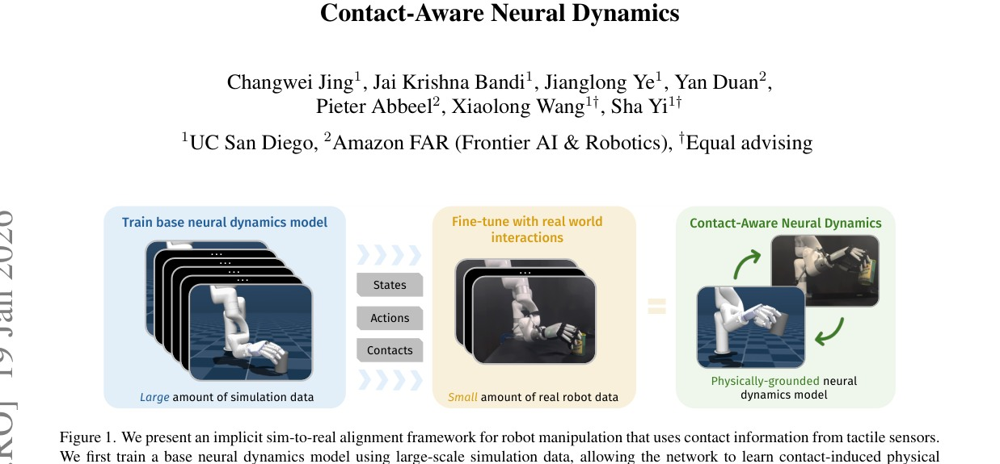

**原论文第二张关键图（Figure 2，PDF 第 4 页）**


*图号、源 PDF 和裁切位置参见 [截图 Manifest](../assets/paper-screenshots/manifest.json)。*

**读图指引**：原论文主图通常说明应用任务与主要模块；第二张重点检查数据如何进入模型、哪个环节承担物理约束、是否使用真实交互。未必所有 Figure 2 都是网络结构图，请结合原图标题阅读。

#### ⑤ 核心技术与算法细节

1. **建立模拟先验。** 采集现成物理引擎中的大量状态—动作—接触历史；保留对象几何、机器人关节和接触事件的信息。

2. **多模态条件编码。** 将历史物体位姿、机器人关节状态、动作、点云/几何与接触观测编码为动力学上下文。

3. **接触先预测、动力学后生成。** 先预测未来接触模式，再将接触条件提供给后续状态/位姿变化预测模块；项目采用扩散式预测器应对多模态未来轨迹。

4. **少量真实触觉校准。** 使用真实接触触发信息与轨迹对网络微调，对真实接触切换做隐式对齐；该方法学习的是一个神经前向模型，并非重新估计所有明确的摩擦系数。

5. **用于策略选择。** 根据模型预测未来接触结果和终态，辅助评估不同仿真策略，并筛选或改善真实执行策略。

#### ⑥ 完整 Pipeline（中文梳理）

```mermaid
flowchart LR
  X0["仿真状态/动作/接触轨迹"]
  X1["接触与几何特征编码"]
  X2["接触事件预测"]
  X3["扩散式未来位姿预测"]
  X4["少量真实触觉微调"]
  X5["策略预测/真实评估"]
  X0 --> X1
  X1 --> X2
  X2 --> X3
  X3 --> X4
  X4 --> X5
```

#### ⑦ 实验设计与主要结果

作者对单物体和多物体的接触丰富操作进行长时状态预测，展示模拟预训练后加入真实触觉可改善位姿/接触预测，并用于策略性能预测。真实策略提升依赖其测试本体、接触传感器与可获得的真实微调样本；不能推断纯 RGB 条件下有同等改善。

#### ⑧ 方法特点与局限性

真实触觉降低了接触是否发生的不可观测性，但依赖传感器标定及接触标签阈值。神经模型的误差界、超出训练分布的接触类型以及严格力学约束尚不能由预测准确率完全保证。

---

### 6.6 Few-Shot Neural Differentiable Simulator：少量真机数据约束的可微接触模型

#### ① 论文基本信息

- **原题**：Few-Shot Neural Differentiable Simulator: Real-to-Sim Rigid-Contact Modeling
- **作者**：Zhenhao Huang、Siyuan Luo、Bingyang Zhou、Ziqiu Zeng、Jason Pho、Fan Shi
- **发表信息**：ICRA 2026
- **研究侧重**：可微接触模拟
- **论文**：[arXiv:2603.06218](https://arxiv.org/abs/2603.06218) · [原始 PDF](https://arxiv.org/pdf/2603.06218)
- **研究定位**：可微接触模拟。本文不把“可以在模拟器运行”直接等同于“真实物理参数准确”。

#### ② 论文概述（根据原文 Abstract 忠实中文译述）

解析物理模拟器难以准确处理复杂刚体接触，而纯神经模拟器依赖大量真实数据。本文提出 Few-Shot Real-to-Sim 方案：先用少量真实观测校准解析仿真器，并利用校准模型生成大规模多样接触数据；再训练基于网格的图神经网络隐式表示刚体前向动力学，同时为碰撞检测构造替代梯度，使动力学模型可微。实验显示其真实轨迹拟合能力优于若干可微基线，并可用于多物体交互任务的梯度式策略优化。

#### ③ 研究动机与核心问题

可微模拟器需要梯度才能高效优化动作，而刚体碰撞的离散接触判定恰好不光滑。仅依赖解析参数会产生模型偏差，纯端到端学习又过于耗费真实数据，因此需要兼顾解析先验、数据规模和梯度可用性。

#### ④ 方法总览与原论文主图

**原论文主图（Figure 1，PDF 第 1 页）**


**原论文第二张关键图（Figure 2，PDF 第 2 页）**

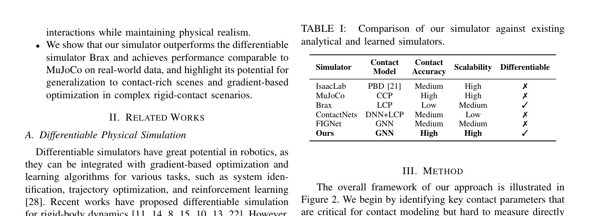

*图号、源 PDF 和裁切位置参见 [截图 Manifest](../assets/paper-screenshots/manifest.json)。*

**读图指引**：原论文主图通常说明应用任务与主要模块；第二张重点检查数据如何进入模型、哪个环节承担物理约束、是否使用真实交互。未必所有 Figure 2 都是网络结构图，请结合原图标题阅读。

#### ⑤ 核心技术与算法细节

1. **真机小样本校准。** 利用有限真实接触轨迹辨识解析仿真器中的主要接触参数，获得尽可能接近现实的基础系统。

2. **扩大合成分布。** 让校准模拟器生成更多物体数量、初始速度与碰撞模式各异的轨迹，为神经模拟器提供监督。

3. **网格 GNN 动力学。** 将物体网格的局部几何与邻接/接触关系编码为图消息传递，预测未来刚体状态而非只输出 RGB 视频。

4. **替代接触梯度。** 对碰撞检测中不可微的离散切换使用代理梯度，使动作输入到下游目标的反向优化成为可能。

5. **策略优化。** 在多物体碰撞和推动场景中用该梯度搜索动作，并与解析可微或纯数据驱动基线比较。

#### ⑥ 完整 Pipeline（中文梳理）

```mermaid
flowchart LR
  X0["少量真实接触轨迹"]
  X1["校准解析接触模拟器"]
  X2["扩增多样物体碰撞数据"]
  X3["网格GNN前向动力学"]
  X4["接触检测替代梯度"]
  X5["梯度式轨迹/策略优化"]
  X0 --> X1
  X1 --> X2
  X2 --> X3
  X3 --> X4
  X4 --> X5
```

#### ⑦ 实验设计与主要结果

文章主要评估真实轨迹复现误差及多物体交互的优化效率，展示更好的重放保真度与基于梯度的控制可用性。其 Figure 1 中优化碰撞初速度属于规划/优化演示；不应未经证实写成大规模真实机器人任务迁移成功率。

#### ⑧ 方法特点与局限性

优点是将少量实测数据放入可微动力学训练链；缺点包括基模校准依赖参数初始化、GNN 对物体数量/形状分布的泛化要求，以及替代梯度不保证与真实接触力的梯度完全一致。

---

### 6.7 PhysTwin：从稀疏视频估计柔性物体的可交互物理数字孪生

#### ① 论文基本信息

- **原题**：PhysTwin: Physics-Informed Reconstruction and Simulation of Deformable Objects from Videos
- **作者**：Hanxiao Jiang、Hao-Yu Hsu、Kaifeng Zhang、Hsin-Ni Yu、Shenlong Wang、Yunzhu Li
- **发表信息**：ICCV 2025
- **研究侧重**：可变形物体
- **论文**：[arXiv:2503.17973](https://arxiv.org/abs/2503.17973) · [原始 PDF](https://arxiv.org/pdf/2503.17973) · [项目主页](https://jianghanxiao.github.io/phystwin-web/)
- **研究定位**：可变形物体。本文不把“可以在模拟器运行”直接等同于“真实物理参数准确”。

#### ② 论文概述（根据原文 Abstract 忠实中文译述）

本文提出 PhysTwin，从少量拍摄物体动态交互的视频中，重建可实时交互、具备视觉和物理属性的柔性物体数字孪生。其表示结合弹簧—质点物理模型、生成式几何先验与 Gaussian Splatting 渲染，通过多阶段逆向优化恢复完整物体几何、稠密物理属性和外观。方法能够处理绳索、毛绒玩具、布料与包装等柔性对象，实验展示其在重建、渲染、未来状态预测以及未见交互模拟方面的表现，并演示模型驱动机器人规划。

#### ③ 研究动机与核心问题

柔性物体内部自由度高，视频观测稀疏且存在遮挡，仅用静态 Mesh 或无动作视频生成难以复现新交互。需要将可渲染几何与具有可计算力学性质的物体表示联合估计。

#### ④ 方法总览与原论文主图

**原论文主图（Figure 1，PDF 第 1 页）**

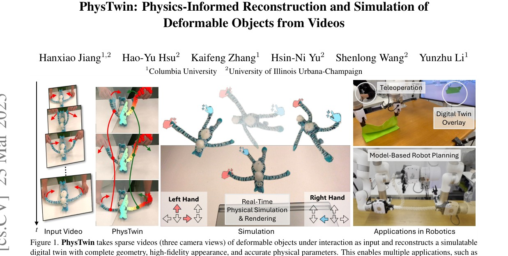

**原论文第二张关键图（Figure 2，PDF 第 3 页）**

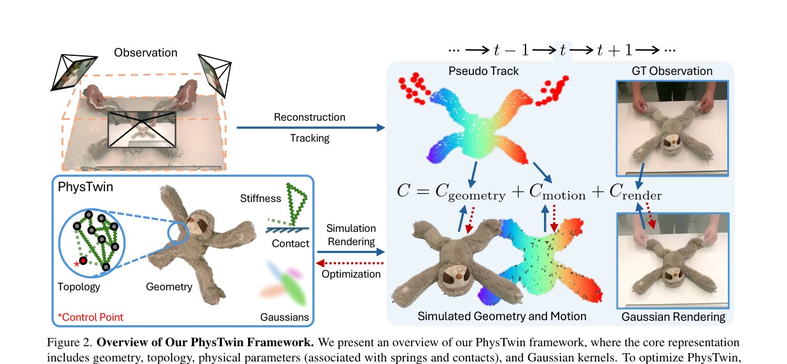

*图号、源 PDF 和裁切位置参见 [截图 Manifest](../assets/paper-screenshots/manifest.json)。*

**读图指引**：原论文主图通常说明应用任务与主要模块；第二张重点检查数据如何进入模型、哪个环节承担物理约束、是否使用真实交互。未必所有 Figure 2 都是网络结构图，请结合原图标题阅读。

#### ⑤ 核心技术与算法细节

1. **物理知觉混合表示。** 用弹簧—质点系统表达物体动态形变，用生成式形状先验恢复遮挡部分几何，用高斯基元负责照片级多视角渲染；避免让高斯颜色点独自承担力学约束。

2. **从稀疏交互视频出发。** 多视角拍摄对象受推动、抓取或形变的状态变化，联合优化几何与可观测运动。

3. **分阶段反问题求解。** 分别处理几何初始化、物理参数反演和外观渲染一致性，使模型既能复现观测片段，也能对新作用给出前向预测。

4. **执行未见交互。** 在拟合好的物理体上施加新动作或受力，以模拟结果驱动机器人运动规划，而非简单回放训练视频。

#### ⑥ 完整 Pipeline（中文梳理）

```mermaid
flowchart LR
  X0["稀疏真实交互视频"]
  X1["形状先验/物体几何恢复"]
  X2["弹簧—质点物理属性反演"]
  X3["Gaussian外观联合优化"]
  X4["新交互前向模拟/机器人规划"]
  X0 --> X1
  X1 --> X2
  X2 --> X3
  X3 --> X4
```

#### ⑦ 实验设计与主要结果

ICCV 2025 论文在绳索、布料、包装物和毛绒对象上比较几何重建、渲染、未来运动预测与未见交互的模拟效果，并展示实时操作模拟与规划应用。不同指标分别对应视觉、动态和应用能力；不要把渲染指标直接解释成抓取成功率。

#### ⑧ 方法特点与局限性

它给出了视觉与力学同时建模的可执行数字孪生路线，但材料参数从少量视频反推仍存在歧义，尤其对复杂接触、材料异质性及高频作用力。可结合 SoMA 第三章的动作条件神经建模作对比。

---

### 6.8 Alloy：多材料耦合的机器人物理仿真基础设施

#### ① 论文基本信息

- **原题**：Alloy: A Multi-Material Physics Engine for Robot Learning
- **作者**：Pranay Gupta、Deepanshu Rohilla
- **发表信息**：arXiv 2026-11-12（预印本）
- **研究侧重**：多材料引擎
- **论文**：[arXiv:2611.16312](https://arxiv.org/abs/2611.16312) · [原始 PDF](https://arxiv.org/pdf/2611.16312) · [代码仓库](https://github.com/argonrobotics-ai/alloy)
- **研究定位**：多材料引擎。本文不把“可以在模拟器运行”直接等同于“真实物理参数准确”。

#### ② 论文概述（根据原文 Abstract 忠实中文译述）

现有机器人仿真在刚体方面相对成熟，但同一场景中的布料、电缆、液体、颗粒和软体往往需要不同物理求解器，导致跨材料交互难以构造。Alloy 提出开放式多材料物理引擎，在同一场景中让不同材料对象由合适的求解器计算，并在控制步内耦合；支持多世界 GPU/CPU 执行，为每个环境提供健康状态评估以区分模拟故障与策略失败。框架建立在 Newton、MuJoCo Warp 与 Warp 之上，并展示运行吞吐、解析参考一致性及多场景任务。

#### ③ 研究动机与核心问题

家庭和工业操作可能同时涉及刚体机械臂、柔性缆线、液体与可变形容器。单一求解器往往在精度与性能之间难兼顾；分别模拟又容易在材料接触边界出现同步与力交换错误。

#### ④ 方法总览与原论文主图

**原论文主图（Figure 1，PDF 第 2 页）**


**原论文第二张关键图（Figure 2，PDF 第 3 页）**


*图号、源 PDF 和裁切位置参见 [截图 Manifest](../assets/paper-screenshots/manifest.json)。*

**读图指引**：原论文主图通常说明应用任务与主要模块；第二张重点检查数据如何进入模型、哪个环节承担物理约束、是否使用真实交互。未必所有 Figure 2 都是网络结构图，请结合原图标题阅读。

#### ⑤ 核心技术与算法细节

1. **统一场景描述。** 每个对象指定材料类别、碰撞属性和接口，而不需要用户手动串联多个独立模拟项目。

2. **按材料分派求解器。** 将刚体、布料、颗粒、流体和软体分配给匹配的数值算法，在统一控制时间步内协调更新。

3. **跨求解器耦合。** 重点处理不同材料之间的接触边界、力与动量传递；引擎能力应通过独立的守恒量与闭式解析解检查。

4. **并行化与异常诊断。** 在 GPU/CPU 上运行多个世界，给每个世界记录健康状态，帮助排除数值发散或接触异常造成的虚假训练信号。

5. **机器人任务接口。** 作者展示步行、缆线操作和倒液体训练案例；核心定位是模拟基础设施，不是某一个通用 Sim-to-Real 策略。

#### ⑥ 完整 Pipeline（中文梳理）

```mermaid
flowchart LR
  X0["统一多材料场景"]
  X1["材料到求解器分派"]
  X2["每控制步跨材料耦合"]
  X3["GPU/CPU并行仿真"]
  X4["数值健康检查/机器人训练"]
  X0 --> X1
  X1 --> X2
  X2 --> X3
  X3 --> X4
```

#### ⑦ 实验设计与主要结果

作者报告不同并行世界规模的吞吐、深度相机运行效率、对闭式参考解的符合程度以及千世界可靠性测试，并展示机器人行走、线缆和倾倒任务。作为新预印本，应将‘能够运行多材料演示’与‘在多材料接触中达到已验证的真实高保真度’区分开。

#### ⑧ 方法特点与局限性

跨求解器耦合机制值得跟踪，但不同时间步、分辨率及接触模型可能引起能量漂移和不稳定性；需要统一测量重放误差、材料边界的力与位移误差，不能单凭展示视频判断物理准确。

---

### 6.9 TactileLab：面向剪切触觉的高吞吐可迁移仿真

#### ① 论文基本信息

- **原题**：TactileLab: Sim-to-Real Dexterous Robot Manipulation with Efficient Shear-Sensitive Tactile Simulation
- **作者**：Yijiong Lin、Wenhao He、Toby Jack、Max Yang、Haoran Li、Nathan F. Lepora
- **发表信息**：arXiv 2026-11-05（预印本）
- **研究侧重**：触觉仿真
- **论文**：[arXiv:2611.07881](https://arxiv.org/abs/2611.07881) · [原始 PDF](https://arxiv.org/pdf/2611.07881)
- **研究定位**：触觉仿真。本文不把“可以在模拟器运行”直接等同于“真实物理参数准确”。

#### ② 论文概述（根据原文 Abstract 忠实中文译述）

高精度触觉剪切模拟通常依赖昂贵的软体求解，难以适应大规模机器人强化学习。本文提出建立在 Isaac Lab 上的高吞吐触觉模拟框架 TactileLab，以刚体接触计算估计接触界面稠密切向运动，形成 simulated tactile flow，并结合接触深度场描述几何信息。方法还提出融合长时间本体感觉与触觉观测的策略结构，以及将真实触觉图像转换为仿真流场与深度场的映射，从而在不同传感器设计上完成双臂和灵巧手真机迁移。

#### ③ 研究动机与核心问题

视觉不足以可靠观测夹持力和初始滑移；全有限元软指腹仿真虽具物理细节，却不适合并行训练数千个环境。问题变成：能否模拟‘控制真正需要的剪切信号’，而非穷尽传感器所有材料微结构？

#### ④ 方法总览与原论文主图

**原论文主图（Figure 1，PDF 第 1 页）**

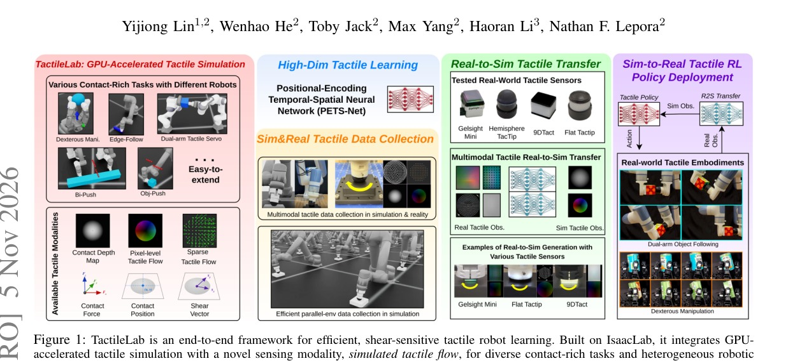

**原论文第二张关键图（Figure 2，PDF 第 4 页）**


*图号、源 PDF 和裁切位置参见 [截图 Manifest](../assets/paper-screenshots/manifest.json)。*

**读图指引**：原论文主图通常说明应用任务与主要模块；第二张重点检查数据如何进入模型、哪个环节承担物理约束、是否使用真实交互。未必所有 Figure 2 都是网络结构图，请结合原图标题阅读。

#### ⑤ 核心技术与算法细节

1. **基于刚体状态构造触觉界面。** 在已有刚体碰撞求解基础上计算局部接触几何，避免完整求解柔性传感器的高维形变。

2. **模拟触觉流。** 通过接触表面的稠密切向运动估计剪切相关光流，再结合接触深度场构造能够反映接触和滑移的低成本表示。

3. **触觉与本体联合策略。** 对长时关节历史和局部丰富触觉观测分别编码，再融合为动作条件，使策略可以响应触觉变化。

4. **真机表征对齐。** 学习或构造真实光学触觉图像到模拟流/深度场的转换，从而让不同硬件的真实传感器提供策略训练时使用的输入形式。

5. **任务部署。** 在双臂和在手操作中验证训练策略对接触/剪切反馈的利用。

#### ⑥ 完整 Pipeline（中文梳理）

```mermaid
flowchart LR
  X0["刚体接触求解"]
  X1["接触深度场+切向运动"]
  X2["模拟触觉流/历史本体感觉"]
  X3["触觉策略训练"]
  X4["真实图像转模拟表征"]
  X5["双臂/灵巧手真机执行"]
  X0 --> X1
  X1 --> X2
  X2 --> X3
  X3 --> X4
  X4 --> X5
```

#### ⑦ 实验设计与主要结果

论文在多个富接触任务中验证模拟触觉流可以用于有效策略学习，并展示双臂与灵巧手真实部署。需要分别评价 Sim/Real 触觉流分布、真实滑移响应、任务成功率与训练吞吐；它的真实感强调‘任务有用的触觉信号’而非高保真材料场重建。

#### ⑧ 方法特点与局限性

基于刚体接触推断剪切流具有高效优势，但柔性垫片内部应力、复杂滞后和非局部形变不能自动得到准确复现。真实传感器图像到模拟触觉表征的映射误差可能造成新的域偏差。

---

### 6.10 TouchTwin：以实测触觉约束手—物体的交互重放

#### ① 论文基本信息

- **原题**：TouchTwin: Scaling Human Touch Data via Real-to-Sim-to-Real
- **作者**：Huiwen Han、Nuo Chen、Ziyao Zeng、Dayou Li、Hao Wang 等
- **发表信息**：arXiv 2026-11-13（预印本）
- **研究侧重**：触觉接触力标定
- **论文**：[arXiv:2611.17619](https://arxiv.org/abs/2611.17619) · [原始 PDF](https://arxiv.org/pdf/2611.17619) · [项目主页](https://touchtwin.github.io/)
- **研究定位**：触觉接触力标定。本文不把“可以在模拟器运行”直接等同于“真实物理参数准确”。

#### ② 论文概述（根据原文 Abstract 忠实中文译述）

仅根据第一视角视频恢复人手姿态，无法确定每根手指是否接触、接触时间和作用力，因而直接模仿或视觉重放往往产生抓握力偏差。TouchTwin 使用双视角 RGB-D 与 880 个 taxel 的触觉手套数据，将人手与可交互物体重建进 MuJoCo；由编码代理构建经物理测试的对象程序，使用实测触觉驱动手指接触与闭合程度，再生成带接触/受力标注的扰动示教。作者报告重放的抓握力更接近真实，并改善接触预测及任务执行。

#### ③ 研究动机与核心问题

视频可以看到手停在哪里，却不能判断柔软手指是否继续压入、究竟施加多少夹持力。重放时仅拟合视觉位姿可能严重低估或高估力，导致外观对齐但动力学错误。

#### ④ 方法总览与原论文主图

**原论文主图（Figure 1，PDF 第 1 页）**


**原论文第二张关键图（Figure 2，PDF 第 2 页）**


*图号、源 PDF 和裁切位置参见 [截图 Manifest](../assets/paper-screenshots/manifest.json)。*

**读图指引**：原论文主图通常说明应用任务与主要模块；第二张重点检查数据如何进入模型、哪个环节承担物理约束、是否使用真实交互。未必所有 Figure 2 都是网络结构图，请结合原图标题阅读。

#### ⑤ 核心技术与算法细节

1. **同步真实采集。** 使用头部/腕部 RGB-D 与 880-taxel 触觉手套记录操作者动作及手指压力，将力学监督与画面时序关联。

2. **Agentic Real-to-Sim。** 编码代理生成可运行的 MuJoCo 物体程序，经过简单物理操作和复核确保对象关节及接触接口可执行。

3. **个体手模型重建。** 根据视频拟合手骨架和可接触几何，把触觉 taxel 映射到模拟手表面。

4. **触觉驱动重放。** 用记录的接触分布和力决定手指是否持续闭合、何时建立接触，而非仅复制可见关节终止位置。

5. **扩增及视频生成。** 对经触觉校准的重放施加对象、视角和操作条件扰动，生成保留接触/力标签的示教，再训练灵巧手策略。

#### ⑥ 完整 Pipeline（中文梳理）

```mermaid
flowchart LR
  X0["RGB-D+880-taxel真实示教"]
  X1["物体程序与手模型重建"]
  X2["按实测接触力校准重放"]
  X3["仿真扰动+视频渲染"]
  X4["带触觉标签训练/测试"]
  X0 --> X1
  X1 --> X2
  X2 --> X3
  X3 --> X4
```

#### ⑦ 实验设计与主要结果

作者在其测试设置中报告：仅模仿视觉位姿的抓力为记录值 0.31×，基于视觉的物理重放为 1.55×，触觉校准后约 0.99×；留出录像测试 20/20 成功，未见扰动 35/36 成功，接触帧漏检率从约 32% 降至 13%。这些结果是论文特定人手—物体重放任务，而非广泛跨本体真机通用性证明。

#### ⑧ 方法特点与局限性

真实触觉为隐含接触提供直接监督，但需要专用采集手套、手骨架重建及受力标定；触觉与模拟手接触几何存在不确定性，复杂多指滑动仍需测量切向力和长期接触稳定性。

---

### 6.11 RoboScape：三维深度和关键点动力学监督的物理视频世界模型

#### ① 论文基本信息

- **原题**：RoboScape: Physics-informed Embodied World Model
- **作者**：Yu Shang、Xin Zhang、Yinzhou Tang、Lei Jin、Chen Gao、Wei Wu、Yong Li
- **发表信息**：NeurIPS 2025
- **研究侧重**：物理感知世界模型
- **论文**：[arXiv:2506.23135](https://arxiv.org/abs/2506.23135) · [原始 PDF](https://arxiv.org/pdf/2506.23135) · [代码仓库](https://github.com/tsinghua-fib-lab/RoboScape)
- **研究定位**：物理感知世界模型。本文不把“可以在模拟器运行”直接等同于“真实物理参数准确”。

#### ② 论文概述（根据原文 Abstract 忠实中文译述）

现有具身视频世界模型常以 RGB 拟合为主，难以保持三维几何与接触运动一致性。RoboScape 将 RGB 视频生成与物理相关辅助任务联合训练：通过时间深度预测增强连续帧间三维几何的一致性，通过关键点动力学学习隐式编码物体形状和材料相关运动。作者在多个机器人场景中比较生成视频的视觉真实性和物理合理性，并将生成数据用于下游机器人策略训练和策略评测。

#### ③ 研究动机与核心问题

仅依据像素似然学习的视频模型可能产生物体漂移、穿透和不合理形变。为机器人生成示教时，关键不仅是‘某一帧像真的’，还要保证同一物体在时间上的空间结构和受动作影响的运动。

#### ④ 方法总览与原论文主图

**原论文主图（Figure 1，PDF 第 3 页）**


**原论文第二张关键图（Figure 2，PDF 第 4 页）**


*图号、源 PDF 和裁切位置参见 [截图 Manifest](../assets/paper-screenshots/manifest.json)。*

**读图指引**：原论文主图通常说明应用任务与主要模块；第二张重点检查数据如何进入模型、哪个环节承担物理约束、是否使用真实交互。未必所有 Figure 2 都是网络结构图，请结合原图标题阅读。

#### ⑤ 核心技术与算法细节

1. **机器人视频数据加工。** 将动作视频转换为可供训练的视觉序列与物理相关辅助标注，避免只有 RGB 重建监督。

2. **时间深度预测。** 显式预测不同时间步的三维距离结构，使生成过程受到跨帧场景几何连续性约束。

3. **关键点动力学预测。** 追踪/预测物体关键点的时序运动，迫使模型学习可用于解释接触和材料状态变化的动态信息。

4. **联合视频生成训练。** 将深度和关键点损失与视频生成目标结合，提高视觉一致性和运动合理性。

5. **下游验证。** 比较生成结果的物理/视觉指标，并在机器人策略训练与评价中检验其效用。

#### ⑥ 完整 Pipeline（中文梳理）

```mermaid
flowchart LR
  X0["机器人动作视频"]
  X1["时间深度/关键点标注"]
  X2["RGB视频生成主干"]
  X3["深度几何与关键点运动联合监督"]
  X4["生成视频/策略训练与评估"]
  X0 --> X1
  X1 --> X2
  X2 --> X3
  X3 --> X4
```

#### ⑦ 实验设计与主要结果

NeurIPS 2025 论文报告在多样机器人场景中相对对照取得更好的视觉保真与物理合理性，同时展示合成数据在策略训练和评测中的效用。不能据此把模型解释为显式质量、摩擦、接触力均准确的动力学引擎；指标仍需要结合真实任务对照。

#### ⑧ 方法特点与局限性

几何和关键点任务为视频提供有意义的物理监督，但像素和关键点的正确性不能唯一决定接触力或摩擦参数。对于难观测的接触、遮挡和长时因果反馈，仍需真正的动作重放与物理指标。

---

### 6.12 ABot-PhysWorld：利用物理偏好优化训练动作可控视频世界模型

#### ① 论文基本信息

- **原题**：ABot-PhysWorld: Interactive World Foundation Model for Robotic Manipulation with Physics Alignment
- **作者**：Yuzhi Chen、Ronghan Chen、Dongjie Huo 等
- **发表信息**：arXiv 2026-03（预印本）
- **研究侧重**：物理对齐视频世界模型
- **论文**：[arXiv:2603.23376](https://arxiv.org/abs/2603.23376) · [原始 PDF](https://arxiv.org/pdf/2603.23376) · [项目主页](https://github.com/amap-cvlab/ABot-PhysWorld) · [代码仓库](https://github.com/amap-cvlab/ABot-PhysWorld)
- **研究定位**：物理对齐视频世界模型。本文不把“可以在模拟器运行”直接等同于“真实物理参数准确”。

#### ② 论文概述（根据原文 Abstract 忠实中文译述）

视频世界模型虽能产生逼真的具身画面，但常出现物体穿透、违反重力等不合理交互。ABot-PhysWorld 提出 14B 参数的 Diffusion Transformer，基于约三百万段带物理标注的操作视频进行训练，并通过解耦物理判别器和基于 DPO 的后训练降低物理违背，同时保持视觉质量。模型设计并行上下文块注入精确空间动作，以支持跨本体控制；作者还提出 EZSbench，分别评价生成的物理合理性与动作对齐。

#### ③ 研究动机与核心问题

生成视频的两种正确性并不相同：‘物体运动符合物理’和‘视频响应指定机器人动作’。仅优化观感可能两者都不足；直接用单一 VLM 偏好打分又容易混淆外观、语义与动力学。

#### ④ 方法总览与原论文主图

**原论文主图（Figure 1，PDF 第 3 页）**


**原论文第二张关键图（Figure 2，PDF 第 4 页）**


*图号、源 PDF 和裁切位置参见 [截图 Manifest](../assets/paper-screenshots/manifest.json)。*

**读图指引**：原论文主图通常说明应用任务与主要模块；第二张重点检查数据如何进入模型、哪个环节承担物理约束、是否使用真实交互。未必所有 Figure 2 都是网络结构图，请结合原图标题阅读。

#### ⑤ 核心技术与算法细节

1. **物理数据策展。** 构建大规模操作视频数据并附加物理信息，区分合理动作结果与明显穿透、悬浮等异常。

2. **动作条件世界模型。** 使用 Diffusion Transformer 生成动作条件视频，空间动作通过专门上下文机制注入，以降低‘机器人动了但视频未执行相应物体变化’的情况。

3. **解耦物理评价。** 分离用于识别物理异常与动作对齐的评价信号，使模型不至于只优化图像清晰度。

4. **DPO 后训练。** 用物理偏好信息微调生成模型，使其偏好更符合接触、重力与任务一致性的候选序列。

5. **EZSbench 测试。** 使用训练之外的机器人、场景、任务组合分别测量物理真实性和动作跟随能力。

#### ⑥ 完整 Pipeline（中文梳理）

```mermaid
flowchart LR
  X0["大规模物理标注操作视频"]
  X1["动作条件14B DiT训练"]
  X2["物理/动作解耦判别器"]
  X3["DPO偏好后训练"]
  X4["EZSbench真实感/动作对齐评价"]
  X0 --> X1
  X1 --> X2
  X2 --> X3
  X3 --> X4
```

#### ⑦ 实验设计与主要结果

论文基于约三百万段操作片段，并在 PBench、EZSbench 等基准上与其他视频生成模型比较。作者报告物理合理性及轨迹一致性方面的改善；目前仍应将其视为生成模型的物理对齐结果，而不是已测得牛顿量纲误差的高保真模拟器。

#### ⑧ 方法特点与局限性

数据策展和后训练可能降低明显物理幻觉，但不能保证模型精确守恒动量、正确预测接触力。大模型推理成本和行动长时因果稳定性仍是部署障碍；评价需防止判别器与生成器共享偏差。

---

### 6.13 Principia：利用对象间关系检验视频模型的牛顿物理规律

#### ① 论文基本信息

- **原题**：Principia: Relational Physics Tests for Video Models
- **作者**：Varun Varma Thozhiyoor、Shivam Tripathi、Venkatesh Babu Radhakrishnan、Anand Bhattad
- **发表信息**：arXiv 2026-09（预印本）
- **研究侧重**：物理规律评价
- **论文**：[arXiv:2609.04200](https://arxiv.org/abs/2609.04200) · [原始 PDF](https://arxiv.org/pdf/2609.04200) · [项目主页](https://principiabench.github.io/)
- **研究定位**：物理规律评价。本文不把“可以在模拟器运行”直接等同于“真实物理参数准确”。

#### ② 论文概述（根据原文 Abstract 忠实中文译述）

生成视频中物体的绝对速度、尺寸或加速度往往依赖未知帧率与相机标定，难以直接评价物理正确性。Principia 提出基于成对对象的相对物理关系测试，在同一场景中比较受相同物理规律约束的两个对象，使用对标定较不敏感的图像空间一致性分数检验重力、恢复系数、摩擦、转动惯量、抛体、动量、摆和弹簧振动等八类现象。作者发现多个视频生成模型视觉质量较高，但关系物理测试得分明显偏低，VLM 对违规事件的识别也不可靠。

#### ③ 研究动机与核心问题

一个物体独自下滑看似合理，并不能判断速度是否符合物理。把两个应满足已知关系的对象放在同一画面，可能在不精确恢复米制尺度和摄像机焦距时，仍检出模型违反基本物理规律的情况。

#### ④ 方法总览与原论文主图

**原论文主图（Figure 1，PDF 第 1 页）**


**原论文第二张关键图（Figure 2，PDF 第 2 页）**

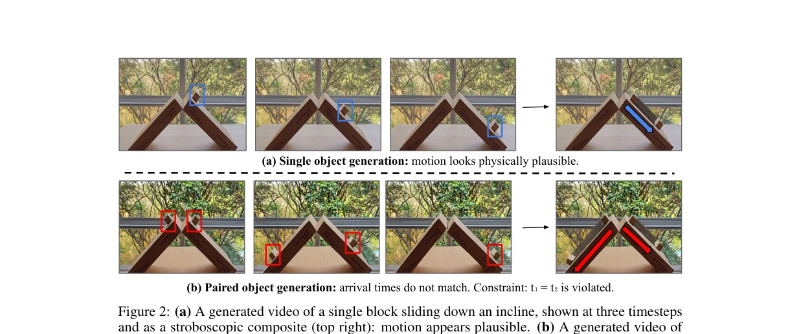

*图号、源 PDF 和裁切位置参见 [截图 Manifest](../assets/paper-screenshots/manifest.json)。*

**读图指引**：原论文主图通常说明应用任务与主要模块；第二张重点检查数据如何进入模型、哪个环节承担物理约束、是否使用真实交互。未必所有 Figure 2 都是网络结构图，请结合原图标题阅读。

#### ⑤ 核心技术与算法细节

1. **构造成对实验。** 设计同一物理规律约束下的两个对象，例如相同坡面上的不同质量物体，构成具有已知相对关系的运动。

2. **控制变量与录制。** 在真实场景下控制对象属性与环境条件，再形成文本/图像提示，减少任务设置的随意性。

3. **关系一致性度量。** 使用对象相对时序、位移和事件关系构造尽量不依赖绝对相机标定的分数，检验多个物理现象。

4. **模型与人类评测。** 对多种视频模型与视觉语言模型测试，区分生成器是否违反规律，以及 VLM 能否可靠发现违规。

#### ⑥ 完整 Pipeline（中文梳理）

```mermaid
flowchart LR
  X0["物理规律与成对对象实验"]
  X1["真实实验/受控提示构建"]
  X2["视频模型生成"]
  X3["图像空间关系测量"]
  X4["校准不敏感一致性评价"]
  X0 --> X1
  X1 --> X2
  X2 --> X3
  X3 --> X4
```

#### ⑦ 实验设计与主要结果

论文覆盖八种物理现象；在六个被测视频生成器中，Principia 最高得分不超过 0.42，而相同模型的 VBench 视觉质量在约 0.8 水平。最佳被测 VLM 的物理违规判断准确率约 67%。这些数字衡量的是该 Benchmark 上的视频关系物理一致性，不是机器人碰撞力/策略成功率。

#### ⑧ 方法特点与局限性

优势是把评价从主观好不好看转向有物理依据的相对约束；不足是实验通常需要可追踪的对象和受控情境，难完全覆盖多指接触与连续复杂控制中的隐藏力学变量。

---

### 6.14 PVBench：以对象级物理测量评价视频生成

#### ① 论文基本信息

- **原题**：PVBench: Quantifying Physical Plausibility in Video Generation with Object-Level Physical Measurements
- **作者**：Kaiwei Chen、Moran Li、Zhenye Gan 等
- **发表信息**：arXiv 2026-10（预印本）
- **研究侧重**：物理量评价
- **论文**：[arXiv:2610.26711](https://arxiv.org/abs/2610.26711) · [原始 PDF](https://arxiv.org/pdf/2610.26711) · [项目主页](https://kszg-11.github.io/PVBench-Website/) · [代码仓库](https://github.com/KSZG-11/PVBench)
- **研究定位**：物理量评价。本文不把“可以在模拟器运行”直接等同于“真实物理参数准确”。

#### ② 论文概述（根据原文 Abstract 忠实中文译述）

现有物理视频评价经常依赖粗粒度 VLM 判断，无法指出哪个对象违反了什么物理条件。PVBench 提出对象级可量化物理真实性 Benchmark，以七大领域、46 个维度和 600 组提示词覆盖语义、因果、空间几何、材料与场状态、运动持续性和守恒定律等，其中约 30% 的提示涉及机器人手臂、人形和四足等具身对象。对可测量维度，作者配合 6D 位姿、真实尺度、表面法向及守恒量残差等视觉模型，减少对单一主观评分的依赖，并以人工评价验证自动指标的一致性。

#### ③ 研究动机与核心问题

生成视频可能看似物理合理，但关节角、物体尺度、支撑关系与守恒量存在不同错误；单一二元‘符合/不符合物理’打分不能定位错误类型和量化严重程度。

#### ④ 方法总览与原论文主图

**原论文主图（Figure 1，PDF 第 2 页）**


**原论文第二张关键图（Figure 2，PDF 第 4 页）**


*图号、源 PDF 和裁切位置参见 [截图 Manifest](../assets/paper-screenshots/manifest.json)。*

**读图指引**：原论文主图通常说明应用任务与主要模块；第二张重点检查数据如何进入模型、哪个环节承担物理约束、是否使用真实交互。未必所有 Figure 2 都是网络结构图，请结合原图标题阅读。

#### ⑤ 核心技术与算法细节

1. **设计多维测试空间。** 将物理真实性拆成七大领域、46 个维度，覆盖语义一致性、因果变化、几何空间、材料与机械动力学等，不只评价某个单独运动现象。

2. **任务提示与具身条件。** 构造 600 组提示词并覆盖机器人本体、环境与交互对象，控制生成条件以便比较。

3. **对象级数值代理。** 使用物体 6D 位姿、尺度、法向、轨迹等可测量信号估计物理量，再计算守恒规律或时序一致性的数值残差。

4. **自动与人工对照。** 分别统计视频视觉质量、具体物理违规维度及自动测量与人工判断的相关性，避免单个判别器支配全部结论。

#### ⑥ 完整 Pipeline（中文梳理）

```mermaid
flowchart LR
  X0["600组提示/46维度测试设计"]
  X1["视频生成与对象追踪"]
  X2["6D位姿/尺度/法向估计"]
  X3["守恒与时序残差计算"]
  X4["多维物理合理性诊断"]
  X0 --> X1
  X1 --> X2
  X2 --> X3
  X3 --> X4
```

#### ⑦ 实验设计与主要结果

论文评估主流开源与闭源视频生成器，提供基准提示词及测量/标定流程，并通过人工评价检查自动指标的一致性。600 组提示中约 30% 涉及具身智能；它仍属于视频生成物理合理性评价，不能直接代替机器人动力学模型的扭矩、接触力、物体加速度重放误差。

#### ⑧ 方法特点与局限性

优点是细粒度、可追踪到物体与物理量；但所有视觉估计器都有深度、尺度、遮挡与时间采样误差，指标反映的仍是估计的物理一致性。用于 Sim-to-Real 时，应与真实传感器时间同步的状态/力测量联合使用。

---

### 6.15 技术路线横向比较：差别在哪里？

| 路线 | 实际学习或校准对象 | 物理约束形式 | 需要真实交互？ | 最直接的验证方式 |
|---|---|---|---|---|
| PhysX-3D / PhysX-Anything | 物体结构与物理属性标签 | 物理语义、关节和资产格式 | 可选；主要依赖标注/图像 | 资产可运行、属性估计与真实参数的误差 |
| Scalable Real2Sim | 物体几何、碰撞、惯性参数 | 机器人运动学和力矩响应 | **需要** | 惯性辨识误差、真实动作动力学重放 |
| 物理一致场景重建 | 物体位姿、接触/支撑关系 | 接触图与可微稳定性 | 真实 RGB-D；可补充扰动 | 释放后稳定性、真实操作位姿误差 |
| Contact-Aware Neural Dynamics | 带接触条件的前向动力学 | 接触事件与预测历史 | **需要少量真实触觉** | 接触事件准确率、状态预测漂移、任务成功率 |
| Few-Shot Neural Differentiable Simulator | 接触刚体前向模型及梯度 | 解析先验 + GNN + 代理梯度 | **少量真实轨迹** | 重放误差、优化收敛与真机转移 |
| PhysTwin / SoMA | 柔性体状态与材料响应 | 弹簧—质点/动作条件神经动力学 | **需要真实形变视频** | 未见动作下的形变场/多视角/长期误差 |
| Alloy | 多材料数值求解系统 | 各材料求解器与耦合接口 | 不一定 | 守恒/闭式解验证 + 真实多材料重放 |
| TactileLab / TouchTwin | 剪切触觉或接触力 | 触觉流/实测接触分布 | 需要真实触觉作对齐或验证 | 受力误差、接触时刻、滑移识别及真机任务 |
| RoboScape / ABot-PhysWorld | 动作条件视频中的物理表征 | 深度/关键点约束、物理偏好 | 需要物理标注或真实视频 | 视觉-动作一致、物理异常与真实任务 |
| Principia / PVBench | 视频物理违背的测量方法 | 关系约束、对象级数值残差 | 真实实验可用于校准 | 物理测试得分、人工判断一致性 |

#### 6.15.1 关键范式转换

1. **从物理标签到物理辨识。** PhysX-Anything 解决“快速生成可运行资产”，Scalable Real2Sim 解决“通过机器人真实运动测量部分物理参数”。两者互补而不能互相替代。
2. **从校准少数参数到学习残差状态转移。** Contact-Aware Neural Dynamics 把高维、接触切换误差交给触觉约束的神经预测；Few-Shot Neural Differentiable Simulator 则将解析模拟先验与可微学习结合。
3. **从只看 RGB 到接触/力的显式监督。** TouchTwin 的真实测力表明即使手指视觉姿态接近，也可能有巨大的抓力偏差。
4. **从单一材料引擎到场景级耦合。** Alloy 扩展多材料的系统接口，却不能仅靠吞吐量证明真实接触准确性。
5. **从看起来合理到可量化物理测试。** Principia 通过相对关系，PVBench 通过对象级数值代理，把物理真实性从审美问题转为可测量问题。

#### 6.15.2 与原有章节的关系

- **第三章 SPARR**：它优化真实域的**残差策略**，并非提高仿真器本身的物理参数或动力学模型；[阅读原文](chapters/03-physics.md)。
- **第三章 PIN-WM**：以少量真实观测进行物理参数辨识，再构造 Digital Cousins；与本章的 Scalable Real2Sim、Contact-Aware Dynamics 形成“显式参数—隐式动力学”对照。
- **第三章 SoMA**：专注机器人动作条件的柔性物体神经仿真，与本章 PhysTwin 的逆向物理重建和 Alloy 的多材料系统设施互补。
- **第二章 SimFoundry / EmbodiedGen V2 / TabletopGen**：侧重生成式可交互场景；本章主要审查生成资产与真实交互的物理一致性。

### 6.16 如何建立可信物理真实性评价体系？

为了判断仿真数据是否真正可信，至少分三层评价：

**(A) 资产和场景层**

- 公制尺度与碰撞几何误差；关节轴/自由度是否与实物一致；
- Mass / inertia / friction 的误差与置信范围；静态场景有无穿透、悬浮、支撑错误；
- 导出 URDF/MJCF 后能否稳定加载、可控执行。**可加载率不是物理保真度。**

**(B) 交互状态转移层**

在相同真实初态和记录动作条件下进行离线状态重放，并明确机器人控制器及时间同步误差：

$
E_{\mathrm{replay}} =
\frac{1}{T}\sum_{t=1}^T
d(s_t^{\mathrm{sim}},s_t^{\mathrm{real}}).
$

其中 $d$ 不应未经量纲归一就将位置、姿态、受力和离散接触事件简单求和。推荐分别报告平移误差（m）、旋转误差（度）、接触时刻误差（ms）、接触分类 F1、滑移速度误差（m/s）、抓握力/法向力误差（N）。有柔性物体时添加形变点云/关键点距离与长期预测偏移。

**(C) 下游迁移层**

$
G_{\mathrm{perf}}=
\left|\operatorname{SR}_{\mathrm{sim}}(\pi)-
\operatorname{SR}_{\mathrm{real}}(\pi)\right|.
$

报告真实成功率时须列出本体、任务、初始状态变化、试验次数、环境重置方式，并区分**零样本 Sim-to-Real**、**使用真实数据校准后的迁移**和**真实在线 RL 适配后的结果**。与第 1 章的 Reality Gap 定义相呼应：动态模型逼近和任务性能改善是不同目标。

#### 6.16.1 最有价值的消融设计

| 消融对照 | 控制变量 | 应观测的增益 |
|---|---|---|
| 仅视觉几何 vs 增加物理属性预测 | 固定几何/动作，改变物理参数来源 | 真实运动重放与接触误差 |
| 随机参数 vs 实测/辨识参数 | 相同模拟与真实任务集 | 接触精度与真实成功率 |
| 无触觉 vs 触觉监督 | 固定模拟规模、真实交互预算 | 接触事件与抓力误差 |
| 解析求解 vs 神经残差 | 相同真实轨迹划分与初态 | 多步状态误差/接触长尾场景 |
| 不用物理筛选 vs 物理筛选 | 相同生成数量及训练步数 | 生成视频的一致性与真实策略收益 |

**研究判断：** 面向真实机器人操作，优先建设任务相关的 Physical Fidelity Benchmark 可能比追求通用的视频物理评分更有价值。最有前景的组合是：可执行显式物理先验 + 少量真实交互校准 + 接触/触觉约束的神经动力学 + 量纲明确的物理误差评估。这个判断属于跨论文分析，不能当作任意一篇论文已经充分证明的实验结论。

### 6.17 阅读建议

建议先按以下顺序精读原文：**Scalable Real2Sim → Contact-Aware Neural Dynamics → Few-Shot Neural Differentiable Simulator → PhysTwin → TactileLab/TouchTwin → Principia/PVBench**。这样依次建立物理参数的可辨识性、接触动力学、柔性状态、触觉监督和物理量评价的完整认识。

图示均来自对应论文 PDF 的 Figure 1/2 截取，若某论文 PDF 特殊版式尚未取得稳定截图，则只放原始 PDF 链接，并注明缺失原因；不能把作者官网 Teaser 或中文 Mermaid 误标为原论文方法架构图。新增论文均保留其真实发表状态，不采用“证据等级”评级。

## 7. 四条主路线与数据协同的综合比较

| 分类 | 代表方法 | 主要成本 | 数据/环境的必要条件 | 应当优先检查的问题 |
|---|---|---|---|---|
| Sim-Ready 可交互场景自动生成 | TabletopGen、EmbodiedGen V2、SimFoundry | 文/图/实景视频输入、生成资产/姿态/物理验证及策略评测 | 需要米制尺度、碰撞体、任务交互关系 | 可执行布局、接触准确性、真机迁移和仿真评测相关性 |
| 可交互视觉数字孪生 | GSWorld、RE³SIM | 场景扫描、三维重建、几何/相机标定 | 有可重复操作场景、URDF/碰撞资产 | 重建尺度及手眼配准是否正确 |
| 机器人条件视频生成 | RoboRender | 真实视频预训练、扩散生成推理 | 已有可执行模拟轨迹和动作标签 | 新 RGB 与原深度、动作是否一致 |
| 真实域残差策略 | SPARR | 安全的真实在线交互/RL | 仿真先验可在真机部分成功 | 真机反馈与安全边界是否充分 |
| 神经可变形动力学 | SoMA | 真实交互视频、多视角训练 | 柔性物体和准确动作同步 | 长期漂移和未见接触误差 |
| 物理参数辨识 | PIN-WM | 少量真实交互、可微仿真 | 刚体动作/接触观察 | 可辨识参数是否唯一、扰动合理性 |
| 自动化专家程序 | RoboTwin 2.0 | 任务资产/模拟器/专家验证 | 有可计算的成功和失败条件 | 自动专家是否在真实物理下有效 |
| 生成式轨迹扩展 | RoboDream | 生成模型、运动先验 | 可追溯原机器人轨迹 | 新物体与原动作相容性 |
| 无动力学数据合成 | Real2Render2Real | 手机扫描、六自由度追踪与逆运动学 | 任务以运动学为主 | 未模拟的碰撞/接触是否关键 |
| 示教数据筛选 | SCIZOR | 自监督进度和联合表示 | 已有混合质量示教 | 是否误删有意义的等待/恢复 |
| 主动生成与联合训练 | MetaGenSim、Sim-and-Real Co-Training | 真实示教、参数化模拟任务、训练预算 | 任务/动作接口有共同结构 | 有无负迁移、数据边际效用如何 |

## 8. 研究方向判断与尚待解决的问题

**可执行场景生成方向**：TabletopGen、EmbodiedGen V2、SimFoundry 依次强调实例/布局对齐、通用 Sim-Ready 世界构建、真实视频数字孪生与 Digital Cousins；应同时检查资产物理接口、任务可执行性、轨迹有效覆盖和真机评测的相关性。

**视觉方向**：今后的主要分歧不在于能否生成照片级画面，而在于可执行几何、渲染图像与动作标签能否共同保持一致。闭环数字孪生与生成式渲染并非替代关系：前者负责稳定的世界状态，后者负责外观多样性。

**物理方向**：新增第 6 章讨论物理资产、接触动力学、触觉/多材料和物理世界模型。真实残差 RL 与可微/神经物理建模解决不同问题。前者可以在真实执行中“补偿”误差，后者试图让模拟器更接近真实运动后果；对精密装配和柔性物体，不应预设有一条全领域最优路线。

**轨迹方向**：自动专家、生成式视角/物体扩展和数据筛选应联合考虑。更需要报告有效任务/技能覆盖、轨迹可执行性、动作标签一致性和下游真实任务收益，而不是仅比较轨迹总条数。

**Sim/Real 协同**：增加仿真占比会提高训练数据的统计权重，但未必增加对目标真实任务有用的信息。主动优化模拟器的生成条件可能比寻找一个“通用固定数据比例”更有研究意义。上述判断属于跨论文综合分析，并非某篇论文的单独实验结论。

## 9. 阅读说明与图源使用

1. **摘要译述**：各小节概述忠实覆盖作者 Abstract 的问题、方法与结果，但中文句式经过自然整理；不是英文全文逐句排版。需要严格逐句核对时，使用每篇“论文基本信息”中的原文链接。
2. **原论文图片**：29 篇论文的 58 张原始 PDF 截图已全部存入 `assets/paper-screenshots/` 并直接内嵌，包含原文 Figure 编号与 PDF 页码。作者官网原图素材保留在 `assets/paper-figures/` 作为旧版备份。
3. **中文重绘图**：`assets/methods/` 中 15 张 SVG 可直接被 GitHub 渲染，若作者原图远程失效仍可正常阅读。所有中文图均依据论文公开信息重新整理，不冒充论文 Figure 1。
4. **资料时点**：论文和代码开源状态按 2026-11-20 记录，后续可能变化。RoboDream 有公开代码；MetaGenSim 的代码当时仍标注 coming soon。
5. **复用与版权**：作者原图版权属于各自作者及原版权方；学术引用请保留名称、来源和相关许可声明。仓库中的中文流程重绘是为阅读辅助而制作。

详细论文索引另见 [papers/catalog.csv](../papers/catalog.csv)，原图链接总表见 [figures/README.md](../figures/README.md)。
