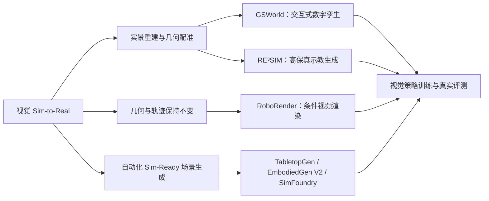
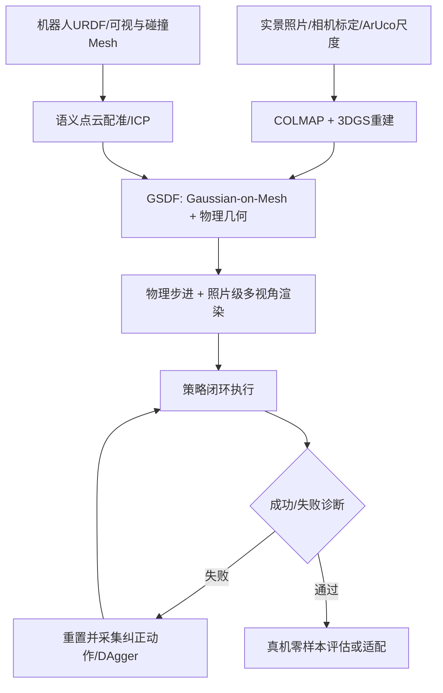
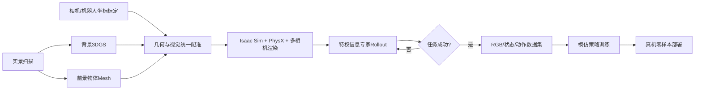
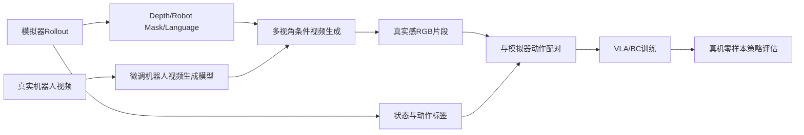
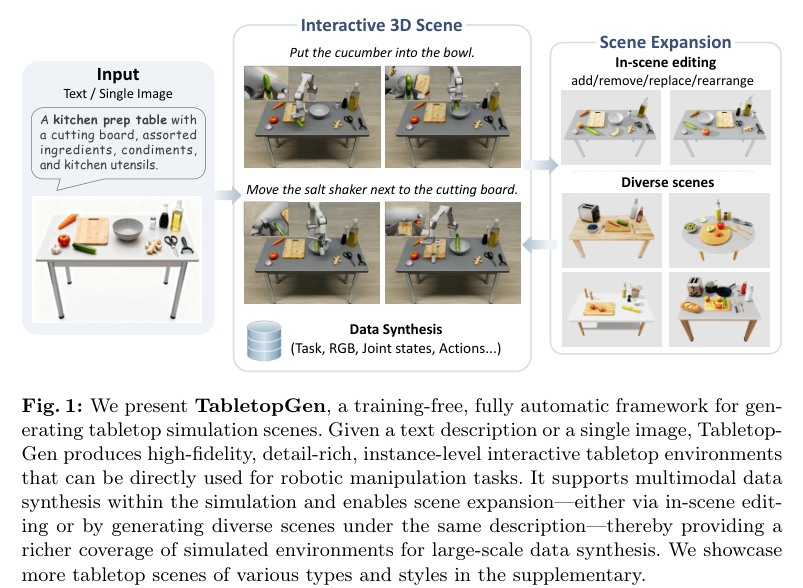
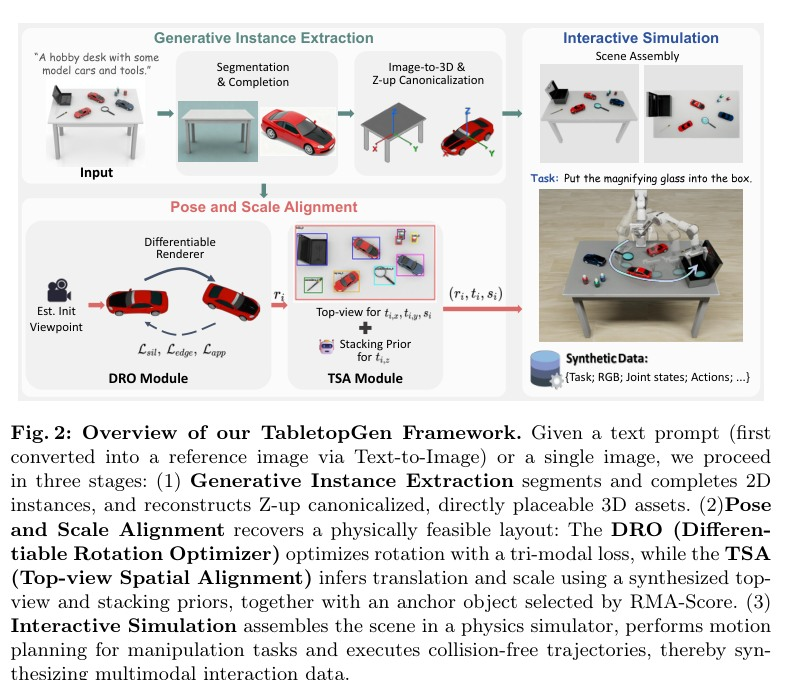
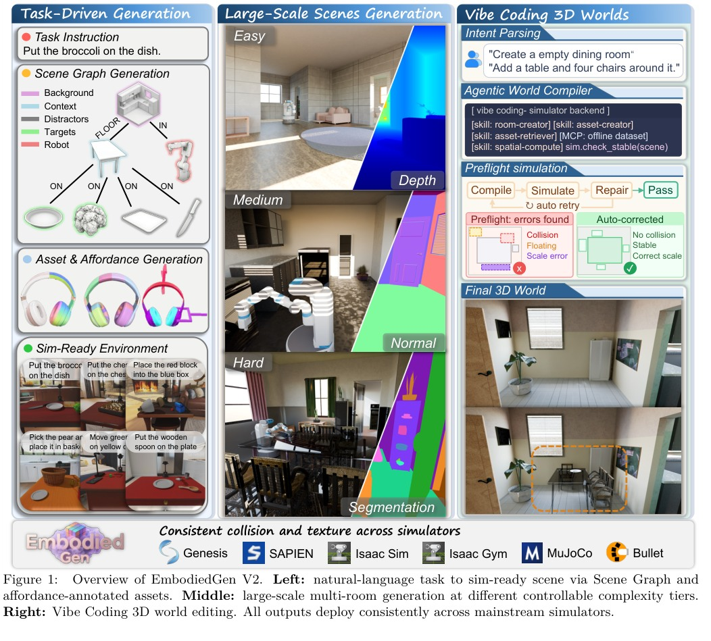
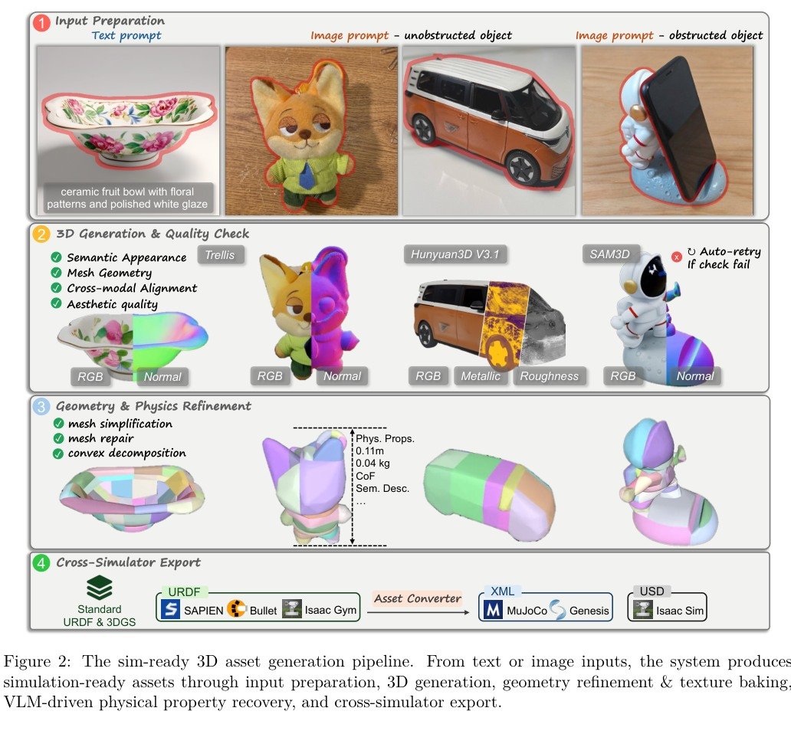
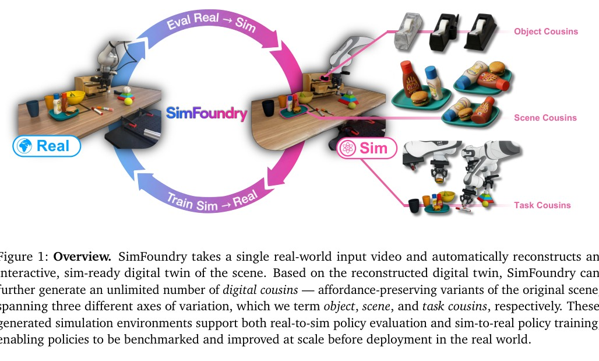
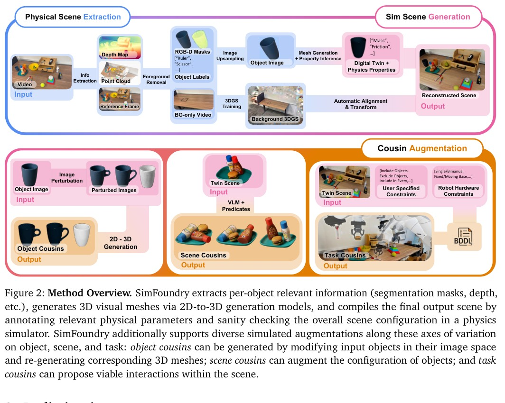

# 2. 视觉真实性：从“逼真图像”到可执行、可监督的数字世界

视觉域差异既包括纹理/光照/遮挡这样的外观差异，也包括相机内外参、物体尺度、几何遮挡和机器人与场景配准这样的结构差异。视觉 Sim-to-Real 的训练对象并非静态图片，而是观测—动作序列，因此还必须检查**跨视角一致性、时间连续性、运动几何与动作标签的一致性**。本章按“可交互数字孪生 → 实景重建数据生产 → 生成式视频渲染 → 自动化可执行世界构建”的技术发展展开。

## 2.0 技术路线总览：代表工作与核心差异

**本章研究主线。** 视觉 Sim-to-Real 的目标并非单纯提高图像的照片级真实感，而是使真实相机观测与仿真中的**物体位置、机器人构型和动作监督**形成一致的对应关系。可以把这一问题拆为两层：第一层是“场景几何与坐标是否正确”，第二层是“从相同几何和机器人运动出发，RGB 图像是否足够接近真实环境”。前者决定像素观测能否对应正确的抓取/操作位置，后者影响视觉策略对材质、照明和背景变化的泛化。

本章先以三篇论文介绍实景重建和条件视频渲染，再补充三篇 Sim-Ready 可交互场景生成工作。四条路线分别从实景数字孪生、数据生产、视频渲染和自动化场景构建切入：

| 技术路线 | 代表论文 | 核心思路与方法流程 | 主要解决的问题 | 适用边界 |
|---|---|---|---|---|
| **可交互照片级数字孪生** | **GSWorld（§2.1）** | 多视角实景采集 → 3DGS/GSDF 资产与机器人几何配准 → 物理引擎闭环执行、照片级渲染 | 同时得到接近真实的观测和可交互的仿真状态，用于策略训练、DAgger 与评测 | 仍需场景标定、碰撞资产和物理参数；图像逼真不自动代表接触精确 |
| **结构化 Real-to-Sim 数据生成** | **RE³SIM（§2.2）** | 前景可碰撞 Mesh + 背景 3DGS → 相机与机器人坐标对齐 → 仿真专家轨迹采集 → 模仿学习 | 在真实场景几何约束下批量生成可直接用于视觉操作策略的训练数据 | 依赖目标场景重建与配准；特权专家和物理引擎仍可能引入动作偏差 |
| **几何约束的生成式视觉迁移** | **RoboRender（§2.3）** | 先在模拟器采集深度、机器人 Mask 和动作 → 条件视频生成器合成真实感多视角 RGB → 与原动作标签配对训练 | 在保持仿真运动轨迹的同时扩大纹理、背景和真实视觉分布覆盖 | 生成器使用真实视频训练；需检验生成画面与原动作、接触状态的一致性 |
| **可执行三维世界自动生成** | **TabletopGen / EmbodiedGen V2 / SimFoundry（§2.4）** | 图像/任务/视频 → 生成或重建逐实例三维资产 → 几何与物理约束 → 形成 Sim-Ready 场景并扩增 | 自动化产出可以执行任务、采集轨迹及评测策略的仿真世界 | 视觉逼真和场景稳定不能替代真实接触参数辨识 |

**前三篇的关键区别是“修改哪一部分”。** GSWorld 和 RE³SIM 优先构建与真实环境对齐的**可执行场景**，前者更强调统一的闭环数字孪生系统，后者更强调从真实场景重建到可用示教的生产链路；RoboRender 则通常**保留模拟器的几何和动作，仅改变渲染外观**。因此，它们是不同层面的能力，可以组合使用，却不能单凭 PSNR 或照片真实感判断哪条路线的真机操作性能更好。

**阅读重点：** 下文重点关注每篇论文的视觉输入来源、空间标定方式、可交互性、生成图像与动作标签的对应关系，以及真机评测是否真正证明迁移有效；这几项比笼统的“渲染质量更高”更有区分力。

---

## 2.1 GSWorld：闭环照片级机器人模拟器

### ① 论文基本信息
- **原题**：GSWorld: Closed-Loop Photo-Realistic Simulation Suite for Robotic Manipulation
- **作者/机构**：Guangqi Jiang 等；UC San Diego、UCLA、Meta。
- **发表**：ICRA 2026；[论文（arXiv）](https://arxiv.org/abs/2510.20813)｜[IEEE 记录](https://doi.org/10.1109/ICRA57385.2026.11697084)｜[官方项目](https://3dgsworld.github.io/)｜[GitHub](https://github.com/luccachiang/GSWorld)。

### ② 论文概述（根据原文 Abstract 忠实中文译述）
GSWorld 提出一种把三维高斯泼溅（3DGS）与物理引擎结合的照片级机器人操作模拟器。作者强调建立一个闭环开发环境：一方面，对从真实机器人数据学到的策略进行可复现评估；另一方面，在不额外使用真实机器人训练数据的情况下，直接生成可用于 Sim-to-Real 的数据。为兼顾渲染、机器人结构与物体几何，工作提出 GSDF（Gaussian Scene Description File）资产格式，将 Gaussian-on-Mesh、机器人 URDF 与场景物体统一管理；同时形成涵盖三类机器人本体、四十余种物体的资产库。作者展示了视觉模仿学习的零样本迁移、DAgger 自动纠错、仿真基准评测、虚拟遥操作以及视觉强化学习等应用。

### ③ 研究动机与核心问题
纯 3DGS 重建可以让相机图片接近真实世界，但无法提供碰撞、物体可操作状态和下一步动作反馈；传统物理仿真虽可交互，却又存在明显的纹理、光照和场景几何偏差。因此，论文追求的不是“渲染最美”的静态场景，而是**照片级反馈和真实动作接口在同一个模拟系统内闭环运行**。它在研究对象上更接近可执行数字孪生，而非单纯的数据增强器。

### ④ 方法总览与原论文截图

下列图片均是从[原论文 PDF](https://3dgsworld.github.io/resources/gsworld.pdf)直接裁切的**原始论文图**，已保存于本仓库，非 AI 生成或重新绘制。引用时请注明论文 Figure 编号。

**主图｜Figure 1：可执行 3DGS 数字孪生的总体能力**

*原论文 Figure 1，PDF 第 1 页。[查看原文对应页](https://3dgsworld.github.io/resources/gsworld.pdf#page=1)。*

**方法/架构图｜Figure 2：GSDF 场景资产及物理仿真接口**

*原论文 Figure 2，PDF 第 3 页。[查看原文对应页](https://3dgsworld.github.io/resources/gsworld.pdf#page=3)。*

**读图重点：** 主图显示实景场景重建和策略应用；第二张图展示 GSDF 与物理、视觉渲染的具体关系。

*图号、原论文 URL 及 PDF 截取坐标记录在 [截图来源清单](../../assets/paper-screenshots/manifest.json)。详细中文 Pipeline 见下一节。*

### ⑤ 核心技术与算法细节
**步骤一，真实场景尺度恢复。** 使用多视角采集、COLMAP 相机位姿估计和 ArUco 尺度基准，训练具有公制尺度的 3DGS；这一步解决“图片相似但实际米制尺寸不正确”的问题。官方脚本提供 COLMAP/GS 训练及资产导出接口。

**步骤二，机器人与环境联合表示。** 从 URDF 可视 Mesh 中采样有语义的机器人点云，将它与重建的场景点云对齐，先做人工初始配准，再使用 ICP 精调；通过机器人 link 信息保留可操纵部件语义。Gaussian 用于外观渲染，碰撞几何与关节约束仍交给物理系统处理，避免将 3DGS 本身当作可碰撞物理体。

**步骤三，GSDF 资产封装。** GSDF 在同一场景描述中组织 3DGS、Gaussian-on-Mesh、URDF/物体几何和坐标变换，使视觉渲染和物理交互能够持续同步。

**步骤四，闭环数据生产与策略学习。** 在模拟器中运行像素输入、动作输出的策略，实时产生下一帧观测；还支持将失败状态重置并重规划，在 DAgger 流程中采集纠正动作。它的“闭环”主要指训练、测试、定位失败与再采样都在可执行仿真内完成，并不等价于已经消除接触物理误差。

**数据接口与前提。** 需要真实场景的多视角扫描、机器人 URDF、机器人与物体的几何资产及校准结果。初始建模、相机/手眼标定和碰撞属性仍会影响最终精度。

### ⑥ 完整 Pipeline（中文重绘）

### ⑦ 实验设计与主要结果
作者展示 FR3、xArm6 等设置下的模拟数据生产，以及零样本视觉模仿学习、视觉 RL、DAgger 和策略模拟评估。研究目标是说明一套系统可以同时支持多种训练/评测工作流，而不是通过统一的任务集证明它对所有接触任务都优于 PhysX、MuJoCo 或其他引擎。评价时应把图像外观、动作接口匹配、任务成功率和物理精度分别记录。

### ⑧ 方法特点与局限性
**特点**：把几何/视觉资产与物理引擎连接成真正可执行的照片级场景；支持数据闭环，不仅输出离线图片。**局限**：每个目标场景仍有扫描、配准、资产清理与参数辨识成本；精细接触、摩擦和柔性物体的准确性不由 3DGS 保证；其优势在闭环系统能力，不能简单理解为 3DGS 提升了全部策略性能。

---

## 2.2 RE³SIM：前景几何与背景外观共同对齐

### ① 论文基本信息
- **原题**：RE³SIM: Generating High-Fidelity Simulation Data via 3D-Photorealistic Real-to-Sim for Robotic Manipulation
- **作者/机构**：Xiaoshen Han 等；上海交通大学、上海人工智能实验室、香港大学。
- **发表**：ICRA 2026；[论文](https://arxiv.org/abs/2502.08645)｜[IEEE 记录](https://doi.org/10.1109/ICRA57385.2026.11695858)｜[官方项目](https://re3sim.github.io/)｜[GitHub](https://github.com/InternRobotics/Re3Sim)。

### ② 论文概述（根据原文 Abstract 忠实中文译述）
机器人真实世界数据昂贵，需要有经验的操作人员和硬件；仿真具有规模优势，但几何与视觉失配常阻碍策略迁移。RE³SIM 为此提出照片级的 Real-to-Sim 系统，使用三维重建和神经渲染还原真实操作场景，使基于物理的模拟器能够实时渲染不同摄像机视角。作者借助仿真内的特权状态高效采集专家示教，并通过模仿学习训练策略，在多类机器人操作任务中验证 Real-to-Sim-to-Real 流程。仅利用合成训练数据，论文报告平均超过 58% 的真实机器人零样本成功率；进一步扩展模拟数据规模，在不同物体间训练更具泛化性的策略。

### ③ 研究动机与核心问题
将真实环境的照片“贴”到模拟器背景上远远不够。机械臂/物体的几何大小、坐标系和相机视角只要有误差，就会造成训练时的抓取像素与真实操作位置不一致。RE³SIM 的研究重点是**将前景可碰撞几何与背景视觉重建分开处理、再统一配准到真实机器人的几何坐标系**。

### ④ 方法总览与原论文截图

下列图片均是从[原论文 PDF](https://arxiv.org/pdf/2502.08645)直接裁切的**原始论文图**，已保存于本仓库，非 AI 生成或重新绘制。引用时请注明论文 Figure 编号。

**主图｜Figure 1：实景任务与 Real-to-Sim-to-Real 系统**

*原论文 Figure 1，PDF 第 1 页。[查看原文对应页](https://arxiv.org/pdf/2502.08645#page=1)。*

**方法/架构图｜Figure 2：前景 Mesh、背景 3DGS 和专家轨迹生产方法**

*原论文 Figure 2，PDF 第 3 页。[查看原文对应页](https://arxiv.org/pdf/2502.08645#page=3)。*

**读图重点：** 主图概括实景任务及仿真生成效果；方法图给出前景重建、背景渲染、真实坐标对齐和专家采样流程。

*图号、原论文 URL 及 PDF 截取坐标记录在 [截图来源清单](../../assets/paper-screenshots/manifest.json)。详细中文 Pipeline 见下一节。*

### ⑤ 核心技术与算法细节
**步骤一，场景解耦重建。** 将需要碰撞和抓取的操作对象恢复为显式 Mesh，将静态场景背景重建为 3DGS；这样不必用单一表示承担视觉和动力学两类相互矛盾的职责。

**步骤二，几何尺度与坐标对齐。** 利用真实机器人、相机内外参和标记物对目标场景配准；将前景 Mesh、背景 Gaussian、机器人模型映射到共同世界坐标系，必要时通过 ICP 等几何配准细化。偏差会直接转化为抓取与放置的坐标误差。

**步骤三，可执行仿真。** 在 NVIDIA Isaac Sim / PhysX 中保留真实的机器人结构、物体碰撞和运动学约束，使用 3DGS 合成多摄像机 RGB 观测。相同相机配置用于记录仿真动作与视觉观测，保障训练与部署的视觉接口尽量一致。

**步骤四，特权专家数据生成。** 使用仿真中精确可用的物体位姿、目标位姿和机器人状态，运行专家策略完成任务；保存成功的轨迹，过滤失败的 Rollout，再用这些带动作标签的数据训练模仿学习策略。这一设计通过“仿真特权状态生成专家、像素策略学习执行”降低真实遥操作需求。

**步骤五，扩增与联合训练。** 工作考察生成数据规模与成功率之间的关系，并对真实与仿真轨迹的轨迹长度、运动风格差异进行讨论。视觉接近并不等于动作统计分布完全一致。

### ⑥ 完整 Pipeline（中文重绘）

### ⑦ 实验设计与主要结果
作者选取四类真实操作任务，报告仅使用仿真示教训练的平均零样本成功率超过 58%。项目页还展示 3DGS 背景的 PSNR/SSIM 对比、任务级数据采集效率（在 8 张 RTX 4090 上，按任务生成 100 条轨迹通常需数分钟至十余分钟），并分析扩大样本规模后的饱和效应。上述指标来自不同实验设置，不能将“重建质量好”直接等同于“动作动力学完美”。

### ⑧ 方法特点与局限性
**特点**：系统性处理前景几何、背景外观、相机配准和示教采样流程；提供较直接的零样本真实测试。**局限**：固定场景依赖建模/校准；特权专家的成功轨迹不包含全部失败/纠错行为；每个新场景重建的人工与算力成本不能忽略；物理参数误差依旧会残留。

---

## 2.3 RoboRender：保持轨迹条件的生成式视觉 Sim-to-Real

### ① 论文基本信息
- **原题**：RoboRender: Robot-Oriented Video Generation for Visual Sim-to-Real Transfer
- **作者/机构**：Huang Huang 等；Stanford University、NVIDIA、Microsoft Research。
- **状态**：2026 年 10 月 arXiv 预印本；[论文](https://arxiv.org/abs/2610.09254)｜[官网](https://robo-render.github.io/)｜[GitHub](https://github.com/robo-render/RoboRender-Video-Model)。

### ② 论文概述（根据原文 Abstract 忠实中文译述）
仿真能够低成本产生大量机器人轨迹，但模拟图片与真实图片的视觉差异常导致策略部署失败。既有方法采用中间视觉表征可能损失语义，或者在部署时引入额外感知模块。RoboRender 提出将模拟轨迹直接转换为真实感 RGB 视频：模型以深度视频、语言指令及机器人 RGB Mask 为条件，尽量保持原模拟器几何、机器人运动和动作标签，同时生成逼真的材质、背景和干扰物；再将生成视频与模拟器的状态及动作配对训练策略。在视频生成测试中，它优于深度条件生成基线；在抓放、关节物体和移动操作的真实机器人测试中，生成数据训练的策略平均成功率达到 71%，分别约为原始仿真渲染和传统视觉随机化的 7.1 倍及 3.6 倍。增加每条模拟轨迹生成的视频数量还能继续提升开门类任务表现。

### ③ 研究动机与核心问题
渲染器的真实感与模拟器的运动学/动作正确性可以拆开优化：模拟器负责“机器人在哪里、做了什么”，视频生成器负责“应该以怎样的真实 RGB 外观呈现”。不同于对每一帧独立做风格迁移，视频级生成必须保证**同一场景多摄像机视角一致、机器人外形不发生幻觉以及动作标签不因视觉合成而失效**。

### ④ 方法总览与原论文截图

下列图片均是从[原论文 PDF](https://arxiv.org/pdf/2610.09254)直接裁切的**原始论文图**，已保存于本仓库，非 AI 生成或重新绘制。引用时请注明论文 Figure 编号。

**主图｜Figure 1：模拟视频转换成逼真机器人物理操作视频**

*原论文 Figure 1，PDF 第 1 页。[查看原文对应页](https://arxiv.org/pdf/2610.09254#page=1)。*

**方法/架构图｜Figure 2：深度、机器人 Mask 与多视角视频生成模型**

*原论文 Figure 2，PDF 第 3 页。[查看原文对应页](https://arxiv.org/pdf/2610.09254#page=3)。*

**读图重点：** 主图展示 Sim-to-Real 生成效果；模型图说明深度、机器人 Mask、语言和多视角条件的融合。

*图号、原论文 URL 及 PDF 截取坐标记录在 [截图来源清单](../../assets/paper-screenshots/manifest.json)。详细中文 Pipeline 见下一节。*

### ⑤ 核心技术与算法细节
**步骤一，建立机器人专用的视频生成器。** 项目将 Wan2.1-T2V-1.3B 适配成机器人视频渲染模型，并用约 13 万条真实机器人操作片段微调（官网列出 AgiBot-World-Alpha 和 DROID 来源）。真实样本用于**训练渲染器**，因此“策略零样本迁移”不代表整个系统没有使用任何真实数据。

**步骤二，定义强条件输入。** 模拟器先生成动作 (a_{1:T})、深度视频、机器人 RGB Mask，并提供语言描述；生成器围绕几何/本体条件改变材质、背景、干扰物等视觉因素。控制输入必须来自模拟轨迹，以避免在生成图片时顺带改动机器人动作。

**步骤三，多视角与长时程生成。** 项目采用多视角联合 latent，而非分别生成每个相机再拼接，减少跨相机物体身份不一致。长视频按片段自回归生成，后续片段条件化于前一片段的末帧，从而突破固定生成窗口。

**步骤四，合成监督数据。** 输出真实感 RGB 与原仿真动作/状态配对；动作标签不因新生成的场景外观而改变。评估应额外检查物体相对位置、接触状态、光学假影和长时漂移，因为“标签未改变”不保证“生成像素与标签严格一致”。

**步骤五，推理成本优化。** 项目提到通过 TeaCache 重用去噪特征，以及 DMD2 步数蒸馏加速多视角生成；这是扩大数据生产的工程关键，但它改变的是计算成本，不是物理仿真能力。

### ⑥ 完整 Pipeline（中文重绘）

### ⑦ 实验设计与主要结果
作者报告真实机器人抓放、关节物体操作及移动操作任务的平均成功率为 71%，与原始仿真渲染（约 10%）和视觉随机化（约 20%）比较，对应约 7.1× 与 3.6× 的相对改善。论文另有“增加每条模拟轨迹生成视频数量”的扩增消融，特定开门任务增加 65 个百分点。需区分视频模型生成质量与真实机器人任务成功率；两者不是同一指标。

### ⑧ 方法特点与局限性
**特点**：可直接构造 RGB-动作配对数据；几何条件和多视角生成比无约束图像生成更适合机器人视频。**局限**：渲染器依赖真实视频预训练；扩散生成成本可观；接触瞬间、反射与遮挡可能造成视觉—动作标签不一致；目前是较新的工作，真实测试的任务覆盖尚不能代表通用结论。

---

## 2.4 生成式可交互仿真环境构建：从视觉三维内容到 Sim-Ready World

传统场景重建和生成式三维内容工具通常分别解决“外观是否像真实世界”和“能否生成一个三维模型”。机器人学习还要求另一组条件：**真实公制尺度、可碰撞几何、物理与关节属性、任务相关的可交互对象、可达的场景布局，以及能在模拟器中运行的观测—动作闭环**。因此，本节将 Simulation-Ready 3D Scene/World Generation 作为视觉真实感与物理可用性之间的一条**上游基础设施路线**，而非将它简单等同于“生成更漂亮的场景图”。

### 2.4.0 技术路线总览：三篇论文分别解决哪一层

| 代表工作 | 关键输入 | 主攻问题 | 生成对象与技术路径 | 下游验证及边界 |
|---|---|---|---|---|
| **TabletopGen（§2.4.1）** | 文本或单张真实/合成图像 | 稠密桌面场景中，单实例三维资产和物体尺度/旋转/支撑关系如何同时正确 | 逐实例补全与 Image-to-3D → DRO 旋转优化 → TSA 俯视图与堆叠先验对齐 → Isaac Sim 场景 | 以自动化桌面操作数据和真实机械臂迁移验证；主要适用于典型桌面而非多层家具 |
| **EmbodiedGen V2（§2.4.2）** | 文本、图片、任务指令、增量编辑指令 | 生成的 3D 模型如何成为有交互语义、可导出、可编辑、可执行的世界 | 资产质量门控、碰撞网格/物性恢复、Affordance、Scene Graph、跨模拟器导出、Agent–Skill 编辑 | 场景可用率及 RL/真机迁移；多模块依赖生成/估计模型，不能由格式兼容性推断物理精度 |
| **SimFoundry（§2.4.3）** | 单段真实场景视频 | 如何低人工成本重建真实任务、扩增环境并让仿真评测预测真机表现 | 前景逐实例重建/配准 + 背景重建 + 可动关节/物性 → Object/Scene/Task Cousins → 策略评测与训练 | 真机—仿真相关性和零样本迁移证据较强；目前重点仍是桌面式任务配置 |

**三条路线的逻辑关系**：TabletopGen 重点解决“给定参考，自动把桌面摆对”；EmbodiedGen V2 重点解决“任意资产怎样进入任务可执行的通用场景系统”；SimFoundry 重点解决“给定真实任务，如何形成数字孪生、扩增成可训练的近邻环境，并验证策略预测能力”。它们都涉及视觉与物理，但主要贡献不是神经动力学方程辨识或视觉生成式视频迁移。

---

### 2.4.1 TabletopGen：面向桌面操作的实例级场景生成与可执行布局

#### ① 论文基本信息
- **原题**：TabletopGen: Tabletop Scene Generation and Interactive Simulation for Robotic Manipulation。
- **作者/机构**：Ziqian Wang 等；中国科学院自动化研究所、中国科学院大学、D-Robotics、地平线等。
- **来源**：[arXiv:2512.01204](https://arxiv.org/abs/2512.01204)（所读 PDF v4，2026-07-02）｜[项目主页](https://d-robotics-ai-lab.github.io/TabletopGen.project/)。
- **关键词**：3D Scene Generation、Instance-Level Interactivity、Pose & Scale Alignment、Manipulation Data Synthesis。

#### ② 论文概述（根据 Abstract 中文译述）
大规模机器人操作数据采集可以借助模拟器降本扩展，但已有三维场景生成往往仅保证观感，难以提供实例级可交互性和物理合理性。TabletopGen 是无需额外训练的自动化桌面场景生成与仿真引擎。它从文本或单张图像出发，首先提取并生成相互独立的三维物体，再通过可微旋转优化和俯视图空间对齐恢复无碰撞布局，最后在物理引擎中配置碰撞几何，生成稳定且可以交互的场景。作者报告在视觉保真度、布局准确性和物理合理性上的优越性，并通过仅用生成示教训练、直接在真机执行的 Real-to-Sim-to-Real 实验证明其实际数据价值。

#### ③ 研究动机与核心问题
文本驱动房间生成往往依赖固定模型库，难以满足桌面密集小物体和功能性摆放约束；单图像三维重建又可能把遮挡物体生成成粘连 Mesh，或出现悬空、相互穿透、尺度失真等问题。机器人的运动规划需要每个对象具有**独立可碰撞实体、正确支撑关系及公制位置**，不能直接使用只有渲染真实感的完整场景网格。本工作的关键不是训练一个新 VLA，而是把单图像/语言重建结果转化为**可直接采集操作轨迹的模拟器场景**。

#### ④ 方法总览与原论文截图

**原论文 Figure 1｜生成可交互桌面场景、场内编辑和数据合成**（上传 PDF 第 2 页）：

*来源：[TabletopGen 原 PDF，第 2 页](https://arxiv.org/pdf/2512.01204#page=2)。*

**原论文 Figure 2｜实例提取—姿态尺度对齐—交互仿真的完整架构**（上传 PDF 第 6 页）：

*来源：[TabletopGen 原 PDF，第 6 页](https://arxiv.org/pdf/2512.01204#page=6)。*

**读图重点**：Figure 2 中 DRO 估计绕竖直轴的旋转，TSA 从俯视图与物体堆叠先验恢复平移和尺度，二者共同决定生成物体能否真正摆入物理场景。

#### ⑤ 核心技术与算法细节
**步骤一，生成式实例提取（Generative Instance Extraction）。** 若输入是文字，先由 LLM 丰富场景描述并通过文生图生成参考图像；若是图片则直接使用。用 MLLM 识别物体类别、GroundedSAM-v2 分割实例，对遮挡部分补全后分别执行 Image-to-3D，并对每个资产做 Z-up 坐标系规范化。这种“实例先生成、再对齐”有利于生成独立碰撞体，但资产几何仍会继承生成模型的误差。

**步骤二，DRO 优化旋转。** 在估计相机视角下对候选物体做可微渲染，联合匹配目标实例的轮廓 IoU、边缘 Chamfer 距离和 DINOv2 外观特征，求出绕竖直轴的较优角度。论文先按 5° 搜索候选，再对低损失角度做梯度优化。DRO 优先保证几何/视觉朝向一致，不负责处理物体之间的支撑和实际尺度。

**步骤三，TSA 约束平移与尺度。** 生成俯视视图，获得各实例俯视包围框；MLLM 推断物体的合理物理尺寸和“哪个物体放在哪个物体上”的堆叠关系。RMA-Score 综合俯视区域面积及物体长宽比误差选取尺度锚点，从而估计共同米/像素比例、各物体 XY 位置和 Z 支撑高度。该约束避免了完全依赖单目深度估计造成的堆叠、穿透和边界错误，但来自生成俯视图和常识尺寸的误差仍会传播。

**步骤四，可执行资产装配和数据生产。** 将实例导入 Isaac Sim，使用凸分解生成碰撞几何，配置重力和摩擦；给定人工或 LLM 生成的任务，调用运动规划器生成避碰轨迹并记录 RGB、关节状态和动作。支持对象增删、替换、重排，以低成本构建场景变体。这里的“物理合理性”主要体现在场景稳定、布局及碰撞有效；不能据此断言摩擦系数和接触动力学已与现实准确一致。

#### ⑥ 完整 Pipeline（中文重绘）
~~~mermaid
flowchart TD
 A[文本描述或单张图片] --> B[文本扩写/参考图像]
 B --> C[开放词汇分割与遮挡补全]
 C --> D[逐实例 Image-to-3D 与 Z-up 规范化]
 D --> E[DRO 可微旋转优化]
 D --> F[TSA 俯视布局/堆叠约束/尺度锚点]
 E --> G[统一实例位姿和公制尺度]
 F --> G
 G --> H[Isaac Sim 碰撞网格/摩擦/重力]
 H --> I[任务生成/运动规划/轨迹记录]
 I --> J[模拟数据微调策略]
 J --> K[真机零样本测试]
~~~

[查看独立中文方法流程 SVG](../../assets/methods/TabletopGen.svg)。

#### ⑦ 实验设计与主要结果
论文用 **78 组参考图像**评估重建，包含真实照片与生成图片；另以 **30 组文本场景**评估生成，并进行 **128 人**用户研究。对图像输入，TabletopGen 报告对象对碰撞率 **0.42%**、包含碰撞的场景比例 **7.69%**（论文 Table 1），但两项均不为零。Real-to-Sim-to-Real 实验对三项桌面操作任务**每项合成 2,000 条轨迹**并微调 π0.5，在 AgileX PiPER 上不使用真实微调数据，真机成功率分别为 **84%、80%、68%**，仿真对应 **98%、92%、90%**（论文 Figure 6）。最后一项堆叠任务下降明显，恰好说明稳定摆放与真实接触仍存在差距。不同测试任务、轨迹规模与对照条件不能直接与其他两篇的成功率作横向排行榜。

#### ⑧ 方法特点与局限性
**价值**：完整连接图片/文字、实例建模、布局校正、可碰撞场景与操作示教；特别适合桌面合成数据生产。**局限**：主要针对单层典型桌面，作者明确指出多层架子和柜体仍待扩展；俯视图、物体尺度常识、生成 Mesh 都可能失准；凸碰撞体与默认摩擦模型不能保证精密插入、柔性或长时接触任务的真实性。它在**场景自动化、空间可执行性**方面的结果比“单纯提高光照真实感”更值得引用。

---

### 2.4.2 EmbodiedGen V2：任务驱动、跨模拟器、可增量编辑的 Sim-Ready World Engine

#### ① 论文基本信息
- **原题**：EmbodiedGen V2: An Agentic, Simulation-Ready 3D World Engine for Embodied AI。
- **作者/机构**：Xinjie Wang 等；Horizon Robotics、WuwenAI。
- **来源**：[arXiv:2607.07459](https://arxiv.org/abs/2607.07459)（所读 PDF v3，2026-08-18）｜[项目主页](https://horizonrobotics.github.io/EmbodiedGen/)｜[代码](https://github.com/HorizonRobotics/EmbodiedGen)。
- **关键词**：Sim-Ready Asset、Affordance、Scene Graph、Cross-Simulator、Agentic World Editing。

#### ② 论文概述（根据 Abstract 中文译述）
生成三维资产已取得明显进展，但从单个资产自动组装成能供机器人策略训练的任务环境仍有大量人工劳动。EmbodiedGen V2 通过统一的 Sim-Ready 表示连接跨模拟器资产、交互可供性、任务驱动场景、多房间结构与有状态的自然语言编辑，使环境可生成、可复用、可修改，并可用于导航、操作、移动操作及策略学习。论文报告生成资产的人工可接受率 **96.5%**、碰撞测试成功率 **98.6%**，任务驱动生成场景的直接可用率 **83.3%**。论文还引用其生成环境支持的在线强化学习实验：仿真成功率由 **9.7% 提升至 79.8%**，真机成功率由 **21.7% 提升至 75.0%**。这些指标对应不同实验环节，不能解释为同一基准的单个综合得分。

#### ③ 研究动机与核心问题
通用 Image-to-3D 生成的 Mesh 往往缺失米制尺度、质量、摩擦、碰撞体、可操作部件及仿真器标准接口。仅将模型以 URDF/USD 导出仍未回答“机械臂能否抓这里”“物体是否放得稳”“任务中哪个对象是目标”“多房间能否通行”。论文提出一种两层统一表示：**资产层**携带几何、物理属性与 Affordance；**场景层**以带任务角色和空间关系的 Scene Graph 组织实体。自然语言 Agent 调度可验证的工具，而不是让 LLM 凭文字直接生成不可检查的三维坐标。

#### ④ 方法总览与原论文截图

**原论文 Figure 1｜任务驱动生成、多房间世界与 Vibe Coding**（PDF 第 1 页）：

*来源：[EmbodiedGen V2 原 PDF，第 1 页](https://arxiv.org/pdf/2607.07459#page=1)。*

**原论文 Figure 2｜Sim-Ready 三维资产生成、检查与跨模拟器导出**（PDF 第 4 页）：

*来源：[EmbodiedGen V2 原 PDF，第 4 页](https://arxiv.org/pdf/2607.07459#page=4)。*

**读图重点**：Figure 1 交代全系统如何由任务扩展到世界；Figure 2 是其中**资产生产分支**的详细 Pipeline，并非整个 Agent 编辑引擎的唯一结构图。任务布局与 Vibe Coding 的补充图分别见原文 Figure 5、Figure 8。

#### ⑤ 核心技术与算法细节
**步骤一，生成 Sim-Ready 资产。** 统一接入 TRELLIS、SAM3D、Hunyuan3D 等图生三维模块；在输入分割、生成模型输出、纹理、网格几何等处设置质量门控及失败重试。几何清理和简化后用 CoACD 做近似凸分解，再将三维高斯外观烘焙到显式纹理；利用 VLM 从类别与多视图推测米制尺度、质量和摩擦。以 URDF 为中间表示导出 SAPIEN、Bullet、Isaac Gym、MuJoCo、Genesis、Isaac Sim 所需格式。**跨引擎可加载**与**跨引擎接触行为完全一致**仍是不同性质的要求。

**步骤二，自动标注部件级 Affordance。** P3-SAM 生成物体功能部件分割；借助几何后处理与 VLM 合并过细部件，对各区域标注名称、功能、抓取可行性和操作场景。GraspGen 给出 6-DoF 抓取候选，再在 SAPIEN 内做闭合、提升、扰动与放下等物理验证。这样从“杯子是一个模型”推进到“杯子哪个部位能以什么动作交互”。

**步骤三，从任务描述编译场景。** 将语言任务拆为 ROBOT、BACKGROUND、CONTEXT、TARGETS、DISTRACTORS 等角色，组成带 ON、IN、FLOOR 等关系的 Scene Graph。逐节点生成/检索资产，再按广度优先顺序放置父物体与子物体，用支撑、IoU 碰撞和机械臂可达性约束筛选位置，最终让物体在 SAPIEN 中重力沉降，生成稳定布局。

**步骤四，大规模世界生成。** 任务若需要跨房间活动，则显式生成房间拓扑、连通门洞及单独可寻址的家具；通过场景复杂度分档控制家具密度、障碍物及细节层次。生成结果不再只是不可编辑的背景大 Mesh，而可以逐实例替换、扩增并导出。

**步骤五，Agent–Skill–Harness 增量编辑。** Agent 理解自然语言、选择 Skill；Skill 将操作交给确定性布局求解器和仿真运行器；Harness 维护 Scene Graph、资产、位姿和编辑历史。通过 Parse–Ground–Invoke–Commit 过程，每次只提交通过物理与几何约束的状态变更，失败时保留原状态。这是“Vibe Coding”背后的工程含义，而非直接依赖语言模型自由生成模型文件。

#### ⑥ 完整 Pipeline（中文重绘）
~~~mermaid
flowchart TD
 A[文本/图片/任务描述] --> B[分割与图生3D]
 B --> C[质量门控/网格修复/纹理烘焙/凸分解]
 C --> D[米制尺度与质量/摩擦估计]
 D --> E[URDF 中间表示与跨仿真器导出]
 E --> F[部件分割+VLM语义+抓取物理验证]
 A --> G[任务角色与 Scene Graph]
 F --> H[任务资产实例化]
 G --> H
 H --> I[空间约束求解/重力沉降]
 I --> J[Sim-Ready 可交互世界]
 K[多房间拓扑与可行通道] --> J
 L[自然语言 Agent/Skills] --> M[增量编辑与物理预检]
 J --> M
 M --> J
 J --> N[VLA/RL 训练及评测]
~~~

[查看独立中文方法流程 SVG](../../assets/methods/EmbodiedGenV2.svg)。

#### ⑦ 实验设计与主要结果
资产管线对 **200 个未见资产**测试：完整版本人类接受率 96.5%、脚本抓取提升测试的碰撞成功率 98.6%，平均每资产处理 **2.6±0.4 分钟**；去掉 Mesh fixing 后平均耗时大幅增加，说明仿真适用性也关系到计算工程可用性。Affordance 级联实验中完整模块端到端通过率为 **50.0%**，不能把“标注语义合法率 99.3%”当作完整物体交互成功率。任务驱动环境使用 **150 条语言操作任务**，其中 **83.3%** 的场景可不经人工修改进入后续仿真，平均约 **47.7±5.4 分钟/场景**。在线 RL 真机迁移数字属于论文所报告的下游策略验证，和资产/世界生产质量统计口径不同。

#### ⑧ 方法特点与局限性
**价值**：把生成资产、交互语义、任务条件、场景规模、跨平台接口和迭代编辑整合成较完整的工具链，适合批量制造不同任务的可执行训练世界。**局限**：规模化场景生成仍有明显计算成本；物理参数由视觉语言模型估计而非真机系统辨识；部件标注、抓取验证和复杂空间求解的失败可能累积；对柔性/接触丰富任务的跨引擎一致性不能由格式统一和基础成功率自动保证。

---

### 2.4.3 SimFoundry：从单段实景视频到数字孪生、数字近邻及策略验证闭环

#### ① 论文基本信息
- **原题**：SimFoundry: Modular and Automated Scene Generation for Policy Learning and Evaluation。
- **作者/机构**：Nadun Ranawaka 等；NVIDIA、Stanford、Georgia Tech、UT Austin、University of Toronto 等。
- **来源**：[arXiv:2606.28276](https://arxiv.org/abs/2606.28276)（所读 PDF v4，2026-08-05）｜[NVIDIA 项目主页](https://research.nvidia.com/labs/gear/simfoundry/)。
- **关键词**：Real-to-Sim、Digital Twins/Cousins、Robot Policy Evaluation、Sim-to-Real Policy Training。

#### ② 论文概述（根据 Abstract 中文译述）
在真机上训练与系统性比较机器人策略成本高，手工搭建逐场景仿真环境又难以规模化。SimFoundry 提出从**单段真实视频**自动生成可交互的 Sim-Ready 数字孪生，并支持对象、空间布局、任务三种“数字近邻”变化，从一个真实任务生成更丰富的训练环境。论文在多步操作、关节物体和双臂交互的真机任务上验证了仅由仿真数据训练的策略可以迁移；在 **7 项操作任务、5 类策略架构**上，仿真成功率与真实成功率的平均 Pearson 相关系数达到 **0.911**，Mean Maximum Rank Violation（MMRV）为 **0.018**。文章还报告 Object/Scene/Task Cousins 对真实任务成功率分别带来平均 17%、21%、40% 的改善；这些是其各自实验设置中的统计结果，并不代表三种增益可相加。

#### ③ 研究动机与核心问题
只构造一个非常像真实桌面的数字孪生，无法覆盖真实部署时的物体外形、布局与目标任务变化；只随机增添道具又可能破坏“任务是否还能执行”这一关键前提。更进一步，**场景重建得相似不等于模拟评测的策略排序与真机一致**。SimFoundry 要把实景重建、结构化扩增、仿真策略测试和真机迁移放到同一闭环中，并用量化的策略排序相关性检验这个闭环是否可信。

#### ④ 方法总览与原论文截图

**原论文 Figure 1｜真实视频到仿真数字孪生与三种 Digital Cousins**（PDF 第 1 页）：

*来源：[SimFoundry 原 PDF，第 1 页](https://arxiv.org/pdf/2606.28276#page=1)。*

**原论文 Figure 2｜实景提取、仿真场景生成与 Object/Scene/Task 扩增**（PDF 第 4 页）：

*来源：[SimFoundry 原 PDF，第 4 页](https://arxiv.org/pdf/2606.28276#page=4)。*

**读图重点**：Figure 2 上半部分是 Real-to-Sim 资产重建，下半部分是数字近邻扩增；其中 Task Cousins 不只是更换模型外观，而是生成新的可执行操作目标。第四章 §4.6 对这一点作专门交叉讨论。

#### ⑤ 核心技术与算法细节
**步骤一，从单段实景视频提取对象与几何。** 选择参考图，估计公制深度并结合相机内参建立 RGB-D/点云；利用视觉模型识别对象、迭代提取分割掩码并修补移除区域，形成逐对象的 RGB-D 裁剪。静态背景可采用与同一视频配准的 **3D Gaussian Splatting**，为渲染提供较真实的纹理与遮挡；但需要注意 3DGS 背景并不是直接用于准确刚体碰撞求解的 Mesh。

**步骤二，实例模型、位姿与关节状态重建。** 使用图生三维生成物体可视 Mesh，结合场景 RGB-D、Mask、点云和姿态估计进行实例尺度与位姿对齐。对抽屉、柜子等可动对象另外推断部件与关节参数，使它们能够在仿真里打开或滑动。用 CoACD 生成碰撞体，并用 VLM 推测质量、摩擦等物性；在 PyBullet 中消除穿透与不稳定摆放，之后可导出到 IsaacLab 等训练环境。这里的参数仍有“视觉合理”与“动力学真实”之间的差距。

**步骤三，生成三种 Digital Cousins。** **Object Cousins** 改变物体形状、纹理或几何但保留任务相关的抓取/容纳等 Affordance；**Scene Cousins** 依据 OnTop、RightOf 等空间谓词重新布置物体，添加合理的干扰项；**Task Cousins** 根据当前场景对象及其可操作性提出新操作任务，并转为可执行的目标与示教收集条件。这三种变化并非彼此排斥，可组合使用。

**步骤四，评测与训练双用途。** Real-to-Sim Evaluation 把已有真实策略在重建环境中进行不依赖针对该模拟器微调的测试，比较模拟/真实成功率与策略排名；Sim-to-Real Training 则在数字孪生与近邻场景中自动生成示教，训练或微调策略后真机直接评估，也包含 Sim+Real 混合训练实验。这样才能验证一个“可生成场景”工具到底是否对真实策略研发有用。

#### ⑥ 完整 Pipeline（中文重绘）
~~~mermaid
flowchart TD
 A[单段真实场景视频] --> B[深度/相机位姿/对象分割]
 B --> C[前景实例 Mesh 与 6DoF 配准]
 B --> D[静态背景 3DGS]
 C --> E[关节物体/碰撞几何/物性标注]
 D --> F[物理稳定的 Sim-Ready Digital Twin]
 E --> F
 F --> G[Object Cousins: 外形与实例]
 F --> H[Scene Cousins: 空间布局]
 F --> I[Task Cousins: 新的可行目标]
 G --> J[可执行多样化仿真任务]
 H --> J
 I --> J
 F --> K[Real-to-Sim 策略评测]
 J --> L[仿真示教/策略训练]
 K --> M[与真机成功率及排序对比]
 L --> N[Sim-to-Real 真机部署]
~~~

[查看独立中文方法流程 SVG](../../assets/methods/SimFoundry.svg)。

#### ⑦ 实验设计与主要结果
**仿真评测可信度**：论文跨 **7 项任务、5 类策略**报告平均 Pearson **0.911** 和 MMRV **0.018**；在多步骤任务中细化至子任务级评估后，相关性从约 **0.90 上升到 0.95**。这一发现直接回应“模拟成绩是否能指导真机模型选择”的问题。

**真实策略训练增益**：作者展示仅靠仿真生成数据训练的策略可以直接在 DROID、YAM 等真机平台执行，包括多步、双臂与关节物体交互；不同单任务案例成功率差异较大，不应择取其中的最高百分比代表通用性能。Object、Scene、Task 三种 Cousins 分别测试对象泛化、布局泛化和相关任务泛化；摘要的 **17%、21%、40%** 属于不同比较集合，不能进行统一因果加总。作者还考察合成与真实示教协同训练。

**重建质量与人工代价**：在 12 个重建场景上，自动重建 F1 范围 **0.81–0.92**，经过少量对象级人工调整可提升至 **0.93–0.99**；这提醒我们“全自动”和“高精确”存在成本与精度权衡。

#### ⑧ 方法特点与局限性
**价值**：把真实世界任务作为锚点，一次视频采集既支持可执行重建，也支持语义受约束的场景/任务扩展；尤其强调用**真实成功率相关性**而不只是画面指标证明仿真评测价值。**局限**：系统依赖多种现成视觉、生成和几何模型，错误可能级联；论文明确提到当前 pipeline 主要依赖桌面式布局假设，多层和非平面环境仍待扩展；VLM 推断物性与真实接触摩擦可能不符。对长时精密接触和软体任务的可迁移性不能直接从已有双臂/关节实验外推。

---

### 2.4.4 三篇论文横向判断与复用建议

| 判断维度 | TabletopGen | EmbodiedGen V2 | SimFoundry |
|---|---|---|---|
| 场景生成模式 | 图片/文本生成桌面布局 | 任务驱动、多房间、自然语言交互式生成 | 真实视频重建 + 数字近邻扩增 |
| 物体可交互性的来源 | 独立 Mesh + 碰撞和简单物性 | 统一物性、部件 Affordance、抓取物理筛选 | 数字孪生几何、关节部件、碰撞与物性 |
| 主要几何约束 | DRO+TSA 旋转/尺度/支撑 | Scene Graph、空间求解器与重力沉降 | RGB-D/位姿配准与仿真稳定化 |
| 最强的下游证据 | 三项桌面任务 Sim-to-Real | 大规模环境直接可用率、RL 迁移 | 仿真与真机策略表现相关性 + 多样化训练 |
| 当前应用边界 | 典型单层桌面 | 复杂系统工程、模块误差和生产成本 | 实景依赖、桌面布局与预测物性误差 |

**综合判断**：这三篇适合作为第二章的**“可执行场景生成”子路线**，与 GSWorld、RE³SIM 的实景照片级数字孪生以及 RoboRender 的条件视频渲染并列。对于实际系统，可从 EmbodiedGen V2 复用资产数据结构和跨引擎输出思想，从 TabletopGen 复用姿态/尺度约束和桌面重建策略，再借鉴 SimFoundry 对 Digital Cousins 和策略排序相关性的真实验证。这里是基于论文的跨工作综合建议，不是作者验证过的联合系统。

## 2.5 视觉路线的横向比较

| 研究路线 | 视觉来源 | 谁决定动作和接触 | 真实数据在哪里使用 | 主要使用场景 |
|---|---|---|---|---|
| GSWorld | 已校准真实环境的 3DGS | 物理引擎 | 场景扫描；部分策略有真实示教 | 可执行数字孪生、DAgger、评测 |
| RE³SIM | 前景 Mesh + 背景 3DGS | Isaac Sim/PhysX | 建模和校准实景 | 固定任务/场景高保真示教生成 |
| RoboRender | 真实视频训练的生成式渲染器 | 模拟器，生成器负责视觉 | 视频生成器训练 | 大规模 RGB 视频扩增 |
| TabletopGen | 文生图/真实单张图像与逐实例三维生成 | Isaac Sim 与运动规划器 | 可使用单张真实场景照片锚定 | 密集桌面重建、可执行示教合成 |
| EmbodiedGen V2 | 文本/图片驱动的生成式资产及多房间世界 | 物理沉降、抓取仿真与任务求解 | 可以完全从任务生成；VLM/生成模型有各自预训练依赖 | 任务世界生成、Affordance、跨引擎复用 |
| SimFoundry | 实景视频/逐实例 Mesh/可选 3DGS 背景 | 可动部件和物理引擎；训练/测试策略 | 真实视频是数字孪生锚点 | Real-to-Sim 评测、Digital Cousins 与策略训练 |

以上路线不互斥：实景重建提供几何与空间坐标，生成式 Sim-Ready 场景提供可规模化的交互资产，物理模拟负责可执行动作，生成式渲染提供更广的视觉域覆盖。但生成视频必须额外通过**动作—像素一致性**检查。
