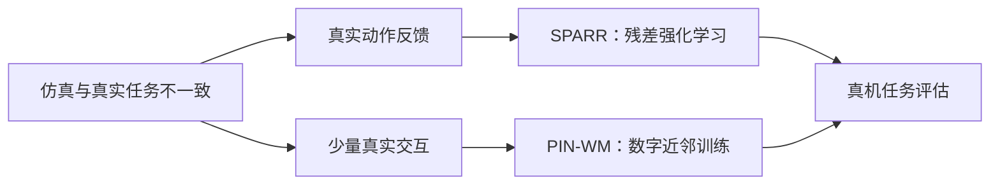
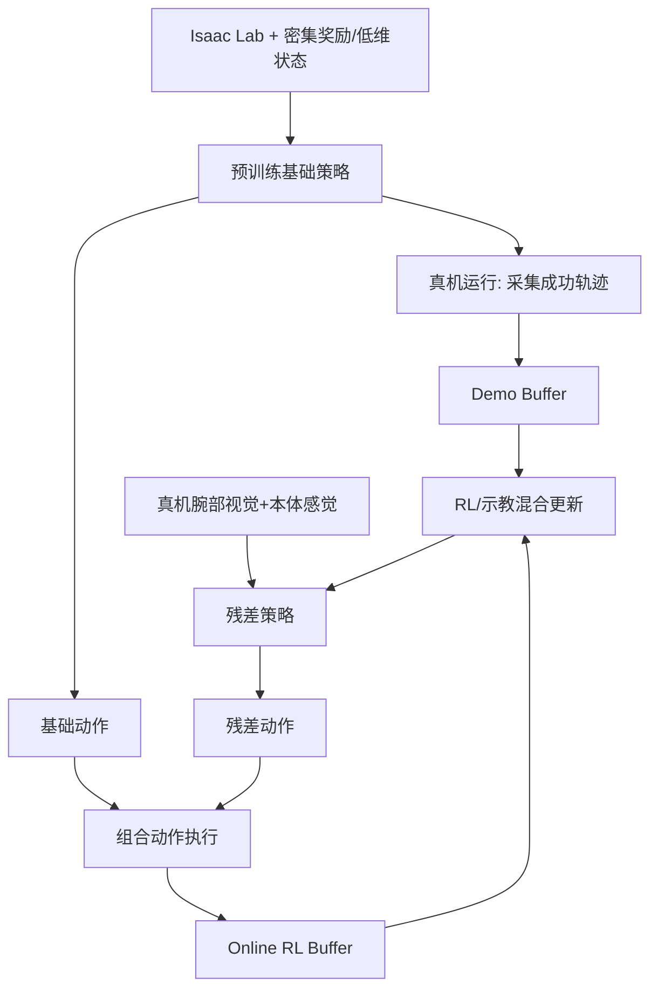
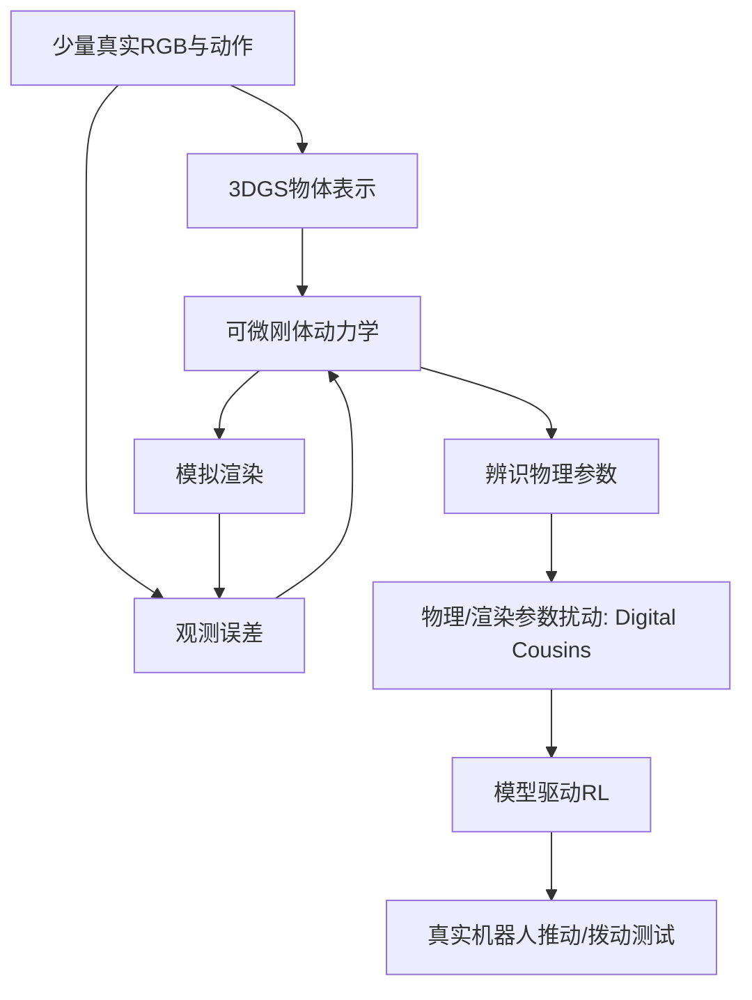

# 3. 物理可靠性：真实反馈如何改善机器人策略迁移

本章仅保留与机器人训练和真机部署直接相关的两条路线：**真实域策略纠偏**与**真实交互校准的 Digital Cousins**。不再展开柔性材料动力学和物理求解器研究。

## 3.0 技术路线总览

| 路线 | 代表论文 | 方法流程 | 对机器人策略的价值 |
|---|---|---|---|
| 真实策略残差学习 | SPARR（§3.1） | 仿真预训练 → 真机收集成功轨迹 → 在线学习动作残差 | 修正真机装配中的动作误差 |
| 真实交互与数字近邻 | PIN-WM（§3.2） | 真实交互 → 校准模拟模型 → 构建 Digital Cousins → 训练策略 | 获得与真实任务相关、可泛化的仿真数据 |

**两条路线的根本区别**：SPARR 修改策略动作，PIN-WM 修改策略学习的环境。两者均以真实任务效果为最终目标，而不是单独追求底层物理求解精度。

---

## 3.1 SPARR：真实残差强化学习补偿装配误差

### ① 论文基本信息
- **原题**：SPARR: Simulation-based Policies with Asymmetric Real-world Residuals for Assembly
- **作者/机构**：Yijie Guo 等；NVIDIA Research。
- **发表**：ICRA 2026；[论文](https://arxiv.org/abs/2602.23253)｜[官方项目](https://research.nvidia.com/labs/srl/projects/sparr/)｜[GitHub](https://github.com/NVlabs/SPARR)。

### ② 论文概述（根据原文 Abstract 忠实中文译述）
精密装配要求接触过程中保持非常准确的运动与力学配合。仿真训练虽然可以产生较好的装配策略，部署到现实后仍会因为 Sim-to-Real 差异退化；纯真实机器人强化学习又经常需要人工监督，且环境变化时泛化不足。SPARR 因此将仿真训练的基础策略与真实环境中学习的残差策略结合：前者用低维状态和密集奖励提供初始行为先验，后者使用视觉观测和稀疏奖励纠正真实动力学与传感器误差。作者在多类双部件真实装配中获得接近完全成功的结果；相较当时的零样本 Sim-to-Real 对照，成功率相对提升 38.4%、循环时间相对减少 29.7%，且不要求人工示教或在线人工干预。

### ③ 研究动机与核心问题
直接把仿真策略放到真机，最大的问题是小的接触位置误差在插入/卡扣装配中会被放大；然而从零开始真机 RL 又因稀疏奖励缺乏成功探索。SPARR 的关键假设是：**仿真策略虽不完美，仍能提供足够接近成功的行为和少量真实成功轨迹**，让残差策略在可行区域中学习，而不用从随机动作探索。

### ④ 方法总览与原论文截图

下列图片均是从[原论文 PDF](https://arxiv.org/pdf/2602.23253)直接裁切的**原始论文图**，已保存于本仓库，非 AI 生成或重新绘制。引用时请注明论文 Figure 编号。

**主图｜Figure 1：仿真基础策略与真机残差学习路线**

*原论文 Figure 1，PDF 第 1 页。[查看原文对应页](https://arxiv.org/pdf/2602.23253#page=1)。*

**方法/架构图｜Figure 3：非对称基础策略与残差策略的动作组合**

*原论文 Figure 3，PDF 第 4 页。[查看原文对应页](https://arxiv.org/pdf/2602.23253#page=4)。*

**读图重点：** Fig.1 描述模拟预训练、真机成功轨迹和残差强化学习；Fig.3 解释两级策略的不同观测及动作叠加。

*图号、原论文 URL 及 PDF 截取坐标记录在 [截图来源清单](../../assets/paper-screenshots/manifest.json)。详细中文 Pipeline 见下一节。*

### ⑤ 核心技术与算法细节
**步骤一，训练具备强先验的基础策略。** 作者在 Isaac Lab 中用低维机器人/物体状态及密集奖励预训练特定装配任务策略。相比仅由 RGB 决策，基础策略利用仿真可获得的低维状态更容易形成稳定的装配基本动作。

**步骤二，在真机零样本执行并自动建立示教池。** 将基础策略移植到真实机器人；即便成功率尚不理想，它通常能完成一部分装配。系统把真实成功执行写入示教池，作为后续 RL 探索和行为学习的正向信号，而不是要求人类专门遥操作采集示教。

**步骤三，引入非对称的观察与奖励机制。** 残差策略使用真实视觉/本体感觉，学习校正仿真策略感知不到的偏差；训练采用真实环境稀疏任务奖励。这里“非对称”体现在两级策略所观察的输入和训练方式不同，而不是要求真实环境复现仿真中的全部特权状态。

**步骤四，动作组合和在线回流。** 执行阶段可以概括为 $a_t=a_t^{\mathrm{base}}+\Delta a_t^{\mathrm{real}}$。新产生的在线轨迹进入 RL 缓冲区，成功且高质量的轨迹还可加入示教缓冲区，形成以成功先验为锚点的再训练闭环。该公式是算法层面的简化写法，具体残差尺度、动作参数化应以源码及论文为准。

**安全性前提。** 真机 RL 仍然需要限制动作范围、考虑碰撞与安全停机；“无需人工监督”不等于适合任意高风险装配现场。

### ⑥ 完整 Pipeline（中文重绘）

### ⑦ 实验设计与主要结果
作者从 AutoMate 的 100 项装配任务中选取仿真成功率超过 99% 的 10 项开展真机实验，并比较 SERL、AutoMate 零样本策略与 SPARR。SPARR 在该组真实任务中达到 95%–100% 成功率，部分评估每任务 20 次试验；论文也考察了迁移到不在基础策略预训练范围内的 NIST 任务的适应表现。必须强调：**95%–100% 是真实残差学习完成后的性能，不是基础策略的零样本性能**。

### ⑧ 方法特点与局限性
**特点**：直接以真实反馈修正物理/感知误差；避免为每类摩擦或装配公差重新标定整个模拟器；从基础策略自动挖掘示教降低人工成本。**局限**：依赖零样本策略已经能够在真实环境偶尔成功；仍需安全的真实探索预算；已验证场景主要是刚体精密装配，不能直接覆盖柔性材料、多步骤厨房操作等任务。

---

---

## 3.2 PIN-WM：从真实视觉辨识物理模型，再生成 Digital Cousins

### ① 论文基本信息
- **原题**：PIN-WM: Learning Physics-INformed World Models for Non-Prehensile Manipulation
- **作者/机构**：Wenxuan Li 等；国防科技大学、武汉大学、深圳大学等。
- **发表**：RSS 2025；[正式论文](https://roboticsproceedings.org/rss21/p153.html)｜[arXiv](https://arxiv.org/abs/2504.16693)｜[官网](https://pinwm.github.io/)｜[GitHub](https://github.com/XuAdventurer/PIN-WM)。

### ② 论文概述（根据原文 Abstract 忠实中文译述）
推动、拨动物体等非抓取操作高度依赖摩擦和恢复系数等复杂物理交互，学习具备泛化能力的策略十分困难。作者采用模型驱动强化学习，提出用于三维刚体运动的 Physics-INformed World Model（PIN-WM），目标是根据视觉观测高效辨识动力学系统。该方法以可微物理仿真为基础，只需少量、与目标任务无关的真实交互轨迹；同时通过 Gaussian Splatting 产生的观测损失训练，无需精确的外部状态估计。为缩小 Sim-to-Real 差异，作者围绕辨识好的模型扰动物理和渲染参数，建立多个 Digital Cousins。仿真和真实机器人实验显示，该组合能够帮助学习更鲁棒的非抓取操作技能，优于论文中比较的 Real2Sim2Real 方法。

### ③ 研究动机与核心问题
非抓取操作的结果取决于摩擦、惯性、碰撞和反弹；手工随机给定这些参数可能生成大量根本不对应真实任务的物理世界。PIN-WM 的问题是：能否先从少量真实交互中恢复一个**可解释、可微调的三维刚体动力学模型**，再围绕真实参数附近的合理变化训练策略？

### ④ 方法总览与原论文截图

下列图片均是从[原论文 PDF](https://www.roboticsproceedings.org/rss21/p153.pdf)直接裁切的**原始论文图**，已保存于本仓库，非 AI 生成或重新绘制。引用时请注明论文 Figure 编号。

**主图｜Figure 1：真实推动数据与物理数字近邻训练**

*原论文 Figure 1，PDF 第 1 页。[查看原文对应页](https://www.roboticsproceedings.org/rss21/p153.pdf#page=1)。*

**方法/架构图｜Figure 2：Real2Sim 可微辨识与 Sim2Real 策略训练结构**

*原论文 Figure 2，PDF 第 4 页。[查看原文对应页](https://www.roboticsproceedings.org/rss21/p153.pdf#page=4)。*

**读图重点：** 总览展示少量真实数据、数字近邻和真机转移；方法图突出 Gaussian 观测损失、可微物理参数及 RL。

*图号、原论文 URL 及 PDF 截取坐标记录在 [截图来源清单](../../assets/paper-screenshots/manifest.json)。详细中文 Pipeline 见下一节。*

### ⑤ 核心技术与算法细节
**步骤一，真实视觉交互与可渲染状态。** 用少量推动/拨动物体的真实轨迹提供图像序列和机器人动作；通过 3DGS 构建能从不同视角投影的物体外观，以渲染误差为动力学辨识提供监督，减少对真实物体状态逐帧人工标注的依赖。

**步骤二，物理模型参数辨识。** 在显式刚体运动结构上使用可微物理求解，反向调整影响接触过程的参数（如摩擦、恢复性质等），使模拟运动渲染出的图像尽量与真实观测一致。网络学习的不是任意视频幻觉，而是受三维物理模型约束的运动。

**步骤三，构造 Digital Cousins。** 以辨识模型为中心，在物理参数与渲染参数空间做结构化扰动，形成一簇彼此不同但与真实操作机制相关的模拟环境。这能缓解参数无法被少量观测完全唯一确定的问题。

**步骤四，模型驱动强化学习。** 在一组数字近邻中生成运动轨迹并学习推动策略，使策略不依赖某一个估计参数的精确数值。最后部署到真实机器人评价新对象或物理扰动下的稳定性。

**损失与可辨识边界。** 可概括为最小化模拟渲染与真实图像的观测误差，并结合物理演化约束；具体权重和求导形式需要以论文公式为准。视觉对齐有时存在多个等价物理解释，这正是保留 Digital Cousins 的原因之一。

### ⑥ 完整 Pipeline（中文重绘）

### ⑦ 实验设计与主要结果
论文在仿真和真实机器人上的非抓取操作任务评估模型和迁移策略，重点与其他 Real-to-Sim-to-Real 方法比较。论文摘要未给出可跨任务直接使用的单一真实成功率，因此文档不虚构统一数字。应分别关注：少量交互辨识需求、可微物理精度、数字近邻策略泛化和真实推动成功率。

### ⑧ 方法特点与局限性
**特点**：物理参数具有一定结构和解释性；学习依赖少量真实交互，且通过图像损失避免强状态标注；数字近邻把模型不确定性转为训练覆盖。**局限**：主要面向三维刚体推动/拨动，不是任意接触和柔性物体的通用模拟器；对遮挡严重、接触复杂的场景，辨识可能多解或出现明显估计误差。

---

---

## 3.3 两条路线的比较

| 维度 | SPARR | PIN-WM |
|---|---|---|
| 主要对象 | 动作残差策略 | 任务相关模拟模型与数据 |
| 使用的真实信息 | 成功轨迹和在线 RL 反馈 | 少量视觉交互 |
| 适用任务 | 精密插入、刚体装配 | 推动、拨动等非抓取操作 |
| 直接验证方式 | 真实任务成功率与耗时 | 真实机器人操作成功率 |
| 关键局限 | 需要安全可控的真机探索 | 需要对物体运动有足够的真实观测 |

实际研究中，仿真策略与真实反馈之间的闭环，往往比构建极其复杂的通用物理模型更直接有效。
