# 6. 物理真实性与动力学可信度：从可执行资产到真实交互对齐

> 研究范围：2025—2026 年机器人操作、接触动力学、物理资产、可变形物体、触觉仿真、物理感知世界模型与评价。资料核对日期：2026-11-20。本章新增 14 篇代表性工作；SPARR、SoMA、PIN-WM 已在第 3 章按八部分完整介绍，这里交叉引用而不重复抄写。

## 6.0 技术路线总览

### 6.0.1 为什么要把“物理真实性”单独讨论？

视觉真实性与物理真实性并不等价。相机观察到的是 $o_t$，但机器人真正需要的是给定状态和动作后，真实环境会怎样转移：

$$
s_{t+1}^{\mathrm{real}} \sim T_{\mathrm{real}}(\cdot\mid s_t,a_t),\qquad
s_{t+1}^{\mathrm{sim}} \sim T_{\mathrm{sim}}(\cdot\mid s_t,a_t).
$$

物理真实性不是要求 $T_{\mathrm{sim}}$ 对整个世界完美，而是要求其对**目标任务关键的状态转移、接触事件、材料响应与控制反馈**足够准确。机器人仿真的 Physics Gap 具体可拆为：①资产层（几何尺度、碰撞、质量、惯性）；②场景层（支撑、穿透、关节拓扑）；③动力学层（接触切换、摩擦、柔性）；④传感反馈层（触觉与力）；⑤模型输出与验证层（物理世界模型与指标）。

另外需区分三种经常被混淆的目标：

| 层级 | 真正要证明什么 | 常见指标 | 不可直接替代的指标 |
|---|---|---|---|
| **Simulation readiness** | 模型能否被加载、碰撞、控制与执行 | URDF/MJCF可加载率、运动范围、运行稳定性 | 真实物理参数误差 |
| **Physical fidelity** | 在相同初态与动作下，模拟与现实的状态、接触力和形变是否接近 | 位姿/速度轨迹误差、接触事件F1、力/形变误差 | 真机策略成功率 |
| **Sim-to-Real validity** | 从仿真获得的策略能否迁移 | 真实成功率、性能差距、交互预算 | 物理模型全局准确性 |

### 6.0.2 五条代表性路线

| 方向 | 代表论文 | 模型/资产实际被更新的部分 | 核心数据需求 | 主要边界 |
|---|---|---|---|---|
| **物理资产生成与Real-to-Sim** | PhysX-3D、PhysX-Anything、Scalable Real2Sim、Physics-Consistent Real-to-Sim | 质量/惯量/关节/物体和物体间接触 | 图像、RGB-D、机器人力矩 | 视觉预测的物理参数不一定唯一 |
| **接触动力学与可微校准** | Contact-Aware Neural Dynamics、Few-Shot Neural Differentiable Simulator | 接触模式、状态转移与模型梯度 | 少量真实接触或触觉轨迹 | 未见接触状态与非光滑优化 |
| **柔性和多材料仿真** | PhysTwin、Alloy；对照 SoMA | 形变结构、材料响应、跨材料耦合 | 柔性物体视频/物理引擎 | 计算代价与长时稳定性 |
| **触觉真实性** | TactileLab、TouchTwin | 触觉流、接触时间和施力 | 真实触觉/关节/视觉同步 | 昂贵传感器、接触隐变量 |
| **物理世界模型与评价** | RoboScape、ABot-PhysWorld、Principia、PVBench | 视频动力学表征、物理偏好和可量化诊断 | 动作视频、物理标注、物体追踪 | 视频合理不代表接触力精准 |

```mermaidd
flowchart TD
  A["物理真实性研究"] --> B["物理资产和物理场景"]
  A --> C["接触/柔性/多材料动力学"]
  A --> D["触觉与真实交互标定"]
  A --> E["生成式物理世界模型"]
  B --> F["状态与动作可重放"]
  C --> F
  D --> F
  E --> G["物理规律与条件动作评测"]
  F --> H["真实任务验证"]
  G --> H
```

**本章组织原则**：正文每篇均按原先确认的八部分呈现。方法介绍优先说明输入、物理表示、训练/辨识、仿真输出与真实验证；对只在 arXiv 上发表的工作明确标明预印本；论文中的相对指标、绝对数值和实验范围不混用。

---

## 6.1 PhysX-3D：从几何资产生成走向带物理知识的三维资产

### ① 论文基本信息

- **原题**：PhysX-3D: Physical-Grounded 3D Asset Generation
- **作者**：Ziang Cao、Zhaoxi Chen、Liang Pan、Ziwei Liu
- **发表信息**：NeurIPS 2025
- **研究侧重**：资产物理知识
- **论文**：[arXiv:2507.12465](https://arxiv.org/abs/2507.12465) · [原始 PDF](https://arxiv.org/pdf/2507.12465) · [项目主页](https://physx-3d.github.io/)
- **研究定位**：资产物理知识。本文不把“可以在模拟器运行”直接等同于“真实物理参数准确”。

### ② 论文概述（根据原文 Abstract 忠实中文译述）

现有三维生成以外观与几何为核心，缺少面向机器人和仿真的物理属性。本文提出 PhysX-3D 范式：首先建立 PhysXNet，将绝对尺度、材质、可供性、运动学和功能描述五类信息系统标注到三维资产；再提出 PhysXGen，通过双分支前馈生成框架，将物理知识注入预训练的三维结构表示，在维持几何质量的同时预测合理的物理属性。作者以属性预测和三维生成实验验证该框架的性能与泛化能力。

### ③ 研究动机与核心问题

三维外观相似不保证物体能在模拟器中正确交互。缺少公制尺度、部件材质和关节关系时，即使 Mesh 可导入，也难以构造合理的碰撞、质量与运动学约束。论文主要解决资产层面的物理语义与生成问题，而不是直接求解接触动力学。

### ④ 方法总览与原论文主图

**原论文主图（Figure 1，PDF 第 1 页）**

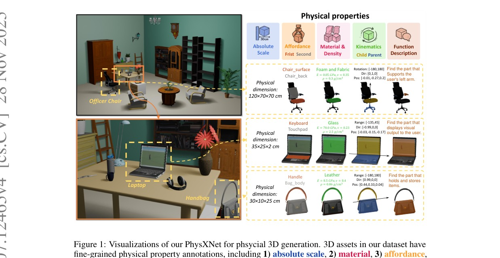

**原论文第二张关键图（Figure 2，PDF 第 4 页）**


*图号、源 PDF 和裁切位置参见 [截图 Manifest](../../assets/paper-screenshots/manifest.json)。*

**读图指引**：原论文主图通常说明应用任务与主要模块；第二张重点检查数据如何进入模型、哪个环节承担物理约束、是否使用真实交互。未必所有 Figure 2 都是网络结构图，请结合原图标题阅读。

### ⑤ 核心技术与算法细节

1. **物理标签体系。** 将 PhysXNet 的信息划为五类：公制尺度、材质、可供性、关节运动学与功能描述；既包含对象级属性，也包含部件级语义。这使模型能够区分“看起来像抽屉”和“确实具有可移动关节”两种资产。

2. **数据构建。** 从已有 3D 资产出发，由 VLM 协助标注，并引入人工校核，建立可供训练和评价的物理属性数据。标注可看作物理建模先验，并不全部来自真实测量。

3. **双分支生成。** PhysXGen 在三维结构生成分支之外显式建模物理属性，学习几何结构与材质、尺度、关节信息的相关性，避免只在生成完成后做零散属性补丁。

4. **资产导出与使用。** 将生成的物体与属性导入仿真，需要进一步检查碰撞 Mesh、可动部件关节与物理引擎参数的对应关系，不能假设属性标签自动等于准确的接触力。

### ⑥ 完整 Pipeline（中文梳理）


### ⑦ 实验设计与主要结果

作者报告 PhysXNet 超过 2.6 万个具有物理属性标注的三维对象，并对生成质量、物理属性预测与泛化进行评估。需要区分生成属性的合理性与真实机器人操作中物理参数实测精度；论文的主要实证不等同于完整的真机动力学重放误差实验。

### ⑧ 方法特点与局限性

提供了可扩展的物理资产数据表示和生成路线，但材质、质量等属性可能仍来自视觉推断与先验，不保证具有可辨识的真实数值；对接触摩擦、滑移和长期动力学的验证需要后续 Real-to-Sim 数据。

---

## 6.2 PhysX-Anything：单图生成仿真就绪的可动三维对象

### ① 论文基本信息

- **原题**：PhysX-Anything: Simulation-Ready Physical 3D Assets from Single Image
- **作者**：Ziang Cao、Fangzhou Hong、Zhaoxi Chen、Liang Pan、Ziwei Liu
- **发表信息**：CVPR 2026
- **研究侧重**：可执行资产
- **论文**：[arXiv:2511.13648](https://arxiv.org/abs/2511.13648) · [原始 PDF](https://arxiv.org/pdf/2511.13648) · [项目主页](https://physx-anything.github.io/) · [代码仓库](https://github.com/ziangcao0312/PhysX-Anything)
- **研究定位**：可执行资产。本文不把“可以在模拟器运行”直接等同于“真实物理参数准确”。

### ② 论文概述（根据原文 Abstract 忠实中文译述）

本文研究如何从单张自然图像直接生成能够参与物理仿真的三维对象，而不仅是静态视觉网格。作者提出基于视觉语言模型的物理三维生成框架，显式输出几何、关节结构与物理属性，并引入高效几何 token 表示，使几何 token 数减少约 193 倍。为增加训练覆盖，构建具有丰富物理标注、包含超过两千种常见物体的 PhysX-Mobility 数据集，并在生成质量、泛化和 MuJoCo 风格的接触操作任务中验证生成资产的可用性。

### ③ 研究动机与核心问题

单图到三维的方法常缺乏运动学拓扑、关节约束和物理参数，导致生成资产虽可渲染，却无法直接驱动机器人学习。核心问题是把资产生产的终点从视觉几何扩展到具有结构约束的仿真文件。

### ④ 方法总览与原论文主图

**原论文主图（Figure 1，PDF 第 1 页）**

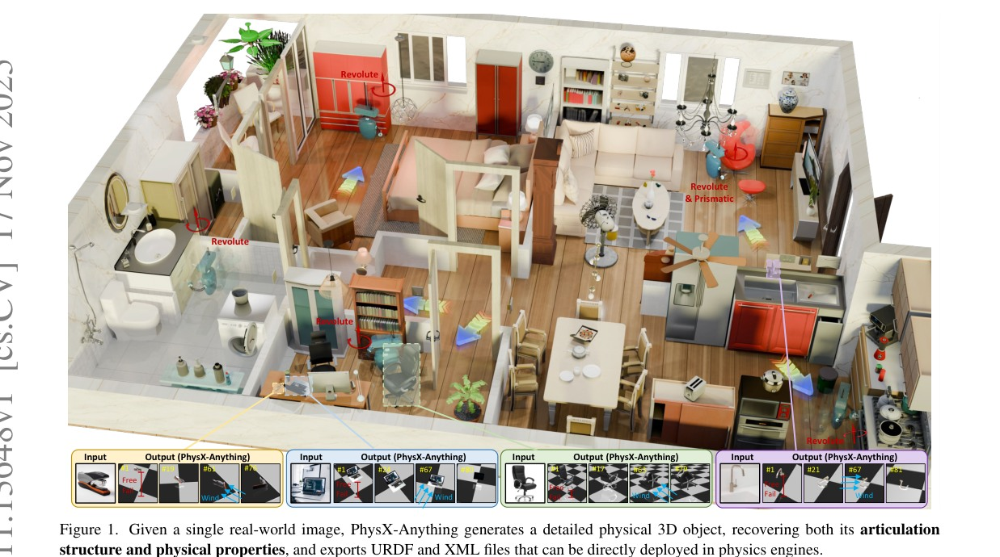

**原论文第二张关键图（Figure 2，PDF 第 3 页）**


*图号、源 PDF 和裁切位置参见 [截图 Manifest](../../assets/paper-screenshots/manifest.json)。*

**读图指引**：原论文主图通常说明应用任务与主要模块；第二张重点检查数据如何进入模型、哪个环节承担物理约束、是否使用真实交互。未必所有 Figure 2 都是网络结构图，请结合原图标题阅读。

### ⑤ 核心技术与算法细节

1. **输入感知与物理结构推断。** 根据图像推断对象整体外形、可动部件、关节连接和物理属性；模型需要处理单视角固有的几何和遮挡歧义。

2. **紧凑显式几何编码。** 使用新的 tokenization 降低几何序列长度，使标准 VLM 上下文窗口能够承载显式几何监督；论文报告约 193 倍 token 降幅，此处是表示效率而非物理误差降幅。

3. **多轮物理资产生成。** 在 VLM 驱动的生成流程中联合输出结构与物理描述，并导出 URDF/XML 资产，使对象在物理引擎中有可解释的关节与碰撞接口。

4. **数据和下游验证。** PhysX-Mobility 增加真实物体类别与物理标注覆盖，再将生成对象用于模拟抓取等接触操作；该验证侧重 sim-ready 性质，而非自动证明参数与实物完全一致。

### ⑥ 完整 Pipeline（中文梳理）


### ⑦ 实验设计与主要结果

论文报告几何 token 数约减少 193 倍、PhysX-Mobility 包含超过两千个日常物体，并展示生成资产在 MuJoCo 风格接触操作模拟中可直接使用。上述结果支持生成与可执行性，但不能将其理解为全部对象的摩擦、密度、惯量已由真实交互测定。

### ⑧ 方法特点与局限性

规模化生成速度和可用性突出；单图推断质量、摩擦和隐藏关节存在多解性，尤其对透明、柔性和内部复杂物体。需要通过真实交互校验才能迈向高物理保真数字孪生。

---

## 6.3 Scalable Real2Sim：机器人交互驱动的物理资产测量与生成

### ① 论文基本信息

- **原题**：Scalable Real2Sim: Physics-Aware Asset Generation Via Robotic Pick-and-Place Setups
- **作者**：Nicholas Pfaff、Evelyn Fu、Jeremy Binagia、Phillip Isola、Russ Tedrake
- **发表信息**：IROS 2025
- **研究侧重**：物理参数辨识
- **论文**：[arXiv:2503.00370](https://arxiv.org/abs/2503.00370) · [原始 PDF](https://arxiv.org/pdf/2503.00370) · [项目主页](https://scalable-real2sim.github.io/) · [代码仓库](https://github.com/nepfaff/scalable-real2sim)
- **研究定位**：物理参数辨识。本文不把“可以在模拟器运行”直接等同于“真实物理参数准确”。

### ② 论文概述（根据原文 Abstract 忠实中文译述）

本文提出无需人工逐个建模的 Real-to-Sim 资产生产流程：机器人在常规抓放工作站中自动拾取对象、通过固定相机采集多角度外观，再结合关节力矩数据识别对象惯性等物理属性。方法引入针对前景遮挡的透明度感知几何重建，从 NeRF/3DGS 等表观重建中提取高质量物体 Mesh，得到视觉几何、碰撞几何和可模拟的动力学参数，最终构造仿真就绪资产。

### ③ 研究动机与核心问题

仅靠单张图像很难确定质量、质心或惯量，而人工称重、扫描和标定难以扩展到大量新物体。这篇工作把机器人本体的力矩响应变成物理监督，是从“推测属性”到“主动测量属性”的路线。

### ④ 方法总览与原论文主图

**原论文主图（Figure 1，PDF 第 1 页）**


**原论文第二张关键图（Figure 2，PDF 第 3 页）**

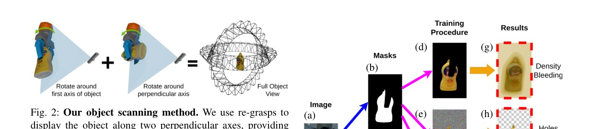

*图号、源 PDF 和裁切位置参见 [截图 Manifest](../../assets/paper-screenshots/manifest.json)。*

**读图指引**：原论文主图通常说明应用任务与主要模块；第二张重点检查数据如何进入模型、哪个环节承担物理约束、是否使用真实交互。未必所有 Figure 2 都是网络结构图，请结合原图标题阅读。

### ⑤ 核心技术与算法细节

1. **自动物体采集。** 机器人从料箱抓取物体，在相机前执行多视角运动和重新抓取，尽量降低遮挡对几何重建的影响。

2. **对象中心视觉/碰撞重建。** 使用包含 alpha 透明训练和前景遮挡建模的图像重建方式，抽取适合仿真器的 Mesh，并区分渲染几何与碰撞用几何。

3. **激励式惯性辨识。** 机器人执行对惯性参数有信息量的运动，利用关节力矩和机器人运动学模型辨识质量分布相关参数。只有激励充分、传感器可靠，辨识才可能稳定。

4. **自动封装。** 将网格、几何尺度、惯性信息和材料/碰撞参数组合成完整资产，供数据生成或策略训练使用；对尚未真实测量的接触参数仍需后续校准。

### ⑥ 完整 Pipeline（中文梳理）

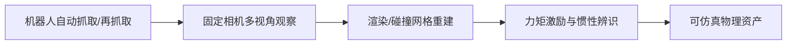

### ⑦ 实验设计与主要结果

论文在多种实物上验证了自动扫描、几何重建和惯性属性辨识的完整流程，强调无需针对每个对象的人为环境改造。比较时应分开记录重建几何误差、动力学参数误差和流水线吞吐，而不是把“自动可导入”视为真实操控成功率。

### ⑧ 方法特点与局限性

真实机器人和力矩传感器成为必要条件；夹持状态误差、测量噪声和外部扰动会影响惯性辨识。其强项是标准刚体对象，不是无需改动便覆盖复杂多材质与柔性对象。

---

## 6.4 Physics-Consistent Real-to-Sim：面向杂乱接触场景的稳定重建

### ① 论文基本信息

- **原题**：Real-to-Sim for Highly Cluttered Environments via Physics-Consistent Inter-Object Reasoning
- **作者**：Tianyi Xiang、Jiahang Cao、Sikai Guo、Guoyang Zhao、Andrew F. Luo、Jun Ma
- **发表信息**：2026 论文 / arXiv:2602.12633
- **研究侧重**：场景级物理约束
- **论文**：[arXiv:2602.12633](https://arxiv.org/abs/2602.12633) · [原始 PDF](https://arxiv.org/pdf/2602.12633) · [项目主页](https://physics-constrained-real2sim.github.io/) · [代码仓库](https://github.com/physics-constrained-Real2Sim/physics-constrained-Real2Sim)
- **研究定位**：场景级物理约束。本文不把“可以在模拟器运行”直接等同于“真实物理参数准确”。

### ② 论文概述（根据原文 Abstract 忠实中文译述）

从单幅 RGB-D 图像重建复杂堆叠场景时，几何重建容易产生悬浮、穿透或不稳定物体，从而破坏后续仿真。本文提出物理约束的 Real-to-Sim 流程，在初步重建和实例分割基础上建立物体接触图，并利用可微刚体仿真联合细化物体位姿与物理属性。作者在仿真和真实接触操作环境中检验场景稳定性及接触交互的可靠性。

### ③ 研究动机与核心问题

多个对象同时存在时，物体间支撑、受力和摩擦共同决定稳定状态。只把每件物体 Mesh 分别对齐，不能保证对象之间存在可维持的接触关系；单纯几何不穿透也不足以确保长时静力平衡。

### ④ 方法总览与原论文主图

**原论文主图（Figure 1，PDF 第 1 页）**


**原论文第二张关键图（Figure 2，PDF 第 3 页）**


*图号、源 PDF 和裁切位置参见 [截图 Manifest](../../assets/paper-screenshots/manifest.json)。*

**读图指引**：原论文主图通常说明应用任务与主要模块；第二张重点检查数据如何进入模型、哪个环节承担物理约束、是否使用真实交互。未必所有 Figure 2 都是网络结构图，请结合原图标题阅读。

### ⑤ 核心技术与算法细节

1. **视觉初始化。** 根据 RGB-D 图像和实例掩码得到各物体初始几何、尺度和位姿，使用几何配准细化。

2. **构建场景接触图。** 将物体与地面/相邻物体的支撑关系以及邻近关系编码为图结构，显式表示一件物体受到哪些其他对象的约束。

3. **两阶段物理优化。** 先消除明显穿透、悬浮等不满足几何约束的问题，再引入可微物理模拟，联合优化物体位姿及摩擦、质量、质心等可能影响稳定性的物理属性。

4. **动态验证。** 使场景在模拟器内释放并接受操作扰动，观察长期稳定性与接触运动，而不是只以第一帧重建误差作为成功标准。

### ⑥ 完整 Pipeline（中文梳理）

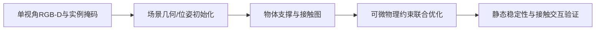

### ⑦ 实验设计与主要结果

原文比较只进行几何重建、仅加入局部非穿透约束以及施加物理约束的版本，并进行模拟与真实场景操作验证。作者报告物理约束版本的稳定性及接触真实性更好；若无统一真实轨迹重放和置信区间，不宜将这一结论写成适用于任意场景的绝对物理正确性。

### ⑧ 方法特点与局限性

适合刚体杂乱场景的初态构建；单帧 RGB-D 仍难观测隐藏接触与真实物体内部属性。优化得到的参数可能不是唯一的材料属性，还应检查接触图错误传播和非刚体物品。

---

## 6.5 Contact-Aware Neural Dynamics：基于真实触觉的隐式动力学对齐

### ① 论文基本信息

- **原题**：Contact-Aware Neural Dynamics
- **作者**：Changwei Jing、Jai Krishna Bandi、Jianglong Ye、Yan Duan、Pieter Abbeel、Xiaolong Wang、Sha Yi
- **发表信息**：CVPR 2026
- **研究侧重**：触觉约束接触动力学
- **论文**：[arXiv:2601.12796](https://arxiv.org/abs/2601.12796) · [原始 PDF](https://arxiv.org/pdf/2601.12796) · [项目主页](https://changwei-jing.github.io/neural-physics/)
- **研究定位**：触觉约束接触动力学。本文不把“可以在模拟器运行”直接等同于“真实物理参数准确”。

### ② 论文概述（根据原文 Abstract 忠实中文译述）

在富接触操作中，仅调节模拟器显式参数往往无法拟合真实世界高维、随状态变化且不连续的接触动力学。本文将现有模拟器视作基础先验，训练接触感知神经前向动力学模型，首先利用大量仿真轨迹学习状态、动作和接触的关联，再以少量带触觉的真实交互数据微调，实现隐式 Sim-to-Real 动力学对齐。作者展示了状态预测精度改进，并将模型用于评估和优化仿真训练得到的策略。

### ③ 研究动机与核心问题

接触模式从分离跳变到粘着/滑动，常因摩擦、柔顺性和离散求解造成突变。低维参数拟合可能把误差错误分配给质量或阻尼，而忽略了接触事件本身。二值触觉能在仿真与真实系统间提供较可对齐的监督信号。

### ④ 方法总览与原论文主图

**原论文主图（Figure 1，PDF 第 1 页）**


**原论文第二张关键图（Figure 2，PDF 第 4 页）**

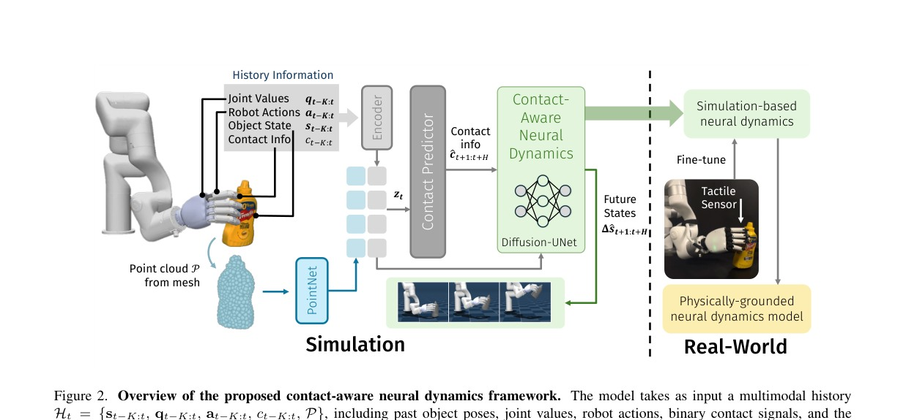

*图号、源 PDF 和裁切位置参见 [截图 Manifest](../../assets/paper-screenshots/manifest.json)。*

**读图指引**：原论文主图通常说明应用任务与主要模块；第二张重点检查数据如何进入模型、哪个环节承担物理约束、是否使用真实交互。未必所有 Figure 2 都是网络结构图，请结合原图标题阅读。

### ⑤ 核心技术与算法细节

1. **建立模拟先验。** 采集现成物理引擎中的大量状态—动作—接触历史；保留对象几何、机器人关节和接触事件的信息。

2. **多模态条件编码。** 将历史物体位姿、机器人关节状态、动作、点云/几何与接触观测编码为动力学上下文。

3. **接触先预测、动力学后生成。** 先预测未来接触模式，再将接触条件提供给后续状态/位姿变化预测模块；项目采用扩散式预测器应对多模态未来轨迹。

4. **少量真实触觉校准。** 使用真实接触触发信息与轨迹对网络微调，对真实接触切换做隐式对齐；该方法学习的是一个神经前向模型，并非重新估计所有明确的摩擦系数。

5. **用于策略选择。** 根据模型预测未来接触结果和终态，辅助评估不同仿真策略，并筛选或改善真实执行策略。

### ⑥ 完整 Pipeline（中文梳理）


### ⑦ 实验设计与主要结果

作者对单物体和多物体的接触丰富操作进行长时状态预测，展示模拟预训练后加入真实触觉可改善位姿/接触预测，并用于策略性能预测。真实策略提升依赖其测试本体、接触传感器与可获得的真实微调样本；不能推断纯 RGB 条件下有同等改善。

### ⑧ 方法特点与局限性

真实触觉降低了接触是否发生的不可观测性，但依赖传感器标定及接触标签阈值。神经模型的误差界、超出训练分布的接触类型以及严格力学约束尚不能由预测准确率完全保证。

---

## 6.6 Few-Shot Neural Differentiable Simulator：少量真机数据约束的可微接触模型

### ① 论文基本信息

- **原题**：Few-Shot Neural Differentiable Simulator: Real-to-Sim Rigid-Contact Modeling
- **作者**：Zhenhao Huang、Siyuan Luo、Bingyang Zhou、Ziqiu Zeng、Jason Pho、Fan Shi
- **发表信息**：ICRA 2026
- **研究侧重**：可微接触模拟
- **论文**：[arXiv:2603.06218](https://arxiv.org/abs/2603.06218) · [原始 PDF](https://arxiv.org/pdf/2603.06218)
- **研究定位**：可微接触模拟。本文不把“可以在模拟器运行”直接等同于“真实物理参数准确”。

### ② 论文概述（根据原文 Abstract 忠实中文译述）

解析物理模拟器难以准确处理复杂刚体接触，而纯神经模拟器依赖大量真实数据。本文提出 Few-Shot Real-to-Sim 方案：先用少量真实观测校准解析仿真器，并利用校准模型生成大规模多样接触数据；再训练基于网格的图神经网络隐式表示刚体前向动力学，同时为碰撞检测构造替代梯度，使动力学模型可微。实验显示其真实轨迹拟合能力优于若干可微基线，并可用于多物体交互任务的梯度式策略优化。

### ③ 研究动机与核心问题

可微模拟器需要梯度才能高效优化动作，而刚体碰撞的离散接触判定恰好不光滑。仅依赖解析参数会产生模型偏差，纯端到端学习又过于耗费真实数据，因此需要兼顾解析先验、数据规模和梯度可用性。

### ④ 方法总览与原论文主图

**原论文主图（Figure 1，PDF 第 1 页）**

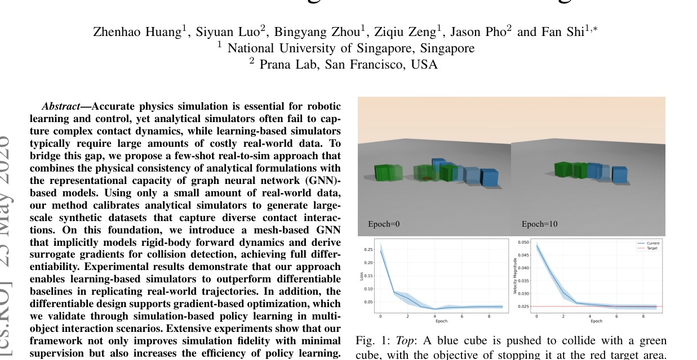

**原论文第二张关键图（Figure 2，PDF 第 2 页）**


*图号、源 PDF 和裁切位置参见 [截图 Manifest](../../assets/paper-screenshots/manifest.json)。*

**读图指引**：原论文主图通常说明应用任务与主要模块；第二张重点检查数据如何进入模型、哪个环节承担物理约束、是否使用真实交互。未必所有 Figure 2 都是网络结构图，请结合原图标题阅读。

### ⑤ 核心技术与算法细节

1. **真机小样本校准。** 利用有限真实接触轨迹辨识解析仿真器中的主要接触参数，获得尽可能接近现实的基础系统。

2. **扩大合成分布。** 让校准模拟器生成更多物体数量、初始速度与碰撞模式各异的轨迹，为神经模拟器提供监督。

3. **网格 GNN 动力学。** 将物体网格的局部几何与邻接/接触关系编码为图消息传递，预测未来刚体状态而非只输出 RGB 视频。

4. **替代接触梯度。** 对碰撞检测中不可微的离散切换使用代理梯度，使动作输入到下游目标的反向优化成为可能。

5. **策略优化。** 在多物体碰撞和推动场景中用该梯度搜索动作，并与解析可微或纯数据驱动基线比较。

### ⑥ 完整 Pipeline（中文梳理）


### ⑦ 实验设计与主要结果

文章主要评估真实轨迹复现误差及多物体交互的优化效率，展示更好的重放保真度与基于梯度的控制可用性。其 Figure 1 中优化碰撞初速度属于规划/优化演示；不应未经证实写成大规模真实机器人任务迁移成功率。

### ⑧ 方法特点与局限性

优点是将少量实测数据放入可微动力学训练链；缺点包括基模校准依赖参数初始化、GNN 对物体数量/形状分布的泛化要求，以及替代梯度不保证与真实接触力的梯度完全一致。

---

## 6.7 PhysTwin：从稀疏视频估计柔性物体的可交互物理数字孪生

### ① 论文基本信息

- **原题**：PhysTwin: Physics-Informed Reconstruction and Simulation of Deformable Objects from Videos
- **作者**：Hanxiao Jiang、Hao-Yu Hsu、Kaifeng Zhang、Hsin-Ni Yu、Shenlong Wang、Yunzhu Li
- **发表信息**：ICCV 2025
- **研究侧重**：可变形物体
- **论文**：[arXiv:2503.17973](https://arxiv.org/abs/2503.17973) · [原始 PDF](https://arxiv.org/pdf/2503.17973) · [项目主页](https://jianghanxiao.github.io/phystwin-web/)
- **研究定位**：可变形物体。本文不把“可以在模拟器运行”直接等同于“真实物理参数准确”。

### ② 论文概述（根据原文 Abstract 忠实中文译述）

本文提出 PhysTwin，从少量拍摄物体动态交互的视频中，重建可实时交互、具备视觉和物理属性的柔性物体数字孪生。其表示结合弹簧—质点物理模型、生成式几何先验与 Gaussian Splatting 渲染，通过多阶段逆向优化恢复完整物体几何、稠密物理属性和外观。方法能够处理绳索、毛绒玩具、布料与包装等柔性对象，实验展示其在重建、渲染、未来状态预测以及未见交互模拟方面的表现，并演示模型驱动机器人规划。

### ③ 研究动机与核心问题

柔性物体内部自由度高，视频观测稀疏且存在遮挡，仅用静态 Mesh 或无动作视频生成难以复现新交互。需要将可渲染几何与具有可计算力学性质的物体表示联合估计。

### ④ 方法总览与原论文主图

**原论文主图（Figure 1，PDF 第 1 页）**


**原论文第二张关键图（Figure 2，PDF 第 3 页）**


*图号、源 PDF 和裁切位置参见 [截图 Manifest](../../assets/paper-screenshots/manifest.json)。*

**读图指引**：原论文主图通常说明应用任务与主要模块；第二张重点检查数据如何进入模型、哪个环节承担物理约束、是否使用真实交互。未必所有 Figure 2 都是网络结构图，请结合原图标题阅读。

### ⑤ 核心技术与算法细节

1. **物理知觉混合表示。** 用弹簧—质点系统表达物体动态形变，用生成式形状先验恢复遮挡部分几何，用高斯基元负责照片级多视角渲染；避免让高斯颜色点独自承担力学约束。

2. **从稀疏交互视频出发。** 多视角拍摄对象受推动、抓取或形变的状态变化，联合优化几何与可观测运动。

3. **分阶段反问题求解。** 分别处理几何初始化、物理参数反演和外观渲染一致性，使模型既能复现观测片段，也能对新作用给出前向预测。

4. **执行未见交互。** 在拟合好的物理体上施加新动作或受力，以模拟结果驱动机器人运动规划，而非简单回放训练视频。

### ⑥ 完整 Pipeline（中文梳理）


### ⑦ 实验设计与主要结果

ICCV 2025 论文在绳索、布料、包装物和毛绒对象上比较几何重建、渲染、未来运动预测与未见交互的模拟效果，并展示实时操作模拟与规划应用。不同指标分别对应视觉、动态和应用能力；不要把渲染指标直接解释成抓取成功率。

### ⑧ 方法特点与局限性

它给出了视觉与力学同时建模的可执行数字孪生路线，但材料参数从少量视频反推仍存在歧义，尤其对复杂接触、材料异质性及高频作用力。可结合 SoMA 第三章的动作条件神经建模作对比。

---

## 6.8 Alloy：多材料耦合的机器人物理仿真基础设施

### ① 论文基本信息

- **原题**：Alloy: A Multi-Material Physics Engine for Robot Learning
- **作者**：Pranay Gupta、Deepanshu Rohilla
- **发表信息**：arXiv 2026-11-12（预印本）
- **研究侧重**：多材料引擎
- **论文**：[arXiv:2611.16312](https://arxiv.org/abs/2611.16312) · [原始 PDF](https://arxiv.org/pdf/2611.16312) · [代码仓库](https://github.com/argonrobotics-ai/alloy)
- **研究定位**：多材料引擎。本文不把“可以在模拟器运行”直接等同于“真实物理参数准确”。

### ② 论文概述（根据原文 Abstract 忠实中文译述）

现有机器人仿真在刚体方面相对成熟，但同一场景中的布料、电缆、液体、颗粒和软体往往需要不同物理求解器，导致跨材料交互难以构造。Alloy 提出开放式多材料物理引擎，在同一场景中让不同材料对象由合适的求解器计算，并在控制步内耦合；支持多世界 GPU/CPU 执行，为每个环境提供健康状态评估以区分模拟故障与策略失败。框架建立在 Newton、MuJoCo Warp 与 Warp 之上，并展示运行吞吐、解析参考一致性及多场景任务。

### ③ 研究动机与核心问题

家庭和工业操作可能同时涉及刚体机械臂、柔性缆线、液体与可变形容器。单一求解器往往在精度与性能之间难兼顾；分别模拟又容易在材料接触边界出现同步与力交换错误。

### ④ 方法总览与原论文主图

**原论文主图（Figure 1，PDF 第 2 页）**

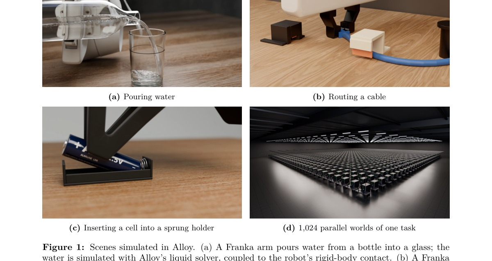

**原论文第二张关键图（Figure 2，PDF 第 3 页）**

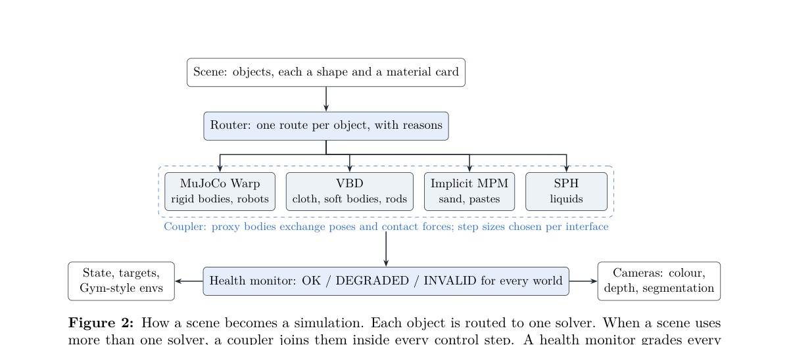

*图号、源 PDF 和裁切位置参见 [截图 Manifest](../../assets/paper-screenshots/manifest.json)。*

**读图指引**：原论文主图通常说明应用任务与主要模块；第二张重点检查数据如何进入模型、哪个环节承担物理约束、是否使用真实交互。未必所有 Figure 2 都是网络结构图，请结合原图标题阅读。

### ⑤ 核心技术与算法细节

1. **统一场景描述。** 每个对象指定材料类别、碰撞属性和接口，而不需要用户手动串联多个独立模拟项目。

2. **按材料分派求解器。** 将刚体、布料、颗粒、流体和软体分配给匹配的数值算法，在统一控制时间步内协调更新。

3. **跨求解器耦合。** 重点处理不同材料之间的接触边界、力与动量传递；引擎能力应通过独立的守恒量与闭式解析解检查。

4. **并行化与异常诊断。** 在 GPU/CPU 上运行多个世界，给每个世界记录健康状态，帮助排除数值发散或接触异常造成的虚假训练信号。

5. **机器人任务接口。** 作者展示步行、缆线操作和倒液体训练案例；核心定位是模拟基础设施，不是某一个通用 Sim-to-Real 策略。

### ⑥ 完整 Pipeline（中文梳理）


### ⑦ 实验设计与主要结果

作者报告不同并行世界规模的吞吐、深度相机运行效率、对闭式参考解的符合程度以及千世界可靠性测试，并展示机器人行走、线缆和倾倒任务。作为新预印本，应将‘能够运行多材料演示’与‘在多材料接触中达到已验证的真实高保真度’区分开。

### ⑧ 方法特点与局限性

跨求解器耦合机制值得跟踪，但不同时间步、分辨率及接触模型可能引起能量漂移和不稳定性；需要统一测量重放误差、材料边界的力与位移误差，不能单凭展示视频判断物理准确。

---

## 6.9 TactileLab：面向剪切触觉的高吞吐可迁移仿真

### ① 论文基本信息

- **原题**：TactileLab: Sim-to-Real Dexterous Robot Manipulation with Efficient Shear-Sensitive Tactile Simulation
- **作者**：Yijiong Lin、Wenhao He、Toby Jack、Max Yang、Haoran Li、Nathan F. Lepora
- **发表信息**：arXiv 2026-11-05（预印本）
- **研究侧重**：触觉仿真
- **论文**：[arXiv:2611.07881](https://arxiv.org/abs/2611.07881) · [原始 PDF](https://arxiv.org/pdf/2611.07881)
- **研究定位**：触觉仿真。本文不把“可以在模拟器运行”直接等同于“真实物理参数准确”。

### ② 论文概述（根据原文 Abstract 忠实中文译述）

高精度触觉剪切模拟通常依赖昂贵的软体求解，难以适应大规模机器人强化学习。本文提出建立在 Isaac Lab 上的高吞吐触觉模拟框架 TactileLab，以刚体接触计算估计接触界面稠密切向运动，形成 simulated tactile flow，并结合接触深度场描述几何信息。方法还提出融合长时间本体感觉与触觉观测的策略结构，以及将真实触觉图像转换为仿真流场与深度场的映射，从而在不同传感器设计上完成双臂和灵巧手真机迁移。

### ③ 研究动机与核心问题

视觉不足以可靠观测夹持力和初始滑移；全有限元软指腹仿真虽具物理细节，却不适合并行训练数千个环境。问题变成：能否模拟‘控制真正需要的剪切信号’，而非穷尽传感器所有材料微结构？

### ④ 方法总览与原论文主图

**原论文主图（Figure 1，PDF 第 1 页）**


**原论文第二张关键图（Figure 2，PDF 第 4 页）**

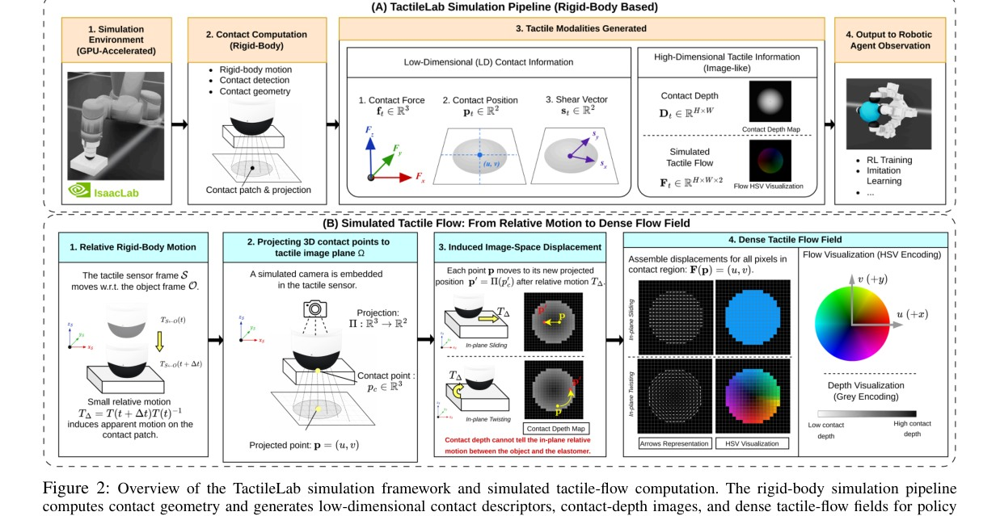

*图号、源 PDF 和裁切位置参见 [截图 Manifest](../../assets/paper-screenshots/manifest.json)。*

**读图指引**：原论文主图通常说明应用任务与主要模块；第二张重点检查数据如何进入模型、哪个环节承担物理约束、是否使用真实交互。未必所有 Figure 2 都是网络结构图，请结合原图标题阅读。

### ⑤ 核心技术与算法细节

1. **基于刚体状态构造触觉界面。** 在已有刚体碰撞求解基础上计算局部接触几何，避免完整求解柔性传感器的高维形变。

2. **模拟触觉流。** 通过接触表面的稠密切向运动估计剪切相关光流，再结合接触深度场构造能够反映接触和滑移的低成本表示。

3. **触觉与本体联合策略。** 对长时关节历史和局部丰富触觉观测分别编码，再融合为动作条件，使策略可以响应触觉变化。

4. **真机表征对齐。** 学习或构造真实光学触觉图像到模拟流/深度场的转换，从而让不同硬件的真实传感器提供策略训练时使用的输入形式。

5. **任务部署。** 在双臂和在手操作中验证训练策略对接触/剪切反馈的利用。

### ⑥ 完整 Pipeline（中文梳理）


### ⑦ 实验设计与主要结果

论文在多个富接触任务中验证模拟触觉流可以用于有效策略学习，并展示双臂与灵巧手真实部署。需要分别评价 Sim/Real 触觉流分布、真实滑移响应、任务成功率与训练吞吐；它的真实感强调‘任务有用的触觉信号’而非高保真材料场重建。

### ⑧ 方法特点与局限性

基于刚体接触推断剪切流具有高效优势，但柔性垫片内部应力、复杂滞后和非局部形变不能自动得到准确复现。真实传感器图像到模拟触觉表征的映射误差可能造成新的域偏差。

---

## 6.10 TouchTwin：以实测触觉约束手—物体的交互重放

### ① 论文基本信息

- **原题**：TouchTwin: Scaling Human Touch Data via Real-to-Sim-to-Real
- **作者**：Huiwen Han、Nuo Chen、Ziyao Zeng、Dayou Li、Hao Wang 等
- **发表信息**：arXiv 2026-11-13（预印本）
- **研究侧重**：触觉接触力标定
- **论文**：[arXiv:2611.17619](https://arxiv.org/abs/2611.17619) · [原始 PDF](https://arxiv.org/pdf/2611.17619) · [项目主页](https://touchtwin.github.io/)
- **研究定位**：触觉接触力标定。本文不把“可以在模拟器运行”直接等同于“真实物理参数准确”。

### ② 论文概述（根据原文 Abstract 忠实中文译述）

仅根据第一视角视频恢复人手姿态，无法确定每根手指是否接触、接触时间和作用力，因而直接模仿或视觉重放往往产生抓握力偏差。TouchTwin 使用双视角 RGB-D 与 880 个 taxel 的触觉手套数据，将人手与可交互物体重建进 MuJoCo；由编码代理构建经物理测试的对象程序，使用实测触觉驱动手指接触与闭合程度，再生成带接触/受力标注的扰动示教。作者报告重放的抓握力更接近真实，并改善接触预测及任务执行。

### ③ 研究动机与核心问题

视频可以看到手停在哪里，却不能判断柔软手指是否继续压入、究竟施加多少夹持力。重放时仅拟合视觉位姿可能严重低估或高估力，导致外观对齐但动力学错误。

### ④ 方法总览与原论文主图

**原论文主图（Figure 1，PDF 第 1 页）**


**原论文第二张关键图（Figure 2，PDF 第 2 页）**


*图号、源 PDF 和裁切位置参见 [截图 Manifest](../../assets/paper-screenshots/manifest.json)。*

**读图指引**：原论文主图通常说明应用任务与主要模块；第二张重点检查数据如何进入模型、哪个环节承担物理约束、是否使用真实交互。未必所有 Figure 2 都是网络结构图，请结合原图标题阅读。

### ⑤ 核心技术与算法细节

1. **同步真实采集。** 使用头部/腕部 RGB-D 与 880-taxel 触觉手套记录操作者动作及手指压力，将力学监督与画面时序关联。

2. **Agentic Real-to-Sim。** 编码代理生成可运行的 MuJoCo 物体程序，经过简单物理操作和复核确保对象关节及接触接口可执行。

3. **个体手模型重建。** 根据视频拟合手骨架和可接触几何，把触觉 taxel 映射到模拟手表面。

4. **触觉驱动重放。** 用记录的接触分布和力决定手指是否持续闭合、何时建立接触，而非仅复制可见关节终止位置。

5. **扩增及视频生成。** 对经触觉校准的重放施加对象、视角和操作条件扰动，生成保留接触/力标签的示教，再训练灵巧手策略。

### ⑥ 完整 Pipeline（中文梳理）

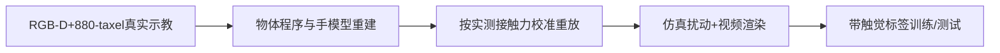

### ⑦ 实验设计与主要结果

作者在其测试设置中报告：仅模仿视觉位姿的抓力为记录值 0.31×，基于视觉的物理重放为 1.55×，触觉校准后约 0.99×；留出录像测试 20/20 成功，未见扰动 35/36 成功，接触帧漏检率从约 32% 降至 13%。这些结果是论文特定人手—物体重放任务，而非广泛跨本体真机通用性证明。

### ⑧ 方法特点与局限性

真实触觉为隐含接触提供直接监督，但需要专用采集手套、手骨架重建及受力标定；触觉与模拟手接触几何存在不确定性，复杂多指滑动仍需测量切向力和长期接触稳定性。

---

## 6.11 RoboScape：三维深度和关键点动力学监督的物理视频世界模型

### ① 论文基本信息

- **原题**：RoboScape: Physics-informed Embodied World Model
- **作者**：Yu Shang、Xin Zhang、Yinzhou Tang、Lei Jin、Chen Gao、Wei Wu、Yong Li
- **发表信息**：NeurIPS 2025
- **研究侧重**：物理感知世界模型
- **论文**：[arXiv:2506.23135](https://arxiv.org/abs/2506.23135) · [原始 PDF](https://arxiv.org/pdf/2506.23135) · [代码仓库](https://github.com/tsinghua-fib-lab/RoboScape)
- **研究定位**：物理感知世界模型。本文不把“可以在模拟器运行”直接等同于“真实物理参数准确”。

### ② 论文概述（根据原文 Abstract 忠实中文译述）

现有具身视频世界模型常以 RGB 拟合为主，难以保持三维几何与接触运动一致性。RoboScape 将 RGB 视频生成与物理相关辅助任务联合训练：通过时间深度预测增强连续帧间三维几何的一致性，通过关键点动力学学习隐式编码物体形状和材料相关运动。作者在多个机器人场景中比较生成视频的视觉真实性和物理合理性，并将生成数据用于下游机器人策略训练和策略评测。

### ③ 研究动机与核心问题

仅依据像素似然学习的视频模型可能产生物体漂移、穿透和不合理形变。为机器人生成示教时，关键不仅是‘某一帧像真的’，还要保证同一物体在时间上的空间结构和受动作影响的运动。

### ④ 方法总览与原论文主图

**原论文主图（Figure 1，PDF 第 3 页）**

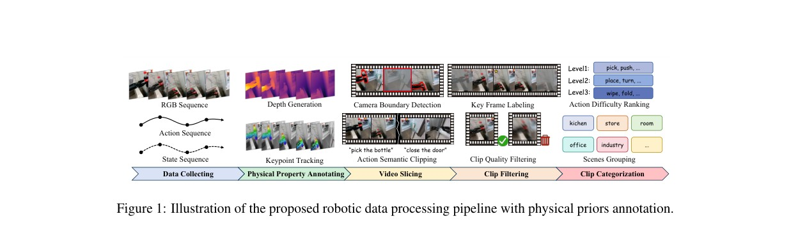

**原论文第二张关键图（Figure 2，PDF 第 4 页）**


*图号、源 PDF 和裁切位置参见 [截图 Manifest](../../assets/paper-screenshots/manifest.json)。*

**读图指引**：原论文主图通常说明应用任务与主要模块；第二张重点检查数据如何进入模型、哪个环节承担物理约束、是否使用真实交互。未必所有 Figure 2 都是网络结构图，请结合原图标题阅读。

### ⑤ 核心技术与算法细节

1. **机器人视频数据加工。** 将动作视频转换为可供训练的视觉序列与物理相关辅助标注，避免只有 RGB 重建监督。

2. **时间深度预测。** 显式预测不同时间步的三维距离结构，使生成过程受到跨帧场景几何连续性约束。

3. **关键点动力学预测。** 追踪/预测物体关键点的时序运动，迫使模型学习可用于解释接触和材料状态变化的动态信息。

4. **联合视频生成训练。** 将深度和关键点损失与视频生成目标结合，提高视觉一致性和运动合理性。

5. **下游验证。** 比较生成结果的物理/视觉指标，并在机器人策略训练与评价中检验其效用。

### ⑥ 完整 Pipeline（中文梳理）


### ⑦ 实验设计与主要结果

NeurIPS 2025 论文报告在多样机器人场景中相对对照取得更好的视觉保真与物理合理性，同时展示合成数据在策略训练和评测中的效用。不能据此把模型解释为显式质量、摩擦、接触力均准确的动力学引擎；指标仍需要结合真实任务对照。

### ⑧ 方法特点与局限性

几何和关键点任务为视频提供有意义的物理监督，但像素和关键点的正确性不能唯一决定接触力或摩擦参数。对于难观测的接触、遮挡和长时因果反馈，仍需真正的动作重放与物理指标。

---

## 6.12 ABot-PhysWorld：利用物理偏好优化训练动作可控视频世界模型

### ① 论文基本信息

- **原题**：ABot-PhysWorld: Interactive World Foundation Model for Robotic Manipulation with Physics Alignment
- **作者**：Yuzhi Chen、Ronghan Chen、Dongjie Huo 等
- **发表信息**：arXiv 2026-03（预印本）
- **研究侧重**：物理对齐视频世界模型
- **论文**：[arXiv:2603.23376](https://arxiv.org/abs/2603.23376) · [原始 PDF](https://arxiv.org/pdf/2603.23376) · [项目主页](https://github.com/amap-cvlab/ABot-PhysWorld) · [代码仓库](https://github.com/amap-cvlab/ABot-PhysWorld)
- **研究定位**：物理对齐视频世界模型。本文不把“可以在模拟器运行”直接等同于“真实物理参数准确”。

### ② 论文概述（根据原文 Abstract 忠实中文译述）

视频世界模型虽能产生逼真的具身画面，但常出现物体穿透、违反重力等不合理交互。ABot-PhysWorld 提出 14B 参数的 Diffusion Transformer，基于约三百万段带物理标注的操作视频进行训练，并通过解耦物理判别器和基于 DPO 的后训练降低物理违背，同时保持视觉质量。模型设计并行上下文块注入精确空间动作，以支持跨本体控制；作者还提出 EZSbench，分别评价生成的物理合理性与动作对齐。

### ③ 研究动机与核心问题

生成视频的两种正确性并不相同：‘物体运动符合物理’和‘视频响应指定机器人动作’。仅优化观感可能两者都不足；直接用单一 VLM 偏好打分又容易混淆外观、语义与动力学。

### ④ 方法总览与原论文主图

**原论文主图（Figure 1，PDF 第 3 页）**

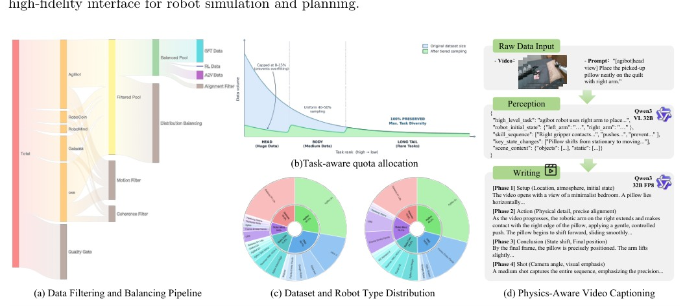

**原论文第二张关键图（Figure 2，PDF 第 4 页）**


*图号、源 PDF 和裁切位置参见 [截图 Manifest](../../assets/paper-screenshots/manifest.json)。*

**读图指引**：原论文主图通常说明应用任务与主要模块；第二张重点检查数据如何进入模型、哪个环节承担物理约束、是否使用真实交互。未必所有 Figure 2 都是网络结构图，请结合原图标题阅读。

### ⑤ 核心技术与算法细节

1. **物理数据策展。** 构建大规模操作视频数据并附加物理信息，区分合理动作结果与明显穿透、悬浮等异常。

2. **动作条件世界模型。** 使用 Diffusion Transformer 生成动作条件视频，空间动作通过专门上下文机制注入，以降低‘机器人动了但视频未执行相应物体变化’的情况。

3. **解耦物理评价。** 分离用于识别物理异常与动作对齐的评价信号，使模型不至于只优化图像清晰度。

4. **DPO 后训练。** 用物理偏好信息微调生成模型，使其偏好更符合接触、重力与任务一致性的候选序列。

5. **EZSbench 测试。** 使用训练之外的机器人、场景、任务组合分别测量物理真实性和动作跟随能力。

### ⑥ 完整 Pipeline（中文梳理）


### ⑦ 实验设计与主要结果

论文基于约三百万段操作片段，并在 PBench、EZSbench 等基准上与其他视频生成模型比较。作者报告物理合理性及轨迹一致性方面的改善；目前仍应将其视为生成模型的物理对齐结果，而不是已测得牛顿量纲误差的高保真模拟器。

### ⑧ 方法特点与局限性

数据策展和后训练可能降低明显物理幻觉，但不能保证模型精确守恒动量、正确预测接触力。大模型推理成本和行动长时因果稳定性仍是部署障碍；评价需防止判别器与生成器共享偏差。

---

## 6.13 Principia：利用对象间关系检验视频模型的牛顿物理规律

### ① 论文基本信息

- **原题**：Principia: Relational Physics Tests for Video Models
- **作者**：Varun Varma Thozhiyoor、Shivam Tripathi、Venkatesh Babu Radhakrishnan、Anand Bhattad
- **发表信息**：arXiv 2026-09（预印本）
- **研究侧重**：物理规律评价
- **论文**：[arXiv:2609.04200](https://arxiv.org/abs/2609.04200) · [原始 PDF](https://arxiv.org/pdf/2609.04200) · [项目主页](https://principiabench.github.io/)
- **研究定位**：物理规律评价。本文不把“可以在模拟器运行”直接等同于“真实物理参数准确”。

### ② 论文概述（根据原文 Abstract 忠实中文译述）

生成视频中物体的绝对速度、尺寸或加速度往往依赖未知帧率与相机标定，难以直接评价物理正确性。Principia 提出基于成对对象的相对物理关系测试，在同一场景中比较受相同物理规律约束的两个对象，使用对标定较不敏感的图像空间一致性分数检验重力、恢复系数、摩擦、转动惯量、抛体、动量、摆和弹簧振动等八类现象。作者发现多个视频生成模型视觉质量较高，但关系物理测试得分明显偏低，VLM 对违规事件的识别也不可靠。

### ③ 研究动机与核心问题

一个物体独自下滑看似合理，并不能判断速度是否符合物理。把两个应满足已知关系的对象放在同一画面，可能在不精确恢复米制尺度和摄像机焦距时，仍检出模型违反基本物理规律的情况。

### ④ 方法总览与原论文主图

**原论文主图（Figure 1，PDF 第 1 页）**

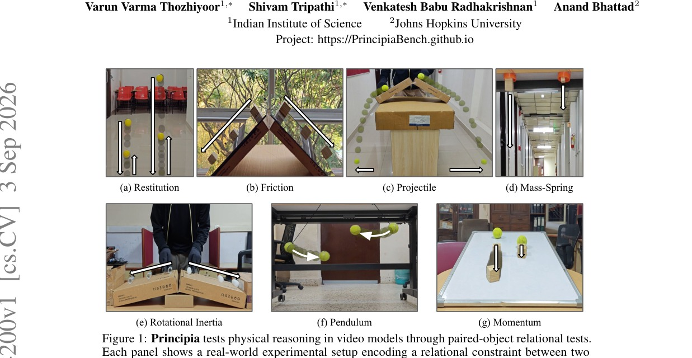

**原论文第二张关键图（Figure 2，PDF 第 2 页）**


*图号、源 PDF 和裁切位置参见 [截图 Manifest](../../assets/paper-screenshots/manifest.json)。*

**读图指引**：原论文主图通常说明应用任务与主要模块；第二张重点检查数据如何进入模型、哪个环节承担物理约束、是否使用真实交互。未必所有 Figure 2 都是网络结构图，请结合原图标题阅读。

### ⑤ 核心技术与算法细节

1. **构造成对实验。** 设计同一物理规律约束下的两个对象，例如相同坡面上的不同质量物体，构成具有已知相对关系的运动。

2. **控制变量与录制。** 在真实场景下控制对象属性与环境条件，再形成文本/图像提示，减少任务设置的随意性。

3. **关系一致性度量。** 使用对象相对时序、位移和事件关系构造尽量不依赖绝对相机标定的分数，检验多个物理现象。

4. **模型与人类评测。** 对多种视频模型与视觉语言模型测试，区分生成器是否违反规律，以及 VLM 能否可靠发现违规。

### ⑥ 完整 Pipeline（中文梳理）


### ⑦ 实验设计与主要结果

论文覆盖八种物理现象；在六个被测视频生成器中，Principia 最高得分不超过 0.42，而相同模型的 VBench 视觉质量在约 0.8 水平。最佳被测 VLM 的物理违规判断准确率约 67%。这些数字衡量的是该 Benchmark 上的视频关系物理一致性，不是机器人碰撞力/策略成功率。

### ⑧ 方法特点与局限性

优势是把评价从主观好不好看转向有物理依据的相对约束；不足是实验通常需要可追踪的对象和受控情境，难完全覆盖多指接触与连续复杂控制中的隐藏力学变量。

---

## 6.14 PVBench：以对象级物理测量评价视频生成

### ① 论文基本信息

- **原题**：PVBench: Quantifying Physical Plausibility in Video Generation with Object-Level Physical Measurements
- **作者**：Kaiwei Chen、Moran Li、Zhenye Gan 等
- **发表信息**：arXiv 2026-10（预印本）
- **研究侧重**：物理量评价
- **论文**：[arXiv:2610.26711](https://arxiv.org/abs/2610.26711) · [原始 PDF](https://arxiv.org/pdf/2610.26711) · [项目主页](https://kszg-11.github.io/PVBench-Website/) · [代码仓库](https://github.com/KSZG-11/PVBench)
- **研究定位**：物理量评价。本文不把“可以在模拟器运行”直接等同于“真实物理参数准确”。

### ② 论文概述（根据原文 Abstract 忠实中文译述）

现有物理视频评价经常依赖粗粒度 VLM 判断，无法指出哪个对象违反了什么物理条件。PVBench 提出对象级可量化物理真实性 Benchmark，以七大领域、46 个维度和 600 组提示词覆盖语义、因果、空间几何、材料与场状态、运动持续性和守恒定律等，其中约 30% 的提示涉及机器人手臂、人形和四足等具身对象。对可测量维度，作者配合 6D 位姿、真实尺度、表面法向及守恒量残差等视觉模型，减少对单一主观评分的依赖，并以人工评价验证自动指标的一致性。

### ③ 研究动机与核心问题

生成视频可能看似物理合理，但关节角、物体尺度、支撑关系与守恒量存在不同错误；单一二元‘符合/不符合物理’打分不能定位错误类型和量化严重程度。

### ④ 方法总览与原论文主图

**原论文主图（Figure 1，PDF 第 2 页）**

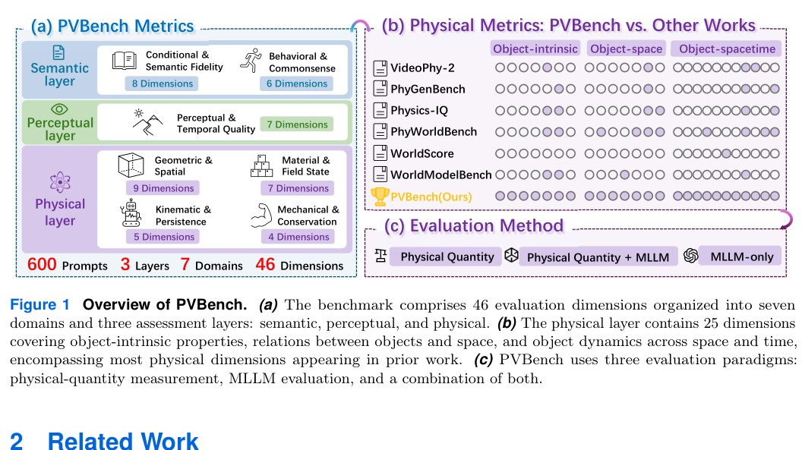

**原论文第二张关键图（Figure 2，PDF 第 4 页）**

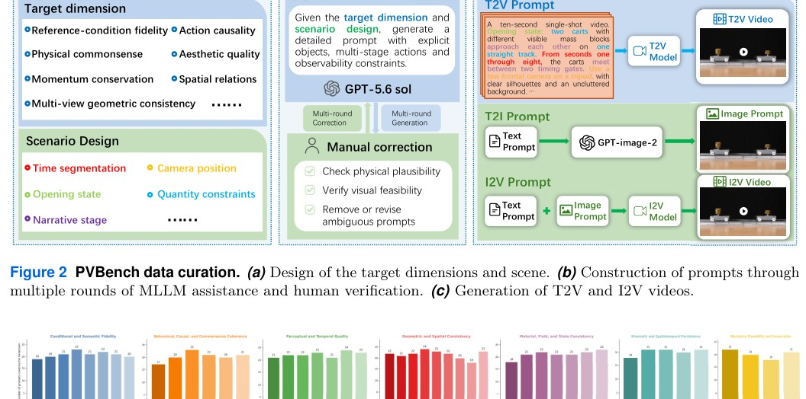

*图号、源 PDF 和裁切位置参见 [截图 Manifest](../../assets/paper-screenshots/manifest.json)。*

**读图指引**：原论文主图通常说明应用任务与主要模块；第二张重点检查数据如何进入模型、哪个环节承担物理约束、是否使用真实交互。未必所有 Figure 2 都是网络结构图，请结合原图标题阅读。

### ⑤ 核心技术与算法细节

1. **设计多维测试空间。** 将物理真实性拆成七大领域、46 个维度，覆盖语义一致性、因果变化、几何空间、材料与机械动力学等，不只评价某个单独运动现象。

2. **任务提示与具身条件。** 构造 600 组提示词并覆盖机器人本体、环境与交互对象，控制生成条件以便比较。

3. **对象级数值代理。** 使用物体 6D 位姿、尺度、法向、轨迹等可测量信号估计物理量，再计算守恒规律或时序一致性的数值残差。

4. **自动与人工对照。** 分别统计视频视觉质量、具体物理违规维度及自动测量与人工判断的相关性，避免单个判别器支配全部结论。

### ⑥ 完整 Pipeline（中文梳理）


### ⑦ 实验设计与主要结果

论文评估主流开源与闭源视频生成器，提供基准提示词及测量/标定流程，并通过人工评价检查自动指标的一致性。600 组提示中约 30% 涉及具身智能；它仍属于视频生成物理合理性评价，不能直接代替机器人动力学模型的扭矩、接触力、物体加速度重放误差。

### ⑧ 方法特点与局限性

优点是细粒度、可追踪到物体与物理量；但所有视觉估计器都有深度、尺度、遮挡与时间采样误差，指标反映的仍是估计的物理一致性。用于 Sim-to-Real 时，应与真实传感器时间同步的状态/力测量联合使用。

---

## 6.15 技术路线横向比较：差别在哪里？

| 路线 | 实际学习或校准对象 | 物理约束形式 | 需要真实交互？ | 最直接的验证方式 |
|---|---|---|---|---|
| PhysX-3D / PhysX-Anything | 物体结构与物理属性标签 | 物理语义、关节和资产格式 | 可选；主要依赖标注/图像 | 资产可运行、属性估计与真实参数的误差 |
| Scalable Real2Sim | 物体几何、碰撞、惯性参数 | 机器人运动学和力矩响应 | **需要** | 惯性辨识误差、真实动作动力学重放 |
| 物理一致场景重建 | 物体位姿、接触/支撑关系 | 接触图与可微稳定性 | 真实 RGB-D；可补充扰动 | 释放后稳定性、真实操作位姿误差 |
| Contact-Aware Neural Dynamics | 带接触条件的前向动力学 | 接触事件与预测历史 | **需要少量真实触觉** | 接触事件准确率、状态预测漂移、任务成功率 |
| Few-Shot Neural Differentiable Simulator | 接触刚体前向模型及梯度 | 解析先验 + GNN + 代理梯度 | **少量真实轨迹** | 重放误差、优化收敛与真机转移 |
| PhysTwin / SoMA | 柔性体状态与材料响应 | 弹簧—质点/动作条件神经动力学 | **需要真实形变视频** | 未见动作下的形变场/多视角/长期误差 |
| Alloy | 多材料数值求解系统 | 各材料求解器与耦合接口 | 不一定 | 守恒/闭式解验证 + 真实多材料重放 |
| TactileLab / TouchTwin | 剪切触觉或接触力 | 触觉流/实测接触分布 | 需要真实触觉作对齐或验证 | 受力误差、接触时刻、滑移识别及真机任务 |
| RoboScape / ABot-PhysWorld | 动作条件视频中的物理表征 | 深度/关键点约束、物理偏好 | 需要物理标注或真实视频 | 视觉-动作一致、物理异常与真实任务 |
| Principia / PVBench | 视频物理违背的测量方法 | 关系约束、对象级数值残差 | 真实实验可用于校准 | 物理测试得分、人工判断一致性 |

### 6.15.1 关键范式转换

1. **从物理标签到物理辨识。** PhysX-Anything 解决“快速生成可运行资产”，Scalable Real2Sim 解决“通过机器人真实运动测量部分物理参数”。两者互补而不能互相替代。
2. **从校准少数参数到学习残差状态转移。** Contact-Aware Neural Dynamics 把高维、接触切换误差交给触觉约束的神经预测；Few-Shot Neural Differentiable Simulator 则将解析模拟先验与可微学习结合。
3. **从只看 RGB 到接触/力的显式监督。** TouchTwin 的真实测力表明即使手指视觉姿态接近，也可能有巨大的抓力偏差。
4. **从单一材料引擎到场景级耦合。** Alloy 扩展多材料的系统接口，却不能仅靠吞吐量证明真实接触准确性。
5. **从看起来合理到可量化物理测试。** Principia 通过相对关系，PVBench 通过对象级数值代理，把物理真实性从审美问题转为可测量问题。

### 6.15.2 与原有章节的关系

- **第三章 SPARR**：它优化真实域的**残差策略**，并非提高仿真器本身的物理参数或动力学模型；[阅读原文](03-physics.md)。
- **第三章 PIN-WM**：以少量真实观测进行物理参数辨识，再构造 Digital Cousins；与本章的 Scalable Real2Sim、Contact-Aware Dynamics 形成“显式参数—隐式动力学”对照。
- **第三章 SoMA**：专注机器人动作条件的柔性物体神经仿真，与本章 PhysTwin 的逆向物理重建和 Alloy 的多材料系统设施互补。
- **第二章 SimFoundry / EmbodiedGen V2 / TabletopGen**：侧重生成式可交互场景；本章主要审查生成资产与真实交互的物理一致性。

## 6.16 如何建立可信物理真实性评价体系？

为了判断仿真数据是否真正可信，至少分三层评价：

**(A) 资产和场景层**

- 公制尺度与碰撞几何误差；关节轴/自由度是否与实物一致；
- Mass / inertia / friction 的误差与置信范围；静态场景有无穿透、悬浮、支撑错误；
- 导出 URDF/MJCF 后能否稳定加载、可控执行。**可加载率不是物理保真度。**

**(B) 交互状态转移层**

在相同真实初态和记录动作条件下进行离线状态重放，并明确机器人控制器及时间同步误差：

$$
E_{\mathrm{replay}} =
\frac{1}{T}\sum_{t=1}^T
d(s_t^{\mathrm{sim}},s_t^{\mathrm{real}}).
$$

其中 $d$ 不应未经量纲归一就将位置、姿态、受力和离散接触事件简单求和。推荐分别报告平移误差（m）、旋转误差（度）、接触时刻误差（ms）、接触分类 F1、滑移速度误差（m/s）、抓握力/法向力误差（N）。有柔性物体时添加形变点云/关键点距离与长期预测偏移。

**(C) 下游迁移层**

$$
G_{\mathrm{perf}}=
\left|\operatorname{SR}_{\mathrm{sim}}(\pi)-
\operatorname{SR}_{\mathrm{real}}(\pi)\right|.
$$

报告真实成功率时须列出本体、任务、初始状态变化、试验次数、环境重置方式，并区分**零样本 Sim-to-Real**、**使用真实数据校准后的迁移**和**真实在线 RL 适配后的结果**。与第 1 章的 Reality Gap 定义相呼应：动态模型逼近和任务性能改善是不同目标。

### 6.16.1 最有价值的消融设计

| 消融对照 | 控制变量 | 应观测的增益 |
|---|---|---|
| 仅视觉几何 vs 增加物理属性预测 | 固定几何/动作，改变物理参数来源 | 真实运动重放与接触误差 |
| 随机参数 vs 实测/辨识参数 | 相同模拟与真实任务集 | 接触精度与真实成功率 |
| 无触觉 vs 触觉监督 | 固定模拟规模、真实交互预算 | 接触事件与抓力误差 |
| 解析求解 vs 神经残差 | 相同真实轨迹划分与初态 | 多步状态误差/接触长尾场景 |
| 不用物理筛选 vs 物理筛选 | 相同生成数量及训练步数 | 生成视频的一致性与真实策略收益 |

**研究判断：** 面向真实机器人操作，优先建设任务相关的 Physical Fidelity Benchmark 可能比追求通用的视频物理评分更有价值。最有前景的组合是：可执行显式物理先验 + 少量真实交互校准 + 接触/触觉约束的神经动力学 + 量纲明确的物理误差评估。这个判断属于跨论文分析，不能当作任意一篇论文已经充分证明的实验结论。

## 6.17 阅读建议

建议先按以下顺序精读原文：**Scalable Real2Sim → Contact-Aware Neural Dynamics → Few-Shot Neural Differentiable Simulator → PhysTwin → TactileLab/TouchTwin → Principia/PVBench**。这样依次建立物理参数的可辨识性、接触动力学、柔性状态、触觉监督和物理量评价的完整认识。

图示均来自对应论文 PDF 的 Figure 1/2 截取，若某论文 PDF 特殊版式尚未取得稳定截图，则只放原始 PDF 链接，并注明缺失原因；不能把作者官网 Teaser 或中文 Mermaid 误标为原论文方法架构图。新增论文均保留其真实发表状态。
