# 6. 面向具身学习的物理一致性：仿真资产、真实数据与世界模型

> 筛选原则：只收录直接支持机器人可交互仿真、Real-to-Sim 数据生成、动作条件世界模型或下游策略训练的工作。保留 7 篇论文；材料力学、接触数值求解器与通用物理规律评分不属于本章范围。

## 6.0 技术路线总览

对于具身学习，核心问题不是完整模拟所有物理现象，而是**生成的对象能否交互、真实示教能否重放、生成视频是否正确对应机器人动作**。

| 技术路线 | 代表论文 | 数据与模型流程 | 直接价值 |
|---|---|---|---|
| 可交互三维资产生成 | PhysX-3D、PhysX-Anything | 物体图像/资产 → 几何、关节和属性 → Sim-Ready 对象 | 扩大可用于策略训练的物体和任务 |
| 真实数据驱动 Real-to-Sim | Scalable Real2Sim、Physics-Consistent Real-to-Sim、TouchTwin | 实景/交互/触觉 → 重建与校准 → 可用仿真场景/示教 | 提升真实动作与仿真数据之间的一致性 |
| 物理感知的动作视频世界模型 | RoboScape、ABot-PhysWorld | 机器人动作视频 → 几何/运动监督或偏好优化 → 未来视频预测 | 提升合成数据的动作条件忠实度 |

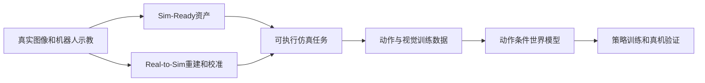

**阅读重点**：模型输入输出、生成/训练 Pipeline、真实数据使用方式、动作标签是否准确，以及对真实机器人学习的价值。不需要先掌握接触求解器和材料力学的细节。

---

## 6.1 PhysX-3D：从几何资产生成走向带物理知识的三维资产

### ① 论文基本信息

- **原题**：PhysX-3D: Physical-Grounded 3D Asset Generation
- **作者**：Ziang Cao、Zhaoxi Chen、Liang Pan、Ziwei Liu
- **发表信息**：NeurIPS 2025
- **研究侧重**：资产物理知识
- **论文**：[arXiv:2507.12465](https://arxiv.org/abs/2507.12465) · [原始 PDF](https://arxiv.org/pdf/2507.12465) · [项目主页](https://physx-3d.github.io/)
- **研究定位**：资产物理知识。本文不把“可以在模拟器运行”直接等同于“真实物理参数准确”。

### ② 论文概述（根据原文 Abstract 忠实中文译述）

现有三维生成以外观与几何为核心，缺少面向机器人和仿真的物理属性。本文提出 PhysX-3D 范式：首先建立 PhysXNet，将绝对尺度、材质、可供性、运动学和功能描述五类信息系统标注到三维资产；再提出 PhysXGen，通过双分支前馈生成框架，将物理知识注入预训练的三维结构表示，在维持几何质量的同时预测合理的物理属性。作者以属性预测和三维生成实验验证该框架的性能与泛化能力。

### ③ 研究动机与核心问题

三维外观相似不保证物体能在模拟器中正确交互。缺少公制尺度、部件材质和关节关系时，即使 Mesh 可导入，也难以构造合理的碰撞、质量与运动学约束。论文主要解决资产层面的物理语义与生成问题，而不是直接求解接触动力学。

### ④ 方法总览与原论文主图

**原论文主图（Figure 1，PDF 第 1 页）**

**原论文第二张关键图（Figure 2，PDF 第 4 页）**

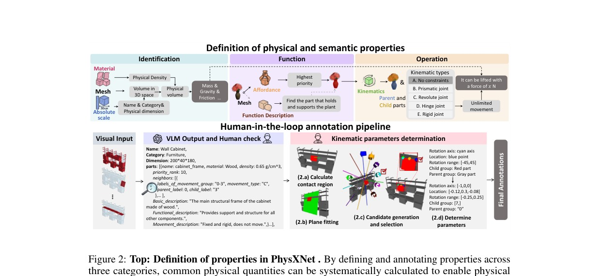

*图号、源 PDF 和裁切位置参见 [截图 Manifest](../../assets/paper-screenshots/manifest.json)。*

**读图指引**：原论文主图通常说明应用任务与主要模块；第二张重点检查数据如何进入模型、哪个环节承担物理约束、是否使用真实交互。未必所有 Figure 2 都是网络结构图，请结合原图标题阅读。

### ⑤ 核心技术与算法细节

1. **物理标签体系。** 将 PhysXNet 的信息划为五类：公制尺度、材质、可供性、关节运动学与功能描述；既包含对象级属性，也包含部件级语义。这使模型能够区分“看起来像抽屉”和“确实具有可移动关节”两种资产。

2. **数据构建。** 从已有 3D 资产出发，由 VLM 协助标注，并引入人工校核，建立可供训练和评价的物理属性数据。标注可看作物理建模先验，并不全部来自真实测量。

3. **双分支生成。** PhysXGen 在三维结构生成分支之外显式建模物理属性，学习几何结构与材质、尺度、关节信息的相关性，避免只在生成完成后做零散属性补丁。

4. **资产导出与使用。** 将生成的物体与属性导入仿真，需要进一步检查碰撞 Mesh、可动部件关节与物理引擎参数的对应关系，不能假设属性标签自动等于准确的接触力。

### ⑥ 完整 Pipeline（中文梳理）

### ⑦ 实验设计与主要结果

作者报告 PhysXNet 超过 2.6 万个具有物理属性标注的三维对象，并对生成质量、物理属性预测与泛化进行评估。需要区分生成属性的合理性与真实机器人操作中物理参数实测精度；论文的主要实证不等同于完整的真机动力学重放误差实验。

### ⑧ 方法特点与局限性

提供了可扩展的物理资产数据表示和生成路线，但材质、质量等属性可能仍来自视觉推断与先验，不保证具有可辨识的真实数值；对接触摩擦、滑移和长期动力学的验证需要后续 Real-to-Sim 数据。

---

---

## 6.2 PhysX-Anything：单图生成仿真就绪的可动三维对象

### ① 论文基本信息

- **原题**：PhysX-Anything: Simulation-Ready Physical 3D Assets from Single Image
- **作者**：Ziang Cao、Fangzhou Hong、Zhaoxi Chen、Liang Pan、Ziwei Liu
- **发表信息**：CVPR 2026
- **研究侧重**：可执行资产
- **论文**：[arXiv:2511.13648](https://arxiv.org/abs/2511.13648) · [原始 PDF](https://arxiv.org/pdf/2511.13648) · [项目主页](https://physx-anything.github.io/) · [代码仓库](https://github.com/ziangcao0312/PhysX-Anything)
- **研究定位**：可执行资产。本文不把“可以在模拟器运行”直接等同于“真实物理参数准确”。

### ② 论文概述（根据原文 Abstract 忠实中文译述）

本文研究如何从单张自然图像直接生成能够参与物理仿真的三维对象，而不仅是静态视觉网格。作者提出基于视觉语言模型的物理三维生成框架，显式输出几何、关节结构与物理属性，并引入高效几何 token 表示，使几何 token 数减少约 193 倍。为增加训练覆盖，构建具有丰富物理标注、包含超过两千种常见物体的 PhysX-Mobility 数据集，并在生成质量、泛化和 MuJoCo 风格的接触操作任务中验证生成资产的可用性。

### ③ 研究动机与核心问题

单图到三维的方法常缺乏运动学拓扑、关节约束和物理参数，导致生成资产虽可渲染，却无法直接驱动机器人学习。核心问题是把资产生产的终点从视觉几何扩展到具有结构约束的仿真文件。

### ④ 方法总览与原论文主图

**原论文主图（Figure 1，PDF 第 1 页）**

**原论文第二张关键图（Figure 2，PDF 第 3 页）**

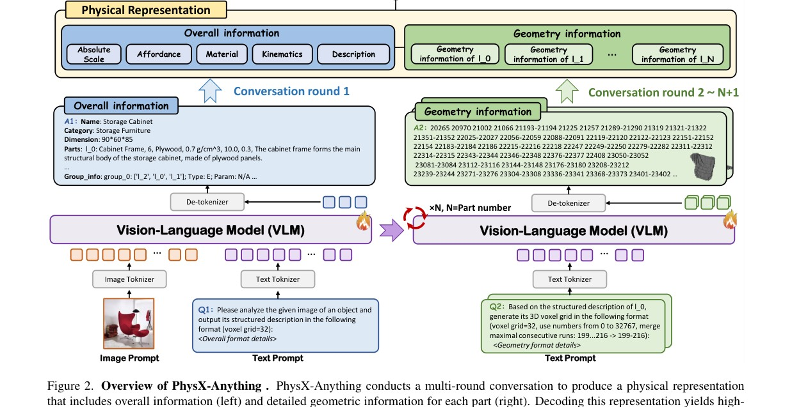

*图号、源 PDF 和裁切位置参见 [截图 Manifest](../../assets/paper-screenshots/manifest.json)。*

**读图指引**：原论文主图通常说明应用任务与主要模块；第二张重点检查数据如何进入模型、哪个环节承担物理约束、是否使用真实交互。未必所有 Figure 2 都是网络结构图，请结合原图标题阅读。

### ⑤ 核心技术与算法细节

1. **输入感知与物理结构推断。** 根据图像推断对象整体外形、可动部件、关节连接和物理属性；模型需要处理单视角固有的几何和遮挡歧义。

2. **紧凑显式几何编码。** 使用新的 tokenization 降低几何序列长度，使标准 VLM 上下文窗口能够承载显式几何监督；论文报告约 193 倍 token 降幅，此处是表示效率而非物理误差降幅。

3. **多轮物理资产生成。** 在 VLM 驱动的生成流程中联合输出结构与物理描述，并导出 URDF/XML 资产，使对象在物理引擎中有可解释的关节与碰撞接口。

4. **数据和下游验证。** PhysX-Mobility 增加真实物体类别与物理标注覆盖，再将生成对象用于模拟抓取等接触操作；该验证侧重 sim-ready 性质，而非自动证明参数与实物完全一致。

### ⑥ 完整 Pipeline（中文梳理）

### ⑦ 实验设计与主要结果

论文报告几何 token 数约减少 193 倍、PhysX-Mobility 包含超过两千个日常物体，并展示生成资产在 MuJoCo 风格接触操作模拟中可直接使用。上述结果支持生成与可执行性，但不能将其理解为全部对象的摩擦、密度、惯量已由真实交互测定。

### ⑧ 方法特点与局限性

规模化生成速度和可用性突出；单图推断质量、摩擦和隐藏关节存在多解性，尤其对透明、柔性和内部复杂物体。需要通过真实交互校验才能迈向高物理保真数字孪生。

---

---

## 6.3 Scalable Real2Sim：机器人交互驱动的物理资产测量与生成

### ① 论文基本信息

- **原题**：Scalable Real2Sim: Physics-Aware Asset Generation Via Robotic Pick-and-Place Setups
- **作者**：Nicholas Pfaff、Evelyn Fu、Jeremy Binagia、Phillip Isola、Russ Tedrake
- **发表信息**：IROS 2025
- **研究侧重**：物理参数辨识
- **论文**：[arXiv:2503.00370](https://arxiv.org/abs/2503.00370) · [原始 PDF](https://arxiv.org/pdf/2503.00370) · [项目主页](https://scalable-real2sim.github.io/) · [代码仓库](https://github.com/nepfaff/scalable-real2sim)
- **研究定位**：物理参数辨识。本文不把“可以在模拟器运行”直接等同于“真实物理参数准确”。

### ② 论文概述（根据原文 Abstract 忠实中文译述）

本文提出无需人工逐个建模的 Real-to-Sim 资产生产流程：机器人在常规抓放工作站中自动拾取对象、通过固定相机采集多角度外观，再结合关节力矩数据识别对象惯性等物理属性。方法引入针对前景遮挡的透明度感知几何重建，从 NeRF/3DGS 等表观重建中提取高质量物体 Mesh，得到视觉几何、碰撞几何和可模拟的动力学参数，最终构造仿真就绪资产。

### ③ 研究动机与核心问题

仅靠单张图像很难确定质量、质心或惯量，而人工称重、扫描和标定难以扩展到大量新物体。这篇工作把机器人本体的力矩响应变成物理监督，是从“推测属性”到“主动测量属性”的路线。

### ④ 方法总览与原论文主图

**原论文主图（Figure 1，PDF 第 1 页）**

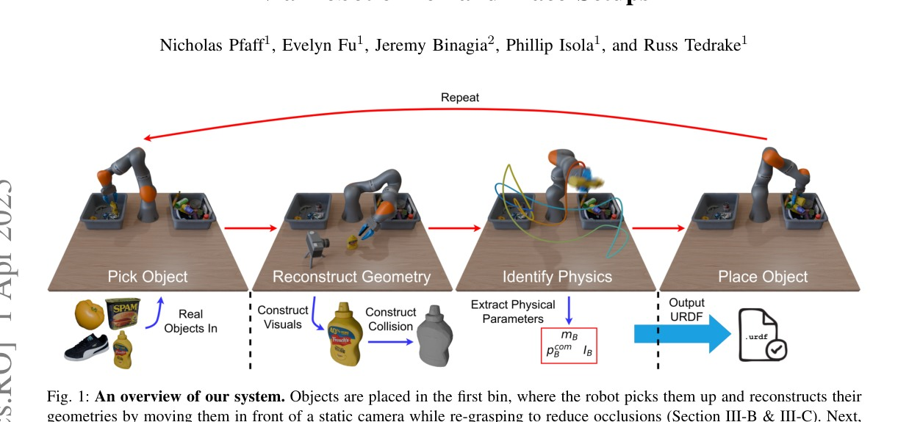

**原论文第二张关键图（Figure 2，PDF 第 3 页）**

*图号、源 PDF 和裁切位置参见 [截图 Manifest](../../assets/paper-screenshots/manifest.json)。*

**读图指引**：原论文主图通常说明应用任务与主要模块；第二张重点检查数据如何进入模型、哪个环节承担物理约束、是否使用真实交互。未必所有 Figure 2 都是网络结构图，请结合原图标题阅读。

### ⑤ 核心技术与算法细节

1. **自动物体采集。** 机器人从料箱抓取物体，在相机前执行多视角运动和重新抓取，尽量降低遮挡对几何重建的影响。

2. **对象中心视觉/碰撞重建。** 使用包含 alpha 透明训练和前景遮挡建模的图像重建方式，抽取适合仿真器的 Mesh，并区分渲染几何与碰撞用几何。

3. **激励式惯性辨识。** 机器人执行对惯性参数有信息量的运动，利用关节力矩和机器人运动学模型辨识质量分布相关参数。只有激励充分、传感器可靠，辨识才可能稳定。

4. **自动封装。** 将网格、几何尺度、惯性信息和材料/碰撞参数组合成完整资产，供数据生成或策略训练使用；对尚未真实测量的接触参数仍需后续校准。

### ⑥ 完整 Pipeline（中文梳理）

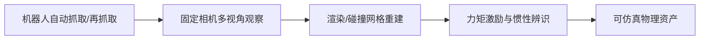

### ⑦ 实验设计与主要结果

论文在多种实物上验证了自动扫描、几何重建和惯性属性辨识的完整流程，强调无需针对每个对象的人为环境改造。比较时应分开记录重建几何误差、动力学参数误差和流水线吞吐，而不是把“自动可导入”视为真实操控成功率。

### ⑧ 方法特点与局限性

真实机器人和力矩传感器成为必要条件；夹持状态误差、测量噪声和外部扰动会影响惯性辨识。其强项是标准刚体对象，不是无需改动便覆盖复杂多材质与柔性对象。

---

---

## 6.4 Physics-Consistent Real-to-Sim：面向杂乱接触场景的稳定重建

### ① 论文基本信息

- **原题**：Real-to-Sim for Highly Cluttered Environments via Physics-Consistent Inter-Object Reasoning
- **作者**：Tianyi Xiang、Jiahang Cao、Sikai Guo、Guoyang Zhao、Andrew F. Luo、Jun Ma
- **发表信息**：2026 论文 / arXiv:2602.12633
- **研究侧重**：场景级物理约束
- **论文**：[arXiv:2602.12633](https://arxiv.org/abs/2602.12633) · [原始 PDF](https://arxiv.org/pdf/2602.12633) · [项目主页](https://physics-constrained-real2sim.github.io/) · [代码仓库](https://github.com/physics-constrained-Real2Sim/physics-constrained-Real2Sim)
- **研究定位**：场景级物理约束。本文不把“可以在模拟器运行”直接等同于“真实物理参数准确”。

### ② 论文概述（根据原文 Abstract 忠实中文译述）

从单幅 RGB-D 图像重建复杂堆叠场景时，几何重建容易产生悬浮、穿透或不稳定物体，从而破坏后续仿真。本文提出物理约束的 Real-to-Sim 流程，在初步重建和实例分割基础上建立物体接触图，并利用可微刚体仿真联合细化物体位姿与物理属性。作者在仿真和真实接触操作环境中检验场景稳定性及接触交互的可靠性。

### ③ 研究动机与核心问题

多个对象同时存在时，物体间支撑、受力和摩擦共同决定稳定状态。只把每件物体 Mesh 分别对齐，不能保证对象之间存在可维持的接触关系；单纯几何不穿透也不足以确保长时静力平衡。

### ④ 方法总览与原论文主图

**原论文主图（Figure 1，PDF 第 1 页）**

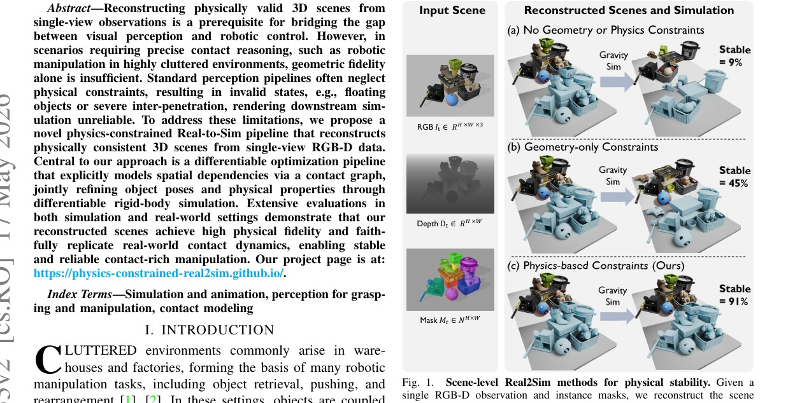

**原论文第二张关键图（Figure 2，PDF 第 3 页）**

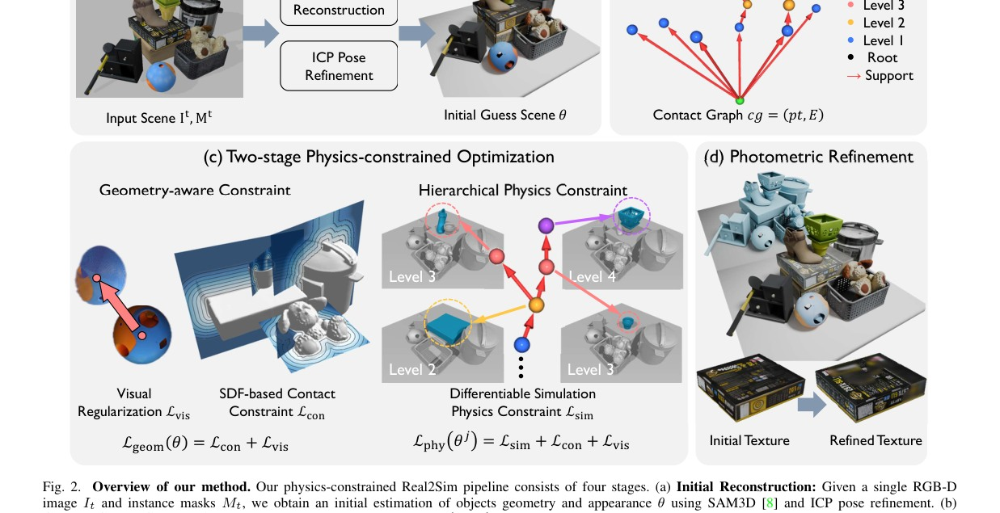

*图号、源 PDF 和裁切位置参见 [截图 Manifest](../../assets/paper-screenshots/manifest.json)。*

**读图指引**：原论文主图通常说明应用任务与主要模块；第二张重点检查数据如何进入模型、哪个环节承担物理约束、是否使用真实交互。未必所有 Figure 2 都是网络结构图，请结合原图标题阅读。

### ⑤ 核心技术与算法细节

1. **视觉初始化。** 根据 RGB-D 图像和实例掩码得到各物体初始几何、尺度和位姿，使用几何配准细化。

2. **构建场景接触图。** 将物体与地面/相邻物体的支撑关系以及邻近关系编码为图结构，显式表示一件物体受到哪些其他对象的约束。

3. **两阶段物理优化。** 先消除明显穿透、悬浮等不满足几何约束的问题，再引入可微物理模拟，联合优化物体位姿及摩擦、质量、质心等可能影响稳定性的物理属性。

4. **动态验证。** 使场景在模拟器内释放并接受操作扰动，观察长期稳定性与接触运动，而不是只以第一帧重建误差作为成功标准。

### ⑥ 完整 Pipeline（中文梳理）

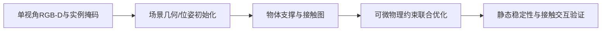

### ⑦ 实验设计与主要结果

原文比较只进行几何重建、仅加入局部非穿透约束以及施加物理约束的版本，并进行模拟与真实场景操作验证。作者报告物理约束版本的稳定性及接触真实性更好；若无统一真实轨迹重放和置信区间，不宜将这一结论写成适用于任意场景的绝对物理正确性。

### ⑧ 方法特点与局限性

适合刚体杂乱场景的初态构建；单帧 RGB-D 仍难观测隐藏接触与真实物体内部属性。优化得到的参数可能不是唯一的材料属性，还应检查接触图错误传播和非刚体物品。

---

---

## 6.5 TouchTwin：以实测触觉约束手—物体的交互重放

### ① 论文基本信息

- **原题**：TouchTwin: Scaling Human Touch Data via Real-to-Sim-to-Real
- **作者**：Huiwen Han、Nuo Chen、Ziyao Zeng、Dayou Li、Hao Wang 等
- **发表信息**：arXiv 2026-11-13（预印本）
- **研究侧重**：触觉接触力标定
- **论文**：[arXiv:2611.17619](https://arxiv.org/abs/2611.17619) · [原始 PDF](https://arxiv.org/pdf/2611.17619) · [项目主页](https://touchtwin.github.io/)
- **研究定位**：触觉接触力标定。本文不把“可以在模拟器运行”直接等同于“真实物理参数准确”。

### ② 论文概述（根据原文 Abstract 忠实中文译述）

仅根据第一视角视频恢复人手姿态，无法确定每根手指是否接触、接触时间和作用力，因而直接模仿或视觉重放往往产生抓握力偏差。TouchTwin 使用双视角 RGB-D 与 880 个 taxel 的触觉手套数据，将人手与可交互物体重建进 MuJoCo；由编码代理构建经物理测试的对象程序，使用实测触觉驱动手指接触与闭合程度，再生成带接触/受力标注的扰动示教。作者报告重放的抓握力更接近真实，并改善接触预测及任务执行。

### ③ 研究动机与核心问题

视频可以看到手停在哪里，却不能判断柔软手指是否继续压入、究竟施加多少夹持力。重放时仅拟合视觉位姿可能严重低估或高估力，导致外观对齐但动力学错误。

### ④ 方法总览与原论文主图

**原论文主图（Figure 1，PDF 第 1 页）**

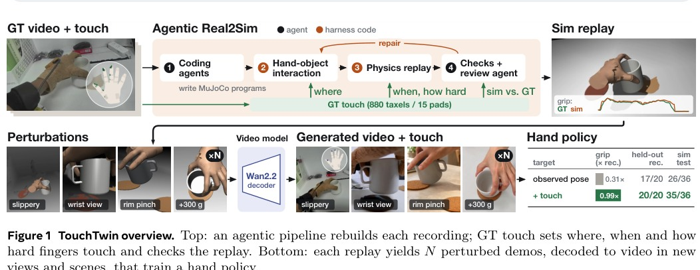

**原论文第二张关键图（Figure 2，PDF 第 2 页）**

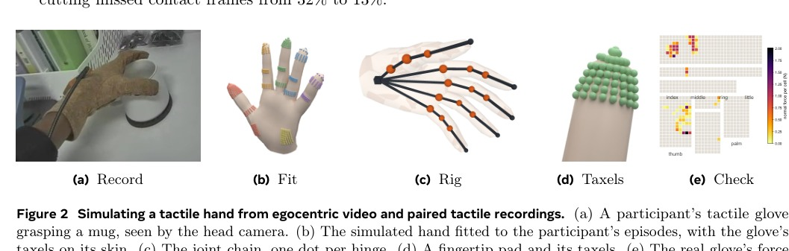

*图号、源 PDF 和裁切位置参见 [截图 Manifest](../../assets/paper-screenshots/manifest.json)。*

**读图指引**：原论文主图通常说明应用任务与主要模块；第二张重点检查数据如何进入模型、哪个环节承担物理约束、是否使用真实交互。未必所有 Figure 2 都是网络结构图，请结合原图标题阅读。

### ⑤ 核心技术与算法细节

1. **同步真实采集。** 使用头部/腕部 RGB-D 与 880-taxel 触觉手套记录操作者动作及手指压力，将力学监督与画面时序关联。

2. **Agentic Real-to-Sim。** 编码代理生成可运行的 MuJoCo 物体程序，经过简单物理操作和复核确保对象关节及接触接口可执行。

3. **个体手模型重建。** 根据视频拟合手骨架和可接触几何，把触觉 taxel 映射到模拟手表面。

4. **触觉驱动重放。** 用记录的接触分布和力决定手指是否持续闭合、何时建立接触，而非仅复制可见关节终止位置。

5. **扩增及视频生成。** 对经触觉校准的重放施加对象、视角和操作条件扰动，生成保留接触/力标签的示教，再训练灵巧手策略。

### ⑥ 完整 Pipeline（中文梳理）

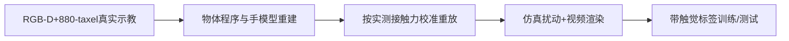

### ⑦ 实验设计与主要结果

作者在其测试设置中报告：仅模仿视觉位姿的抓力为记录值 0.31×，基于视觉的物理重放为 1.55×，触觉校准后约 0.99×；留出录像测试 20/20 成功，未见扰动 35/36 成功，接触帧漏检率从约 32% 降至 13%。这些结果是论文特定人手—物体重放任务，而非广泛跨本体真机通用性证明。

### ⑧ 方法特点与局限性

真实触觉为隐含接触提供直接监督，但需要专用采集手套、手骨架重建及受力标定；触觉与模拟手接触几何存在不确定性，复杂多指滑动仍需测量切向力和长期接触稳定性。

---

---

## 6.6 RoboScape：三维深度和关键点动力学监督的物理视频世界模型

### ① 论文基本信息

- **原题**：RoboScape: Physics-informed Embodied World Model
- **作者**：Yu Shang、Xin Zhang、Yinzhou Tang、Lei Jin、Chen Gao、Wei Wu、Yong Li
- **发表信息**：NeurIPS 2025
- **研究侧重**：物理感知世界模型
- **论文**：[arXiv:2506.23135](https://arxiv.org/abs/2506.23135) · [原始 PDF](https://arxiv.org/pdf/2506.23135) · [代码仓库](https://github.com/tsinghua-fib-lab/RoboScape)
- **研究定位**：物理感知世界模型。本文不把“可以在模拟器运行”直接等同于“真实物理参数准确”。

### ② 论文概述（根据原文 Abstract 忠实中文译述）

现有具身视频世界模型常以 RGB 拟合为主，难以保持三维几何与接触运动一致性。RoboScape 将 RGB 视频生成与物理相关辅助任务联合训练：通过时间深度预测增强连续帧间三维几何的一致性，通过关键点动力学学习隐式编码物体形状和材料相关运动。作者在多个机器人场景中比较生成视频的视觉真实性和物理合理性，并将生成数据用于下游机器人策略训练和策略评测。

### ③ 研究动机与核心问题

仅依据像素似然学习的视频模型可能产生物体漂移、穿透和不合理形变。为机器人生成示教时，关键不仅是‘某一帧像真的’，还要保证同一物体在时间上的空间结构和受动作影响的运动。

### ④ 方法总览与原论文主图

**原论文主图（Figure 1，PDF 第 3 页）**

**原论文第二张关键图（Figure 2，PDF 第 4 页）**

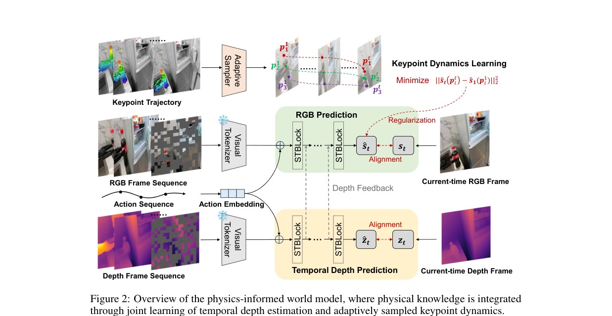

*图号、源 PDF 和裁切位置参见 [截图 Manifest](../../assets/paper-screenshots/manifest.json)。*

**读图指引**：原论文主图通常说明应用任务与主要模块；第二张重点检查数据如何进入模型、哪个环节承担物理约束、是否使用真实交互。未必所有 Figure 2 都是网络结构图，请结合原图标题阅读。

### ⑤ 核心技术与算法细节

1. **机器人视频数据加工。** 将动作视频转换为可供训练的视觉序列与物理相关辅助标注，避免只有 RGB 重建监督。

2. **时间深度预测。** 显式预测不同时间步的三维距离结构，使生成过程受到跨帧场景几何连续性约束。

3. **关键点动力学预测。** 追踪/预测物体关键点的时序运动，迫使模型学习可用于解释接触和材料状态变化的动态信息。

4. **联合视频生成训练。** 将深度和关键点损失与视频生成目标结合，提高视觉一致性和运动合理性。

5. **下游验证。** 比较生成结果的物理/视觉指标，并在机器人策略训练与评价中检验其效用。

### ⑥ 完整 Pipeline（中文梳理）

### ⑦ 实验设计与主要结果

NeurIPS 2025 论文报告在多样机器人场景中相对对照取得更好的视觉保真与物理合理性，同时展示合成数据在策略训练和评测中的效用。不能据此把模型解释为显式质量、摩擦、接触力均准确的动力学引擎；指标仍需要结合真实任务对照。

### ⑧ 方法特点与局限性

几何和关键点任务为视频提供有意义的物理监督，但像素和关键点的正确性不能唯一决定接触力或摩擦参数。对于难观测的接触、遮挡和长时因果反馈，仍需真正的动作重放与物理指标。

---

---

## 6.7 ABot-PhysWorld：利用物理偏好优化训练动作可控视频世界模型

### ① 论文基本信息

- **原题**：ABot-PhysWorld: Interactive World Foundation Model for Robotic Manipulation with Physics Alignment
- **作者**：Yuzhi Chen、Ronghan Chen、Dongjie Huo 等
- **发表信息**：arXiv 2026-03（预印本）
- **研究侧重**：物理对齐视频世界模型
- **论文**：[arXiv:2603.23376](https://arxiv.org/abs/2603.23376) · [原始 PDF](https://arxiv.org/pdf/2603.23376) · [项目主页](https://github.com/amap-cvlab/ABot-PhysWorld) · [代码仓库](https://github.com/amap-cvlab/ABot-PhysWorld)
- **研究定位**：物理对齐视频世界模型。本文不把“可以在模拟器运行”直接等同于“真实物理参数准确”。

### ② 论文概述（根据原文 Abstract 忠实中文译述）

视频世界模型虽能产生逼真的具身画面，但常出现物体穿透、违反重力等不合理交互。ABot-PhysWorld 提出 14B 参数的 Diffusion Transformer，基于约三百万段带物理标注的操作视频进行训练，并通过解耦物理判别器和基于 DPO 的后训练降低物理违背，同时保持视觉质量。模型设计并行上下文块注入精确空间动作，以支持跨本体控制；作者还提出 EZSbench，分别评价生成的物理合理性与动作对齐。

### ③ 研究动机与核心问题

生成视频的两种正确性并不相同：‘物体运动符合物理’和‘视频响应指定机器人动作’。仅优化观感可能两者都不足；直接用单一 VLM 偏好打分又容易混淆外观、语义与动力学。

### ④ 方法总览与原论文主图

**原论文主图（Figure 1，PDF 第 3 页）**

**原论文第二张关键图（Figure 2，PDF 第 4 页）**

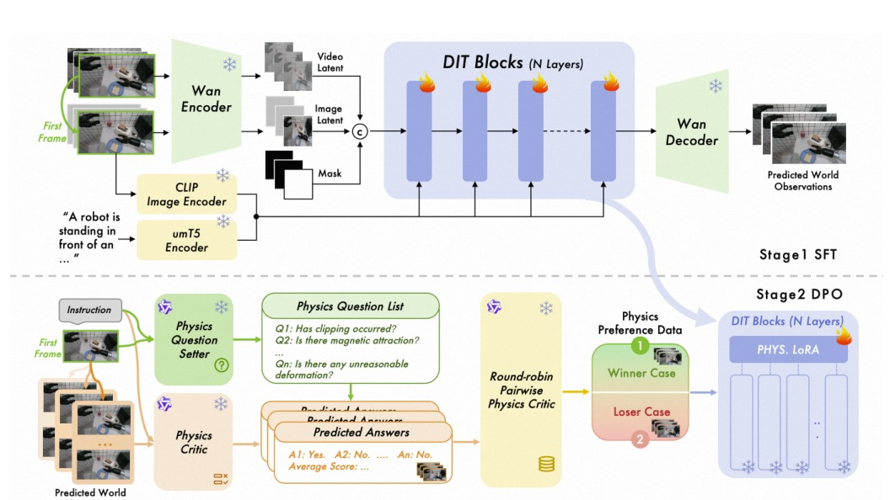

*图号、源 PDF 和裁切位置参见 [截图 Manifest](../../assets/paper-screenshots/manifest.json)。*

**读图指引**：原论文主图通常说明应用任务与主要模块；第二张重点检查数据如何进入模型、哪个环节承担物理约束、是否使用真实交互。未必所有 Figure 2 都是网络结构图，请结合原图标题阅读。

### ⑤ 核心技术与算法细节

1. **物理数据策展。** 构建大规模操作视频数据并附加物理信息，区分合理动作结果与明显穿透、悬浮等异常。

2. **动作条件世界模型。** 使用 Diffusion Transformer 生成动作条件视频，空间动作通过专门上下文机制注入，以降低‘机器人动了但视频未执行相应物体变化’的情况。

3. **解耦物理评价。** 分离用于识别物理异常与动作对齐的评价信号，使模型不至于只优化图像清晰度。

4. **DPO 后训练。** 用物理偏好信息微调生成模型，使其偏好更符合接触、重力与任务一致性的候选序列。

5. **EZSbench 测试。** 使用训练之外的机器人、场景、任务组合分别测量物理真实性和动作跟随能力。

### ⑥ 完整 Pipeline（中文梳理）

### ⑦ 实验设计与主要结果

论文基于约三百万段操作片段，并在 PBench、EZSbench 等基准上与其他视频生成模型比较。作者报告物理合理性及轨迹一致性方面的改善；目前仍应将其视为生成模型的物理对齐结果，而不是已测得牛顿量纲误差的高保真模拟器。

### ⑧ 方法特点与局限性

数据策展和后训练可能降低明显物理幻觉，但不能保证模型精确守恒动量、正确预测接触力。大模型推理成本和行动长时因果稳定性仍是部署障碍；评价需防止判别器与生成器共享偏差。

---

---

## 6.8 技术路线对比

| 工作 | 可复用模块 | 最关键的验证条件 |
|---|---|---|
| PhysX-3D | 资产物理语义标注体系 | 是否能够转换为可执行的仿真对象 |
| PhysX-Anything | 结合 VLM 的三维结构与关节生成 | 模拟器加载、关节可执行性、交互任务成功 |
| Scalable Real2Sim | 自动扫描、实物交互、资产导出流程 | 几何与真实操作的对齐程度 |
| Physics-Consistent Real-to-Sim | RGB-D 场景重建与支撑关系校验 | 杂乱场景在仿真中是否稳定可操作 |
| TouchTwin | 触觉监督的示教重放及数据扩增 | 接触时刻和抓握动作是否对应真实记录 |
| RoboScape | 时间深度与关键点动态辅助监督 | 视频中对象运动是否符合动作条件 |
| ABot-PhysWorld | 物理偏好判别与动作条件视频生成 | 是否减少接触错误和视觉—动作不一致 |

与其笼统比较“物理精度”，不如分别检查**资产可用性、真实数据对齐、视频动作一致性和真机训练收益**。

## 6.9 从机器人学习角度评价

| 维度 | 检查内容 |
|---|---|
| 可执行性 | 机器人与物体的关节/碰撞配置正确，任务可以自动运行 |
| 数据一致性 | 相机和机器人坐标对齐，动作与物体位姿变化相符，接触事件能够同步 |
| 泛化与规模 | 新物体、新布局、新视觉条件下的数据有效性，以及生成效率 |
| 迁移效果 | 在控制训练预算后，真实成功率、OOD 任务和少样本提升如何变化 |

建议实验按“基础仿真 → 加入生成资产 → 少量真实数据校准 → 动作一致性过滤 → 真机测试”依次消融，避免只报告视频真实感而忽略策略收益。

## 6.10 与其他章节的联系

- [第二章](02-visual.md)：TabletopGen、EmbodiedGen V2、SimFoundry 提供自动化可交互场景生成；本章补充资产可用性与真实监督。
- [第三章](03-physics.md)：SPARR 直接修正动作策略，PIN-WM 通过真实交互生成 Digital Cousins。
- [第四章](04-diversity.md)：RoboTwin、RoboDream 和 Real2Render2Real 提供新的轨迹/示教；本章关注物体与动作的对应关系。
- [第五章](05-sim-real.md)：MetaGenSim 与 Co-training 检验这些仿真数据对真实任务是否有帮助。

**推荐阅读顺序：** PhysX-Anything → Physics-Consistent Real-to-Sim → RoboScape → ABot-PhysWorld → TouchTwin。其他两篇可以作为资产生成和 Real-to-Sim 系统补充。
