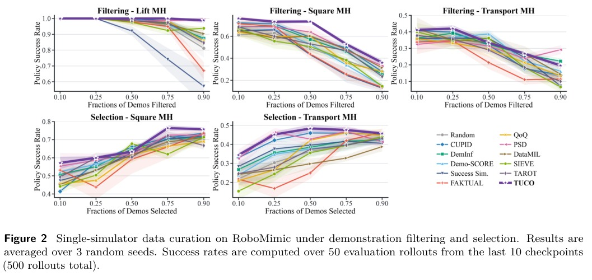

# Sim2Real 轨迹多样性专题综述：生成机制、探索策略、质量度量与有效数据选择

> **更新：2026-11-26** ｜**范围：2022–2026，重点 2025–2026** ｜**独立专题调研**
>
> 与[完整中文综述](Sim2Real_前沿技术路线综述_2025-2026.md)、[原轨迹多样性章节](chapters/04-diversity.md)及[DiscoDemo 深度调研](DiscoDemo_轨迹多样性_深度调研_2026-11-23.md)互补，不覆盖原文。本文逐篇整理 34 篇核心工作，另列补充阅读。此次以研究问题相关性为准，不以开源完整性为硬门槛。逐篇沿用原仓库八部分模板；摘要采用基于原文的简明中文译述，方法归纳与研究建议为本综述分析。论文结果均为作者报告，未做跨论文统一实测。对旧文沿用仓库已有图，对新文提供原文/项目图入口及中文流程，不声称新截图已保存。部分工作依据摘要与作者项目而非逐行源码审计；未核实的数值和资源明确保留为空。

## 1. 研究定位：多样性不是一个标量

### 1.1 从数据生成到训练效用

令一条轨迹为 τ=(c,s₀,o₀,a₀,…,s_T)，c 含任务、场景、目标和本体。首先需要分清以下变化：

| 层次 | 具体因素 | 正例 | 容易误判为多样的情况 |
|---|---|---|---|
| 任务语义 | 指令、约束、子任务图 | 同一初态按不同指令操作不同物体 | 只改同义词 |
| 场景与初态 | 物体位置、形状、障碍、底盘位置 | 适应不同可达条件 | 仅换纹理 |
| 同条件成功解 | 路径、接近方向、抓法、绕行、双臂分工 | 同一物体有两种可行接触方式 | 重复同一路径加噪声 |
| 运动时间结构 | 速度、停顿、动作 chunk、协作时序 | 需要不同节奏的有效动作 | 抖动或人为拖延 |
| 状态转移与恢复 | 误差、失败前兆、纠正、重新抓取 | 打滑后重新抓取完成任务 | 无纠正标签的失败动作 |
| 本体与观测 | 相机、关节冗余、机器人结构 | 同一对象效果的不同全身动作 | 仅机器人外观变化 |

核心对象不是裸轨迹分布 p(τ)，而是有条件的 p(τ | c, success, feasible)。同初态多解与跨初态覆盖必须分开测量。进一步从生成数据中选择对目标域学生有价值的子集，而非追求单一指标最大。

~~~mermaid
flowchart TD
 A[数据预算/目标任务] --> B[生成器:重定向/规划/RL/QD/Agent/视频]
 B --> C[候选轨迹与元数据]
 C --> D[成功/接触/动作标签一致性检验]
 D --> E[条件化多样性与长尾覆盖统计]
 E --> F[按质量与互补性选集]
 F --> G[固定学生模型与训练预算]
 G --> H[独立仿真与真实 OOD 闭环评估]
 H --> I[失败诊断与边际收益]
 I --> B
~~~

### 1.2 文献路线图

| 路线 | 代表工作 | 生成/评估对象 | 关键对照 |
|---|---|---|---|
| 几何与规划 | MimicGen、DexMimicGen、SkillGen、AutoMoMa、AffordGen、FieldGen | 对象中心片段、可行路径、全身协调、接触前运动 | 固定初态、不同 seed；固定源轨迹、不同场景 |
| 主动行为搜索 | DiscoDemo、QDTraj、SOE、RDGen、URSA、SymmGrid | 多成功解、latent、archive、策略自探索、对称经验 | 普通 RL、独立噪声、去 diversity reward |
| 任务与生成模型 | SkillWeaver、KnowDemo、DROM、RoboGene、DreamGen、RoboCurate、IntervenGen、MOVE | 技能组合、语义、接触策略、视频动作、恢复状态 | 参考轨迹、固定技能顺序、无验证器 |
| 多样性度量与筛选 | Geometric Entropy、Vendi、MI、SCIZOR、CUPID、TUCO、D3IL | 几何形状、可预测性、目标回报与集合互补 | 随机等量、只按成功、只按多样性、联合筛选 |
| 规模与生成预算 | Data Scaling Laws、FSC、What Matters、Is Diversity All You Need、HeteroMotion | 任务/场景/专家/运动类别的边际收益 | 因素控制、固定总条数/步数/算力 |

优先阅读 DiscoDemo、Geometric Entropy、QDTraj、TUCO、SOE、SkillWeaver、KnowDemo、FSC。它们共同回答“产生何种差异、如何度量、怎样选集、如何证明有效”。

## 2. 几何变换、规划与专家程序生成

这一类把少量示教或任务约束变成大量可执行轨迹。需要区别同一动作的位姿搬运、真正不同的接触解以及多种任务程序。

---

### 2.1 MimicGen

#### ① 论文基本信息

- **原题**：A Data Generation System for Scalable Robot Learning using Human Demonstrations
- **作者/发表**：Mandlekar 等；CoRL 2023
- **原文**：[论文](https://proceedings.mlr.press/v229/mandlekar23a.html)｜[项目或原文入口](https://mimicgen.github.io/)

#### ② 论文概述（依据 Abstract 的中文译述）

对象中心的轨迹片段重定向把少量人工示教扩展到新场景。

#### ③ 研究动机与核心问题

人工采集昂贵；同一子任务在不同物体位姿下有可复用的相对运动。

#### ④ 方法总览与原论文图

[原文与论文图](https://proceedings.mlr.press/v229/mandlekar23a.html)｜[作者项目/方法图入口](https://mimicgen.github.io/)。此条未新存原论文截图。

#### ⑤ 核心技术与算法细节

示教分段并记录参考对象坐标系；将末端相对位姿变换到新对象坐标系，连接片段并闭环执行。对于参考变换 T_old、T_new，目标位姿为 T_new T_old^{-1} T_ee。

#### ⑥ 完整 Pipeline（中文归纳）

`少量示教 → 子任务分段 → 新场景/对象采样 → 相对位姿变换与连接 → 仿真执行 → 成功轨迹 → BC`

#### ⑦ 实验设计与主要结果

论文进行多个操作环境与本体的数据生成及策略学习，支持少量源数据扩展；作者项目提供演示。

#### ⑧ 方法特点、局限与可借鉴之处

是几何扩展基线，而非主动发现全新接触策略。初态大范围变化、障碍及非刚体交互会破坏可行性。对照时固定源示教与新初态。

**代码/数据状态**：项目有代码入口；未重新审计。

---

### 2.2 DexMimicGen

#### ① 论文基本信息

- **原题**：Automated Data Generation for Bimanual Dexterous Manipulation via Imitation Learning
- **作者/发表**：Jiang 等；2024-10 arXiv / ICRA 2025
- **原文**：[论文](https://arxiv.org/abs/2410.24185)｜[项目或原文入口](https://dexmimicgen.github.io/)

#### ② 论文概述（依据 Abstract 的中文译述）

将示教扩展从单臂推广到双臂与灵巧操作。

#### ③ 研究动机与核心问题

双手动作的独立重定向容易破坏协作依赖和时序。

#### ④ 方法总览与原论文图

[原文与论文图](https://arxiv.org/abs/2410.24185)｜[作者项目/方法图入口](https://dexmimicgen.github.io/)。此条未新存原论文截图。

#### ⑤ 核心技术与算法细节

按各手子任务组织示教，显式考虑双臂协作和顺序约束，变换参考对象相关片段并在仿真验证。

#### ⑥ 完整 Pipeline（中文归纳）

`双臂示教 → 每臂分段与协作约束 → 重定向 → 双臂执行 → 成功数据 → 模仿学习`

#### ⑦ 实验设计与主要结果

论文验证双臂与灵巧仿真任务；真机迁移不能由仿真条数推定。

#### ⑧ 方法特点、局限与可借鉴之处

适合研究左右手分工、时序与同步多样性；模板式约束仍可能限制新策略。

**代码/数据状态**：项目有代码入口；未重新审计。

---

### 2.3 SkillMimicGen / SkillGen

#### ① 论文基本信息

- **原题**：Automated Demonstration Generation for Efficient Skill Learning and Deployment
- **作者/发表**：Garrett、Mandlekar、Wen、Fox；CoRL 论文集 2025
- **原文**：[论文](https://proceedings.mlr.press/v270/garrett25a.html)｜[项目或原文入口](https://skillgen.github.io/)

#### ② 论文概述（依据 Abstract 的中文译述）

将接触技能与非接触运动连接拆分，使用自动规划提高数据生成及部署效率。

#### ③ 研究动机与核心问题

长程轨迹直接搬运容易在子任务之间碰撞或积累误差。

#### ④ 方法总览与原论文图

[原文与论文图](https://proceedings.mlr.press/v270/garrett25a.html)｜[作者项目/方法图入口](https://skillgen.github.io/)。此条未新存原论文截图。

#### ⑤ 核心技术与算法细节

分割技能段与连接运动，利用对象中心重定向和运动规划；学习局部技能而非把所有自由空间连接都交给学生。Isaac Lab 的 SkillGen 文档给出了 cuRobo 连接规划与边界标注接口。

#### ⑥ 完整 Pipeline（中文归纳）

`示教及边界 → 技能片段 → 新初态重定向 → 连接规划 → 采集 → 技能学习与执行`

#### ⑦ 实验设计与主要结果

作者项目展示每任务 10 条 Panda 示教扩展为 1000 条 Sawyer 示教的实验设置。

#### ⑧ 方法特点、局限与可借鉴之处

适合拆分 transit/contact 的多样性控制；边界标注、规划器与新接触模式仍是限制。

**代码/数据状态**：https://docs.nvidia.com/isaaclab/features/skill-gen-for-automated-demonstration-generation

---

### 2.4 RoboTwin 2.0

#### ① 论文基本信息

- **原题**：A Scalable Data Generator and Benchmark with Strong Domain Randomization for Robust Bimanual Robotic Manipulation
- **作者/发表**：Chen 等；ICML 2026（原仓库记录）
- **原文**：[论文](https://proceedings.mlr.press/v306/chen26j.html)｜[项目或原文入口](https://robotwin-platform.github.io/)

#### ② 论文概述（依据 Abstract 的中文译述）

使用 MLLM 自动构建双臂专家程序，并结合执行反馈与域随机化生产数据。

#### ③ 研究动机与核心问题

人工逐任务编写专家程序很难规模化。

#### ④ 方法总览与原论文图

*沿用仓库已有原论文截图；[图源清单](../assets/paper-screenshots/manifest.json)。*

#### ⑤ 核心技术与算法细节

资产与任务约束 → Code Agent → 仿真执行和失败反馈 → 修订程序；随机化对象、杂物、光照、背景、桌面和语言等条件。

#### ⑥ 完整 Pipeline（中文归纳）

`任务/资产 → 专家程序 → 执行/修复 → 随机化 → 轨迹 → VLA`

#### ⑦ 实验设计与主要结果

旧综述记录 50 个双臂任务、5 种本体；相对真实少样本和零样本对照有改善，详细协议见旧章。

#### ⑧ 方法特点、局限与可借鉴之处

任务与场景覆盖很强，但单一程序在不同场景重复未必产生多解策略。

**代码/数据状态**：https://github.com/RoboTwin-Platform/RoboTwin

---

### 2.5 AutoMoMa

#### ① 论文基本信息

- **原题**：Scalable Trajectory Generation for Whole-Body Mobile Manipulation
- **作者/发表**：2026-04 arXiv
- **原文**：[论文](https://arxiv.org/abs/2604.12565)｜[项目或原文入口](https://automoma.pages.dev/)

#### ② 论文概述（依据 Abstract 的中文译述）

GPU 并行全身轨迹优化为移动操作生成大规模运动数据。

#### ③ 研究动机与核心问题

底盘、机械臂与可动对象关节的耦合使采样空间急剧扩大。

#### ④ 方法总览与原论文图

[原文与论文图](https://arxiv.org/abs/2604.12565)｜[作者项目/方法图入口](https://automoma.pages.dev/)。此条未新存原论文截图。

#### ⑤ 核心技术与算法细节

AKR 将底盘、臂与对象运动学统一为链，结合并行轨迹优化与运动约束求解不同全身轨迹。

#### ⑥ 完整 Pipeline（中文归纳）

`场景/对象/本体 → AKR → GPU 批量轨迹优化 → 可行性检查 → 数据 → IL`

#### ⑦ 实验设计与主要结果

作者报告约 5000 episodes/GPU-hour、50 万以上轨迹、330 场景；单关节对象任务达到约 80% 成功的实验需要数万示教。项目展示真机验证。

#### ⑧ 方法特点、局限与可借鉴之处

特别适合研究底盘站位、臂姿态冗余和协调模式；运动学有效不等于所有真实接触动力学均可靠。作者规模结果不是普适样本复杂度定律。

**代码/数据状态**：项目入口；本轮未核验资产和代码完整性。

---

### 2.6 AffordGen

#### ① 论文基本信息

- **原题**：Generating Diverse Demonstrations for Generalizable Object Manipulation with Afford Correspondence
- **作者/发表**：Zhang、Hu、Huang、Ju、Xue、Xu；2026-04 arXiv
- **原文**：[论文](https://arxiv.org/abs/2604.10579)｜[项目或原文入口](https://arxiv.org/abs/2604.10579)

#### ② 论文概述（依据 Abstract 的中文译述）

将语义功能对应而不是仅全局刚体变换用于新形状对象的轨迹生成。

#### ③ 研究动机与核心问题

同类别对象外形差异使简单 SE(3) 变换不足。

#### ④ 方法总览与原论文图

[原文与论文图](https://arxiv.org/abs/2604.10579)｜[作者项目/方法图入口](https://arxiv.org/abs/2604.10579)。此条未新存原论文截图。

#### ⑤ 核心技术与算法细节

3D 生成模型构造对象 mesh，视觉基础模型确定有意义的语义关键点对应，以 affordance 对应指导机器人轨迹适配和执行，训练闭环 visuomotor policy。

#### ⑥ 完整 Pipeline（中文归纳）

`源示教/关键点 → 新 mesh → 功能对应 → 轨迹生成 → 验证 → 策略`

#### ⑦ 实验设计与主要结果

作者报告仿真与真机未见对象零样本泛化改善。

#### ⑧ 方法特点、局限与可借鉴之处

能扩展形状和接触位置；需区分视觉生成 mesh、可碰撞资产与真实物理属性。无原 mesh 时可研究替代资产，但不是严格复现。

**代码/数据状态**：本轮未证实原始 mesh 数据或训练资产完整公开。

---

### 2.7 FieldGen

#### ① 论文基本信息

- **原题**：From Teleoperated Pre-Manipulation Trajectories to Field-Guided Data Generation
- **作者/发表**：Wang 等；2025-10 arXiv
- **原文**：[论文](https://arxiv.org/abs/2510.20774)｜[项目或原文入口](https://fieldgen.github.io/)

#### ② 论文概述（依据 Abstract 的中文译述）

分离可自由变化的预操作与需要精准监督的精细操作，在真实机器人上半自动扩充数据。

#### ③ 研究动机与核心问题

无约束地改变接触过程风险高，但自由空间接近可以多样化。

#### ④ 方法总览与原论文图

[原文与论文图](https://arxiv.org/abs/2510.20774)｜[作者项目/方法图入口](https://fieldgen.github.io/)。此条未新存原论文截图。

#### ⑤ 核心技术与算法细节

人工示教提供关键位姿与接触信息；吸引场生成汇聚到成功操作构型的多种运动；FieldGen-Reward 为生成样本加入奖励标注。

#### ⑥ 完整 Pipeline（中文归纳）

`关键位姿采集 → 构建吸引场 → 多种接近路径 → 精细操作 → 真机采集 → IL`

#### ⑦ 实验设计与主要结果

作者报告相对遥操基线更高成功率、稳定性及更少人工投入。

#### ⑧ 方法特点、局限与可借鉴之处

是研究分阶段多样性的重要对照；吸引场可能偏向同一终端接触策略，不能自动等同于全程多解。

**代码/数据状态**：项目入口；不假设全部真机设备已公开。

## 3. 强化学习、质量多样性与主动探索

与几何搬运相比，主动探索有机会发现源示教未展示的解；但奖励、潜变量、初态分布、验证器决定了探索真正覆盖的行为。

---

### 3.1 DiscoDemo

#### ① 论文基本信息

- **原题**：Discovering Efficient and Diverse Robot Demonstrations for Imitation Learning
- **作者/发表**：Park 等；KAIST AI / Holiday Robotics；2026-10-23 arXiv
- **原文**：[论文](https://arxiv.org/abs/2610.32093)｜[项目或原文入口](https://davian-robotics.github.io/DiscoDemo/)

#### ② 论文概述（依据 Abstract 的中文译述）

在仿真训练潜变量条件 RL 教师，从不同成功行为中生成视觉学生数据。

#### ③ 研究动机与核心问题

单一成功轨迹簇会限制学生在分布外状态的覆盖；稀疏奖励又限制探索。

#### ④ 方法总览与原论文图

*作者仓库原图；[方法总览](https://arxiv.org/html/2610.32093v1#S3)。*

#### ⑤ 核心技术与算法细节

并行逆向课程用示教中间状态作为 reset；每 episode 固定采样 z；METRA 状态表征差分与 z 的内积构成多样性奖励，按整条轨迹成功门控；另有安全惩罚与离线过滤。Vendi 是分析指标而非直接 RL 奖励。

#### ⑥ 完整 Pipeline（中文归纳）

`真实示教 → Real-to-Sim → reverse curriculum + latent RL → 多解 rollout → 成功/安全过滤 → RGB 动作数据 → π0.5 SFT → 仿真/真机`

#### ⑦ 实验设计与主要结果

作者四任务均值：仿真 40%→62%，真机 39%→78%（对照与协议见原文）；说明特定成功解多样性可提高下游表现。

#### ⑧ 方法特点、局限与可借鉴之处

最适合作为主动多样性生成主基线。需分析过滤前后模式损失、同初态与跨初态、潜变量可控性；特权状态与视觉学生存在信息差。

**代码/数据状态**：https://github.com/DAVIAN-Robotics/DiscoDemo；[既有深度调研](DiscoDemo_轨迹多样性_深度调研_2026-11-23.md)

---

### 3.2 QDTraj

#### ① 论文基本信息

- **原题**：Exploration of Diverse Trajectory Primitives for Articulated Objects Robotic Manipulation
- **作者/发表**：2026-04 arXiv；项目标注 IROS 2026
- **原文**：[论文](https://arxiv.org/abs/2604.22551)｜[项目或原文入口](https://kappel.web.isir.upmc.fr/trajectory_primitive_website/)

#### ② 论文概述（依据 Abstract 的中文译述）

以 Quality-Diversity 搜索构建可动对象的多解低层轨迹档案。

#### ③ 研究动机与核心问题

开门、抽屉等相同目标可由多种接触与运动实现；单一最优解不一定适合现场约束。

#### ④ 方法总览与原论文图

[原文与论文图](https://arxiv.org/abs/2604.22551)｜[作者项目/方法图入口](https://kappel.web.isir.upmc.fr/trajectory_primitive_website/)。此条未新存原论文截图。

#### ⑤ 核心技术与算法细节

输入 URDF 与关节激活目标；在 Genesis 中并行评估参数化轨迹，MAP-Elites 类搜索按行为描述符组织 archive，保留各区域高质量解。

#### ⑥ 完整 Pipeline（中文归纳）

`对象/目标 → 原语参数采样/变异 → 仿真稀疏奖励 → 描述符分箱/精英替换 → 轨迹库 → 可达解选择`

#### ⑦ 实验设计与主要结果

作者报告铰链和滑轨任务相较对照至少 5 倍多样轨迹；PartNetMobility 30 个 articulation 平均每任务 704 条不同轨迹，且展示真机部署。

#### ⑧ 方法特点、局限与可借鉴之处

可直接研究 descriptor 对探索的影响；档案丰富不等于 VLA 训练有效，需另做等量 BC。

**代码/数据状态**：项目提供源码、安装教程、API、HF 数据入口；本轮未实际运行。

---

### 3.3 SOE

#### ① 论文基本信息

- **原题**：Sample-Efficient Robot Policy Self-Improvement via On-Manifold Exploration
- **作者/发表**：Jin 等；上海交大等；2025-09 arXiv / 作者仓库标注 ICRA 2026
- **原文**：[论文](https://arxiv.org/abs/2509.19292)｜[项目或原文入口](https://ericjin2002.github.io/SOE/)

#### ② 论文概述（依据 Abstract 的中文译述）

在任务相关潜空间内探索，避免直接对动作加入无结构随机噪声。

#### ③ 研究动机与核心问题

动作模式坍塌使现有 IL 策略缺乏探索；逐步噪声可能造成抖动和危险动作。

#### ④ 方法总览与原论文图

[原文与论文图](https://arxiv.org/abs/2509.19292)｜[作者项目/方法图入口](https://ericjin2002.github.io/SOE/)。此条未新存原论文截图。

#### ⑤ 核心技术与算法细节

学习紧凑任务相关表示，作为现有策略的探索插件，在潜空间变化下产生时间连贯行为；采集新 rollout 迭代改进策略，可人为引导潜维度。

#### ⑥ 完整 Pipeline（中文归纳）

`现有策略/示教 → latent 表征 → 有结构探索 → rollout → 选取/学习 → 改进策略`

#### ⑦ 实验设计与主要结果

项目说明四个 robomimic 仿真任务及挂杯、烤面包机装载、灯帽安装三个真实任务；报告更平滑、更高成功率和样本效率。

#### ⑧ 方法特点、局限与可借鉴之处

与 DiscoDemo 互补：SOE 从已有策略附近探索，可能无法跨越从未观察过的行为模式；流形内不等于安全证书。

**代码/数据状态**：https://github.com/EricJin2002/SOE

---

### 3.4 RDGen

#### ① 论文基本信息

- **原题**：Demonstration Generation for High-Quality Robot Learning via Reinforcement Learning
- **作者/发表**：2026-05 arXiv
- **原文**：[论文](https://arxiv.org/abs/2605.30957)｜[项目或原文入口](https://arxiv.org/abs/2605.30957)

#### ② 论文概述（依据 Abstract 的中文译述）

利用仿真训练并迁移的 RL 策略自动收集真实高质量示教。

#### ③ 研究动机与核心问题

纯遥操成本高，轨迹抖动和操作一致性可能影响学生。

#### ④ 方法总览与原论文图

[原文与论文图](https://arxiv.org/abs/2605.30957)｜[作者项目/方法图入口](https://arxiv.org/abs/2605.30957)。此条未新存原论文截图。

#### ⑤ 核心技术与算法细节

VLM 解析任务，Grounding DINO 定位对象，RL 控制器执行，成功轨迹作为 VLA 训练数据；仿真也可扩展候选。

#### ⑥ 完整 Pipeline（中文归纳）

`任务解析 → 对象定位 → sim RL → real rollout → 成功数据 → VLA`

#### ⑦ 实验设计与主要结果

作者在 pick-and-place 报告高成功率、比遥操更平滑及下游优势。

#### ⑧ 方法特点、局限与可借鉴之处

重点是生成质量/一致性，不是显式多解奖励；适合做普通 RL 与 diversity-RL 对照。单任务证据范围有限。

**代码/数据状态**：代码和权重完整性未核验。

---

### 3.5 URSA

#### ① 论文基本信息

- **原题**：From Tabula Rasa to Emergent Abilities: Discovering Robot Skills via Real-World Unsupervised Quality-Diversity
- **作者/发表**：Grillotti 等；CoRL 2025
- **原文**：[论文](https://proceedings.mlr.press/v305/grillotti25a.html)｜[项目或原文入口](https://proceedings.mlr.press/v305/grillotti25a.html)

#### ② 论文概述（依据 Abstract 的中文译述）

扩展 QDAC，在真实硬件自主发现高质量多样技能。

#### ③ 研究动机与核心问题

手工定义行为描述符的 QD 难扩展，真机探索有安全和样本成本。

#### ④ 方法总览与原论文图

[原文与论文图](https://proceedings.mlr.press/v305/grillotti25a.html)｜[作者项目/方法图入口](https://proceedings.mlr.press/v305/grillotti25a.html)。此条未新存原论文截图。

#### ⑤ 核心技术与算法细节

通过无监督技能表征与 quality-diversity actor-critic 学习技能库，复用到环境变化后的适应。

#### ⑥ 完整 Pipeline（中文归纳）

`状态探索 → 技能表征/QDAC → 多样技能 → 真机评估 → 下游适应`

#### ⑦ 实验设计与主要结果

Unitree A1 仿真与真机运动技能、损伤适应；作者报告在若干损伤设置优于基线。

#### ⑧ 方法特点、局限与可借鉴之处

这是跨领域算法借鉴而非机械臂 IL 数据生成证明；可研究自动学习行为描述符。

**代码/数据状态**：论文入口；未审代码。

---

### 3.6 SymmGrid

#### ① 论文基本信息

- **原题**：Super-Scaling On-Robot Learning with Parallelized Symmetries and Egocentric-Exocentric Visual Perception
- **作者/发表**：Everett 等；2026-07 arXiv
- **原文**：[论文](https://arxiv.org/abs/2607.26985)｜[项目或原文入口](https://symmgrid-robot.github.io/)

#### ② 论文概述（依据 Abstract 的中文译述）

用轨迹级并行对称变换扩大真实 RL replay buffer。

#### ③ 研究动机与核心问题

真机交互速度限制训练；直接增强图像会破坏状态动作一致性。

#### ④ 方法总览与原论文图

[原文与论文图](https://arxiv.org/abs/2607.26985)｜[作者项目/方法图入口](https://symmgrid-robot.github.io/)。此条未新存原论文截图。

#### ⑤ 核心技术与算法细节

以对称树组织 MDP 中允许的状态—动作联合变换；视觉通过 homography 与空间变换协调，生成多个对称等价经验。

#### ⑥ 完整 Pipeline（中文归纳）

`真机轨迹 → 对称树 → 图像/本体/动作一致变换 → replay → RL`

#### ⑦ 实验设计与主要结果

作者在插孔、线缆布设与物体搬移报告 1.37–2.17 倍训练收敛加速、1.09–1.27 倍成功率相对提升。

#### ⑧ 方法特点、局限与可借鉴之处

低成本扩展等价经验，主要增大上下文/对称覆盖；不保证不同接触策略。对称破缺（遮挡、重力、障碍、相机视差）须单独验证。

**代码/数据状态**：项目入口；代码完整性本轮未核验。

## 4. 任务级、长时程与生成式数据

关注不仅是同一步如何移动，还包括接触策略、子任务顺序、失败恢复以及视频生成得到的动作标签是否正确。

---

### 4.1 SkillWeaver

#### ① 论文基本信息

- **原题**：Agentic Exploration over Neural Interaction Skills for Scalable Robot Data Generation
- **作者/发表**：Zhu、Zhao、Cheng、Li、Fragkiadaki；2026-09 arXiv
- **原文**：[论文](https://arxiv.org/abs/2609.36171)｜[项目或原文入口](https://arxiv.org/abs/2609.36171)

#### ② 论文概述（依据 Abstract 的中文译述）

VLM Agent 使用参数化闭环神经交互技能，通过验证器引导搜索发现长时程成功解。

#### ③ 研究动机与核心问题

固定脚本与开放环原语难处理新场景及失败反馈。

#### ④ 方法总览与原论文图

[原文与论文图](https://arxiv.org/abs/2609.36171)｜[作者项目/方法图入口](https://arxiv.org/abs/2609.36171)。此条未新存原论文截图。

#### ⑤ 核心技术与算法细节

RL 学得 Neural Interaction Skills（NIS）；Agent 选择并参数化技能，观察执行结果，进行验证、反思及记忆，以树搜索探索技能组合。

#### ⑥ 完整 Pipeline（中文归纳）

`任务/仿真 → VLM 规划 → NIS 调用 → 状态反馈/验证 → 树搜索 → 成功长轨迹 → 蒸馏`

#### ⑦ 实验设计与主要结果

作者报告 3.91 万条示教、1.41 万场景，以及新物体、布局、任务与环境泛化和 sim-to-real 迁移。

#### ⑧ 方法特点、局限与可借鉴之处

显式探索任务图和技能顺序；验证器偏差、技能库盲区和树搜索开销可能限制多样性。

**代码/数据状态**：本轮未核实完整代码与 NIS 权重。

---

### 4.2 KnowDemo

#### ① 论文基本信息

- **原题**：Knowledge-Guided Robot Demonstration Generation from Human Videos
- **作者/发表**：Gao、Zhan、Khoshnazar、Schäfer、Beetz；2026-09 arXiv
- **原文**：[论文](https://arxiv.org/abs/2609.21229)｜[项目或原文入口](https://zhiyuan-gao.github.io/knowdemo/)

#### ② 论文概述（依据 Abstract 的中文译述）

从人类视频抽取任务必要条件及可变执行选择，生成替代接触方式与有效子任务顺序。

#### ③ 研究动机与核心问题

仅跟随视频运动会把偶然选择误作必要约束。

#### ④ 方法总览与原论文图

[原文与论文图](https://arxiv.org/abs/2609.21229)｜[作者项目/方法图入口](https://zhiyuan-gao.github.io/knowdemo/)。此条未新存原论文截图。

#### ⑤ 核心技术与算法细节

VLM 提取对象、动作、任务条件、示教参考和允许变化；将这些信息 grounding 到目标场景和几何，筛候选、采样抓取、规划及仿真校验。

#### ⑥ 完整 Pipeline（中文归纳）

`人类视频 → 结构化任务知识 → 场景 grounding → 多接触/顺序候选 → 规划/仿真 → 带标签轨迹 → π0.5`

#### ⑦ 实验设计与主要结果

作者报告比 reference-only 配置有更多验证通过的执行模式，三任务 sim-to-real。

#### ⑧ 方法特点、局限与可借鉴之处

将策略差异显式标注，适合研究同指令多解与动作可解释性；VLM 推理错误和接触状态定义需验证。

**代码/数据状态**：项目入口；未核实完整资源。

---

### 4.3 DROM

#### ① 论文基本信息

- **原题**：A Language-Guided Diffusion Framework for Multi-Skill Robotic Manipulation
- **作者/发表**：Pomponi 等；2026-09 arXiv
- **原文**：[论文](https://arxiv.org/abs/2609.37348)｜[项目或原文入口](https://github.com/automation-robotics-machines/drom)

#### ② 论文概述（依据 Abstract 的中文译述）

用运动原语扩展少量示教，再训练语言条件轨迹 diffusion 以生成与组合多技能运动。

#### ③ 研究动机与核心问题

跨技能的姿态敏感轨迹难由统一手工规划器描述。

#### ④ 方法总览与原论文图

[原文与论文图](https://arxiv.org/abs/2609.37348)｜[作者项目/方法图入口](https://github.com/automation-robotics-machines/drom)。此条未新存原论文截图。

#### ⑤ 核心技术与算法细节

DMP 进行数据增强；在 Motion Planning Diffusion 上加入语言 cross-attention；LLM 将长程指令拆成可执行技能。

#### ⑥ 完整 Pipeline（中文归纳）

`少量示教 → DMP 增强 → 语言条件 diffusion → 技能生成 → LLM 组合 → 执行`

#### ⑦ 实验设计与主要结果

作者在 Franka Panda、FANUC CRX25ia 和 MuJoCo 验证，相比 MPD/BC 报告改善。

#### ⑧ 方法特点、局限与可借鉴之处

可以研究生成模型的模式覆盖和采样温度；DMP 增强本身受源原语形状约束，运动可行需额外校验。

**代码/数据状态**：作者提供数据与仿真仓库入口；未运行。

---

### 4.4 RoboGene

#### ① 论文基本信息

- **原题**：Boosting VLA Pre-training via Diversity-Driven Agentic Framework for Real-World Task Generation
- **作者/发表**：2026-02 arXiv
- **原文**：[论文](https://arxiv.org/abs/2602.16444)｜[项目或原文入口](https://robogene-boost-vla.github.io/)

#### ② 论文概述（依据 Abstract 的中文译述）

自动构造多样、物理可行的真实操作任务，面向单臂、双臂及移动机器人。

#### ③ 研究动机与核心问题

任务设计本身是数据采集瓶颈，重复 pick-and-place 无法覆盖复杂行为。

#### ④ 方法总览与原论文图

[原文与论文图](https://arxiv.org/abs/2602.16444)｜[作者项目/方法图入口](https://robogene-boost-vla.github.io/)。此条未新存原论文截图。

#### ⑤ 核心技术与算法细节

Agent 生成、筛选任务并根据人类反馈持续修订，使任务匹配具体本体与现实约束。

#### ⑥ 完整 Pipeline（中文归纳）

`本体/物料/场景 → Agent 任务候选 → 多样性与可行性审查 → 真实采集 → VLA 预训练`

#### ⑦ 实验设计与主要结果

论文研究真实任务生成与预训练；此处不引用未核实的定量表。

#### ⑧ 方法特点、局限与可借鉴之处

扩展的是任务分布而非必然同任务运动多解；适合设计动作语义、约束组合及任务图覆盖度。

**代码/数据状态**：项目入口；本轮未核验采集系统。

---

### 4.5 DreamGen

#### ① 论文基本信息

- **原题**：Unlocking Generalization in Robot Learning through Video World Models
- **作者/发表**：Jang 等；CoRL 2025
- **原文**：[论文](https://proceedings.mlr.press/v305/jang25a.html)｜[项目或原文入口](https://research.nvidia.com/labs/gear/dreamgen/)

#### ② 论文概述（依据 Abstract 的中文译述）

通过视频世界模型生成神经轨迹并训练机器人策略，以扩展新行为和新场景。

#### ③ 研究动机与核心问题

真实动作采集无法像图文数据一样规模化。

#### ④ 方法总览与原论文图

[原文与论文图](https://proceedings.mlr.press/v305/jang25a.html)｜[作者项目/方法图入口](https://research.nvidia.com/labs/gear/dreamgen/)。此条未新存原论文截图。

#### ⑤ 核心技术与算法细节

利用视频生成先验产生条件化机器人视频，再恢复动作监督、构造策略训练数据；用真实执行验证迁移。

#### ⑥ 完整 Pipeline（中文归纳）

`真实数据适配视频模型 → 条件视频采样 → 动作恢复 → 策略训练 → 真机`

#### ⑦ 实验设计与主要结果

项目展示新动词、新场景及两者同时变化下的真实策略实验。

#### ⑧ 方法特点、局限与可借鉴之处

视频多样性可能包含动作标签错误；需要把视频内容质量与动作可执行性分开，参见 RoboCurate。

**代码/数据状态**：作者项目；此处不等同于原综述的 RoboDream。

---

### 4.6 RoboCurate

#### ① 论文基本信息

- **原题**：Harnessing Diversity with Action-Verified Neural Trajectory for Robot Learning
- **作者/发表**：2026-02 arXiv；作者项目更新题名为 Action-Verified Synthetic Data
- **原文**：[论文](https://arxiv.org/abs/2602.18742)｜[项目或原文入口](https://seungkukim.github.io/robocurate/)

#### ② 论文概述（依据 Abstract 的中文译述）

将生成视频的逆动力学动作回放到仿真，用运动一致性识别错误监督。

#### ③ 研究动机与核心问题

VLM 可以看视频是否异常，却不能直接保证动作标签能产生相应运动。

#### ④ 方法总览与原论文图

[原文与论文图](https://arxiv.org/abs/2602.18742)｜[作者项目/方法图入口](https://seungkukim.github.io/robocurate/)。此条未新存原论文截图。

#### ⑤ 核心技术与算法细节

I2I 改写初始场景，V2V 保持运动改变外观；IDM 推断动作，模拟器执行，冻结 V-JEPA 2 上训练 attentive probe 检查两视频运动是否相符；也用于 Best-of-N。

#### ⑥ 完整 Pipeline（中文归纳）

`场景编辑 → 视频生成 → VLM 预筛 → IDM → 仿真回放 → 一致性分类 → 策略`

#### ⑦ 实验设计与主要结果

项目 Table 1：ALLEX 平均 13.9→38.9%，OpenArm 21.9→31.3%，为真实数据基线与带 Best-of-N 合成数据对照；不能将所有提升归于场景编辑。

#### ⑧ 方法特点、局限与可借鉴之处

直接连接多样性与标签可靠性；模拟器偏差、探针误判及额外生成/回放开销需要测量。

**代码/数据状态**：项目入口；未验证训练资源。

---

### 4.7 IntervenGen

#### ① 论文基本信息

- **原题**：Interventional Data Generation for Robust and Data-Efficient Robot Imitation Learning
- **作者/发表**：IROS 2024
- **原文**：[论文](https://ieeexplore.ieee.org/abstract/document/10801523)｜[项目或原文入口](https://sites.google.com/view/intervengen2024)

#### ② 论文概述（依据 Abstract 的中文译述）

由少量人工纠正动作扩展大量恢复轨迹。

#### ③ 研究动机与核心问题

只收集成功专家数据会漏掉学生自己执行出错后遇到的状态。

#### ④ 方法总览与原论文图

[原文与论文图](https://ieeexplore.ieee.org/abstract/document/10801523)｜[作者项目/方法图入口](https://sites.google.com/view/intervengen2024)。此条未新存原论文截图。

#### ⑤ 核心技术与算法细节

利用源纠正干预生成新的纠偏样本，扩大策略错误状态附近的覆盖；与普通成功示教混合学习。

#### ⑥ 完整 Pipeline（中文归纳）

`学生 rollout → 少量人工纠正 → 自动干预扩展 → 恢复数据 → 策略`

#### ⑦ 实验设计与主要结果

四个仿真环境及一个有对象位姿估计误差的真实环境；作者报告特定设置下 10 次人工干预带来最高 39 倍鲁棒性相对改善。

#### ⑧ 方法特点、局限与可借鉴之处

恢复覆盖与成功路径覆盖正交；不要将所有失败动作作为正向 BC 标签。

**代码/数据状态**：项目入口；未核验可运行代码。

---

### 4.8 MOVE

#### ① 论文基本信息

- **原题**：A Simple Motion-Based Data Collection Paradigm for Spatial Generalization in Robotic Manipulation
- **作者/发表**：2025-12 arXiv
- **原文**：[论文](https://arxiv.org/abs/2512.04813)｜[项目或原文入口](https://huggingface.co/datasets/BAAI/MOVE)

#### ② 论文概述（依据 Abstract 的中文译述）

在单次采集中改变可移动对象、目标或视角，增加动态空间配置覆盖。

#### ③ 研究动机与核心问题

静态场景中每条示教只提供少数空间配置。

#### ④ 方法总览与原论文图

[原文与论文图](https://arxiv.org/abs/2512.04813)｜[作者项目/方法图入口](https://huggingface.co/datasets/BAAI/MOVE)。此条未新存原论文截图。

#### ⑤ 核心技术与算法细节

在不同任务阶段有意识地改变环境因素，记录机器人对动态条件的反应，扩展单 episode 内空间变化。

#### ⑥ 完整 Pipeline（中文归纳）

`任务/动态配置 → 真实示教与环境变化 → 轨迹 → 策略`

#### ⑦ 实验设计与主要结果

作者报告空间泛化和数据效率改善；HF 有真实数据卡。

#### ⑧ 方法特点、局限与可借鉴之处

研究动态环境、多样性密度与主动观察；动态变化可能改变任务难度和状态分布，需独立控制。

**代码/数据状态**：HF 数据入口；未审采集代码。

## 5. 轨迹多样性评估、可学习性与数据选择

这组文献把问题从‘生成更多’变成‘如何测量、选择和证明其价值’。指标必须明确其输入表示与适用边界。

---

### 5.1 Geometric Entropy

#### ① 论文基本信息

- **原题**：When Trajectory Diversity Helps and Hurts in Imitation Learning
- **作者/发表**：Luo 等；香港大学 / Transcengram；IROS 2026；2026-11-07 v2
- **原文**：[论文](https://arxiv.org/html/2606.20871v2)｜[项目或原文入口](https://geometric-entropy.github.io/)

#### ② 论文概述（依据 Abstract 的中文译述）

提出几何熵衡量目标相对自由空间轨迹形状，分析多样性和模仿学习成功率的非单调关系。

#### ③ 研究动机与核心问题

原始坐标方差把目标位置、工作尺度和轨迹策略混在一起。

#### ④ 方法总览与原论文图

[原文与论文图](https://arxiv.org/html/2606.20871v2)｜[作者项目/方法图入口](https://geometric-entropy.github.io/)。此条未新存原论文截图。

#### ⑤ 核心技术与算法细节

按接触事件划分 transit/fine manipulation；transit 按弧长重采样 50 点，终点平移、目标姿态旋转、起终距离归一；对中心化向量做 SVD，令 p_j=λ_j/Σλ，d_eff=exp(-Σp_j log p_j)，H_G=log d_eff+log Σλ。多阶段按有效样本数聚合。

#### ⑥ 完整 Pipeline（中文归纳）

`轨迹 → 分段 → 目标系对齐/归一 → covariance spectrum → H_G → 多档生成数据 → IL 性能曲线`

#### ⑦ 实验设计与主要结果

作者在仿真及 ARX 真机 ACT（StackCube、PlacePanda、OpenDrawer）观察倒 U；预训练 π0.5 的实验中趋势近似单调下降，最优熵随 mastery 提高而降低。

#### ⑧ 方法特点、局限与可借鉴之处

与 DiscoDemo 不矛盾：几何 transit 熵不等于成功状态覆盖。H_G 不包含速度、接触和关节冗余；近零位移和全重复需处理。不可将实验趋势当作普适规律。

**代码/数据状态**：项目当前显示 Code coming soon；公式可独立实现，但非作者完整复现。

---

### 5.2 Vendi Score

#### ① 论文基本信息

- **原题**：A Diversity Evaluation Metric for Machine Learning
- **作者/发表**：Friedman、Dieng；2022-10 arXiv
- **原文**：[论文](https://arxiv.org/abs/2210.02410)｜[项目或原文入口](https://arxiv.org/abs/2210.02410)

#### ② 论文概述（依据 Abstract 的中文译述）

以相似度矩阵谱的有效秩描述样本集合的有效多样性。

#### ③ 研究动机与核心问题

方差和类别计数难统一应用于高维轨迹。

#### ④ 方法总览与原论文图

[原文与论文图](https://arxiv.org/abs/2210.02410)｜[作者项目/方法图入口](https://arxiv.org/abs/2210.02410)。此条未新存原论文截图。

#### ⑤ 核心技术与算法细节

用单位对角 PSD kernel 构造 K，归一 K/n 得谱 λ；Vendi=exp(-Σλ log λ)。全相同为 1，完全正交为 n。

#### ⑥ 完整 Pipeline（中文归纳）

`轨迹描述符 → 相似度核 → 特征值 → Vendi → 分组/bootstrap`

#### ⑦ 实验设计与主要结果

原论文研究分子、图像及文本；DiscoDemo 将其用于机器人轨迹分析。

#### ⑧ 方法特点、局限与可借鉴之处

无需目标参考集；对核、尺度、样本数及特征定义敏感，不能检验任务成功或下游价值。

**代码/数据状态**：论文可实现，非机器人专项代码审计。

---

### 5.3 Data Quality in Imitation Learning

#### ① 论文基本信息

- **原题**：Data Quality in Imitation Learning
- **作者/发表**：Belkhale、Cui、Sadigh；2023-06 arXiv
- **原文**：[论文](https://arxiv.org/abs/2306.02437)｜[项目或原文入口](https://arxiv.org/abs/2306.02437)

#### ② 论文概述（依据 Abstract 的中文译述）

从闭环分布偏移解释数据质量，而非把状态多样性直接当成收益。

#### ③ 研究动机与核心问题

行为克隆小误差会累积到未见状态。

#### ④ 方法总览与原论文图

[原文与论文图](https://arxiv.org/abs/2306.02437)｜[作者项目/方法图入口](https://arxiv.org/abs/2306.02437)。此条未新存原论文截图。

#### ⑤ 核心技术与算法细节

以 action divergence 表征专家与学习策略差异，以 transition diversity 表征给定状态动作下系统变化；分析二者耦合对分布外风险的影响。

#### ⑥ 完整 Pipeline（中文归纳）

`数据/策略 → 分析动作差异及转移变化 → 闭环分布偏移 → 比较数据组合`

#### ⑦ 实验设计与主要结果

作者理论与实验指出状态多样性并非总是有益。

#### ⑧ 方法特点、局限与可借鉴之处

为质量与覆盖冲突提供理论背景；它不是具体轨迹生成器，action divergence 也依赖学习器。

**代码/数据状态**：论文入口。

---

### 5.4 Robot Data Curation with Mutual Information Estimators

#### ① 论文基本信息

- **原题**：Robot Data Curation with Mutual Information Estimators
- **作者/发表**：Hejna 等；2025-02 arXiv
- **原文**：[论文](https://arxiv.org/abs/2502.08623)｜[项目或原文入口](https://arxiv.org/abs/2502.08623)

#### ② 论文概述（依据 Abstract 的中文译述）

利用状态和动作的互信息估计轨迹质量，兼顾动作分布丰富度与条件可预测性。

#### ③ 研究动机与核心问题

丰富数据若在相同可观测状态下产生冲突标签，BC 可能难学。

#### ④ 方法总览与原论文图

[原文与论文图](https://arxiv.org/abs/2502.08623)｜[作者项目/方法图入口](https://arxiv.org/abs/2502.08623)。此条未新存原论文截图。

#### ⑤ 核心技术与算法细节

在状态和动作的 VAE embedding 上使用 kNN 互信息估计，计算每条轨迹对整体统计的贡献。I(S;A)=H(A)-H(A|S)。

#### ⑥ 完整 Pipeline（中文归纳）

`状态/动作 → VAE → kNN MI → 单轨迹贡献 → 筛选 → IL`

#### ⑦ 实验设计与主要结果

作者报告 RoboMimic 筛选后 5–10% 改善，真实 ALOHA、Franka 也有提升。

#### ⑧ 方法特点、局限与可借鉴之处

高 MI 不保证因果正确；对表征和 kNN 参数敏感。条件信息缺失与合理多模态不能简单混为低质。

**代码/数据状态**：论文入口；未重新审计代码。

---

### 5.5 SCIZOR

#### ① 论文基本信息

- **原题**：Self-Supervised Data Curation for Imitation Learning
- **作者/发表**：UT Austin RPL；ICRA 2026
- **原文**：[论文](https://rpl.cs.utexas.edu/publications/2026/06/01/zhang-icra26-scizor/)｜[项目或原文入口](https://ut-austin-rpl.github.io/SCIZOR/)

#### ② 论文概述（依据 Abstract 的中文译述）

细粒度过滤低进度和冗余状态—动作对，提高单位数据效用。

#### ③ 研究动机与核心问题

轨迹级成功标签无法识别中途低效或重复动作。

#### ④ 方法总览与原论文图

*沿用仓库已有原论文截图；[图源清单](../assets/paper-screenshots/manifest.json)。*

#### ⑤ 核心技术与算法细节

自监督任务进展预测筛除低质量转移；联合状态—动作表示做 deduplication。

#### ⑥ 完整 Pipeline（中文归纳）

`示教 → 进度估计 → 冗余检测 → 筛选 transition → IL`

#### ⑦ 实验设计与主要结果

作者机构页面报告跨基准平均改善 15.4%；具体绝对/相对口径应以原文为准。

#### ⑧ 方法特点、局限与可借鉴之处

不是生成器；回退、等待、调整可能对恢复至关重要，过滤时保留语义事件与动作 chunk 边界。

**代码/数据状态**：作者项目有代码入口；[原仓库章节](chapters/04-diversity.md)

---

### 5.6 CUPID

#### ① 论文基本信息

- **原题**：Curating Data your Robot Loves with Influence Functions
- **作者/发表**：Agia 等；2025-06 arXiv / CoRL 2025
- **原文**：[论文](https://arxiv.org/abs/2506.19121)｜[项目或原文入口](https://cupid-curation.github.io/)

#### ② 论文概述（依据 Abstract 的中文译述）

用影响函数估计每条训练示教对策略闭环回报的贡献。

#### ③ 研究动机与核心问题

离线 loss、小距离或高成功标签不一定能预测真实闭环效果。

#### ④ 方法总览与原论文图

[原文与论文图](https://arxiv.org/abs/2506.19121)｜[作者项目/方法图入口](https://cupid-curation.github.io/)。此条未新存原论文截图。

#### ⑤ 核心技术与算法细节

结合参考策略、评估 rollout 及训练样本梯度，估计数据权重变化对期望回报的影响，用于删除有害示教和选择新增数据。

#### ⑥ 完整 Pipeline（中文归纳）

`训练数据/参考策略 → 评估 rollout → influence → 排序/筛选 → 重训练`

#### ⑦ 实验设计与主要结果

作者报告在 RoboMimic 用少于 33% 的精选数据可获得强 diffusion policy；真实机器人也验证筛选效果。

#### ⑧ 方法特点、局限与可借鉴之处

适合从生成器输出反向识别有价值模式；依赖参考策略、目标 rollout、影响函数近似，须独立测试。

**代码/数据状态**：作者项目有代码入口。

---

### 5.7 TUCO

#### ① 论文基本信息

- **原题**：Curating Simulation Demonstrations for Sim-to-Real Robot Policy Co-Training
- **作者/发表**：Zhu 等；2026-10 arXiv
- **原文**：[论文](https://arxiv.org/abs/2610.05407)｜[项目或原文入口](https://tuco-curation.github.io/)

#### ② 论文概述（依据 Abstract 的中文译述）

利用目标域闭环影响同时优化轨迹效用与集合互补，选择仿真数据参与协同训练。

#### ③ 研究动机与核心问题

单条样本很有用并不意味着多条高分样本组成的集合不冗余。

#### ④ 方法总览与原论文图

*沿用仓库已有原论文截图；[图源清单](../assets/paper-screenshots/manifest.json)。*

#### ⑤ 核心技术与算法细节

以影响函数构成源轨迹到目标评分 rollout 的 influence matrix；平均影响刻画效用，跨 rollout 变化刻画互补覆盖；集合优化结合 utility 与 logdet 类覆盖。

#### ⑥ 完整 Pipeline（中文归纳）

`仿真池 + 真实少量数据 → 参考策略与目标评分 rollout → 影响矩阵 → 集合优化 → co-training → 独立测试`

#### ⑦ 实验设计与主要结果

作者在 RoboMimic 和 OmniReset 的单仿真器、sim-to-sim 与 sim-to-real 设置报告优势。

#### ⑧ 方法特点、局限与可借鉴之处

最接近目标域有用多样性；目标 rollout 采集成本、近似影响及评分/测试泄漏是主要风险。

**代码/数据状态**：作者项目有代码链接；[原仓库章节](chapters/04-diversity.md)；真机资源完整性未重审。

---

### 5.8 D3IL

#### ① 论文基本信息

- **原题**：Towards Diverse Behaviors: A Benchmark for Imitation Learning with Human Demonstrations
- **作者/发表**：ICLR 2024
- **原文**：[论文](https://proceedings.iclr.cc/paper_files/paper/2024/hash/b63cb503757f9f31e5d74e3567dd160a-Abstract-Conference.html)｜[项目或原文入口](https://proceedings.iclr.cc/paper_files/paper/2024/hash/b63cb503757f9f31e5d74e3567dd160a-Abstract-Conference.html)

#### ② 论文概述（依据 Abstract 的中文译述）

建立多模态人类示教基准，评估学生能否重现多种行为。

#### ③ 研究动机与核心问题

只看平均任务成功率会掩盖模式坍塌。

#### ④ 方法总览与原论文图

[原文与论文图](https://proceedings.iclr.cc/paper_files/paper/2024/hash/b63cb503757f9f31e5d74e3567dd160a-Abstract-Conference.html)｜[作者项目/方法图入口](https://proceedings.iclr.cc/paper_files/paper/2024/hash/b63cb503757f9f31e5d74e3567dd160a-Abstract-Conference.html)。此条未新存原论文截图。

#### ⑤ 核心技术与算法细节

多对象、多子任务且需要闭环感知的仿真环境；通过可计算的行为多样性指标比较 IL 模型。

#### ⑥ 完整 Pipeline（中文归纳）

`多模态人类示教 → 训练模型 → 多次闭环 rollout → 成功与行为覆盖度`

#### ⑦ 实验设计与主要结果

论文提供多类 IL 方法对比，揭示多模态学习仍具挑战。

#### ⑧ 方法特点、局限与可借鉴之处

适合测‘学生继承多少教师多样性’，不只是统计训练集；行为分类定义需与任务对应。

**代码/数据状态**：会议论文入口；未审代码。

## 6. 数据规模、组成与预算优化

本组工作研究不同数据因素的边际收益，指导下一轮应该采什么，而非无差别扩大生成规模。

---

### 6.1 Data Scaling Laws

#### ① 论文基本信息

- **原题**：Data Scaling Laws in Imitation Learning for Robotic Manipulation
- **作者/发表**：Lin 等；2024-10 arXiv / ICLR 2025
- **原文**：[论文](https://arxiv.org/abs/2410.18647)｜[项目或原文入口](https://arxiv.org/abs/2410.18647)

#### ② 论文概述（依据 Abstract 的中文译述）

在真实机器人上系统研究示教数量与环境、对象多样性的规模规律。

#### ③ 研究动机与核心问题

同一条件重复采集与增加新环境的投入可能有不同收益。

#### ④ 方法总览与原论文图

[原文与论文图](https://arxiv.org/abs/2410.18647)｜[作者项目/方法图入口](https://arxiv.org/abs/2410.18647)。此条未新存原论文截图。

#### ⑤ 核心技术与算法细节

构造不同示教数量和环境/对象变化的数据集，固定任务评估真实 OOD 泛化，拟合规模趋势。

#### ⑥ 完整 Pipeline（中文归纳）

`采集多因素数据 → 分组/规模控制 → IL → 真实 rollout → scaling curves`

#### ⑦ 实验设计与主要结果

作者收集超 4 万示教、超 1.5 万真机 rollout；在其设置中环境与对象变化比单条件继续重复更重要。

#### ⑧ 方法特点、局限与可借鉴之处

适合分解数据规模和条件覆盖；结论不直接适用于几何路径模式或所有 VLA。

**代码/数据状态**：原文入口；未重审采集代码。

---

### 6.2 Factored Scaling Curves

#### ① 论文基本信息

- **原题**：Guiding Data Collection via Factored Scaling Curves
- **作者/发表**：Zha 等；2025-05 arXiv
- **原文**：[论文](https://arxiv.org/abs/2505.07728)｜[项目或原文入口](https://arxiv.org/abs/2505.07728)

#### ② 论文概述（依据 Abstract 的中文译述）

按单因素及双因素规模曲线决定有限预算下应该增加哪些样本。

#### ③ 研究动机与核心问题

相机、桌高、干扰物全组合采样代价高。

#### ④ 方法总览与原论文图

[原文与论文图](https://arxiv.org/abs/2505.07728)｜[作者项目/方法图入口](https://arxiv.org/abs/2505.07728)。此条未新存原论文截图。

#### ⑤ 核心技术与算法细节

在控制其他因素时改变指定轴的数据规模，用性能或离线代理拟合 FSC，优先投入边际收益大的因子及组合。

#### ⑥ 完整 Pipeline（中文归纳）

`定义因素 → 小规模对照 → 拟合 FSC → 预算分配 → 新数据 → 评估`

#### ⑦ 实验设计与主要结果

作者在仿真和真机、从头训练和微调设置验证，报告真实新环境相对既有采集策略最高 26% 成功率改善（具体口径以原文为准）。

#### ⑧ 方法特点、局限与可借鉴之处

非常适合将 RL 的 z、初态、课程、扰动、接触模式变成可控因素；组合交互与代理失准仍是问题。

**代码/数据状态**：论文入口。

---

### 6.3 What Matters

#### ① 论文基本信息

- **原题**：What Matters in Learning from Large-Scale Datasets for Robot Manipulation
- **作者/发表**：ICLR 2025
- **原文**：[论文](https://proceedings.iclr.cc/paper_files/paper/2025/hash/16466b6c95c5924784486ac5a3feeb65-Abstract-Conference.html)｜[项目或原文入口](https://proceedings.iclr.cc/paper_files/paper/2025/hash/16466b6c95c5924784486ac5a3feeb65-Abstract-Conference.html)

#### ② 论文概述（依据 Abstract 的中文译述）

程序化构建可控组成的大规模数据集，研究数据采集与检索因素。

#### ③ 研究动机与核心问题

真实数据同时改变多项因素，难隔离哪一项决定下游收益。

#### ④ 方法总览与原论文图

[原文与论文图](https://proceedings.iclr.cc/paper_files/paper/2025/hash/16466b6c95c5924784486ac5a3feeb65-Abstract-Conference.html)｜[作者项目/方法图入口](https://proceedings.iclr.cc/paper_files/paper/2025/hash/16466b6c95c5924784486ac5a3feeb65-Abstract-Conference.html)。此条未新存原论文截图。

#### ⑤ 核心技术与算法细节

控制传感器位置、对象和空间布局等，生成不同组成，分析采集多样性与目标任务检索对齐。

#### ⑥ 完整 Pipeline（中文归纳）

`因素控制生成 → 数据组成实验 → 训练 → 目标任务检索/验证`

#### ⑦ 实验设计与主要结果

作者指出视角与空间布局很关键，并在 DROID 等真实数据检索实验报告最高 70% 相对优势。

#### ⑧ 方法特点、局限与可借鉴之处

提醒轨迹研究必须控制视觉及布局；检索增益不是单独动作多样性效应。

**代码/数据状态**：会议论文入口。

---

### 6.4 Is Diversity All You Need?

#### ① 论文基本信息

- **原题**：Is Diversity All You Need for Scalable Robotic Manipulation?
- **作者/发表**：2025-07 arXiv；IEEE 期刊记录 2026
- **原文**：[论文](https://arxiv.org/abs/2507.06219)｜[项目或原文入口](https://ieeexplore.ieee.org/abstract/document/11488937)

#### ② 论文概述（依据 Abstract 的中文译述）

区分 task、embodiment 和 expert 多样性，检验何种变化促进或阻碍策略。

#### ③ 研究动机与核心问题

操作者速度和习惯差异会带来动作条件歧义。

#### ④ 方法总览与原论文图

[原文与论文图](https://arxiv.org/abs/2507.06219)｜[作者项目/方法图入口](https://ieeexplore.ieee.org/abstract/document/11488937)。此条未新存原论文截图。

#### ⑤ 核心技术与算法细节

构造多因素对照，分析任务与场景覆盖、单/多本体预训练和专家多模态，针对动作速率歧义提出去偏。

#### ⑥ 完整 Pipeline（中文归纳）

`数据因素分组 → 预训练/微调 → 多平台评估 → 去偏 → 再训练`

#### ⑦ 实验设计与主要结果

作者报告任务多样性优于单任务重复量的若干设置；专家动作速率多模态会干扰学习；GO-1-Pro 报告 15% 改善。

#### ⑧ 方法特点、局限与可借鉴之处

解释为何可学的成功解比无结构噪声重要；需分别计算几何、速度与语言条件化多模态，不能一概排除专家差异。

**代码/数据状态**：期刊页面表示代码将公开；未核实当前完整状态。

---

### 6.5 HeteroMotion

#### ① 论文基本信息

- **原题**：Toward Motion Diverse Community Datasets for VLA-Based Robot Learning
- **作者/发表**：Eslami 等；CVPRW ScaleBot 2026
- **原文**：[论文](https://openaccess.thecvf.com/content/CVPR2026W/ScaleBot/html/Eslami_Toward_Motion_Diverse_Community_Datasets_for_VLA-Based_Robot_Learning_CVPRW_2026_paper.html)｜[项目或原文入口](https://openaccess.thecvf.com/content/CVPR2026W/ScaleBot/html/Eslami_Toward_Motion_Diverse_Community_Datasets_for_VLA-Based_Robot_Learning_CVPRW_2026_paper.html)

#### ② 论文概述（依据 Abstract 的中文译述）

针对社区数据中 pick-and-place 偏多的问题设计覆盖多运动原语的数据。

#### ③ 研究动机与核心问题

不同任务名称可能对应相似运动，语义数量不是动作覆盖的充分指标。

#### ④ 方法总览与原论文图

[原文与论文图](https://openaccess.thecvf.com/content/CVPR2026W/ScaleBot/html/Eslami_Toward_Motion_Diverse_Community_Datasets_for_VLA-Based_Robot_Learning_CVPRW_2026_paper.html)｜[作者项目/方法图入口](https://openaccess.thecvf.com/content/CVPR2026W/ScaleBot/html/Eslami_Toward_Motion_Diverse_Community_Datasets_for_VLA-Based_Robot_Learning_CVPRW_2026_paper.html)。此条未新存原论文截图。

#### ⑤ 核心技术与算法细节

构建五类行为与 15 项任务、1050 条轨迹；对比关节方差覆盖和受控训练规模。

#### ⑥ 完整 Pipeline（中文归纳）

`行为类别 → 采集任务 → 关节变化分析 → VLA 微调与真实评估`

#### ⑦ 实验设计与主要结果

作者报告相较直接微调和较小数据子集改善真实表现。

#### ⑧ 方法特点、局限与可借鉴之处

关节方差是易实施但粗糙的 proxy，不区分噪声、冗余与有意义模式；可与目标对齐形状/接触标签联合使用。

**代码/数据状态**：会议论文入口。

## 7. 多样性与质量的统一评估框架（本综述建议，不是某篇论文的原始算法）

### 7.1 评价指标分层

| 指标 | 实现 | 衡量什么 | 主要限制 |
|---|---|---|---|
| 成功率 / 可行率 | 通过数 / 尝试数 | 生成效率、任务达成 | 只统计成功会遮蔽选择偏差 |
| 目标相对几何熵 H_G | 分阶段弧长重采样 + 目标对齐 + SVD | 自由空间路径形状 | 不含时序、接触、姿态；近零位移退化 |
| Vendi | RBF kernel 特征谱有效秩 | 指定表示下有效样本数 | 带宽、样本数与距离定义 |
| DTW / Fréchet / Chamfer | 路径相似度；前两者保留不同程度顺序 | 重复与不同路线 | Chamfer 忽略时序；DTW 会弱化速度差 |
| Occupancy coverage | 网格或 embedding 聚类占据率 | 状态空间/对象运动覆盖 | 网格维度敏感，静止长轨迹可能过权重 |
| 模式熵与均衡度 | 接触类别、抓法、顺序、双臂分工标签统计 | 离散行为策略覆盖 | 标签定义影响结论 |
| 速度/平滑度 | 路程、速度/加速度/jerk 分布、停顿占比 | 动作质量与速度多模态 | jerk 高不必然低质；频率需统一 |
| 接触事件质量 | 非法碰撞、峰值/持续力、对象滑移、接触序列 | 物理可执行性 | 仿真接触信号未必准确 |
| 条件歧义 / MI | H(A|O,c) 代理、kNN/embedding MI | 学生能否区分动作模式 | 估计偏差，真实多模态未必有害 |
| 目标分布覆盖 | 目标到训练 embedding 的 kNN 距离、MMD、任务条件分层 recall | 目标域相关性 | 特征与核敏感；低距离不保证控制可行 |
| 下游效用 | 等预算 SFT + 独立闭环成功/回报 | 对目标学生的实际价值 | 成本高；需多种子与盲测 |
| 学生模式保持率 | 生成器与学生在相同初态重复 rollout 的模式频率与 JSD | 学生是否学到多解 | 只在成功样本上测会漏掉模式失败 |

### 7.2 关键公式和实现注意事项

**Geometric Entropy。** 对每个阶段的末端位置进行目标坐标系对齐：

$$
\xi_i = \operatorname{vec}\left(\frac{R_i^\top(p_{ik}-p_{iT})}{\|p_{i1}-p_{iT}\|+\epsilon}\right)_{k=1}^T.
$$

若样本协方差特征值为 λ，则

$$
H_G=-\sum_j q_j\ln q_j+\ln\sum_j\lambda_j,\qquad q_j=\frac{\lambda_j}{\sum_k\lambda_k}.
$$

实际实现使用 SVD，不必求完整协方差；全重复数据应单列零方差情况，而不是伪造有限熵；近零位移、接触轨迹单独分析。弧长重采样不用于速度统计，时间对齐的数据需另存。

**Vendi。** 使用单位对角的 RBF 核，令归一化 K/n 的非负谱为 λ：

$$
V=\exp(-\sum_j\lambda_j\log\lambda_j).
$$

固定样本数 N 与核带宽，重复随机子采样给置信区间。至少分别计算末端位置、物体运动、关节、接触序列 embedding；不能只用 RGB 或把它们无权重拼接。报告两类分组指标：固定初态的 solution diversity，以及跨初态的 coverage。Vendi/N 可作为附加统计，但不能替代相同 N 下的 Vendi 比较。

**状态与动作差异。** 令生成器有条件变量 z，学生看不到 z；如果相同观测出现冲突动作，BC 的困难来自条件分布，而不是单纯样本条数。以 I(A;O|c) 或估计 H(A|O,c) 检测歧义，并用指令、历史、技能标签条件化后重新计算。连续动作熵受单位与估计器影响，不能跨不同控制频率和归一化直接比较。对于真正合理的多模态，使用分布模型和闭环模式统计而不是简单过滤。

**建议的集合目标**（综合 TUCO/QD 的研究假设）：

$$
\max_{S\subseteq D,\,|S|=B}\left[\sum_{i\in S}u_i+\alpha\log\det(I+\sum_{i\in S}v_iv_i^\top)-\beta\sum_{i\in S}r_i\right].
$$

其中 u_i 为目标效用估计、v_i 为归一后的行为或影响特征、r_i 为风险代价。先以成功、安全、标签一致性为硬门控，再优化软目标。注意这里是建议构造，不声称等同于 TUCO 原公式。与随机、utility-only、diversity-only、质量过滤后随机四种基线等量比较。若不具备目标域 rollout，可先以 target-like 仿真验证集建立代理，不能把代理效用宣称为真实收益。

### 7.3 评价协议：先检验数据本身，再验证学生

1. **控制初态**：每个固定初态重复 K 次 latent 或随机种子采样；另设初态池，跨初态每类等量。场景、对象和相机随机化单独记录。
2. **控制生成预算**：同时报告同尝试数、同生成 GPU 时间、同最终成功条数三种对照。过滤前后均计算各模式通过率和多样性。
3. **控制学生预算**：同一预训练 checkpoint、训练 steps、batch、action horizon、分辨率、归一化和模型结构；按条数、总帧/有效动作 token 双重报告。改变数据分布而不是一起改变训练方法。
4. **防止泄漏**：按场景/初态家族/对象/源示教 lineage 划分，而非随机帧切分；目标评分集和最终测试集独立。
5. **闭环测试**：ID、未见初态、未见物体、扰动恢复分别报告。成功率、碰撞率、完成时间、模式覆盖；至少 3 个训练 seed（预算允许），固定评估初态，报告区间。
6. **解释失败**：区分生成器没探索到、探索到但失败、过滤丢失、学生没学会、以及真机域偏差五个环节。不要以训练 loss 下降替代闭环成功率。

## 8. 可进一步切入的研究方向

| 研究问题 | 可控变量 | 推荐指标/对照 | 价值与风险 |
|---|---|---|---|
| 成功解如何出现 | z 维数、分布、奖励权重、课程位置、训练步数、随机种子 | 固定初态 Vendi/H_G、模式数、成功率；普通 RL | 从生成过程而非仅最终数据解释多样性；需控制探索预算 |
| 多样性在何时产生 | approach/contact/transport/release/recovery | 分阶段模式熵、接触变化、路径形状 | 可定位哪些阶段应增加/降低差异；需可靠事件分割 |
| 质量筛选是否扼杀长尾 | 安全阈值、过滤条件、过滤顺序 | 每模式接受率、Pareto 前沿、拒绝原因 | 避免把安全与保守路径混为一谈；不可用放松安全换成功 |
| 多样性是否可控 | 连续 z 插值、离散技能、接触标签、语言条件 | z→描述符可预测性、跨种子稳定性、同初态模式覆盖 | 由随机生成走向指定需求的生成 |
| 生成器—学生信息差 | 特权状态、历史、对象位姿、技能标签 | 条件歧义、模式保持、闭环表现 | 解释生成器成功而学生失败；部署不能使用不可获取信息 |
| 结构化长程多样性 | 合法子任务拓扑顺序、替代接触、双臂分工 | 任务图覆盖、顺序熵、错误恢复 | KnowDemo/SkillWeaver 指向组合式数据引擎；验证复杂 |
| 真机相关的多样性 | 源数据域、目标评分 rollout、摩擦/位置误差 | TUCO/CUPID 影响、真实 OOD 益处 | 最终价值应由目标域评估决定 |
| 失败及恢复覆盖 | 干预时机、错误类型、纠正策略 | 扰动后恢复率、恢复模式覆盖 | 区分坏动作与好纠正；避免失败标签混入成功 BC |
| 自适应数据预算 | 场景数、每场景解数、每解重复数 | FSC、边际成功率/GPU-hour | 有限预算下针对性生产；因素交互需验证 |
| 多样性与训练阶段 | scratch/预训练、模型容量、数据量、课程顺序 | H_G–性能曲线、学生模式 JSD | 检验 mastery–entropy 假说，寻找模型依赖的最优分布 |
| 跨本体的行为不变量 | 对象效果、相对位姿、末端路径、关节/底盘 | 同对象轨迹匹配、本体特有模式 | 统一语义又不丢全身运动差异 |

### 8.1 建议优先实验：DiscoDemo 多样性形成机制

已有公开 Stage 2 数据时可以开展离线度量，但**仅有最终导出的成功轨迹无法识别探索过程**。需从训练 checkpoint 或在线生成器按可控协议采集原始 rollout，保留失败与拒绝样本。原仓库已有 [DiscoDemo 深度调研](DiscoDemo_轨迹多样性_深度调研_2026-11-23.md)，这里扩展研究设计。

| 阶段 | 实验 | 输出 |
|---|---|---|
| E0 数据审计 | 读取 StackCube 等官方数据的字段；统一坐标、时间、夹爪事件；若仅有视频/动作则明确哪些对象状态不可得 | 字段覆盖表、有效 episode 及分段 |
| E1 离线统计 | 相同样本数计算 H_G、Vendi、接触/速度模式；固定初态组需要初始状态元数据，否则不声称已分离 | 多样性画像、稳定性/样本量曲线 |
| E2 过程采集 | 普通 RL 与 success-gated RL；多个训练 checkpoint；相同初态和 latent 池；记录所有 rollout | 成功率、课程进展、latent/初态方差分解 |
| E3 因素消融 | 固定课程与训练预算，先改 α，再改 z 维数/采样方式；必要时测试独立动作噪声 | 多样性-成功-风险曲线 |
| E4 筛选 | 随机等量、质量优先、Vendi/H_G 分层、质量+覆盖、目标效用+覆盖 | 过滤保留率与分布漂移 |
| E5 SFT | 相同 checkpoint 和预算；低/中/高多样性子集，每组匹配初态、成功率、安全程度、帧数 | 下游 ID/OOD 与模式保持 |
| E6 闭环 | 仿真和真机固定测试协议；扰动、未见对象/布局及恢复单列 | 最终证据及统计区间 |

建议初次 E2 采用 20 个固定初态 × 16 个 latent × 2 个重复 seed 作为试验起点（建议值，不是作者设置），随后依据有效样本数扩展。初态与潜变量采用交叉设计，估计描述符方差来源；若策略本身确定且固定 z 后重复无差异，重复 seed 的作用是验证环境随机性。连续描述符可用方差分解、回归/混合效应模型；离散模式可用条件熵和占据统计。按 initial_state_id 分组 bootstrap，不能把同一初态多条轨迹当作完全独立实验单位。

建议保存如下 schema（按现有可得字段实现，不凭空补值）：

~~~text
episode_id, source_demo_id, generator_version, checkpoint_step,
task_id, initial_state_id, object_id, scene_id, latent_z, seed,
phase_id, action_space, fps, ee_pose, joint_pos, object_pose,
gripper_state, contact_events, task_success, safety_pass,
reject_reason, rollout_steps, collection_cost, split
~~~

**解释 DiscoDemo 和 Geometric Entropy 的表面冲突**：前者改变成功行为覆盖，后者强调去除外在因素后的 transit 形状。两者的被操纵变量、筛选规则、数据量与学习器并不相同。建议使用同一个生成池分层采样形成低/中/高 H_G，同时匹配初态覆盖、接触模式、安全指标；反过来固定 H_G 改变目标状态覆盖，形成二维 factorial design。这样才能区分路径形状与成功状态覆盖对 π0.5 的贡献，而不是先验认定某一方错误。

### 8.2 推荐阅读与执行顺序

| 优先级 | 论文组合 | 直接产出 |
|---|---|---|
| 第一组 | DiscoDemo + Geometric Entropy + Vendi + D3IL | 定义轨迹描述符、阶段和教师/学生多样性指标 |
| 第二组 | QDTraj + SOE + FieldGen + SymmGrid | 比较 QD、latent、分阶段几何和对称增强 |
| 第三组 | CUPID + TUCO + MI + SCIZOR | 质量与集合互补选择，建立训练效用评估 |
| 第四组 | SkillWeaver + KnowDemo + AutoMoMa + DROM | 长程、移动操作和组合策略多样性 |
| 第五组 | FSC + Data Scaling Laws + What Matters + Is Diversity All You Need? | 因素控制、预算优化、模型依赖的多样性 |

## 9. 补充阅读（跨领域方法与既有仓库）

- [Gen2Act](https://proceedings.mlr.press/v305/bharadhwaj25a.html)：生成的人类视频用于条件化机器人执行，区别于直接产生机器人动作标签。
- [CAST](https://cast-vla.github.io/)：反事实轨迹与指令重标注，研究同观测下的细粒度任务语义差异；合成标签必须可执行。
- [HumanoidMimicGen](https://humanoidmimicgen.github.io/)：少量全身示教经 whole-body planning 扩展到 G1 移动操作，适合与 AutoMoMa 比较。
- [RoboMIND](https://x-humanoid-robomind.github.io/)：107k 真实轨迹、四本体、479 任务、96 类对象，含失败示教；是数据组成而非自动生成器参照。
- [RoboDream、Real2Render2Real、SimFoundry Digital Cousins](chapters/04-diversity.md)：已有综述涉及组合式视觉生成、人类对象运动重定向和数字近邻场景；可作动作覆盖与外在上下文覆盖的对照。原章节排除 DemoGen 的决定保持不变，本专题未将其重新列为核心论文。
- [人类视频到机器人操作综述](https://ijcai.org/proceedings/2026/871)：区分 latent action、世界模型、显式 2D 与显式 3D 表示。
- [VLA 数据引擎索引](https://github.com/AIDASLab/Awesome-VLA-Data-Collection-Synthesis-Curation)：用于后续扩大检索范围；不是本文所有条目实验事实的独立证明。

## 10. 结论与调研边界

轨迹多样性研究的关键不是无条件最大化某种距离，而是辨认生成过程中的可控因素、找出具有任务相关性和可学习性的不同成功模式，再以闭环收益验证数据价值。最直接的路线是 **成功解生成 → 多层条件度量 → 质量与互补性选择 → 固定学生验证 → 依据边际收益反馈生成器**。从现有生成器输出开始，可以先解决测量和归因，再逐步改变生成算法；这比一开始重做整套仿真数据引擎更容易建立可靠对照。

证据边界：以上为截至 2026-11-26 的非穷尽叙述性专题检索，以 arXiv 原文/摘要、作者项目及会议页面为主，优先近期论文并保留必要的经典方法。无新实测、无完整代码审计、未统一不同论文实验口径；新论文原始图片通过原文/项目入口阅读，未下载截图到仓库。研究方案、指标组合、样本规模和优先级为本综述建议，不是既有论文已验证结论。旧仓库的综述和图源不改动。
