# Sim2Real 轨迹多样性专题综述：生成机制、探索策略、质量度量与有效数据选择

> **更新：2026-11-26** ｜**范围：2022–2026，重点 2025–2026** ｜**独立专题调研**
>
> 与[完整中文综述](Sim2Real_前沿技术路线综述_2025-2026.md)、[原轨迹多样性章节](chapters/04-diversity.md)及[DiscoDemo 深度调研](DiscoDemo_轨迹多样性_深度调研_2026-11-23.md)互补，不覆盖原文。本文逐篇整理 34 篇核心工作，另列补充阅读。此次以研究问题相关性为准，不以开源完整性为硬门槛。逐篇沿用原仓库八部分模板；摘要部分采用基于摘要及方法的中文概述（非逐字翻译），方法归纳与研究建议为本综述分析。论文结果均为作者报告，未做跨论文统一实测。截图补充：本专题 34 篇核心论文，复用 3 篇的 6 张原图；新增已保存 62 张原论文截图（31/31 篇新增论文具备双图）。图源清单记录失败、图号、PDF 页码及截取坐标；自动裁切未逐图人工复核。部分工作依据摘要与作者项目而非逐行源码审计；未核实的数值和资源明确保留为空。

## 1. 研究定位：多样性不是一个标量

### 1.1 从数据生成到训练效用

令一条轨迹为 τ=(c,s₀,o₀,a₀,…,s_T)，c 含任务、场景、目标和本体。首先需要分清以下变化：

| 层次 | 具体因素 | 正例 | 容易误判为多样的情况 |
|---|---|---|---|
| 任务语义 | 指令、约束、子任务图 | 同一初态按不同指令操作不同物体 | 只改同义词 |
| 场景与初态 | 物体位置、形状、障碍、底盘位置 | 适应不同可达条件 | 仅换纹理 |
| 同条件成功解 | 路径、接近方向、抓法、绕行、双臂分工 | 同一物体有两种可行接触方式 | 重复同一路径加噪声 |
| 运动时间结构 | 速度、停顿、动作 chunk、协作时序 | 需要不同节奏的有效动作 | 抖动或人为拖延 |
| 状态转移与恢复 | 误差、失败前兆、纠正、重新抓取 | 打滑后重新抓取完成任务 | 无纠正标签的失败动作 |
| 本体与观测 | 相机、关节冗余、机器人结构 | 同一对象效果的不同全身动作 | 仅机器人外观变化 |

核心对象不是裸轨迹分布 p(τ)，而是有条件的 p(τ | c, success, feasible)。同初态多解与跨初态覆盖必须分开测量。进一步从生成数据中选择对目标域学生有价值的子集，而非追求单一指标最大。

~~~mermaid
flowchart TD
 A[数据预算/目标任务] --> B[生成器:重定向/规划/RL/QD/Agent/视频]
 B --> C[候选轨迹与元数据]
 C --> D[成功/接触/动作标签一致性检验]
 D --> E[条件化多样性与长尾覆盖统计]
 E --> F[按质量与互补性选集]
 F --> G[固定学生模型与训练预算]
 G --> H[独立仿真与真实 OOD 闭环评估]
 H --> I[失败诊断与边际收益]
 I --> B
~~~

### 1.2 文献路线图

| 路线 | 代表工作 | 生成/评估对象 | 关键对照 |
|---|---|---|---|
| 几何与规划 | MimicGen、DexMimicGen、SkillGen、AutoMoMa、AffordGen、FieldGen | 对象中心片段、可行路径、全身协调、接触前运动 | 固定初态、不同 seed；固定源轨迹、不同场景 |
| 主动行为搜索 | DiscoDemo、QDTraj、SOE、RDGen、URSA、SymmGrid | 多成功解、latent、archive、策略自探索、对称经验 | 普通 RL、独立噪声、去 diversity reward |
| 任务与生成模型 | SkillWeaver、KnowDemo、DROM、RoboGene、DreamGen、RoboCurate、IntervenGen、MOVE | 技能组合、语义、接触策略、视频动作、恢复状态 | 参考轨迹、固定技能顺序、无验证器 |
| 多样性度量与筛选 | Geometric Entropy、Vendi、MI、SCIZOR、CUPID、TUCO、D3IL | 几何形状、可预测性、目标回报与集合互补 | 随机等量、只按成功、只按多样性、联合筛选 |
| 规模与生成预算 | Data Scaling Laws、FSC、What Matters、Is Diversity All You Need、HeteroMotion | 任务/场景/专家/运动类别的边际收益 | 因素控制、固定总条数/步数/算力 |

优先阅读 DiscoDemo、Geometric Entropy、QDTraj、TUCO、SOE、SkillWeaver、KnowDemo、FSC。它们共同回答“产生何种差异、如何度量、怎样选集、如何证明有效”。

## 2. 几何变换、规划与专家程序生成

这一类把少量示教或任务约束变成大量可执行轨迹。需要区别同一动作的位姿搬运、真正不同的接触解以及多种任务程序。

---

### 2.1 MimicGen

#### ① 论文基本信息

- **原题**：A Data Generation System for Scalable Robot Learning using Human Demonstrations
- **作者/发表**：Mandlekar 等；CoRL 2023
- **原文**：[论文](https://proceedings.mlr.press/v229/mandlekar23a.html)｜[项目或原文入口](https://mimicgen.github.io/)

#### ② 论文概述（摘要与研究内容的中文归纳）

对象中心的轨迹片段重定向把少量人工示教扩展到新场景。

同一对象的抓取、插入和放置动作在参考对象坐标系中往往比在世界坐标系中更稳定。直接记录世界坐标的示教，一旦物体平移或旋转，机器人便可能抓空；而从头规划每个接触过程，又需要复杂的任务专家。

#### ③ 研究动机与核心问题

同一对象的抓取、插入和放置动作在参考对象坐标系中往往比在世界坐标系中更稳定。直接记录世界坐标的示教，一旦物体平移或旋转，机器人便可能抓空；而从头规划每个接触过程，又需要复杂的任务专家。作者将人工示教的接触知识与仿真的可执行性结合，将重复人工操作变成自动化数据采集问题。

#### ④ 方法总览与原论文图

**主图｜Figure 1**

*原论文 Figure 1，PDF 第 2 页；整页保真截图。[原文对应页](https://arxiv.org/pdf/2310.17596#page=2)。*

**方法/第二关键图｜Figure 2**

*原论文 Figure 2，PDF 第 3 页；整页保真截图。[原文对应页](https://arxiv.org/pdf/2310.17596#page=3)。*

[截图来源清单](../assets/paper-screenshots/trajectory-diversity/manifest.json)。自动定位图号，裁切尚需人工逐图复核；第二图不一定是网络架构。

#### ⑤ 核心技术与算法细节

**对象中心分段。** 将长轨迹按操作对象和子任务结束条件切分，例如先抓杯、再移至杯架；每个片段记录参考物体的位姿、末端目标位姿与夹爪动作。不同片段的参考坐标系可以不同。

**轨迹重定向。** 设源对象位姿为 T_o、当前对象位姿为 T'_o，源末端位姿为 T_e(t)，保持对象相对位姿得到 T'_e(t)=T'_o T_o^{-1} T_e(t)。这不是把所有关节角直接平移，而是生成新末端控制目标，再交给机器人控制器实现。

**连接与验证。** 从示教库选取当前子任务的源片段，用插值将当前末端连接到目标片段起点，逐步执行并记录新的观测与控制动作；只有完整任务满足成功判定才保存。生成器知道仿真对象位姿，但学生不需要获得这些特权状态。

#### ⑥ 完整 Pipeline（中文归纳）

1. 人工遥操作少量成功示教，保存逐步末端控制目标、对象位姿与夹爪状态。
2. 根据子任务信号切分示教，构建以参考对象为索引的片段库。
3. 从新的环境初态取对象位姿，为每个子任务选择一个源片段并执行坐标变换。
4. 在模拟器中连接片段并实际控制机器人；记录执行得到的新状态与图像，而不是简单复用旧图。
5. 判定整条任务是否成功，拒绝无效轨迹，导出训练集后训练并闭环测试策略。

#### ⑦ 实验设计与主要结果

原文实验在多种任务、场景与机器人设置中评估数据生成成功率和模仿学习性能。应特别区分生成器尝试成功率（决定收集成本）与学生策略成功率（决定数据效用）。多源示教与初态范围共同变化时不能单独归因于路径多样性；实际评估宜以固定起始状态和相同最终数据量进行再采样。

#### ⑧ 方法特点、局限与可借鉴之处

**贡献**：把接触技能复用与初态随机化分离，给出低成本、可解释的增强基线。**局限**：几何等价不是物理等价；源片段内的抓法、接触顺序通常不变，插值可能穿越障碍。**后续切入点**：固定初态改变源片段，比较仅改变位置与改变运动模式的收益，并统计各源片段的生成成功率及过滤后的覆盖。

**代码/数据状态**：项目有代码入口；未重新审计。

---

### 2.2 DexMimicGen

#### ① 论文基本信息

- **原题**：Automated Data Generation for Bimanual Dexterous Manipulation via Imitation Learning
- **作者/发表**：Jiang 等；2024-10 arXiv / ICRA 2025
- **原文**：[论文](https://arxiv.org/abs/2410.24185)｜[项目或原文入口](https://dexmimicgen.github.io/)

#### ② 论文概述（摘要与研究内容的中文归纳）

将示教扩展从单臂推广到双臂与灵巧操作。

单臂重定向假设一条末端轨迹与参考物体之间存在相对稳定的关系。双臂操作中还必须满足两手相互约束：例如一手扶容器、另一手插入物体，若独立选择与重定向两条片段，可能在空间上合理但在时间上冲突。

#### ③ 研究动机与核心问题

单臂重定向假设一条末端轨迹与参考物体之间存在相对稳定的关系。双臂操作中还必须满足两手相互约束：例如一手扶容器、另一手插入物体，若独立选择与重定向两条片段，可能在空间上合理但在时间上冲突。作者针对双臂灵巧场景引入独立分段与协作约束。

#### ④ 方法总览与原论文图

**主图｜Figure 1**

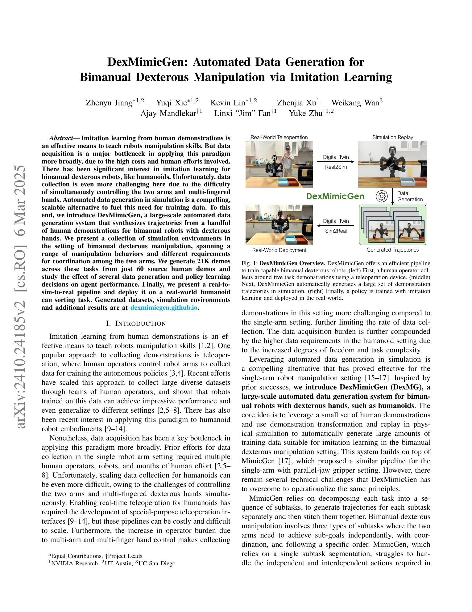

*原论文 Figure 1，PDF 第 1 页；整页保真截图。[原文对应页](https://arxiv.org/pdf/2410.24185#page=1)。*

**方法/第二关键图｜Figure 3**

*原论文 Figure 3，PDF 第 4 页；整页保真截图。[原文对应页](https://arxiv.org/pdf/2410.24185#page=4)。*

[截图来源清单](../assets/paper-screenshots/trajectory-diversity/manifest.json)。自动定位图号，裁切尚需人工逐图复核；第二图不一定是网络架构。

#### ⑤ 核心技术与算法细节

**双手分段与表示。** 每只手分别保存对象中心轨迹与子任务边界，保留两手任务结构。**协作条件。** 对需要共同操控同一物体的片段，重定向时需保持相互空间关系；有先后依赖的子任务需要等待另一只手达到指定条件，而非强制整条双手轨迹同速回放。**执行验证。** 在新场景实际执行两手控制指令，记录双方与物体的交互结果；失败碰撞或不满足目标的轨迹不能作为成功示教。具体约束类别和生成细节见原论文工作流。

#### ⑥ 完整 Pipeline（中文归纳）

1. 采集少量双臂完整示教，分别识别每只手的子任务及参考物体。
2. 确定可独立执行、需要协调、存在先后依赖的片段关系。
3. 为新场景选择并重定向左右臂源片段，按照依赖关系推进执行。
4. 从实际仿真状态保存双手动作、对象轨迹及视觉数据。
5. 成功检查后构建双臂数据集，训练视觉策略并评估新初态下双手协作。

#### ⑦ 实验设计与主要结果

作者以双臂及灵巧操作环境验证少量遥操作可扩展为大量仿真示教。应观察不同协调约束下的生成成功率与最终策略成功率，而不能只看轨迹总量。来源示教的协作模式通常仍有限；论文附录亦将碰撞列为生成失败原因。具体实验图表参见上面的原图与全文。

#### ⑧ 方法特点、局限与可借鉴之处

**贡献**：将多臂轨迹视作带依赖的技能组合，而非两条独立的单臂轨迹。**局限**：新分工、交换持物角色、交接方式未必由已有片段自动产生。**研究建议**：以左右手职责、交接次数、同步间隔作为独立行为描述符，并控制初态与任务语义，测量真正的双臂协作多解。

**代码/数据状态**：项目有代码入口；未重新审计。

---

### 2.3 SkillMimicGen / SkillGen

#### ① 论文基本信息

- **原题**：Automated Demonstration Generation for Efficient Skill Learning and Deployment
- **作者/发表**：Garrett、Mandlekar、Wen、Fox；CoRL 论文集 2025
- **原文**：[论文](https://proceedings.mlr.press/v270/garrett25a.html)｜[项目或原文入口](https://skillgen.github.io/)

#### ② 论文概述（摘要与研究内容的中文归纳）

将接触技能与非接触运动连接拆分，使用自动规划提高数据生成及部署效率。

MimicGen 对完整片段复用的优点在于接触动作可以保留，但远距离搬运时插值未必绕开障碍。作者发现自由空间连接和接触丰富技能的技术需求并不相同：前者适合规划，后者更依赖示教中的细粒度交互知识。

#### ③ 研究动机与核心问题

MimicGen 对完整片段复用的优点在于接触动作可以保留，但远距离搬运时插值未必绕开障碍。作者发现自由空间连接和接触丰富技能的技术需求并不相同：前者适合规划，后者更依赖示教中的细粒度交互知识。

#### ④ 方法总览与原论文图

**主图｜Figure 1**

*原论文 Figure 1，PDF 第 2 页；整页保真截图。[原文对应页](https://arxiv.org/pdf/2410.18907#page=2)。*

**方法/第二关键图｜Figure 2**

*原论文 Figure 2，PDF 第 4 页；整页保真截图。[原文对应页](https://arxiv.org/pdf/2410.18907#page=4)。*

[截图来源清单](../assets/paper-screenshots/trajectory-diversity/manifest.json)。自动定位图号，裁切尚需人工逐图复核；第二图不一定是网络架构。

#### ⑤ 核心技术与算法细节

**技能与运动分离。** 人工或任务信号标记接触技能的起止边界，技能段按对象参考坐标系重定向；其前后的非接触移动由规划模块处理。**规划连接。** 在新初态及当前障碍配置下求机器人可达的无碰撞连接路径，使不同源技能可以重新组合。Isaac Lab 实现使用 cuRobo 作为运动规划入口。**部署分工。** 规划器承担可由模型可靠求解的自由空间运动，学习策略负责接触技能；避免要求 BC 记忆任意绕障路线。原论文与 Isaac Lab 具体版本接口应分别核对。

#### ⑥ 完整 Pipeline（中文归纳）

1. 为示教标注每个技能的开始、结束及对应对象，保留技能控制序列。
2. 在目标场景采样对象和障碍，选择合适的示教技能并计算新的入口位姿。
3. 规划当前状态到技能入口的连接；若不可达则拒绝或重新采样。
4. 执行重定向后的技能并检查是否满足子任务条件，重复直至全任务结束。
5. 保存成功的技能/连接片段以及动作观测，学习局部技能，在部署中与规划模块配合。

#### ⑦ 实验设计与主要结果

重点实验对照是完整轨迹重放与规划连接的区别，以及改变物体布局、杂物和机器人形态后生成效率的变化。项目展示从 10 条 Panda 源示教扩展为 Sawyer 数据的设置。不能将这类跨本体生成直接等同于无条件通用迁移；关节限制、末端工具和接触控制仍需适配。

#### ⑧ 方法特点、局限与可借鉴之处

**贡献**：将几何路径与接触技能多样性解耦，允许针对各阶段独立控制生成方式。**局限**：技能边界不准确或规划模型不可靠时会出现接触前后断裂。**研究建议**：保持接触片段固定，系统改变 transit 路径复杂度，然后反向固定 transit、改变抓法，直接检验几何熵与接触多样性的不同效用。[实现文档](https://docs.nvidia.com/isaaclab/features/skill-gen-for-automated-demonstration-generation)

**代码/数据状态**：https://docs.nvidia.com/isaaclab/features/skill-gen-for-automated-demonstration-generation

---

### 2.4 RoboTwin 2.0

#### ① 论文基本信息

- **原题**：A Scalable Data Generator and Benchmark with Strong Domain Randomization for Robust Bimanual Robotic Manipulation
- **作者/发表**：Chen 等；ICML 2026（原仓库记录）
- **原文**：[论文](https://proceedings.mlr.press/v306/chen26j.html)｜[项目或原文入口](https://robotwin-platform.github.io/)

#### ② 论文概述（摘要与研究内容的中文归纳）

使用 MLLM 自动构建双臂专家程序，并结合执行反馈与域随机化生产数据。

大规模双臂仿真需要的不只是物体资产，更是能在各种场景中运行的任务专家。若每个新任务都要人工编写抓取、交接、避障与成功判断逻辑，增加任务种类会导致工程成本线性增长。

#### ③ 研究动机与核心问题

大规模双臂仿真需要的不只是物体资产，更是能在各种场景中运行的任务专家。若每个新任务都要人工编写抓取、交接、避障与成功判断逻辑，增加任务种类会导致工程成本线性增长。RoboTwin 2.0 将任务专家构建纳入多模态模型与仿真反馈闭环。

#### ④ 方法总览与原论文图

*沿用仓库已有原论文截图；[图源清单](../assets/paper-screenshots/manifest.json)。*

#### ⑤ 核心技术与算法细节

**任务与资产接口。** 提供对象资产、双臂本体、目标任务和可调用的操作接口，约束生成程序可使用的动作。**Code Agent。** 多模态模型依据任务信息生成专家代码，而不是直接输出无约束逐帧动作；执行程序可以得到具体轨迹和错误。**闭环修复。** 根据仿真执行反馈改写失败程序，直到通过任务检查。**结构化随机化。** 以通过验证的专家为生成器，对杂物、光照、背景、桌面高度及语言等因素进行采样；保存新场景实际执行得到的状态动作数据。随机化变量分属视觉、环境与语言，不应统称同初态动作多解。

#### ⑥ 完整 Pipeline（中文归纳）

1. 准备任务配置、资产库、机器人和成功判定接口。
2. 向 Code Agent 提供任务描述及可用 API，生成专家程序。
3. 执行程序并记录错误、失败状态和目标完成情况；失败时反馈修订。
4. 通过的专家在多组场景、物体及视觉/语言随机化配置中重复运行。
5. 将成功 episode 导出用于 VLA 预训练或微调，并进行仿真与真机对照。

#### ⑦ 实验设计与主要结果

作者实验包含 50 个双臂任务、5 种本体，原仓库记录资产库 731 实例/147 类。对于真机少样本及零样本结果，应按原文协议读取相对提升，不把数据规模、专家修复与视觉域随机化的联合效果全部归因于路径多样性。详细对照及原始数值见[原章节](chapters/04-diversity.md)。

#### ⑧ 方法特点、局限与可借鉴之处

**贡献**：可扩展任务定义及专家生成，而非仅复制已有运动。**局限**：专家往往采用固定程序结构，同任务在相同初态下可能始终是同一抓法；执行验证也依赖仿真器与成功条件。**研究建议**：对同一任务生成多个独立专家程序，显式记录程序 lineage、技能图和抓取方式；在同一初态下比较程序间多解，而不是只比较不同纹理。

**代码/数据状态**：https://github.com/RoboTwin-Platform/RoboTwin

---

### 2.5 AutoMoMa

#### ① 论文基本信息

- **原题**：Scalable Trajectory Generation for Whole-Body Mobile Manipulation
- **作者/发表**：2026-04 arXiv
- **原文**：[论文](https://arxiv.org/abs/2604.12565)｜[项目或原文入口](https://automoma.pages.dev/)

#### ② 论文概述（摘要与研究内容的中文归纳）

GPU 并行全身轨迹优化为移动操作生成大规模运动数据。

移动操作不同于固定基座单臂：同一对象目标可能通过改变底盘站位、全身构型和末端接触路径实现。逐对象逐场景用 CPU 规划会成为大规模采集瓶颈。

#### ③ 研究动机与核心问题

移动操作不同于固定基座单臂：同一对象目标可能通过改变底盘站位、全身构型和末端接触路径实现。逐对象逐场景用 CPU 规划会成为大规模采集瓶颈。作者的主要目标是将这些耦合自由度统一建模，利用 GPU 并行求解足够多的可行动作轨迹。

#### ④ 方法总览与原论文图

**主图｜Figure 1**

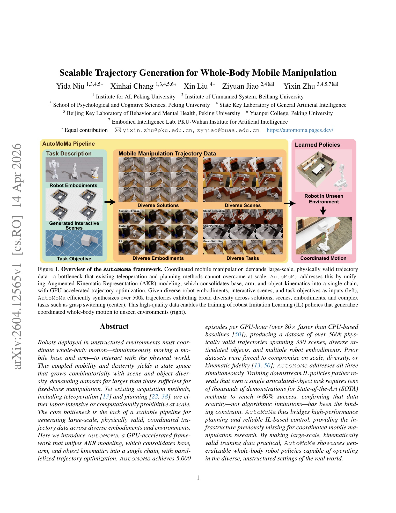

*原论文 Figure 1，PDF 第 1 页；整页保真截图。[原文对应页](https://arxiv.org/pdf/2604.12565#page=1)。*

**方法/第二关键图｜Figure 3**

*原论文 Figure 3，PDF 第 5 页；整页保真截图。[原文对应页](https://arxiv.org/pdf/2604.12565#page=5)。*

[截图来源清单](../assets/paper-screenshots/trajectory-diversity/manifest.json)。自动定位图号，裁切尚需人工逐图复核；第二图不一定是网络架构。

#### ⑤ 核心技术与算法细节

**统一运动学表示。** 将移动底盘、机器人关节与可动对象关节纳入同一 Articulated Kinematic Representation，显式表达目标对象运动与机器人末端之间的关系，避免先独立规划底盘再随意拼接手臂。**批量优化。** 对多个起始构型与轨迹候选并行求解，并检查关节、可达性、碰撞等约束。**数据导出。** 筛选满足任务约束的轨迹形成大规模训练数据，用于移动操作策略学习。这里的多样性首先来自初态、场景、对象与全身构型搜索；是否包含不同接触策略需要看具体任务和目标约束。

#### ⑥ 完整 Pipeline（中文归纳）

1. 加载场景、对象关节描述、机器人运动学与目标操作条件。
2. 构建 AKR 并采样多个底盘/手臂初态与轨迹候选。
3. GPU 批量执行约束优化，获得候选全身运动与对象关节变化。
4. 根据可达性、碰撞及任务完成等条件检查或重新求解，保留可用轨迹。
5. 保存多场景多本体数据，训练移动操作策略并评估仿真/真机任务。

#### ⑦ 实验设计与主要结果

摘要明确报告约 5000 episode/GPU-hour、超过 50 万条轨迹、330 个场景，并相对 CPU 对照报告超过 80 倍速度。其证据主要说明规模与约束求解能力，不能由吞吐直接推得同初态策略熵或真机闭环成功率。单关节对象实验的样本量趋势也须限定在该任务和学生模型。

#### ⑧ 方法特点、局限与可借鉴之处

**贡献**：将全身运动冗余转化为数据生成的可控维度。**局限**：运动学规划约束无法自动替代接触力、摩擦和柔顺控制验证。**研究建议**：固定对象关节终点，分解底盘站位、躯干/手臂冗余与接触方式，分别估计有效覆盖；比较相同轨迹量下是否值得增加底盘多样性。

**代码/数据状态**：项目入口；本轮未核验资产和代码完整性。

---

### 2.6 AffordGen

#### ① 论文基本信息

- **原题**：Generating Diverse Demonstrations for Generalizable Object Manipulation with Afford Correspondence
- **作者/发表**：Zhang、Hu、Huang、Ju、Xue、Xu；2026-04 arXiv
- **原文**：[论文](https://arxiv.org/abs/2604.10579)｜[项目或原文入口](https://arxiv.org/abs/2604.10579)

#### ② 论文概述（摘要与研究内容的中文归纳）

将语义功能对应而不是仅全局刚体变换用于新形状对象的轨迹生成。

刚体坐标变换适合形状一致对象，但对于把手长度不同的杯子、形状不同的工具等，新对象的抓取部位和功能部位未必能由一个全局 SE(3) 变换同时对齐。作者以 affordance correspondence 将“哪个部位可操作、哪个部位实现功能”作为跨实例轨迹迁移的依据。

#### ③ 研究动机与核心问题

刚体坐标变换适合形状一致对象，但对于把手长度不同的杯子、形状不同的工具等，新对象的抓取部位和功能部位未必能由一个全局 SE(3) 变换同时对齐。作者以 affordance correspondence 将“哪个部位可操作、哪个部位实现功能”作为跨实例轨迹迁移的依据。

#### ④ 方法总览与原论文图

**主图｜Figure 1**

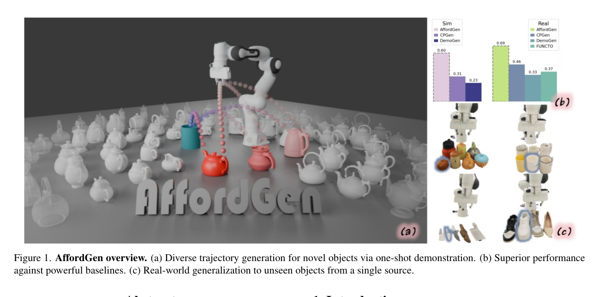

*原论文 Figure 1，PDF 第 1 页；原图及图注裁切。[原文对应页](https://arxiv.org/pdf/2604.10579#page=1)。*

**方法/第二关键图｜Figure 2**

*原论文 Figure 2，PDF 第 3 页；整页保真截图。[原文对应页](https://arxiv.org/pdf/2604.10579#page=3)。*

[截图来源清单](../assets/paper-screenshots/trajectory-diversity/manifest.json)。自动定位图号，裁切尚需人工逐图复核；第二图不一定是网络架构。

#### ⑤ 核心技术与算法细节

**对象库构建。** 通过 3D 生成等方式扩大目标类别的 mesh 候选，得到具有形状变化的对象。**关键点对应。** 利用视觉基础模型建立源对象与新对象的语义对应，识别 affordance point 和 function point，而不依赖纯几何最近邻。**分段迁移。** 抓取与技能段依赖相应功能/抓取关键点进行变换；连接段使用运动规划，避免把所有路径机械地按统一变换搬过去。**策略学习。** 生成的状态动作序列作为视觉策略监督，使学生适应未见对象。CVPR 2026 正式论文题名使用 Affordance Correspondence。

#### ⑥ 完整 Pipeline（中文归纳）

1. 记录少量人类机器人示教并切出抓取、交互技能及过渡阶段。
2. 准备或生成新的目标对象 mesh，识别其可抓部位与功能关键点。
3. 建立与源对象的语义对应，据此计算新抓取/技能段的位姿。
4. 求解过渡路径并检查完整操作的可执行性，形成新对象训练轨迹。
5. 使用这些对象及动作数据训练视觉策略，测试训练未包含的实例。

#### ⑦ 实验设计与主要结果

作者在仿真和真实机器人验证未见对象泛化；应重点阅读新对象组而非只看训练形状上的结果。正确的对照是固定物体数量、场景与示教预算，比较刚体变换、语义对应与人工关键点。原始 mesh 是否公开仍是复现问题，不能以项目视频替代资源证明。[CVPR正式论文](https://openaccess.thecvf.com/content/CVPR2026/html/Zhang_AffordGen_Generating_Diverse_Demonstrations_for_Generalizable_Object_Manipulation_with_Affordance_CVPR_2026_paper.html)。

#### ⑧ 方法特点、局限与可借鉴之处

**贡献**：将跨形状操作的功能等价性纳入轨迹生成。**局限**：关键点错误、不可碰撞 mesh、摩擦/质量差异均可能使对应轨迹无效；替代资产可验证机制但不是严格复现。**研究建议**：独立改变形状距离、关键点误差和抓法，研究多样性是否来自功能接触变化，而非仅对象外观。

**代码/数据状态**：本轮未证实原始 mesh 数据或训练资产完整公开。

---

### 2.7 FieldGen

#### ① 论文基本信息

- **原题**：From Teleoperated Pre-Manipulation Trajectories to Field-Guided Data Generation
- **作者/发表**：Wang 等；2025-10 arXiv
- **原文**：[论文](https://arxiv.org/abs/2510.20774)｜[项目或原文入口](https://fieldgen.github.io/)

#### ② 论文概述（摘要与研究内容的中文归纳）

分离可自由变化的预操作与需要精准监督的精细操作，在真实机器人上半自动扩充数据。

真实数采中，精细操作如对准孔口、捏取与插入需要高质量人类控制，但接触前长距离移动占据许多采集时间。对所有阶段同样随机扰动既浪费预算又破坏接触。

#### ③ 研究动机与核心问题

真实数采中，精细操作如对准孔口、捏取与插入需要高质量人类控制，但接触前长距离移动占据许多采集时间。对所有阶段同样随机扰动既浪费预算又破坏接触。FieldGen 将人工监督集中在关键操作构型，用可控运动场扩展前置移动。

#### ④ 方法总览与原论文图

**主图｜Figure 1**

*原论文 Figure 1，PDF 第 1 页；整页保真截图。[原文对应页](https://arxiv.org/pdf/2510.20774#page=1)。*

**方法/第二关键图｜Figure 2**

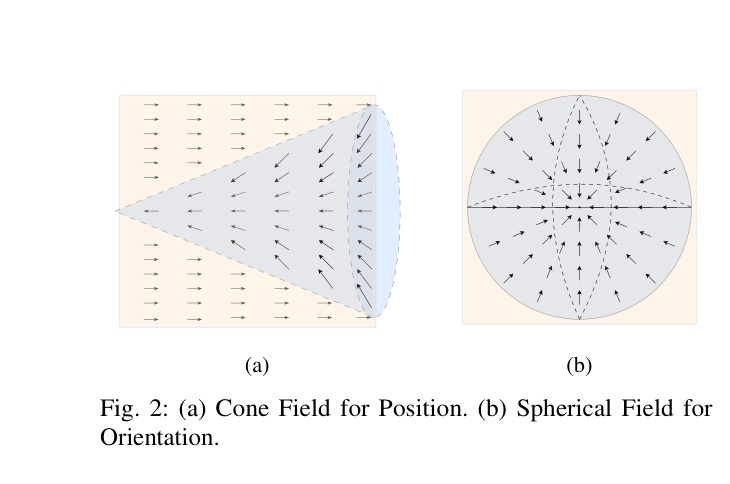

*原论文 Figure 2，PDF 第 3 页；整页保真截图。[原文对应页](https://arxiv.org/pdf/2510.20774#page=3)。*

[截图来源清单](../assets/paper-screenshots/trajectory-diversity/manifest.json)。自动定位图号，裁切尚需人工逐图复核；第二图不一定是网络架构。

#### ⑤ 核心技术与算法细节

**关键构型提取。** 根据遥操作示教确定精细技能的入口与相关操作信息。**场引导预操作。** 构造具有收敛特性的吸引场，让不同起点和路径汇聚至关键操作位姿；不是直接逐帧重放原示教。**真实执行。** 在机器人上实际运行生成的接近路径并完成操作，记录新观测与动作。FieldGen-Reward 进一步提供奖励标注。重点是对可自由变化阶段提供多样性，而保留接触阶段的有效性。

#### ⑥ 完整 Pipeline（中文归纳）

1. 少量遥操作采集具有可靠精细动作的轨迹并确定关键位姿。
2. 建立场引导运动模型，采样不同接近初态和路径。
3. 控制机器人从不同起点向关键构型运动并接续精细操作。
4. 检查实际执行结果和安全性，记录成功数据及所需标签。
5. 在同一数据预算下训练学生，与完整人工遥操及较低多样性数据比较。

#### ⑦ 实验设计与主要结果

作者报告真实任务中相对传统遥操的数据效率、成功率和稳定性改善。其关键机制不是仿真规模，而是缩减每条示教人工参与部分。建议复核论文中人工时间和机器人运行时间的统计口径，按相同真实机器人占用预算比较；路径变化与精细操作一致性可能共同影响结果。

#### ⑧ 方法特点、局限与可借鉴之处

**贡献**：把采集时间和多样性分配到不同阶段。**局限**：单吸引终点可能限制替代接触模式，场本身不是碰撞安全保证。**研究建议**：比较多个吸引构型与单吸引构型；对预接触段做 H_G 分层，检查动作连贯性和最终接触成功率，避免无意义绕路。

**代码/数据状态**：项目入口；不假设全部真机设备已公开。

## 3. 强化学习、质量多样性与主动探索

与几何搬运相比，主动探索有机会发现源示教未展示的解；但奖励、潜变量、初态分布、验证器决定了探索真正覆盖的行为。

---

### 3.1 DiscoDemo

#### ① 论文基本信息

- **原题**：Discovering Efficient and Diverse Robot Demonstrations for Imitation Learning
- **作者/发表**：Park 等；KAIST AI / Holiday Robotics；2026-10-23 arXiv
- **原文**：[论文](https://arxiv.org/abs/2610.32093)｜[项目或原文入口](https://davian-robotics.github.io/DiscoDemo/)

#### ② 论文概述（摘要与研究内容的中文归纳）

在仿真训练潜变量条件 RL 教师，从不同成功行为中生成视觉学生数据。

普通强化学习通常优化期望任务回报，达到成功后可能收敛到单一动作模式。MimicGen 的主要变化又受限于源示教。

#### ③ 研究动机与核心问题

普通强化学习通常优化期望任务回报，达到成功后可能收敛到单一动作模式。MimicGen 的主要变化又受限于源示教。作者要解决的是：稀疏奖励下如何让教师发现不同且成功的行为，再将其转换为不依赖特权状态的视觉学生数据。成功行为覆盖与动作可学习性是两个独立环节。

#### ④ 方法总览与原论文图

**主图｜Figure 1**

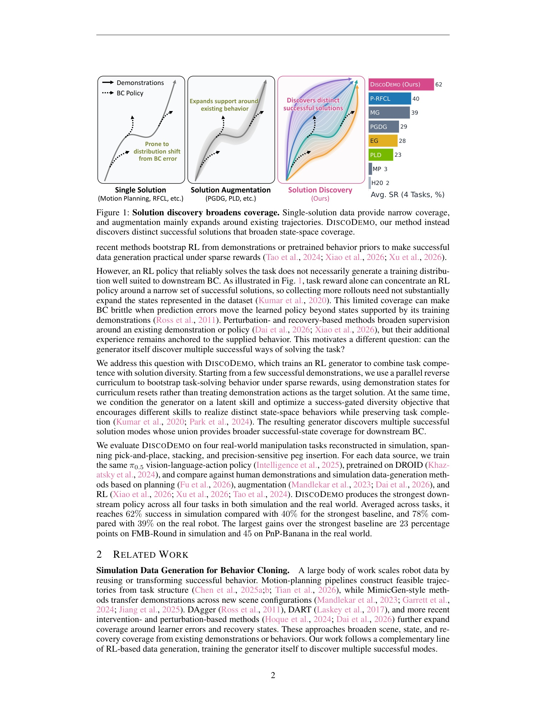

*原论文 Figure 1，PDF 第 2 页；整页保真截图。[原文对应页](https://arxiv.org/pdf/2610.32093#page=2)。*

**方法/第二关键图｜Figure 2**

*原论文 Figure 2，PDF 第 3 页；整页保真截图。[原文对应页](https://arxiv.org/pdf/2610.32093#page=3)。*

[截图来源清单](../assets/paper-screenshots/trajectory-diversity/manifest.json)。自动定位图号，裁切尚需人工逐图复核；第二图不一定是网络架构。

#### ⑤ 核心技术与算法细节

**逆向课程。** 使用 20 条源示教的可重置仿真状态，从接近成功的末端逐步向自然起点扩展；并行环境分别维护课程进展，降低稀疏成功奖励难度。

**潜变量教师。** 每回合采样固定 z，教师 π(a|s,z) 依赖特权状态。METRA 使用表示差分与 z 的内积 r_div=〈φ(s')−φ(s),z〉驱动不同技能访问不同状态区域。整个 episode 成功后才激活多样性奖励，因此经验回放必须知道 episode 对应的成功标签；失败轨迹不能因探索距离大获得相同奖励。训练安全 shaping 与生成后硬过滤分别处理。

**导出与学生。** 在自然初态分布采样 z 并闭环 rollout，检查完成及接触/位移约束，渲染保存 RGB、状态和动作，再以固定 π0.5 基座 SFT。论文以 Vendi 分别测量固定初态的 solution diversity 和跨初态 coverage，不能将 Vendi 误认作 RL 奖励。

#### ⑥ 完整 Pipeline（中文归纳）

1. 对真实 FR3 工作台、物体、相机与动作接口进行 Real-to-Sim 标定，保存示教状态序列。
2. 并行从靠近成功的示教状态 reset，训练带 latent 的 SAC 教师，成功率达标后前移课程。
3. 将整条轨迹成功标签绑定至 replay transition，按成功门控叠加 METRA 多样性目标与安全 shaping。
4. 固定训练完成的教师，从相同自然初态池采样多个 z，保存所有成功与失败 rollout 及过滤原因。
5. 对成功轨迹做接触/位移安全检查，渲染合格数据并导出；每任务训练学生使用的数量及评估协议以原文为准。
6. 微调预训练 π0.5；在四任务中分别进行仿真、真实 FR3 评估；同时用固定初态与跨初态分组计算多样性。

#### ⑦ 实验设计与主要结果

四项任务包含 PnP-Banana、StackCube、FMB-Round、FMB-SqCircle。作者报告最强对照到 DiscoDemo 的平均成功率为仿真 40%→62%、真机 39%→78%。重点关注 P-RFCL（去掉多样性目标）作为普通 RL 对照，而非只比较人工示教。原文 §4.3 还研究生成产率、效率、不同奖励权重和覆盖度；§4.5 讨论纠错数据互补性。不能据四任务均值推导任意模型的多样性最优点；详细配置与审计疑点见[深度调研](DiscoDemo_轨迹多样性_深度调研_2026-11-23.md)。

#### ⑧ 方法特点、局限与可借鉴之处

**贡献**：将 RL 用作数据教师而非真机部署策略，直接研究成功解发现。**局限**：潜变量可能学到学生不可辨认的行为选择，安全过滤可能系统性抹去少数模式；教师可重置状态与准确仿真是前提。**研究建议**：对训练 checkpoint 做固定初态×固定 z 的交叉 rollout，估计行为描述符方差来源；按接触/自由空间分段，对奖励权重、课程位置和安全筛选分别做消融，再进行等量 π0.5 对照。

**代码/数据状态**：https://github.com/DAVIAN-Robotics/DiscoDemo；[既有深度调研](DiscoDemo_轨迹多样性_深度调研_2026-11-23.md)

---

### 3.2 QDTraj

#### ① 论文基本信息

- **原题**：Exploration of Diverse Trajectory Primitives for Articulated Objects Robotic Manipulation
- **作者/发表**：2026-04 arXiv；项目标注 IROS 2026
- **原文**：[论文](https://arxiv.org/abs/2604.22551)｜[项目或原文入口](https://kappel.web.isir.upmc.fr/trajectory_primitive_website/)

#### ② 论文概述（摘要与研究内容的中文归纳）

以 Quality-Diversity 搜索构建可动对象的多解低层轨迹档案。

对门、抽屉等可动对象，最短轨迹不一定是最好的解：实际环境中可能有障碍、机器人可达性或不同初始站位。同一关节目标需要一组可切换的接触和路径策略。

#### ③ 研究动机与核心问题

对门、抽屉等可动对象，最短轨迹不一定是最好的解：实际环境中可能有障碍、机器人可达性或不同初始站位。同一关节目标需要一组可切换的接触和路径策略。作者将寻找多个可行解表述为 quality-diversity 搜索，而非只优化单条轨迹。

#### ④ 方法总览与原论文图

**主图｜Figure 1**

*原论文 Figure 1，PDF 第 1 页；原图及图注裁切。[原文对应页](https://arxiv.org/pdf/2604.22551#page=1)。*

**方法/第二关键图｜Figure 2**

*原论文 Figure 2，PDF 第 2 页；原图及图注裁切。[原文对应页](https://arxiv.org/pdf/2604.22551#page=2)。*

[截图来源清单](../assets/paper-screenshots/trajectory-diversity/manifest.json)。自动定位图号，裁切尚需人工逐图复核；第二图不一定是网络架构。

#### ⑤ 核心技术与算法细节

**参数化运动原语。** 原文 III-A/B 将原语保存为对象坐标系下的末端位姿序列，遗传搜索个体的 genotype 是起始末端 6-DoF frame（位置 x,y,z 与单位四元数 q），并非任意整条轨迹的每个时间点。由起始 frame 构造完整交互原语，在 Genesis 中并行执行（作者图 3 为 10,000 环境），依据关节激活目标评价质量。**行为档案。** MAP-Elites 以末端起始位置的三维 Cartesian descriptor 组织行为格子；候选经变异和评估，若属于空格或优于格内精英，则更新 archive。其 descriptor 的明确含义非常重要：起始位置多样不必然代表接触全过程形状多样。**适应性执行。** 从高质量档案选择当前可执行的原语，柔顺控制吸收部分几何/物理偏差；这是与纯刚体重放的重要区别。

#### ⑥ 完整 Pipeline（中文归纳）

1. 输入对象 URDF、关节类型及激活目标，确定运动原语参数边界。
2. 初始化候选，利用 Genesis 并行执行并测量任务奖励和行为描述符。
3. 将成功/高质量候选放进对应 descriptor 格子，对档案精英变异并继续搜索。
4. 获得覆盖不同起始接触位置的原语档案，记录每个格子的质量、可行性和搜索次数。
5. 根据当前真实环境可达约束选择原语，通过适应性控制执行并验证关节运动。

#### ⑦ 实验设计与主要结果

原文报告 hinge 与 slider 任务均至少产生五倍多样轨迹，在 PartNetMobility 30 个 articulation 平均每任务 704 条不同轨迹，并展示真机部署。论文主要证据是搜索档案及实际原语可执行性，并没有由此证明 VLA 学习性能同比提升。应读原文 III-A/B、IV-D、V 中原语、descriptor 与对照指标的定义。

#### ⑧ 方法特点、局限与可借鉴之处

**贡献**：搜索输出是可解释档案，能够指定覆盖区域、保留多种成功接触方案。**局限**：格子分辨率、descriptor 选择与采样预算强烈影响数量；起始位置不表达抓法、接触时序和全身冗余。**研究建议**：固定同一原语参数空间，替换为路径/接触/初始位置 descriptor，比较 archive 覆盖、成功率与等量学生学习，形成直接的 QD 评价研究。

**代码/数据状态**：项目提供源码、安装教程、API、HF 数据入口；本轮未实际运行。

---

### 3.3 SOE

#### ① 论文基本信息

- **原题**：Sample-Efficient Robot Policy Self-Improvement via On-Manifold Exploration
- **作者/发表**：Jin 等；上海交大等；2025-09 arXiv / 作者仓库标注 ICRA 2026
- **原文**：[论文](https://arxiv.org/abs/2509.19292)｜[项目或原文入口](https://ericjin2002.github.io/SOE/)

#### ② 论文概述（摘要与研究内容的中文归纳）

在任务相关潜空间内探索，避免直接对动作加入无结构随机噪声。

已有 BC 策略即使能完成任务，重复执行也容易因为模式坍塌产生相似行为。逐步添加随机动作噪声会破坏动作 chunk 的时间相关性，并可能使机器人离开合理动作流形。

#### ③ 研究动机与核心问题

已有 BC 策略即使能完成任务，重复执行也容易因为模式坍塌产生相似行为。逐步添加随机动作噪声会破坏动作 chunk 的时间相关性，并可能使机器人离开合理动作流形。SOE 的出发点是从已学行为附近进行有结构的探索，让采集过程本身成为改进策略的手段。

#### ④ 方法总览与原论文图

**主图｜Figure 1**

*原论文 Figure 1，PDF 第 1 页；整页保真截图。[原文对应页](https://arxiv.org/pdf/2509.19292#page=1)。*

**方法/第二关键图｜Figure 2**

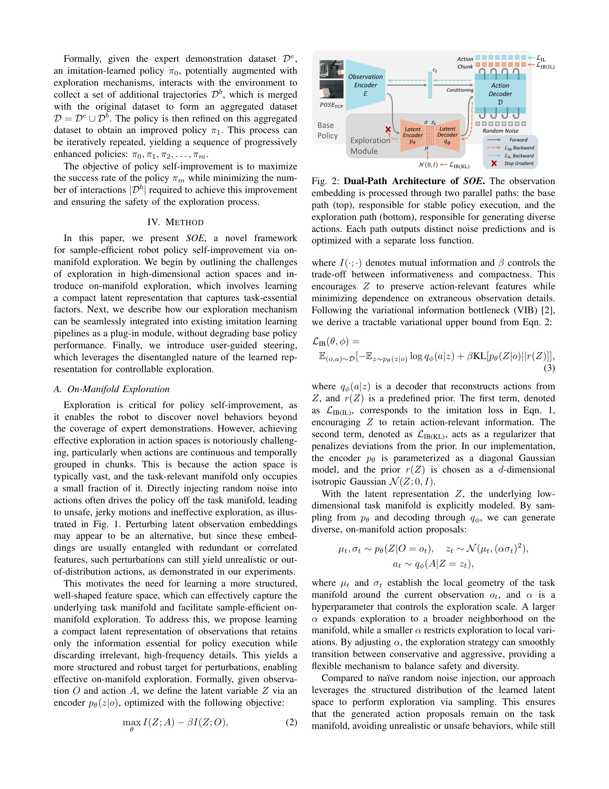

*原论文 Figure 2，PDF 第 3 页；整页保真截图。[原文对应页](https://arxiv.org/pdf/2509.19292#page=3)。*

[截图来源清单](../assets/paper-screenshots/trajectory-diversity/manifest.json)。自动定位图号，裁切尚需人工逐图复核；第二图不一定是网络架构。

#### ⑤ 核心技术与算法细节

**任务相关潜空间与双路径。** 原文 IV-B 明确在基础策略的观察编码器 E 与动作解码器 D 之间增加一条辅助旁路。基础路径 c=E(o)，a=D(c)；探索路径通过潜变量 encoder 估计 μ(c)、σ(c)，采样 z~N(μ,(ασ)²)，再由 decoder q(z) 得到修改后的条件表示，交给同一个动作解码器 D 输出动作 chunk。α 控制潜空间探索强度，不是关节噪声幅度。**联合训练。** 基础路径使用标准 IL 损失，探索路径使用包含动作重建及 KL 正则的变分信息瓶颈损失。运行时切换基础与探索路径，可通过人为引导潜变量方向控制变化。**自我改进。** 对探索执行获得的新数据进行筛选和再训练，形成 rollout—更新循环。具体网络损失和 latent 采样参数须以原文 IV 节为准。

#### ⑥ 完整 Pipeline（中文归纳）

1. 准备源示教和已经能够执行任务的基础策略。
2. 学习与任务相关的低维行为表示，构建有效动作流形。
3. 在策略执行时激活探索插件，按潜变量变化生成连贯动作并在环境闭环执行。
4. 收集新行为，依据任务成功及实际质量选择数据；也可以对潜空间进行人工引导。
5. 用增量数据更新策略，在固定交互预算下重复并评估成功率和样本效率。

#### ⑦ 实验设计与主要结果

原论文包含四项 robomimic 仿真任务及挂杯、烤面包机装载、灯帽安装等真实任务。比较应关注普通策略、直接噪声探索和流形探索在相同 rollout 预算下的成功样本产率、时间平滑性与自改进曲线。单看轨迹方差高低无法评价 SOE：其目标是有效探索而非最大化噪声。

#### ⑧ 方法特点、局限与可借鉴之处

**贡献**：一种适用于已有策略的生成方式，可与 DiscoDemo 的从零/课程 RL 教师形成对照。**局限**：学到的流形通常受源数据支撑，完全新接触模式不保证可发现；平滑也不构成真实安全证明。**研究建议**：用同一初态池比较潜空间尺度、逐步噪声、整段噪声和多技能 RL；测量新模式出现概率及每单位尝试的有效覆盖。

**代码/数据状态**：https://github.com/EricJin2002/SOE

---

### 3.4 RDGen

#### ① 论文基本信息

- **原题**：Demonstration Generation for High-Quality Robot Learning via Reinforcement Learning
- **作者/发表**：2026-05 arXiv
- **原文**：[论文](https://arxiv.org/abs/2605.30957)｜[项目或原文入口](https://arxiv.org/abs/2605.30957)

#### ② 论文概述（摘要与研究内容的中文归纳）

利用仿真训练并迁移的 RL 策略自动收集真实高质量示教。

数据生成不仅需要数量，还需要能作为学生监督的高质量、连贯操作。人类遥操常出现停顿、速度差异或不必要调整，而 RL 教师可以通过任务目标和执行反馈产生较一致的成功示教。

#### ③ 研究动机与核心问题

数据生成不仅需要数量，还需要能作为学生监督的高质量、连贯操作。人类遥操常出现停顿、速度差异或不必要调整，而 RL 教师可以通过任务目标和执行反馈产生较一致的成功示教。RDGen 着重探索如何用训练好的 RL 控制器自动生产真实数据。

#### ④ 方法总览与原论文图

**主图｜Figure 1**

*原论文 Figure 1，PDF 第 2 页；原图及图注裁切。[原文对应页](https://arxiv.org/pdf/2605.30957#page=2)。*

**方法/第二关键图｜Figure 2**

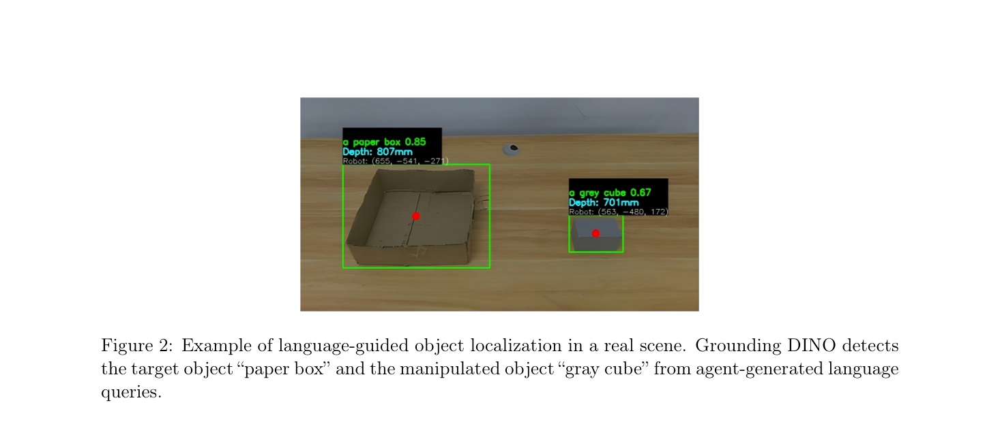

*原论文 Figure 2，PDF 第 6 页；原图及图注裁切。[原文对应页](https://arxiv.org/pdf/2605.30957#page=6)。*

[截图来源清单](../assets/paper-screenshots/trajectory-diversity/manifest.json)。自动定位图号，裁切尚需人工逐图复核；第二图不一定是网络架构。

#### ⑤ 核心技术与算法细节

**任务 grounding。** 通过视觉语言模型解析指令，结合目标检测/定位确定操作对象与场景信息。**执行教师。** 仿真训练的 RL 控制策略根据环境状态完成操作，再迁移到机器人进行实际执行和采集。**监督导出。** 保存成功执行的观测与动作并供 VLA 学习；与普通遥操对照，评估数据动作质量及学生表现。该方法没有被证明使用显式多样性奖励，故作为质量优先的 RL 生成对照更合适。

#### ⑥ 完整 Pipeline（中文归纳）

1. 指定任务及真实工作空间，用感知模块定位目标。
2. 在仿真中训练能够完成任务的 RL 控制器，建立现实控制/感知接口。
3. 在真实初态分布运行 RL 教师，记录观测、机器人动作和任务结果。
4. 拒绝失败或不合格示教，形成自动采集的高质量数据集。
5. 使用同规模的生成数据与遥操作数据训练学生，比较实际任务表现。

#### ⑦ 实验设计与主要结果

论文报告 pick-and-place 设置下的 RL 生成、动作平滑性及学生效果。当前不把单任务结果推广为多任务或长程保证，也不填写未逐表核实的成功率。研究上应比较单位真实运行时间的有效数据量，并注意感知与 RL 控制的协同作用。

#### ⑧ 方法特点、局限与可借鉴之处

**贡献**：提供普通任务回报 RL 生产真实示教的路线，可作 DiscoDemo diversity-RL 的有意义基线。**局限**：单一高成功教师也可能模式坍塌，真实采集仍受机器人时间限制。**研究建议**：固定教师初态、执行预算和过滤条件，研究显式多样性目标是否在同等质量下提高 OOD 学习。

**代码/数据状态**：代码和权重完整性未核验。

---

### 3.5 URSA

#### ① 论文基本信息

- **原题**：From Tabula Rasa to Emergent Abilities: Discovering Robot Skills via Real-World Unsupervised Quality-Diversity
- **作者/发表**：Grillotti 等；CoRL 2025
- **原文**：[论文](https://proceedings.mlr.press/v305/grillotti25a.html)｜[项目或原文入口](https://proceedings.mlr.press/v305/grillotti25a.html)

#### ② 论文概述（摘要与研究内容的中文归纳）

扩展 QDAC，在真实硬件自主发现高质量多样技能。

传统 QD 常依赖人工指定技能描述符，而开放环境中很难预先定义所有有意义行为。在真机上搜索又受到样本成本、硬件安全和不易并行的约束。

#### ③ 研究动机与核心问题

传统 QD 常依赖人工指定技能描述符，而开放环境中很难预先定义所有有意义行为。在真机上搜索又受到样本成本、硬件安全和不易并行的约束。URSA 从无监督技能发现出发，研究高质量与行为多样性可以如何共同学习。

#### ④ 方法总览与原论文图

**主图｜Figure 1**

*原论文 Figure 1，PDF 第 1 页；原图及图注裁切。[原文对应页](https://raw.githubusercontent.com/mlresearch/v305/main/assets/grillotti25a/grillotti25a.pdf#page=1)。*

**方法/第二关键图｜Figure 2**

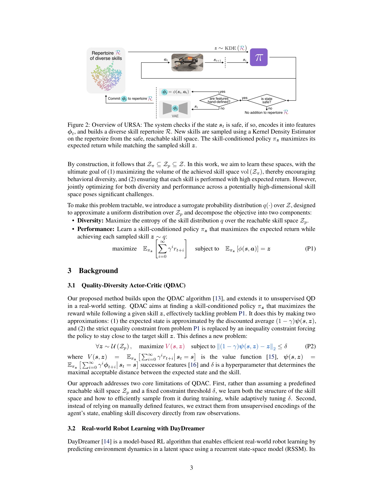

*原论文 Figure 2，PDF 第 3 页；整页保真截图。[原文对应页](https://raw.githubusercontent.com/mlresearch/v305/main/assets/grillotti25a/grillotti25a.pdf#page=3)。*

[截图来源清单](../assets/paper-screenshots/trajectory-diversity/manifest.json)。自动定位图号，裁切尚需人工逐图复核；第二图不一定是网络架构。

#### ⑤ 核心技术与算法细节

**QDAC 基础。** QDAC 将任务价值 critic 与 successor-features critic 配合，既评价行为回报，又估计可持续实现的技能相关状态特征。**无监督技能空间。** URSA 扩展该思路，在探索中学习技能表示，降低人工设计 descriptor 的依赖。**真机学习与复用。** 学到的多样技能在不同现实条件中作为可选择的行为库；在环境/硬件变化后选择可行策略，而非完全重新训练。此处是机器人运动技能，不等同于接触操作示教生成。

#### ⑥ 完整 Pipeline（中文归纳）

1. 定义机器人可观察状态、任务质量回报和真实执行约束。
2. 初始化技能条件策略及相关 critic，收集状态动作经验。
3. 学习可区分技能的表示，同时更新任务价值与技能实现能力。
4. 多次探索获得不同可执行行为，并记录技能与实际描述符关系。
5. 在真实环境变化或损伤适应设置测试可用技能，评估质量和覆盖。

#### ⑦ 实验设计与主要结果

作者在 Unitree A1 运动领域开展仿真与真机实验并研究损伤适应。应将其作为自动发现 descriptor 和技能表征的证据，不声称论文证明机械臂 VLA 的数据生成收益。QDAC 原始工作见 [ICML 2024](https://proceedings.mlr.press/v235/grillotti24a.html)，URSA 原文见 CoRL。

#### ⑧ 方法特点、局限与可借鉴之处

**贡献**：从手工定义行为格子推进到学习技能空间，可借鉴到操作轨迹聚类和自监督行为描述符。**局限**：自主探索可能关注容易区分但与目标操作无关的运动，真实机器人执行受约束。**研究建议**：用对象状态、末端相对运动与接触事件训练表示，比较其与手工 QDTraj descriptor 的档案覆盖和目标效用。

**代码/数据状态**：论文入口；未审代码。

---

### 3.6 SymmGrid

#### ① 论文基本信息

- **原题**：Super-Scaling On-Robot Learning with Parallelized Symmetries and Egocentric-Exocentric Visual Perception
- **作者/发表**：Everett 等；2026-07 arXiv
- **原文**：[论文](https://arxiv.org/abs/2607.26985)｜[项目或原文入口](https://symmgrid-robot.github.io/)

#### ② 论文概述（摘要与研究内容的中文归纳）

用轨迹级并行对称变换扩大真实 RL replay buffer。

真机 RL 最昂贵的部分是与环境交互，已有经验若只使用一次，就浪费了任务中的几何对称性。另一方面，图像旋转/翻转而动作标签不变会产生错误监督。

#### ③ 研究动机与核心问题

真机 RL 最昂贵的部分是与环境交互，已有经验若只使用一次，就浪费了任务中的几何对称性。另一方面，图像旋转/翻转而动作标签不变会产生错误监督。SymmGrid 研究在 MDP 对称条件下对整条轨迹进行联合变换，增加与原经验一致的新样本。

#### ④ 方法总览与原论文图

**主图｜Figure 1**

*原论文 Figure 1，PDF 第 2 页；整页保真截图。[原文对应页](https://arxiv.org/pdf/2607.26985#page=2)。*

**方法/第二关键图｜Figure 2**

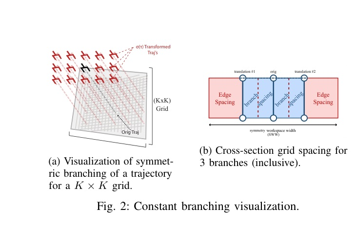

*原论文 Figure 2，PDF 第 4 页；整页保真截图。[原文对应页](https://arxiv.org/pdf/2607.26985#page=4)。*

[截图来源清单](../assets/paper-screenshots/trajectory-diversity/manifest.json)。自动定位图号，裁切尚需人工逐图复核；第二图不一定是网络架构。

#### ⑤ 核心技术与算法细节

**对称树。** 将可组合的状态—动作变换组织为树状分支，在允许的对称关系下扩展原轨迹，形成几何网格上的经验集合。**多模态一致。** 同时变换机器人/物体状态、末端或控制动作及图像；在 egocentric/exocentric 视觉设置中使用相应几何映射和 homography，使观测与动作含义匹配。**replay 复用。** 将有效对称变换产生的序列写入 RL replay buffer，提升每次真实交互的有效利用率。对称变换只有保持 MDP 动力学与任务回报时才是严格等价；实际场景需要检查近似误差。

#### ⑥ 完整 Pipeline（中文归纳）

1. 收集一条含视觉、本体状态、动作及奖励的真实 rollout。
2. 根据任务和相机几何定义可允许的对称变换与组合关系。
3. 对整条轨迹联合变换状态、动作、视觉及目标条件，保留时间顺序。
4. 检查越界、遮挡、动作映射和任务语义等约束，形成有效经验集合。
5. 将原始与合成经验共同用于 RL 更新，按真实交互预算比较收敛与最终性能。

#### ⑦ 实验设计与主要结果

作者在插孔、线缆布设和搬移任务报告训练加速与成功率相对改善，原文给出 1.37–2.17 倍收敛加速与 1.09–1.27 倍成功率相对比。应区别相对倍数和百分点，并检验基线真实 interaction 数相同。训练变快主要说明样本效率，不能直接证明产生新的接触模式。

#### ⑧ 方法特点、局限与可借鉴之处

**贡献**：通过结构保持的联合变换低成本扩充真实经验。**局限**：真实桌面障碍、相机视差、重力和关节边界可能破坏对称；对称等价轨迹在目标相对坐标中可能具有相同几何形状。**研究建议**：分别报告绝对空间覆盖与对称不变量覆盖，比较联合正确变换、普通图像增强、无增强在固定真实交互预算下的效果。

**代码/数据状态**：项目入口；代码完整性本轮未核验。

## 4. 任务级、长时程与生成式数据

关注不仅是同一步如何移动，还包括接触策略、子任务顺序、失败恢复以及视频生成得到的动作标签是否正确。

---

### 4.1 SkillWeaver

#### ① 论文基本信息

- **原题**：Agentic Exploration over Neural Interaction Skills for Scalable Robot Data Generation
- **作者/发表**：Zhu、Zhao、Cheng、Li、Fragkiadaki；2026-09 arXiv
- **原文**：[论文](https://arxiv.org/abs/2609.36171)｜[项目或原文入口](https://arxiv.org/abs/2609.36171)

#### ② 论文概述（摘要与研究内容的中文归纳）

VLM Agent 使用参数化闭环神经交互技能，通过验证器引导搜索发现长时程成功解。

长时程机器人操作的瓶颈不是单一动作能否成功，而是当中间状态发生变化时能否选择、组合和重新调用有效技能。单纯让大模型输出固定动作脚本，往往在接触环节失效；把完整任务作为 RL 的学习对象又面临长时程稀疏奖励。

#### ③ 研究动机与核心问题

长时程机器人操作的瓶颈不是单一动作能否成功，而是当中间状态发生变化时能否选择、组合和重新调用有效技能。单纯让大模型输出固定动作脚本，往往在接触环节失效；把完整任务作为 RL 的学习对象又面临长时程稀疏奖励。SkillWeaver 将高层推理、低层闭环技能和搜索验证分开。

#### ④ 方法总览与原论文图

**主图｜Figure 1**

*原论文 Figure 1，PDF 第 1 页；原图及图注裁切。[原文对应页](https://arxiv.org/pdf/2609.36171#page=1)。*

**方法/第二关键图｜Figure 2**

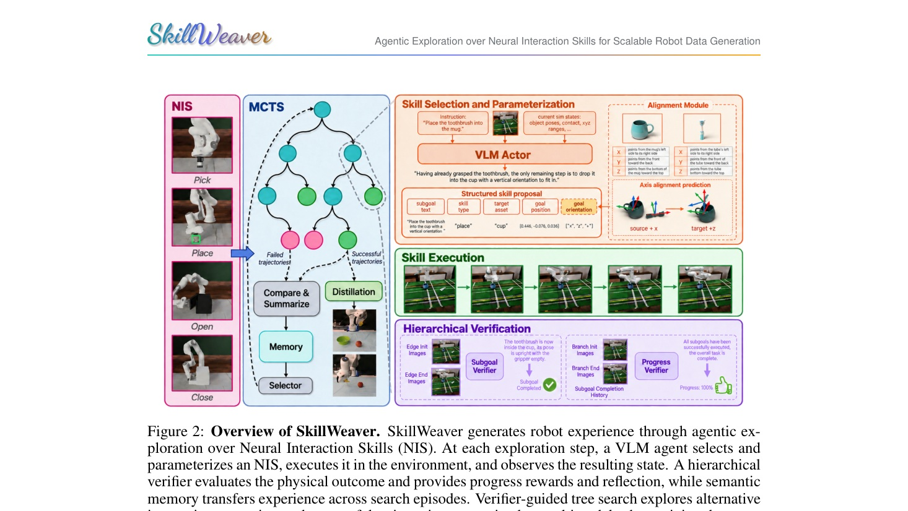

*原论文 Figure 2，PDF 第 4 页；原图及图注裁切。[原文对应页](https://arxiv.org/pdf/2609.36171#page=4)。*

[截图来源清单](../assets/paper-screenshots/trajectory-diversity/manifest.json)。自动定位图号，裁切尚需人工逐图复核；第二图不一定是网络架构。

#### ⑤ 核心技术与算法细节

**神经交互技能（NIS）。** 在仿真中以 RL 学习可参数化的接触操作技能，技能根据当前状态执行，而不是简单回放开环轨迹。高层 Agent 调用这些技能时需要指定操作对象与参数；低层策略负责实际接触控制。

**验证器引导的树搜索。** 将中间场景状态与已执行技能序列视作搜索节点，Agent 推理下一项可调用技能，执行后获得环境反馈并由验证器判断子目标或任务是否达成。遇到失败时可以探索其他分支，从而发现不同成功技能组合。记忆及反馈机制使搜索不局限于一次生成的固定流水线。

**数据生产。** 对多个任务、场景和物体重复搜索，成功分支产生由多个技能拼接、实际闭环执行的长时程轨迹，再作为学生策略示教。多样性既可能来自技能内部动作，也可能来自技能序列的变化，两层应分别测量。

#### ⑥ 完整 Pipeline（中文归纳）

1. 建立仿真环境与任务完成验证器，训练或准备神经交互技能库。
2. 以当前场景状态和自然语言目标初始化 Agent 搜索。
3. Agent 选择技能、对象与参数；低层技能执行并更新实际状态。
4. 验证子目标与最终成功条件，保留可行分支，对失败分支回溯或重新探索。
5. 汇总多场景成功分支及动作观测，构建长时程训练数据并评估策略在未见任务与现实环境的迁移。

#### ⑦ 实验设计与主要结果

论文报告约 3.91 万条示教、1.41 万场景，并评估新布局、对象、任务及环境泛化与 sim-to-real。关键应读取固定技能管线与 verifier-guided search 的对照，确认成功提升到底来自搜索、技能稳定性还是数据规模。报告数据规模不能直接证明同一任务每条都具有不同技能序列；原文未直接提供的模式统计需另做。

#### ⑧ 方法特点、局限与可借鉴之处

**贡献**：把数据生成从连续轨迹搜索推广到离散技能组合搜索，适合长时程任务。**局限**：技能库不可完成的交互、验证器错误与搜索开销限制覆盖。**研究建议**：固定技能库和初态，比较贪心、随机、树搜索的成功分支数、任务图边覆盖和每成功 episode 计算量；再对相同终态但不同合法顺序进行等量 SFT。

**代码/数据状态**：本轮未核实完整代码与 NIS 权重。

---

### 4.2 KnowDemo

#### ① 论文基本信息

- **原题**：Knowledge-Guided Robot Demonstration Generation from Human Videos
- **作者/发表**：Gao、Zhan、Khoshnazar、Schäfer、Beetz；2026-09 arXiv
- **原文**：[论文](https://arxiv.org/abs/2609.21229)｜[项目或原文入口](https://zhiyuan-gao.github.io/knowdemo/)

#### ② 论文概述（摘要与研究内容的中文归纳）

从人类视频抽取任务必要条件及可变执行选择，生成替代接触方式与有效子任务顺序。

人类视频只提供某一次完成任务的过程，其中既有任务必须满足的约束，也有操作者偶然选择的抓法、接触点或动作顺序。若把所有观察到的运动都当成唯一正确解，会限制目标机器人形态下的可行轨迹集合。

#### ③ 研究动机与核心问题

人类视频只提供某一次完成任务的过程，其中既有任务必须满足的约束，也有操作者偶然选择的抓法、接触点或动作顺序。若把所有观察到的运动都当成唯一正确解，会限制目标机器人形态下的可行轨迹集合。KnowDemo 通过从人类视频提取可迁移的操作知识，扩大跨工作空间的成功执行模式。

#### ④ 方法总览与原论文图

**主图｜Figure 1**

*原论文 Figure 1，PDF 第 2 页；整页保真截图。[原文对应页](https://arxiv.org/pdf/2609.21229#page=2)。*

**方法/第二关键图｜Figure 4**

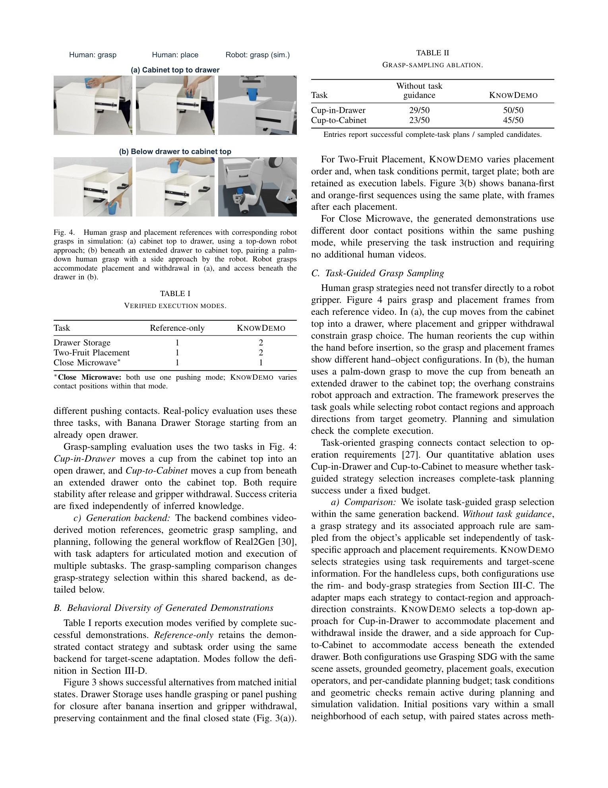

*原论文 Figure 4，PDF 第 6 页；整页保真截图。[原文对应页](https://arxiv.org/pdf/2609.21229#page=6)。*

[截图来源清单](../assets/paper-screenshots/trajectory-diversity/manifest.json)。自动定位图号，裁切尚需人工逐图复核；第二图不一定是网络架构。

#### ⑤ 核心技术与算法细节

**知识抽取。** 从视频分析参与对象、操作关系、目标与参考动作，区分必要约束及允许变化的执行选择。**场景 grounding。** 将结构化知识映射到目标工作空间实际对象、几何位置和机器人可达条件。**候选生成。** 在满足知识约束的前提下，采样替代抓取、接触位姿与合法子任务顺序，使用运动规划与仿真验证获得可执行机器人轨迹。其核心不是从人手运动直接复制机器人关节角，而是先抽象任务语义，再生成目标本体行为。

#### ⑥ 完整 Pipeline（中文归纳）

1. 输入人类操作视频，提取任务目标、对象关系、参考执行及必要约束。
2. 在目标场景定位对象并建立机器人可达、功能与接触信息。
3. 枚举或采样符合约束的抓法、接触位姿与合法技能顺序。
4. 规划并实际验证每个候选，剔除不可行或违反任务约束的方案。
5. 将通过验证的示教导出给机器人策略训练，并在新场景/真机检验。

#### ⑦ 实验设计与主要结果

作者与仅依赖参考示范的配置比较，通过验证的执行模式更丰富，并报告三项任务 sim-to-real 实验。重要的是‘验证通过的不同模式’和‘生成候选数’不能混用，模式标签定义应从原文实验读取。对于尚未逐表核实的绝对成功率不另填数值。

#### ⑧ 方法特点、局限与可借鉴之处

**贡献**：显式生成任务语义与执行选择的多样性，避免把参考视频中的偶然动作固定成规则。**局限**：VLM 可能混淆必要约束与偏好，目标场景感知误差会传播到接触与规划。**研究建议**：人工构建少量可验证任务 DAG，对 VLM 抽取约束做 precision/recall；固定物体与初态，比较不同合法顺序、抓法及组合的训练价值。

**代码/数据状态**：项目入口；未核实完整资源。

---

### 4.3 DROM

#### ① 论文基本信息

- **原题**：A Language-Guided Diffusion Framework for Multi-Skill Robotic Manipulation
- **作者/发表**：Pomponi 等；2026-09 arXiv
- **原文**：[论文](https://arxiv.org/abs/2609.37348)｜[项目或原文入口](https://github.com/automation-robotics-machines/drom)

#### ② 论文概述（摘要与研究内容的中文归纳）

用运动原语扩展少量示教，再训练语言条件轨迹 diffusion 以生成与组合多技能运动。

多技能操作难以通过单一规划规则覆盖，尤其是目标方向、末端姿态和接触方式随任务改变时，普通 BC 又需要大量逐技能数据。作者将少量示教的结构化运动增强与语言条件生成模型结合，试图让模型学习可被不同指令调度的轨迹分布。

#### ③ 研究动机与核心问题

多技能操作难以通过单一规划规则覆盖，尤其是目标方向、末端姿态和接触方式随任务改变时，普通 BC 又需要大量逐技能数据。作者将少量示教的结构化运动增强与语言条件生成模型结合，试图让模型学习可被不同指令调度的轨迹分布。

#### ④ 方法总览与原论文图

**主图｜Figure 1**

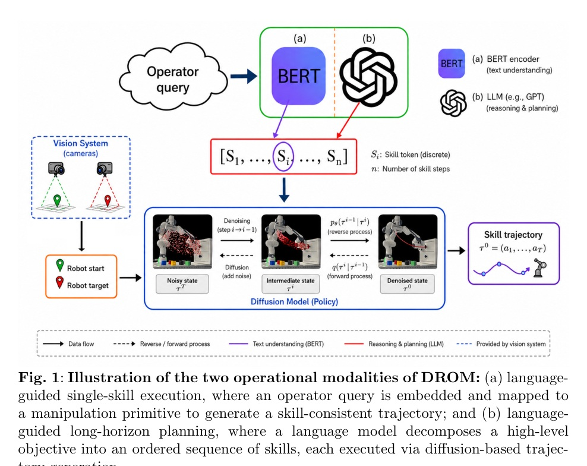

*原论文 Figure 1，PDF 第 2 页；原图及图注裁切。[原文对应页](https://arxiv.org/pdf/2609.37348#page=2)。*

**方法/第二关键图｜Figure 2**

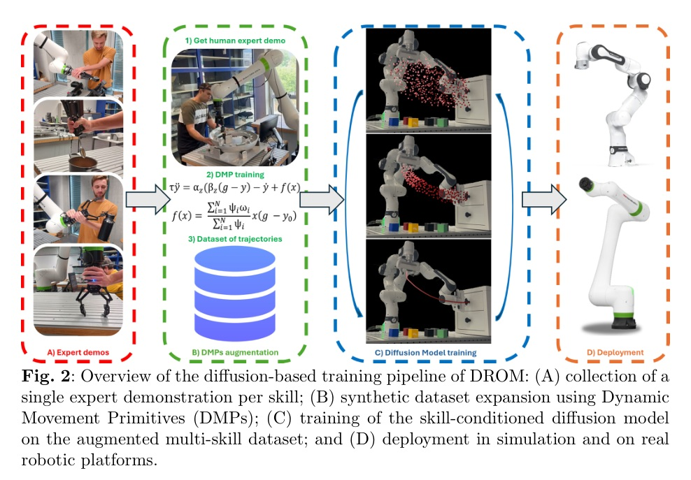

*原论文 Figure 2，PDF 第 6 页；原图及图注裁切。[原文对应页](https://arxiv.org/pdf/2609.37348#page=6)。*

[截图来源清单](../assets/paper-screenshots/trajectory-diversity/manifest.json)。自动定位图号，裁切尚需人工逐图复核；第二图不一定是网络架构。

#### ⑤ 核心技术与算法细节

**运动原语增强。** 使用 DMP 表示示教轨迹的主要动态形状，通过修改边界或运动参数构造更多样本，而非逐时间步任意扰动。**语言条件扩散。** 在 Motion Planning Diffusion 框架中引入语言 cross-attention，使去噪生成过程根据指定技能产生相应轨迹。多个噪声种子可以给出候选路径，但生成多样性是否覆盖有意义模式取决于训练数据与条件设计。**高层组合。** 使用 LLM 将长程任务分解为技能指令并调用生成模块；应检查技能边界与物理约束，不能将语言规划正确等同于动作可执行。

#### ⑥ 完整 Pipeline（中文归纳）

1. 为少量人工技能示教标注语言指令与轨迹条件。
2. 拟合运动原语并生成不同边界条件下的扩展轨迹，检查训练标签。
3. 训练语言条件轨迹扩散网络，学习动作或运动序列分布。
4. 高层根据长程指令生成技能序列，逐项条件采样轨迹。
5. 在仿真及机器人上执行，评估单技能成功、组合成功及轨迹质量。

#### ⑦ 实验设计与主要结果

作者在 Franka、FANUC 和 MuJoCo 设置与 MPD、BC 等基线比较。实验应分别分析 DMP 增强、语言条件和技能分解的贡献，而非把总体提升归为 diffusion 多样性。新噪声样本是否对应新的接触模式，需额外对生成轨迹做分组统计。

#### ⑧ 方法特点、局限与可借鉴之处

**贡献**：提供参数化原语与生成式模型结合的路线，适合研究条件控制和轨迹分布采样。**局限**：源 DMP 的行为形状与训练模式决定分布支持；长程组合仍可能出现状态不匹配。**研究建议**：固定技能与目标，控制扩散随机种子和采样配置，统计模式覆盖、非法候选比例和任务成功率；比较带条件标签与不带标签的学生。

**代码/数据状态**：作者提供数据与仿真仓库入口；未运行。

---

### 4.4 RoboGene

#### ① 论文基本信息

- **原题**：Boosting VLA Pre-training via Diversity-Driven Agentic Framework for Real-World Task Generation
- **作者/发表**：2026-02 arXiv
- **原文**：[论文](https://arxiv.org/abs/2602.16444)｜[项目或原文入口](https://robogene-boost-vla.github.io/)

#### ② 论文概述（摘要与研究内容的中文归纳）

自动构造多样、物理可行的真实操作任务，面向单臂、双臂及移动机器人。

大型机器人数据集的规模受任务设计本身限制。即使可以快速采集，若操作需求始终是同一种抓取放置，数据仍难覆盖真实机器人工作所需的组合能力。

#### ③ 研究动机与核心问题

大型机器人数据集的规模受任务设计本身限制。即使可以快速采集，若操作需求始终是同一种抓取放置，数据仍难覆盖真实机器人工作所需的组合能力。RoboGene 将任务候选的生产、筛选与人类反馈视为数据引擎的上游问题。

#### ④ 方法总览与原论文图

**主图｜Figure 1**

*原论文 Figure 1，PDF 第 2 页；整页保真截图。[原文对应页](https://arxiv.org/pdf/2602.16444#page=2)。*

**方法/第二关键图｜Figure 3**

*原论文 Figure 3，PDF 第 4 页；整页保真截图。[原文对应页](https://arxiv.org/pdf/2602.16444#page=4)。*

[截图来源清单](../assets/paper-screenshots/trajectory-diversity/manifest.json)。自动定位图号，裁切尚需人工逐图复核；第二图不一定是网络架构。

#### ⑤ 核心技术与算法细节

**任务空间建模。** 结合机器人本体、物料、工作场景及技能可行性生成任务候选。**Agent 生成与策展。** 对候选任务进行多样性、实际可执行性和重复性检查；引入人的反馈来修订不合适的任务。**采集与预训练。** 将经过审查的任务规范交给真实数采，获得机器人状态、图像、动作与指令，再用于 VLA 预训练。研究对象是任务级分布，不能仅凭语言任务名称丰富推定动作模式丰富。

#### ⑥ 完整 Pipeline（中文归纳）

1. 构建本体、物体、场景及允许技能的描述。
2. Agent 生成多样任务候选及操作目标。
3. 审查任务是否重复、可达、物理可行并符合真实场景需求，接受人类反馈后修订。
4. 执行真实任务采集与成功标注，记录任务结构和行为类型。
5. 使用多样任务数据预训练 VLA，测试未见任务及场景。

#### ⑦ 实验设计与主要结果

摘要报告与 GPT-4o、Gemini 等基础模型任务生成方案的比较以及面向 VLA 预训练的研究。应区分任务质量评价、实际采集执行和下游模型表现这三个层次，避免将任务候选数等同于成功示教数。具体数值应以相应版本原文为准。

#### ⑧ 方法特点、局限与可借鉴之处

**贡献**：从任务设计入口增加语义及技能组合覆盖。**局限**：表面任务名称可能掩盖重复运动；复杂任务的采集与成功检查成本可能更高。**研究建议**：用任务 DAG、接触事件、对象关系变化和动作原语分布共同定义任务多样性，对同一采集预算比较基于语义新颖性和运动新颖性的任务选择。

**代码/数据状态**：项目入口；本轮未核验采集系统。

---

### 4.5 DreamGen

#### ① 论文基本信息

- **原题**：Unlocking Generalization in Robot Learning through Video World Models
- **作者/发表**：Jang 等；CoRL 2025
- **原文**：[论文](https://proceedings.mlr.press/v305/jang25a.html)｜[项目或原文入口](https://research.nvidia.com/labs/gear/dreamgen/)

#### ② 论文概述（摘要与研究内容的中文归纳）

通过视频世界模型生成神经轨迹并训练机器人策略，以扩展新行为和新场景。

真实机器人采集的新行为与场景覆盖受本体和人力限制，而视频世界模型从大量视觉数据中学得较强生成先验。难点是视频本身没有可直接用于控制的机器人动作，且外观合理不代表操作物理可行。

#### ③ 研究动机与核心问题

真实机器人采集的新行为与场景覆盖受本体和人力限制，而视频世界模型从大量视觉数据中学得较强生成先验。难点是视频本身没有可直接用于控制的机器人动作，且外观合理不代表操作物理可行。DreamGen 研究如何将视频模型生成结果转成可训练的神经轨迹。

#### ④ 方法总览与原论文图

**主图｜Figure 1**

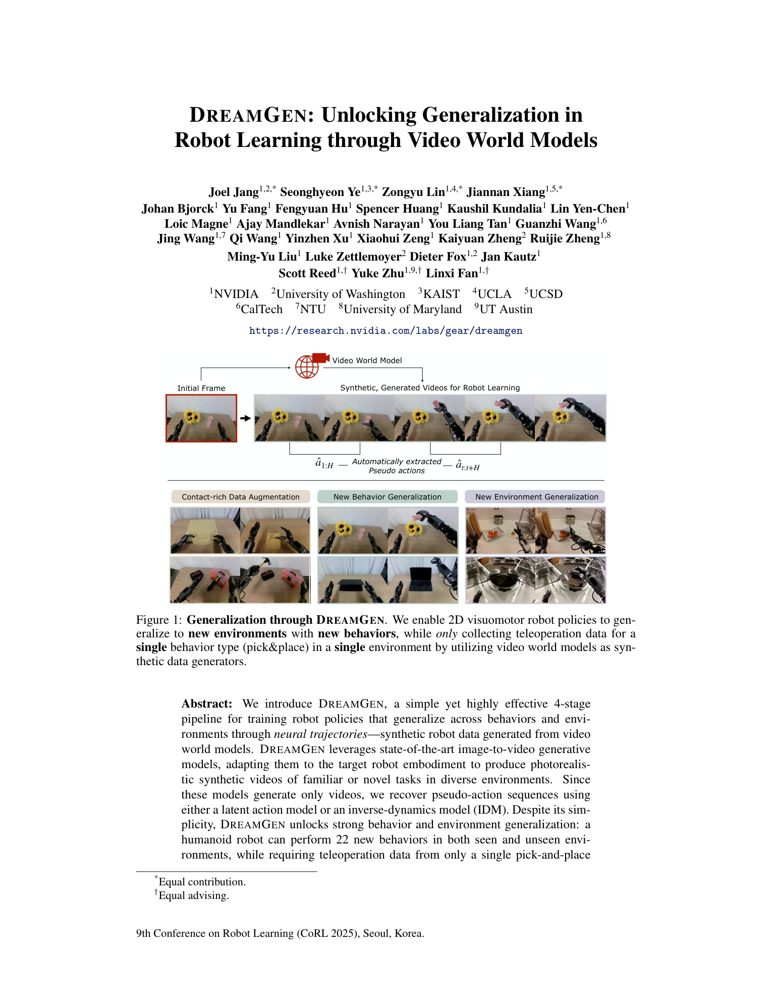

*原论文 Figure 1，PDF 第 1 页；整页保真截图。[原文对应页](https://raw.githubusercontent.com/mlresearch/v305/main/assets/jang25a/jang25a.pdf#page=1)。*

**方法/第二关键图｜Figure 2**

*原论文 Figure 2，PDF 第 2 页；整页保真截图。[原文对应页](https://raw.githubusercontent.com/mlresearch/v305/main/assets/jang25a/jang25a.pdf#page=2)。*

[截图来源清单](../assets/paper-screenshots/trajectory-diversity/manifest.json)。自动定位图号，裁切尚需人工逐图复核；第二图不一定是网络架构。

#### ⑤ 核心技术与算法细节

**本体适配与视频生成。** 用机器人示教对视频世界模型进行适配，使其生成符合目标本体的运动外观，并通过条件变化产生新环境或行为。**动作恢复。** 作者比较两条途径：通用 latent action model 提取潜动作，或 inverse-dynamics model 从相邻视频观测预测机器人动作；两种动作空间及学生训练方式不能混淆。**策略训练。** 将合成视频与伪动作作为神经轨迹，训练下游控制策略并在实际机器人上检验。该路线扩展生成分布，但伪动作误差是独立的数据质量问题。

#### ⑥ 完整 Pipeline（中文归纳）

1. 准备目标本体的真实遥操作视频/动作数据，适配视频生成模型与所需动作恢复模型。
2. 采样新的场景、行为或语言条件，生成机器人操作视频。
3. 使用 latent action 或逆动力学恢复动作序列并整理训练样本。
4. 训练下游机器人策略；按原实验划分测新动词、新场景以及二者同时变化。
5. 以真实机器人闭环评估，而不是只用视频视觉评价替代策略效果。

#### ⑦ 实验设计与主要结果

论文及项目展示新行为、新环境和二者联合变化的真实操作实验，并提供 DreamGen Bench 评估思路。应核对 synthetic-only 和真实/合成混合的训练条件，以及动作恢复途径是否不同。视频生成指标只能说明视觉或行为先验，不能直接证明机器人动作准确。

#### ⑧ 方法特点、局限与可借鉴之处

**贡献**：使视频生成模型成为可扩展的行为数据来源。**局限**：生成视频可能包含不可执行接触、对象突变及错误动作伪标签；潜动作和真实控制动作也不是同一空间。**研究建议**：将合成轨迹按动作恢复置信度、回放一致性和任务覆盖三轴分层，再测真实学生收益；与 RoboCurate 联合阅读。

**代码/数据状态**：作者项目；此处不等同于原综述的 RoboDream。

---

### 4.6 RoboCurate

#### ① 论文基本信息

- **原题**：Harnessing Diversity with Action-Verified Neural Trajectory for Robot Learning
- **作者/发表**：2026-02 arXiv；作者项目更新题名为 Action-Verified Synthetic Data
- **原文**：[论文](https://arxiv.org/abs/2602.18742)｜[项目或原文入口](https://seungkukim.github.io/robocurate/)

#### ② 论文概述（摘要与研究内容的中文归纳）

将生成视频的逆动力学动作回放到仿真，用运动一致性识别错误监督。

视频世界模型可扩大训练样本的背景、对象和运动上下文，但从生成视频逆推的动作并不一定能够复现视频里显示的运动。视觉审核即使认为画面自然，也无法证明每步机器人控制标签正确。

#### ③ 研究动机与核心问题

视频世界模型可扩大训练样本的背景、对象和运动上下文，但从生成视频逆推的动作并不一定能够复现视频里显示的运动。视觉审核即使认为画面自然，也无法证明每步机器人控制标签正确。RoboCurate 将动作可执行一致性引入神经轨迹数据筛选。

#### ④ 方法总览与原论文图

**主图｜Figure 1**

*原论文 Figure 1，PDF 第 2 页；整页保真截图。[原文对应页](https://arxiv.org/pdf/2602.18742#page=2)。*

**方法/第二关键图｜Figure 3**

*原论文 Figure 3，PDF 第 6 页；整页保真截图。[原文对应页](https://arxiv.org/pdf/2602.18742#page=6)。*

[截图来源清单](../assets/paper-screenshots/trajectory-diversity/manifest.json)。自动定位图号，裁切尚需人工逐图复核；第二图不一定是网络架构。

#### ⑤ 核心技术与算法细节

**候选合成。** 利用图像编辑构造新的初态外观，并通过视频生成保持参考运动；生成多个候选可以提高找到高质量样本的概率。**动作恢复及回放。** 逆动力学模型预测机器人动作，将预测控制序列放入仿真执行，获得第二条可验证的运动视频。**运动一致性评估。** 通过冻结 V-JEPA 2 特征与训练的 attentive probe 判断两条视频是否在运动层面匹配，减少外观差异对判断的干扰。VLM 预筛及 Best-of-N 提高候选选择质量，但验证器通过不等于获得严格的物理证明。

#### ⑥ 完整 Pipeline（中文归纳）

1. 从已有轨迹与新场景条件生成若干候选初始图像和操作视频。
2. 进行视频内容初筛，恢复每条候选的机器人动作。
3. 在对应仿真场景执行预测动作，渲染实际回放。
4. 比较生成视频与回放视频的运动表征，筛除不一致候选或 Best-of-N 选择。
5. 将动作验证通过的神经轨迹混入训练集，比较真实机器人策略表现。

#### ⑦ 实验设计与主要结果

项目表格显示 ALLEX 平均成功率 13.9→38.9%，OpenArm 21.9→31.3%（真实数据基线与添加 Best-of-N 合成数据的对应设置）。这属于整套合成与验证方案的下游证据，不等于 probe 单独贡献；应检查未验证合成、随机候选、VLM-only 与动作验证等对照。作者项目有版本更新，图表与论文版本需匹配。

#### ⑧ 方法特点、局限与可借鉴之处

**贡献**：把‘有多样性’与‘动作标签可用’建立直接联系。**局限**：仿真初态或动力学不准会误判，视觉 probe 也可能忽略细小接触错误；Best-of-N 增加生成成本。**研究建议**：构造已知动作错位、方向翻转和接触错误测试集测过滤器召回/误杀；记录每种行为模式筛选前后保留率，与仅视觉打分对照。

**代码/数据状态**：项目入口；未验证训练资源。

---

### 4.7 IntervenGen

#### ① 论文基本信息

- **原题**：Interventional Data Generation for Robust and Data-Efficient Robot Imitation Learning
- **作者/发表**：IROS 2024
- **原文**：[论文](https://ieeexplore.ieee.org/abstract/document/10801523)｜[项目或原文入口](https://sites.google.com/view/intervengen2024)

#### ② 论文概述（摘要与研究内容的中文归纳）

由少量人工纠正动作扩展大量恢复轨迹。

只模仿成功专家轨迹时，学生执行产生的小误差可能把系统带入专家数据中从未出现的状态。继续增加理想路径数量未必覆盖这种分布偏移。

#### ③ 研究动机与核心问题

只模仿成功专家轨迹时，学生执行产生的小误差可能把系统带入专家数据中从未出现的状态。继续增加理想路径数量未必覆盖这种分布偏移。IntervenGen 将少量人类纠正干预作为可扩展的数据源，重点生成错误状态附近的有效恢复行为。

#### ④ 方法总览与原论文图

**主图｜Figure 1**

*原论文 Figure 1，PDF 第 1 页；整页保真截图。[原文对应页](https://arxiv.org/pdf/2405.01472#page=1)。*

**方法/第二关键图｜Figure 2**

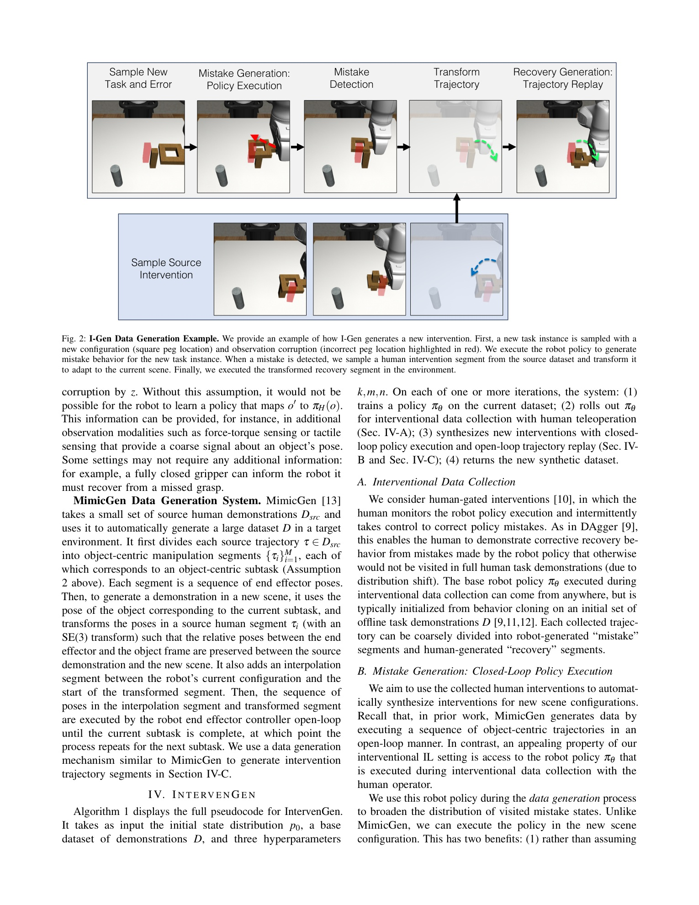

*原论文 Figure 2，PDF 第 3 页；整页保真截图。[原文对应页](https://arxiv.org/pdf/2405.01472#page=3)。*

[截图来源清单](../assets/paper-screenshots/trajectory-diversity/manifest.json)。自动定位图号，裁切尚需人工逐图复核；第二图不一定是网络架构。

#### ⑤ 核心技术与算法细节

**干预数据。** 让现有策略在任务中执行，出现失败前兆或偏离时由人接管并给出纠正示范，记录干预状态与后续恢复动作。**干预迁移。** 类似对象中心数据生成的思想，将已有纠偏运动扩展到新的可行场景和偏离状态，利用仿真验证生成恢复示教。**再训练。** 将可恢复状态及对应正确行为加入原数据；原始错误动作可用于诊断或其他训练目标，但不能一律当成正向 BC 标签。

#### ⑥ 完整 Pipeline（中文归纳）

1. 训练初始模仿策略并收集其失败/偏离状态。
2. 人类在少量代表性错误场景中进行干预，提供成功恢复动作。
3. 基于源干预、对象关系及新场景生成对应的纠正轨迹。
4. 在仿真或适当验证环境执行恢复，保留成功纠正数据。
5. 与原专家数据合并再训练，在相同扰动协议下评估恢复和任务完成率。

#### ⑦ 实验设计与主要结果

作者在四种仿真环境及一个存在物体位姿估计误差的真实环境评估，报告特定设置 10 次干预带来最高 39 倍相对鲁棒性改善。相对值受基线低成功率影响，不能解释为绝对百分点。应检验干预次数相同、不同错误程度和不同测试扰动下的表现。

#### ⑧ 方法特点、局限与可借鉴之处

**贡献**：让数据覆盖从成功轨迹分布延伸至学生实际访问的状态。**局限**：源纠正示例的类型限制可合成的恢复行为；若错误状态已不可恢复，合成纠正也不能强行成功。**研究建议**：按打滑、抓偏、遮挡、接近偏差等失败类型构建恢复模式字典；比较增加理想成功解与增加恢复解的边际收益。

**代码/数据状态**：项目入口；未核验可运行代码。

---

### 4.8 MOVE

#### ① 论文基本信息

- **原题**：A Simple Motion-Based Data Collection Paradigm for Spatial Generalization in Robotic Manipulation
- **作者/发表**：2025-12 arXiv
- **原文**：[论文](https://arxiv.org/abs/2512.04813)｜[项目或原文入口](https://huggingface.co/datasets/BAAI/MOVE)

#### ② 论文概述（摘要与研究内容的中文归纳）

在单次采集中改变可移动对象、目标或视角，增加动态空间配置覆盖。

传统空间泛化数据采集通常在每条 episode 开始前改变对象和相机位置，执行期间环境基本固定。因此获得更多空间组合需要大量独立重置和重复采集。

#### ③ 研究动机与核心问题

传统空间泛化数据采集通常在每条 episode 开始前改变对象和相机位置，执行期间环境基本固定。因此获得更多空间组合需要大量独立重置和重复采集。MOVE 研究让可变空间因素在采集过程中运动，从一次轨迹中得到更密集的空间条件覆盖。

#### ④ 方法总览与原论文图

**主图｜Figure 1**

*原论文 Figure 1，PDF 第 1 页；整页保真截图。[原文对应页](https://arxiv.org/pdf/2512.04813#page=1)。*

**方法/第二关键图｜Figure 2**

*原论文 Figure 2，PDF 第 2 页；整页保真截图。[原文对应页](https://arxiv.org/pdf/2512.04813#page=2)。*

[截图来源清单](../assets/paper-screenshots/trajectory-diversity/manifest.json)。自动定位图号，裁切尚需人工逐图复核；第二图不一定是网络架构。

#### ⑤ 核心技术与算法细节

**动态空间配置。** 在真实采集时有意识地引入目标或物体位置、旋转以及相机运动等变化，使观测与相对几何在 episode 内不断更新。**同步动作记录。** 机器人执行过程中响应当前配置，记录实际观测与控制标签，不能通过静态图片编辑替代这种动态交互。**组合消融。** 原文比较不同类型运动的累积作用，以观察空间泛化收益。该方法主要提高环境条件变化密度，不必然增加同初态接触策略的数量。

#### ⑥ 完整 Pipeline（中文归纳）

1. 选择需要空间泛化的操作任务和可以安全改变的环境因素。
2. 设计采集中的物体平移、旋转及相机变化条件。
3. 在动态条件下执行真实示教并同步采集图像、动作与状态。
4. 按不同运动因素组成数据子集，训练相同学生模型。
5. 在未见空间配置与相应静态基线对照中检验泛化。

#### ⑦ 实验设计与主要结果

作者对不同运动因素进行消融，并报告相比静态采集的空间泛化与数据效率改善；HF 提供 MOVE 数据入口。应按相同轨迹数与相同有效时间分别比较，因为动态 episode 可能同时增加每条轨迹的信息密度和实际动作长度。没有必要虚构尚未核实的绝对数值。

#### ⑧ 方法特点、局限与可借鉴之处

**贡献**：把初态随机化推广为 episode 内动态条件覆盖。**局限**：动态变化可能使任务更困难，或者产生相机运动引起的观测歧义；真实采集安全和同步很重要。**研究建议**：记录对象/相机的实际运动，分别评估静态初态覆盖、动态配置覆盖和机器人动作多样性；控制轨迹长度做等预算训练。

**代码/数据状态**：HF 数据入口；未审采集代码。

## 5. 轨迹多样性评估、可学习性与数据选择

这组文献把问题从‘生成更多’变成‘如何测量、选择和证明其价值’。指标必须明确其输入表示与适用边界。

---

### 5.1 Geometric Entropy

#### ① 论文基本信息

- **原题**：When Trajectory Diversity Helps and Hurts in Imitation Learning
- **作者/发表**：Luo 等；香港大学 / Transcengram；IROS 2026；2026-11-07 v2
- **原文**：[论文](https://arxiv.org/html/2606.20871v2)｜[项目或原文入口](https://geometric-entropy.github.io/)

#### ② 论文概述（摘要与研究内容的中文归纳）

提出几何熵衡量目标相对自由空间轨迹形状，分析多样性和模仿学习成功率的非单调关系。

同一个机器人在不同桌面位置执行相同直线接近，原始坐标的方差可以很大，却没有新的运动策略；反过来，同一目标的曲线接近、绕行和不同接近角可能在相同环境下造成真实的几何多模态。作者研究的是剥离外在条件后的路径形状，而不是数据集总体状态覆盖。

#### ③ 研究动机与核心问题

同一个机器人在不同桌面位置执行相同直线接近，原始坐标的方差可以很大，却没有新的运动策略；反过来，同一目标的曲线接近、绕行和不同接近角可能在相同环境下造成真实的几何多模态。作者研究的是剥离外在条件后的路径形状，而不是数据集总体状态覆盖。问题是：多样路径在什么时候提高抗扰性，什么时候使学生难以决定应该执行哪种动作？

#### ④ 方法总览与原论文图

**主图｜Figure 1**

*原论文 Figure 1，PDF 第 4 页；整页保真截图。[原文对应页](https://arxiv.org/pdf/2606.20871v2#page=4)。*

**方法/第二关键图｜Figure 2**

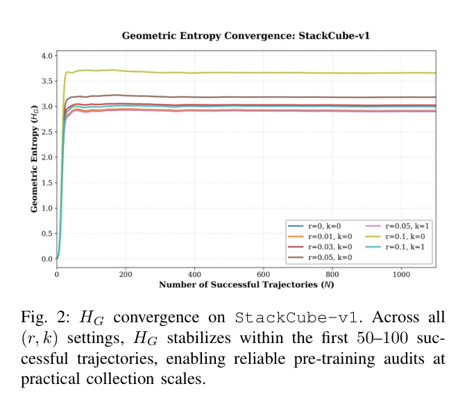

*原论文 Figure 2，PDF 第 4 页；原图及图注裁切。[原文对应页](https://arxiv.org/pdf/2606.20871v2#page=4)。*

[截图来源清单](../assets/paper-screenshots/trajectory-diversity/manifest.json)。自动定位图号，裁切尚需人工逐图复核；第二图不一定是网络架构。

#### ⑤ 核心技术与算法细节

**分阶段表示。** 原文 III-B 将操作分为 transit 和 fine manipulation，重点量化自由空间 transit。按弧长将变长位置序列重采样为固定 50 点，末端平移到阶段终点，用目标姿态旋转到局部坐标系，再以起终点距离归一化，弱化目标位置、工作尺度和执行速度的影响。

**谱统计。** 将轨迹展平为固定长度向量，中心化并用 SVD 得到协方差非零特征值 λ_j。令 q_j=λ_j/Σλ，则有效维度 d_eff=exp(−Σq_j log q_j)，几何熵 H_G=log(d_eff)+log(Σλ_j)。第一项反映有效形状方向数，第二项反映整体散布；多阶段按各阶段有效轨迹数加权。它不是严格的连续概率微分熵。

**可控生成器。** ManiSkill3 PandaArmMotionPlanningSolver 在目标上方加入必须经过的 waypoint，w=g+[r cosθ,r sinθ,Δz]。改变半径 r 及角度 θ 的分布产生不同曲率和接近路线，同时保持任务与观测动作接口不变。该设计可将几何多样性作为独立干预变量，而不仅对已有数据做相关性分析。

#### ⑥ 完整 Pipeline（中文归纳）

1. 固定任务、机器人、场景采样协议和成功判定，设定若干档路径生成参数。
2. 为各档采样接近 waypoint 并进行运动规划，收集成功示教，控制各训练集的数量。
3. 依据接触事件分割 transit 和精细操作，对 transit 做重采样及目标坐标归一化。
4. 计算每阶段 H_G、有效维度和总方差，形成不同几何熵水平的数据集。
5. 固定学生架构、数据量和训练协议进行多档 SFT/IL，画出几何熵—闭环成功率曲线；再改变数据量、任务难度和预训练先验。
6. 在真实机器人上验证趋势，与其他轨迹距离指标比较辨别能力。

#### ⑦ 实验设计与主要结果

原文 v2 §V：StackCube-v1 与 PegInsertionSide-v1 的 Diffusion Policy 实验呈倒 U 型；数据增多后最佳 H_G 左移，误差条来自三个 seed。StackCube 的 π0.5 微调实验则在测试范围内表现近似单调下降；作者解释为预训练先验已覆盖大量常见路径，新几何变化的边际收益减小。另有 ARX 真机 ACT 实验（StackCube、PlacePanda、OpenDrawer）及指标 aliasing 分析。重要限定：这些结果针对可控 transit 形状，不证明接触策略、初态或恢复覆盖越少越好。[原文实验与定义](https://arxiv.org/html/2606.20871v2#S5)。

#### ⑧ 方法特点、局限与可借鉴之处

**贡献**：提出可以隔离外在空间变化的几何描述，并通过可控生成器干预多样性建立模型依赖的规律。**局限**：只保留位置几何、舍弃速度及姿态等信息；近零位移、接触阶段或混合阶段需特殊处理；相同谱也可能对应不同形状簇。**研究建议**：在同一 DiscoDemo 生成池中同时控制 H_G 与成功状态覆盖，匹配初态、接触模式、安全和样本数，检验二者的主效应与交互效应，而不是直接套用倒 U 规律。

**代码/数据状态**：项目当前显示 Code coming soon；公式可独立实现，但非作者完整复现。

---

### 5.2 Vendi Score

#### ① 论文基本信息

- **原题**：A Diversity Evaluation Metric for Machine Learning
- **作者/发表**：Friedman、Dieng；2022-10 arXiv
- **原文**：[论文](https://arxiv.org/abs/2210.02410)｜[项目或原文入口](https://arxiv.org/abs/2210.02410)

#### ② 论文概述（摘要与研究内容的中文归纳）

以相似度矩阵谱的有效秩描述样本集合的有效多样性。

轨迹集合可能同时包含连续变化、离散模式和许多近重复样本，直接数类别需要事先定义类别，均值距离又会被少数离群点主导。Vendi Score 将多样性表示为集合相似度矩阵的有效谱秩，可在不同类型的对象上使用，但语义完全依赖输入表示与核。

#### ③ 研究动机与核心问题

轨迹集合可能同时包含连续变化、离散模式和许多近重复样本，直接数类别需要事先定义类别，均值距离又会被少数离群点主导。Vendi Score 将多样性表示为集合相似度矩阵的有效谱秩，可在不同类型的对象上使用，但语义完全依赖输入表示与核。

#### ④ 方法总览与原论文图

**主图｜Figure 1**

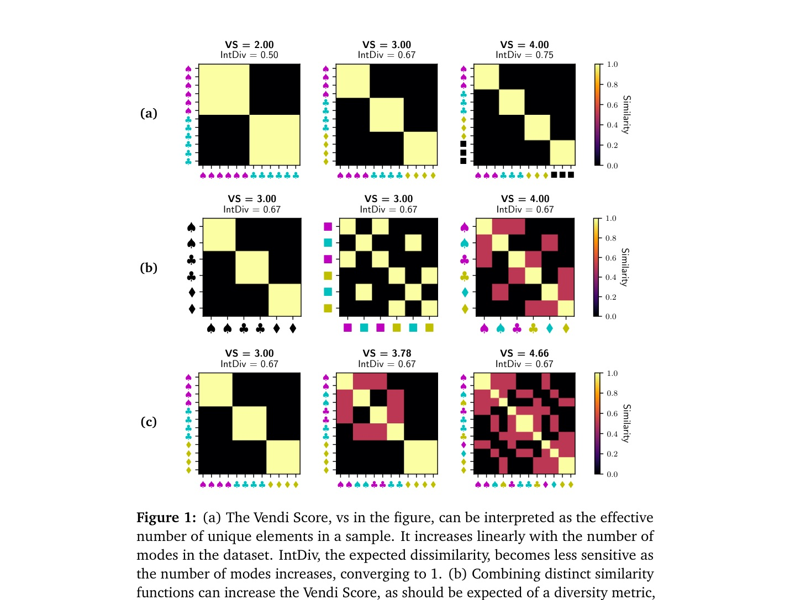

*原论文 Figure 1，PDF 第 2 页；整页保真截图。[原文对应页](https://arxiv.org/pdf/2210.02410#page=2)。*

**方法/第二关键图｜Figure 2**

*原论文 Figure 2，PDF 第 9 页；整页保真截图。[原文对应页](https://arxiv.org/pdf/2210.02410#page=9)。*

[截图来源清单](../assets/paper-screenshots/trajectory-diversity/manifest.json)。自动定位图号，裁切尚需人工逐图复核；第二图不一定是网络架构。

#### ⑤ 核心技术与算法细节

**相似度矩阵。** 对 N 条轨迹先确定表示 x_i，例如末端目标相对形状、物体状态变化或完整轨迹 embedding。构造对称、半正定且 K_ii=1 的相似度核 K。常见选择为 RBF：K_ij=exp(−||x_i−x_j||²/(2σ²))。**谱熵。** 令 λ 为 K/N 的特征值，Σλ=1，V=exp(−Σλ logλ)。所有样本完全相同时 V=1，正交独立时 V=N；重复和相关性会降低有效样本数。**应用到机器人。** DiscoDemo 对末端及物体状态的时序表示计算相似性，并把固定初态与跨初态的 Vendi 分开。这里 V 是描述性指标而不是成功/质量判别。

#### ⑥ 完整 Pipeline（中文归纳）

1. 确定评估的多样性维度，统一坐标系、轨迹时间或弧长表示以及尺度。
2. 在固定初态或跨初态分组中采样相同数量 N 的 episode。
3. 构建核矩阵，检查单位对角及特征值数值稳定性。
4. 对归一化矩阵做特征分解，计算有效谱秩；重复采样并报告区间和带宽敏感性。
5. 将分数与成功率、物理质量、接触模式及下游闭环性能联合展示。

#### ⑦ 实验设计与主要结果

原文是在分子、图像、文本等集合上检验通用多样性度量，不是机器人操作训练对照。机器人证据应引用 DiscoDemo 的应用：它把两个不同条件分组下的 Vendi 与策略学习结果对照。高 Vendi 本身只证明所选核下有效差异较大，不证明覆盖目标域或提升成功率。

#### ⑧ 方法特点、局限与可借鉴之处

**贡献**：无需人工离散类别即可衡量有效样本数，适合大规模生成轨迹去冗余与对照分析。**局限**：结果随表示、带宽和 N 改变，离群失败轨迹也能增加 V；同一分数可能对应完全不同的模式。**研究建议**：固定核参数与样本规模，分别计算目标相对末端、物体运动、关节、接触四种 Vendi；报告过滤前后与同/跨初态结果，不用单值排名所有数据集。

**代码/数据状态**：论文可实现，非机器人专项代码审计。

---

### 5.3 Data Quality in Imitation Learning

#### ① 论文基本信息

- **原题**：Data Quality in Imitation Learning
- **作者/发表**：Belkhale、Cui、Sadigh；2023-06 arXiv
- **原文**：[论文](https://arxiv.org/abs/2306.02437)｜[项目或原文入口](https://arxiv.org/abs/2306.02437)

#### ② 论文概述（摘要与研究内容的中文归纳）

从闭环分布偏移解释数据质量，而非把状态多样性直接当成收益。

行为克隆是监督学习，但部署后策略自己的动作会改变下一步输入分布。即使离线动作损失低，也可能因单步小错误反复累积进入训练集未覆盖的状态。

#### ③ 研究动机与核心问题

行为克隆是监督学习，但部署后策略自己的动作会改变下一步输入分布。即使离线动作损失低，也可能因单步小错误反复累积进入训练集未覆盖的状态。因此数据质量不应只按专家轨迹是否成功判断，更应看学习策略在实际动力学下能否维持在可控分布内。

#### ④ 方法总览与原论文图

**主图｜Figure 1**

*原论文 Figure 1，PDF 第 7 页；原图及图注裁切。[原文对应页](https://arxiv.org/pdf/2306.02437#page=7)。*

**方法/第二关键图｜Figure 2**

*原论文 Figure 2，PDF 第 8 页；原图及图注裁切。[原文对应页](https://arxiv.org/pdf/2306.02437#page=8)。*

[截图来源清单](../assets/paper-screenshots/trajectory-diversity/manifest.json)。自动定位图号，裁切尚需人工逐图复核；第二图不一定是网络架构。

#### ⑤ 核心技术与算法细节

**动作差异（action divergence）。** 分析给定状态时专家动作与学习策略动作的偏差：偏差越容易造成状态分布偏移，闭环越脆弱。**转移多样性（transition diversity）。** 描述给定状态与动作后系统转移本身的随机性或多样性，反映执行扰动和动力学的作用。二者的关系决定数据是否帮助学习器覆盖其实际访问状态。注意 transition diversity 不是不同示教路径之间的几何方差，action divergence 也不是简单的专家之间动作距离。

#### ⑥ 完整 Pipeline（中文归纳）

1. 明确专家分布、学习策略和真实或仿真转移动力学。
2. 在可控任务中改变专家动作差异及状态转移变化，构造不同组成的训练集。
3. 训练相同模仿策略并分析闭环执行访问的状态分布。
4. 测量错误、成功及 OOD 风险与不同数据因素之间的关系。
5. 基于分析选择对部署状态覆盖更合理的数据组成。

#### ⑦ 实验设计与主要结果

NeurIPS 2023 原文以分布偏移为出发点提出并检验两个性质，指出覆盖与一致性之间存在耦合。论文不是通过任意高几何熵得到更好策略的证明。这里最有价值的是它为后来的 Geometric Entropy、互信息筛选以及纠错数据方法提供解释框架；未重新核对原文每个任务的绝对成功率。

#### ⑧ 方法特点、局限与可借鉴之处

**贡献**：将数据质量和闭环分布偏移联系起来，避免只在静态数据上定义好坏。**局限**：action divergence 依赖所选学习器，动力学变化与数据采集策略可能耦合。**研究建议**：从同一生成池分别构造几何差异大但条件一致、几何差异小但转移覆盖大等子集，并在学生 rollout 状态上测训练支持度，验证覆盖是否真的降低闭环偏移。[正式论文](https://proceedings.neurips.cc/paper_files/paper/2023/hash/fe692980c5d9732cf153ce27947653a7-Abstract-Conference.html)。

**代码/数据状态**：论文入口。

---

### 5.4 Robot Data Curation with Mutual Information Estimators

#### ① 论文基本信息

- **原题**：Robot Data Curation with Mutual Information Estimators
- **作者/发表**：Hejna 等；2025-02 arXiv
- **原文**：[论文](https://arxiv.org/abs/2502.08623)｜[项目或原文入口](https://arxiv.org/abs/2502.08623)

#### ② 论文概述（摘要与研究内容的中文归纳）

利用状态和动作的互信息估计轨迹质量，兼顾动作分布丰富度与条件可预测性。

在相同观测下出现多种不相容动作可能意味着示教者依赖机器人看不到的条件，或者操作习惯、速度不一致。简单按动作方差选择更多样数据会同时扩大有意义的动作覆盖和不必要的标签歧义。

#### ③ 研究动机与核心问题

在相同观测下出现多种不相容动作可能意味着示教者依赖机器人看不到的条件，或者操作习惯、速度不一致。简单按动作方差选择更多样数据会同时扩大有意义的动作覆盖和不必要的标签歧义。作者希望从数据本身估计状态—动作关系，尽量保留既丰富又可预测的经验。

#### ④ 方法总览与原论文图

**主图｜Figure 1**

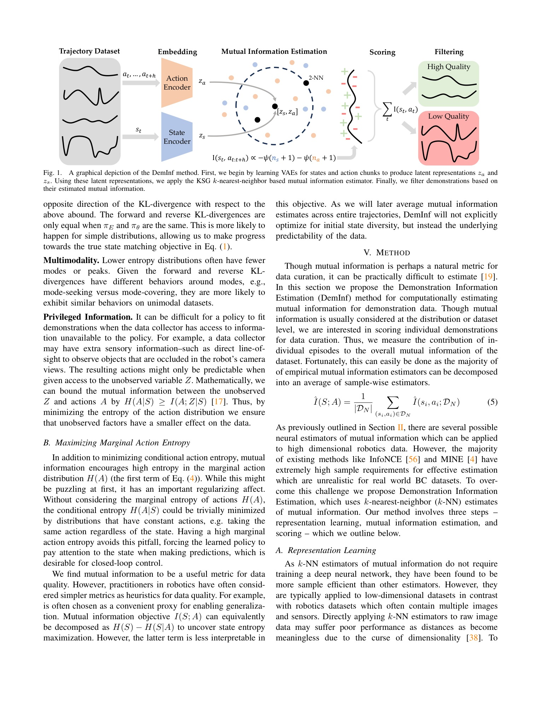

*原论文 Figure 1，PDF 第 4 页；整页保真截图。[原文对应页](https://arxiv.org/pdf/2502.08623#page=4)。*

**方法/第二关键图｜Figure 2**

*原论文 Figure 2，PDF 第 5 页；整页保真截图。[原文对应页](https://arxiv.org/pdf/2502.08623#page=5)。*

[截图来源清单](../assets/paper-screenshots/trajectory-diversity/manifest.json)。自动定位图号，裁切尚需人工逐图复核；第二图不一定是网络架构。

#### ⑤ 核心技术与算法细节

**互信息定义。** I(S;A)=H(A)−H(A|S)=H(S)−H(S|A)，同时考虑边缘动作丰富程度和给定状态后的条件不确定性。对于不同观察条件对应不同合理动作的数据，边缘动作可以丰富而条件歧义较低。

**DemInf 估计。** 机器人图像和动作维度高，直接估计密度困难；原方法使用 VAE embedding 与基于近邻的互信息估计，将轨迹中样本对整体状态—动作互信息的贡献聚合成轨迹分数，用于筛选。此处互信息是估计量，不把 latent 距离误认为真实概率密度。

**数据策展。** 按轨迹得分保留子集训练模仿模型，检验去除低价值数据是否提高下游性能。该方法不需要像 CUPID 那样为每条示教计算目标域闭环回报影响。

#### ⑥ 完整 Pipeline（中文归纳）

1. 统一数据的观测与动作空间、采样频率及归一化。
2. 学习或获取状态、动作低维 embedding，保留每条轨迹身份。
3. 计算近邻统计并估计样本级互信息贡献，按 episode 聚合为数据分数。
4. 从相同候选池按分数选择子集，与随机同规模、全集及其他质量指标比较。
5. 训练相同学生并闭环评估；检查因条件歧义、低信息量及长尾状态而被拒绝的样本。

#### ⑦ 实验设计与主要结果

RSS 2025 工作报告 RoboMimic 与真实 ALOHA、Franka 任务上的数据筛选改善；原仓库记录仿真约 5–10% 改善，具体绝对/相对口径请看原文。指标评估应该特别关注混合质量示教与高质量但多模态示教是否被同样处理。作者正式页面：[RSS 2025](https://roboticsconference.org/2025/program/papers/23/)。

#### ⑧ 方法特点、局限与可借鉴之处

**贡献**：提供不依赖完整真机评估的可学习性代理，适合大规模离线数据初筛。**局限**：近邻估计受 embedding、样本密度和 action horizon 影响；未观测变量造成的合理多模态可能被误删；高 MI 也不能保证动作因果正确。**研究建议**：对比 I(A;O)、I(A;O,c) 与增加历史/技能标签后的条件信息量；将 MI 与 Vendi 及安全指标联合筛选，并在独立学生上验证。

**代码/数据状态**：论文入口；未重新审计代码。

---

### 5.5 SCIZOR

#### ① 论文基本信息

- **原题**：Self-Supervised Data Curation for Imitation Learning
- **作者/发表**：UT Austin RPL；ICRA 2026
- **原文**：[论文](https://rpl.cs.utexas.edu/publications/2026/06/01/zhang-icra26-scizor/)｜[项目或原文入口](https://ut-austin-rpl.github.io/SCIZOR/)

#### ② 论文概述（摘要与研究内容的中文归纳）

细粒度过滤低进度和冗余状态—动作对，提高单位数据效用。

一条成功示教中也可能有停顿、无效重复、偏离后修正等片段。整条轨迹成功与否太粗糙，完全删掉长轨迹又可能丢失关键接触或恢复动作。

#### ③ 研究动机与核心问题

一条成功示教中也可能有停顿、无效重复、偏离后修正等片段。整条轨迹成功与否太粗糙，完全删掉长轨迹又可能丢失关键接触或恢复动作。作者把筛选对象下沉到 transition 级，研究有效样本密度和重复经验对模仿学习的影响。

#### ④ 方法总览与原论文图

*沿用仓库已有原论文截图；[图源清单](../assets/paper-screenshots/manifest.json)。*

#### ⑤ 核心技术与算法细节

**任务进展估计。** 通过自监督方式学习与操作进度相关的表示或信号，用于识别进展不足的状态—动作转移，不要求人工逐帧提供质量标签。**冗余删除。** 在状态—动作联合表示中寻找高度相似的重复 transition，减少相同局部行为在训练目标中过度加权。**训练数据构造。** 将通过过滤的转移用于模仿学习，而不是把方法误认为一个新的轨迹生成器。实际实现应遵守模型动作窗口与片段边界，不能任意删除时间步后假定相邻样本仍然连续。

#### ⑥ 完整 Pipeline（中文归纳）

1. 加载包含成功与低效片段的示教数据，保存 episode 和时间索引。
2. 学习自监督任务进展估计，计算各转移质量相关分数。
3. 在联合状态—动作空间进行去重或近重复识别。
4. 综合两类结果构建保留数据；确保下游动作窗口不会跨越被删除的非连续片段。
5. 固定训练预算，与原数据、仅质量过滤、仅去重等对照比较闭环表现。

#### ⑦ 实验设计与主要结果

作者机构页面报告跨基准平均改善约 15.4%，对应论文版本的计算口径需以原文为准。重点是 transition 筛选相对于整条轨迹筛选的作用，以及相同预算下效率。不能从最终成功率反推所有被移除片段都是坏动作；恢复状态尤其需要独立评测。[项目](https://scizor-icra2026.github.io/)。

#### ⑧ 方法特点、局限与可借鉴之处

**贡献**：提高数据有效密度，允许研究每个阶段的贡献而不只是整条 episode。**局限**：等待、重新调整及回退可能是必要行为；近重复可能代表稀有接触状态下的稳定控制。**研究建议**：按 approach/contact/transport/recovery 分别计算去除比例及成功率，保护接触事件和恢复样本，比较 transition 策展与 episode 策展的训练效用。

**代码/数据状态**：作者项目有代码入口；[原仓库章节](chapters/04-diversity.md)

---

### 5.6 CUPID

#### ① 论文基本信息

- **原题**：Curating Data your Robot Loves with Influence Functions
- **作者/发表**：Agia 等；2025-06 arXiv / CoRL 2025
- **原文**：[论文](https://arxiv.org/abs/2506.19121)｜[项目或原文入口](https://cupid-curation.github.io/)

#### ② 论文概述（摘要与研究内容的中文归纳）

用影响函数估计每条训练示教对策略闭环回报的贡献。

成功示教、平滑动作与较低离线损失都不能保证训练出的机器人策略在真实环境中更稳健。问题在于一条示教改变训练参数后，闭环策略实际会怎样变化。

#### ③ 研究动机与核心问题

成功示教、平滑动作与较低离线损失都不能保证训练出的机器人策略在真实环境中更稳健。问题在于一条示教改变训练参数后，闭环策略实际会怎样变化。CUPID 以目标闭环表现作为选择依据，而非先假定何种几何多样性有益。

#### ④ 方法总览与原论文图

**主图｜Figure 1**

*原论文 Figure 1，PDF 第 1 页；整页保真截图。[原文对应页](https://arxiv.org/pdf/2506.19121#page=1)。*

**方法/第二关键图｜Figure 2**

*原论文 Figure 2，PDF 第 4 页；整页保真截图。[原文对应页](https://arxiv.org/pdf/2506.19121#page=4)。*

[截图来源清单](../assets/paper-screenshots/trajectory-diversity/manifest.json)。自动定位图号，裁切尚需人工逐图复核；第二图不一定是网络架构。

#### ⑤ 核心技术与算法细节

**参考策略与评估 rollout。** 先训练 BC 参考策略，在目标环境执行若干次并记录回报，从实际闭环结果定义数据效用。**影响函数。** 概念上，对于训练风险 L(θ)，上调样本 i 的权重会产生局部参数变化 dθ/dw_i≈−H^{-1}∇ℓ_i；将该变化与目标评估量的梯度结合，可估计示教对期望回报的影响。CUPID 针对 IL 与闭环策略回报设计具体近似，不需要针对每条轨迹完整重训。这是局部估计而非严格因果实验。

**选择。** 对现有训练集删除负效用数据，或从新采集池选择高效用样本。与互信息代理不同，其得分直接关联参考策略和目标评估 rollout；与 TUCO 不同，基本选择方式是单轨迹影响排序，集合互补需要额外处理。

#### ⑥ 完整 Pipeline（中文归纳）

1. 固定候选示教池与目标任务，训练参考 BC 或 diffusion policy。
2. 在目标评估条件中执行参考策略，记录观察动作及回报。
3. 估计每条示教的训练梯度与参数影响，并结合 rollout 估计对闭环性能的贡献。
4. 筛除负效用轨迹或选择 top-k 新示教，以固定预算重训练。
5. 在与评分 rollout 隔离的测试集上闭环验证，比较随机选集、质量代理及全集。

#### ⑦ 实验设计与主要结果

CoRL 2025 原文及作者项目报告在 RoboMimic 使用少于 33% 的精选数据可取得强 diffusion policy；真实 Franka 实验每种数据策展方案限制为 25 条策略 rollout，涉及 Figure-8、TuckBox、Bookshelf 等问题设置。项目还展示用单任务 diffusion policy 策展数据改善 π0 后训练，说明小模型作为代理具有潜力，但不能保证任意 VLA 迁移。[实验详情](https://cupid-curation.github.io/)。

#### ⑧ 方法特点、局限与可借鉴之处

**贡献**：把轨迹的好坏定义为其对特定目标学生闭环性能的作用，可用于定位生成器产生的有害模式。**局限**：影响函数是参考点附近近似，参考策略与评分 rollout 不充分时会偏；高分轨迹之间可能重复。**研究建议**：在同一 RL 数据池使用 CUPID 小模型代理为轨迹赋效用，与 Vendi/MI 排序比较重合度，并用随机等量及不同学生验证排序迁移。

**代码/数据状态**：作者项目有代码入口。

---

### 5.7 TUCO

#### ① 论文基本信息

- **原题**：Curating Simulation Demonstrations for Sim-to-Real Robot Policy Co-Training
- **作者/发表**：Zhu 等；2026-10 arXiv
- **原文**：[论文](https://arxiv.org/abs/2610.05407)｜[项目或原文入口](https://tuco-curation.github.io/)

#### ② 论文概述（摘要与研究内容的中文归纳）

利用目标域闭环影响同时优化轨迹效用与集合互补，选择仿真数据参与协同训练。

仿真数据中可能同时存在对真实任务有益、冗余和有害的示教。逐条质量打分通常不能区分两条高分轨迹是互补还是仅重复同一能力。

#### ③ 研究动机与核心问题

仿真数据中可能同时存在对真实任务有益、冗余和有害的示教。逐条质量打分通常不能区分两条高分轨迹是互补还是仅重复同一能力。作者将单轨迹效用与集合覆盖放到同一目标域闭环影响空间中，避免直接用视觉或几何距离作为真实任务效用。

#### ④ 方法总览与原论文图

*沿用仓库已有原论文截图；[图源清单](../assets/paper-screenshots/manifest.json)。*

#### ⑤ 核心技术与算法细节

**影响矩阵。** 设候选仿真示教为 i，目标评分 rollout 为 j，通过影响函数估计上调示教 i 的训练权重后 rollout j 的相对可能性变化，形成矩阵 M_ij。每行是该示教对不同目标行为的影响 profile。

**效用与互补。** 将 profile 投影到目标 rollout 回报方向，得到对目标成功的总体推动；其余变化构成 coverage vector，表达它帮助哪些具体 rollout。两个样本效用相似但 coverage 方向不同，可能互补；方向相同则可能冗余。

**集合优化。** 先排除背离目标成功的候选，再通过效用和新增覆盖方向的联合目标选择固定预算子集。采用 logdet 类覆盖思想衡量已选方向与新增方向的互补性。作者的具体权重、归一化和选择过程以原文为准，不能把本综述第 7 节通用目标冒充其原式。

#### ⑥ 完整 Pipeline（中文归纳）

1. 在仿真环境构建候选轨迹池，准备少量目标域示教并训练参考策略。
2. 在目标域收集有回报的评分 rollout；保证最终测试初态独立。
3. 对每条源示教和目标 rollout 估计影响，形成源×目标矩阵。
4. 分解单轨迹 utility 与 coverage vector，过滤明显有害轨迹，逐步选择效用高且互补的集合。
5. 将选中的仿真轨迹与全部少量目标域示教按固定混合比例训练策略。
6. 在 sim-to-sim、sim-to-real 及目标独立测试比较选集、随机和全集。

#### ⑦ 实验设计与主要结果

作者项目真机实验是 Peg、StackCube、CupCake：每任务 10 条真实示教，源池 1200 条仿真，策展选 600 条，固定真实/仿真混合比例，Franka 每策略评估 40 次。平均成功率：仅真实 16.7%，全集/随机均 25.8%，Success Similarity 38.3%，DataMIL 62.5%，CUPID 73.3%，TUCO 85.8%；TUCO 三任务分别 82.5%、75.0%、100%。这直接说明在该域差下‘更多仿真数据’并非充分条件。项目还报告 IsaacSim→MuJoCo 对照中 18 个设置有 15 个最优。注意不能将该 85.8% 与 DiscoDemo 的四任务均值直接排名。[作者实验表](https://tuco-curation.github.io/)。

#### ⑧ 方法特点、局限与可借鉴之处

**贡献**：把数据互补定义在与目标任务相关的性能影响空间，而不是几何空间。**局限**：目标域 rollout 采集及影响估计有成本，评分集分布偏差会导致选择偏差；真机资产与采集接口仍需独立审计。**研究建议**：用 influence profile 反向指导生成器采样稀缺有用模式；设置 utility-only、coverage-only、随机等量和几何多样性基线，验证收益是否来自集合互补。

**代码/数据状态**：作者项目有代码链接；[原仓库章节](chapters/04-diversity.md)；真机资源完整性未重审。

---

### 5.8 D3IL

#### ① 论文基本信息

- **原题**：Towards Diverse Behaviors: A Benchmark for Imitation Learning with Human Demonstrations
- **作者/发表**：ICLR 2024
- **原文**：[论文](https://proceedings.iclr.cc/paper_files/paper/2024/hash/b63cb503757f9f31e5d74e3567dd160a-Abstract-Conference.html)｜[项目或原文入口](https://proceedings.iclr.cc/paper_files/paper/2024/hash/b63cb503757f9f31e5d74e3567dd160a-Abstract-Conference.html)

#### ② 论文概述（摘要与研究内容的中文归纳）

建立多模态人类示教基准，评估学生能否重现多种行为。

多模态模仿学习的评估不能只问机器人是否完成任务。如果两种策略都能成功，但模型总是执行其中一种，普通成功率无法识别模式坍塌。

#### ③ 研究动机与核心问题

多模态模仿学习的评估不能只问机器人是否完成任务。如果两种策略都能成功，但模型总是执行其中一种，普通成功率无法识别模式坍塌。D3IL 通过构造具有多种合法行为、需要闭环反馈的任务与人类示教数据，直接评价学生继承多解的能力。

#### ④ 方法总览与原论文图

**主图｜Figure 1**

*原论文 Figure 1，PDF 第 8 页；整页保真截图。[原文对应页](https://arxiv.org/pdf/2402.14606#page=8)。*

**方法/第二关键图｜Figure 3**

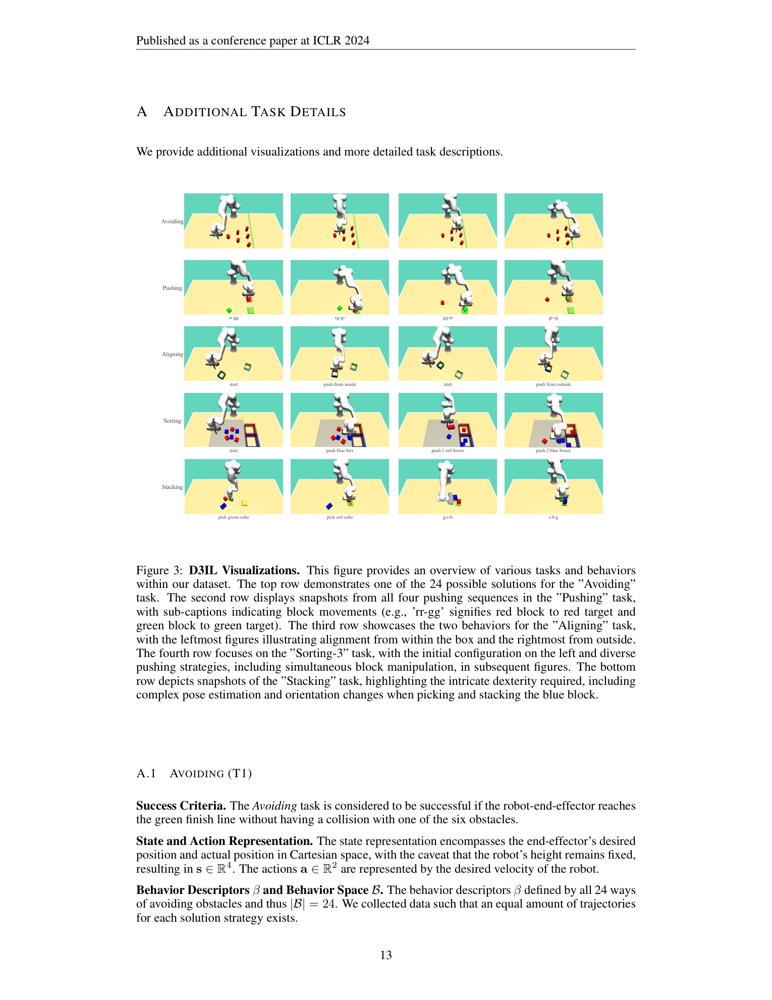

*原论文 Figure 3，PDF 第 13 页；整页保真截图。[原文对应页](https://arxiv.org/pdf/2402.14606#page=13)。*

[截图来源清单](../assets/paper-screenshots/trajectory-diversity/manifest.json)。自动定位图号，裁切尚需人工逐图复核；第二图不一定是网络架构。

#### ⑤ 核心技术与算法细节

**多模态示教环境。** 设计可通过不同对象选择、顺序或运动策略完成的任务，让人类示教覆盖多个真实合法模式，而不只是给同一动作增加噪声。**行为度量。** 按任务语义定义可计算的模式或轨迹描述符，统计学生 rollout 对这些模式的覆盖和分布变化；与成功率联合评价。

**对照模型。** 在相同示教数据上训练不同模仿学习方法，从重复闭环 rollout 观察其能否重现多种行为。应将源数据模式分布、学生成功模式分布及失败比例分别记录，而不是只统计成功轨迹的熵。

#### ⑥ 完整 Pipeline（中文归纳）

1. 选择存在多个合法解的仿真任务，并明确可区分的行为模式。
2. 采集多种人类示教，保留模式标签及初态信息。
3. 使用统一数据训练不同策略架构，固定评估初态及重复次数。
4. 从学生 rollout 提取模式及成功标签，计算覆盖、频率及模式坍塌指标。
5. 联合比较完成率与行为分布，检查学生是否只学到最容易的一类解。

#### ⑦ 实验设计与主要结果

ICLR 2024 原文提出 D3IL 环境、数据与可计算多样性指标，对比多种 IL 方法，揭示学习复杂多模态行为的挑战。它主要是仿真评测基准，不等同于一篇真机数据生成论文。对于具体任务指标、模型排序和数值，以会议原文实验为准，不填写未重新核实的表格。

#### ⑧ 方法特点、局限与可借鉴之处

**贡献**：评价多样性的对象从教师数据转向学生实际行为。**局限**：离散模式定义可能遗漏连续差异；训练集模式频率不一定就是最优部署分布。**研究建议**：为 DiscoDemo 设置固定初态重复 rollout，计算教师/学生模式 recall、Jensen–Shannon divergence 及每模式成功率，另将失败作为独立类别，以避免表面多样性被成功过滤掩盖。

**代码/数据状态**：会议论文入口；未审代码。

## 6. 数据规模、组成与预算优化

本组工作研究不同数据因素的边际收益，指导下一轮应该采什么，而非无差别扩大生成规模。

---

### 6.1 Data Scaling Laws

#### ① 论文基本信息

- **原题**：Data Scaling Laws in Imitation Learning for Robotic Manipulation
- **作者/发表**：Lin 等；2024-10 arXiv / ICLR 2025
- **原文**：[论文](https://arxiv.org/abs/2410.18647)｜[项目或原文入口](https://arxiv.org/abs/2410.18647)

#### ② 论文概述（摘要与研究内容的中文归纳）

在真实机器人上系统研究示教数量与环境、对象多样性的规模规律。

数据集规模可以通过在同一环境对象组合上反复采集，也可以扩大对象与环境组合。两种方式的硬件时间相似，但增加信息量的方式不同。

#### ③ 研究动机与核心问题

数据集规模可以通过在同一环境对象组合上反复采集，也可以扩大对象与环境组合。两种方式的硬件时间相似，但增加信息量的方式不同。作者研究真实机器人中环境、物体与每条件示教量的规模规律，回答有限数据预算优先放在哪类条件。

#### ④ 方法总览与原论文图

**主图｜Figure 1**

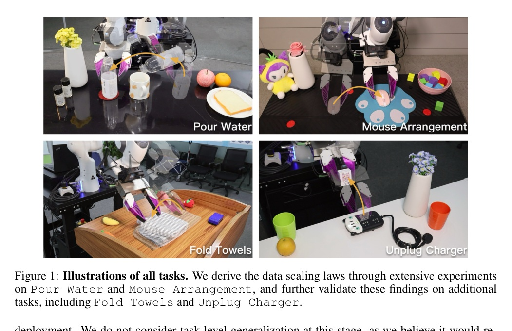

*原论文 Figure 1，PDF 第 2 页；原图及图注裁切。[原文对应页](https://arxiv.org/pdf/2410.18647#page=2)。*

**方法/第二关键图｜Figure 2**

*原论文 Figure 2，PDF 第 6 页；整页保真截图。[原文对应页](https://arxiv.org/pdf/2410.18647#page=6)。*

[截图来源清单](../assets/paper-screenshots/trajectory-diversity/manifest.json)。自动定位图号，裁切尚需人工逐图复核；第二图不一定是网络架构。

#### ⑤ 核心技术与算法细节

**因子分解。** 将单任务学习的数据规模拆为环境数量、对象实例数量及每环境对象组合的示教数。设计受控数据组成并训练单任务策略，在未见环境与同类别新物体上测试。**规模曲线。** 比较性能随各因子规模变化的趋势，关注不同环境对象组合而非仅总 episode；作者项目指出新环境/对象泛化与训练环境对象对数量近似呈幂律关系。**预算含义。** 在覆盖不足时增加新组合往往比重复同一组合更具收益，但这不是独立证明几何路径差异越大越好。

#### ⑥ 完整 Pipeline（中文归纳）

1. 选定任务、对象类别与多个真实场景，设计可控制的采集组合。
2. 采集并按环境、对象与重复示教记录数据，建立不同因子规模的训练子集。
3. 在相同策略与训练协议下依次改变环境数、对象数及每组合示教数。
4. 在未见环境、未见对象及联合变化测试条件评估成功率并拟合 scaling curves。
5. 比较固定预算下增加新组合与追加重复轨迹的边际收益。

#### ⑦ 实验设计与主要结果

原文及项目报告超过 4 万条示教和 1.5 万次真实评估 rollout 的实验规模，支持其特定单任务设置下的环境对象组合规律。需要区分真实训练与测试组合，避免用场景内随机划分产生过于乐观的泛化估计。[作者项目](https://data-scaling-laws.github.io/)。

#### ⑧ 方法特点、局限与可借鉴之处

**贡献**：为‘多采多少’和‘多采哪些条件’提供实证方法。**局限**：环境/物体覆盖与同初态成功解是不同维度，幂律参数也依赖任务和学生。**研究建议**：将初态数 C、每初态不同解数 K、每解重复数 R 作为三因子，在固定 C×K×R 的数据预算下做规模曲线及边际收益分析。

**代码/数据状态**：原文入口；未重审采集代码。

---

### 6.2 Factored Scaling Curves

#### ① 论文基本信息

- **原题**：Guiding Data Collection via Factored Scaling Curves
- **作者/发表**：Zha 等；2025-05 arXiv
- **原文**：[论文](https://arxiv.org/abs/2505.07728)｜[项目或原文入口](https://arxiv.org/abs/2505.07728)

#### ② 论文概述（摘要与研究内容的中文归纳）

按单因素及双因素规模曲线决定有限预算下应该增加哪些样本。

真实机器人数据涉及相机、光照、物体、桌面、杂物、机器人初始位姿等因素。穷举组合会使采集规模组合爆炸；平均分配预算又可能浪费在对策略不重要的变化上。

#### ③ 研究动机与核心问题

真实机器人数据涉及相机、光照、物体、桌面、杂物、机器人初始位姿等因素。穷举组合会使采集规模组合爆炸；平均分配预算又可能浪费在对策略不重要的变化上。FSC 的目的不是创造更多动作，而是用小规模可控实验推断应将新数据采集投入何种因素。

#### ④ 方法总览与原论文图

**主图｜Figure 1**

*原论文 Figure 1，PDF 第 1 页；整页保真截图。[原文对应页](https://arxiv.org/pdf/2505.07728#page=1)。*

**方法/第二关键图｜Figure 2**

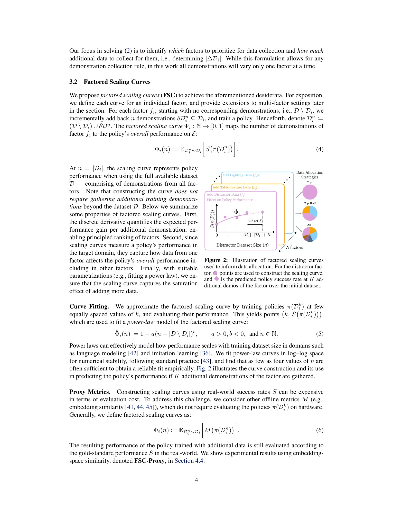

*原论文 Figure 2，PDF 第 4 页；整页保真截图。[原文对应页](https://arxiv.org/pdf/2505.07728#page=4)。*

[截图来源清单](../assets/paper-screenshots/trajectory-diversity/manifest.json)。自动定位图号，裁切尚需人工逐图复核；第二图不一定是网络架构。

#### ⑤ 核心技术与算法细节

**单因素曲线。** 固定其他环境因素，改变某一个因素采集规模，测学习器表现随数据量的变化。**双因素曲线。** 测量两个因素共同变化时的收益，以识别交互作用；例如相机位姿和物体位置变化可能共同决定视觉—动作泛化难度。**外推与预算分配。** 用曲线估计增加某类数据的边际性能，有限预算优先采集更有影响的组合。作者还提出以离线指标作为闭环性能代理的 FSC-Proxy，降低真实大规模验证成本。

#### ⑥ 完整 Pipeline（中文归纳）

1. 枚举候选因素与可安全控制的取值，定义目标测试分布和总采集预算。
2. 采集小规模单因素、双因素变化数据，训练一致学生并获取性能或代理分数。
3. 拟合各因子的 scaling curve 及组合曲线，对未采集规模进行谨慎外推。
4. 按预计边际收益分配新增采集预算，生成目标数据集。
5. 使用真实独立评估验证分配策略，与均匀、随机及既有采集策略比较。

#### ⑦ 实验设计与主要结果

作者项目列出 Put Mouse in Drawer、Fold Towel、Put Tomato in Plate 三项真机任务；真机六类因素包括相机、光照、杂物、桌面纹理、物体位姿、机器人初态；仿真另有背景与桌高。比较从头训练 Diffusion Policy 与 π0 微调，报告新环境相对既有采集策略最高 26% 成功率提升，FSC-Proxy 在作者设置中无需额外硬件执行即可接近 FSC 表现。具体相对/绝对口径参照论文。[项目](https://factored-data-scaling.github.io/)。

#### ⑧ 方法特点、局限与可借鉴之处

**贡献**：提供数据生成影响因素研究的直接实验范式。**局限**：单因素/双因素无法完全刻画高阶交互，外推可能失败，离线代理也可能与真实闭环不一致。**研究建议**：把 DiscoDemo 的初态数量、z 维数与采样尺度、奖励权重、课程 checkpoint、接触模式纳入 FSC 式设计，估计每增加单位生成成本的有效覆盖和学生收益。

**代码/数据状态**：论文入口。

---

### 6.3 What Matters

#### ① 论文基本信息

- **原题**：What Matters in Learning from Large-Scale Datasets for Robot Manipulation
- **作者/发表**：ICLR 2025
- **原文**：[论文](https://proceedings.iclr.cc/paper_files/paper/2025/hash/16466b6c95c5924784486ac5a3feeb65-Abstract-Conference.html)｜[项目或原文入口](https://proceedings.iclr.cc/paper_files/paper/2025/hash/16466b6c95c5924784486ac5a3feeb65-Abstract-Conference.html)

#### ② 论文概述（摘要与研究内容的中文归纳）

程序化构建可控组成的大规模数据集，研究数据采集与检索因素。

大规模机器人数据集中的传感器位置、对象种类、空间布局、任务动作等往往同时变化，仅观察已有真实数据难确定哪一因素主导泛化。作者通过可控程序化生成构建不同组成的大规模数据集，隔离影响数据采集和目标域检索的变量。

#### ③ 研究动机与核心问题

大规模机器人数据集中的传感器位置、对象种类、空间布局、任务动作等往往同时变化，仅观察已有真实数据难确定哪一因素主导泛化。作者通过可控程序化生成构建不同组成的大规模数据集，隔离影响数据采集和目标域检索的变量。

#### ④ 方法总览与原论文图

**主图｜Figure 1**

*原论文 Figure 1，PDF 第 2 页；整页保真截图。[原文对应页](https://arxiv.org/pdf/2506.13536#page=2)。*

**方法/第二关键图｜Figure 2**

*原论文 Figure 2，PDF 第 3 页；整页保真截图。[原文对应页](https://arxiv.org/pdf/2506.13536#page=3)。*

[截图来源清单](../assets/paper-screenshots/trajectory-diversity/manifest.json)。自动定位图号，裁切尚需人工逐图复核；第二图不一定是网络架构。

#### ⑤ 核心技术与算法细节

**程序化因子控制。** 利用仿真生成环境，将相机/传感器位置、对象类型及配置等因素作为独立或联合变化轴，构造规模可比而组成不同的数据集。**数据组成实验。** 在统一学习协议下比较不同因子变化对目标性能的作用，避免把总数据量当成唯一解释。**检索应用。** 将实验发现转化为选择与目标任务相符的数据的依据，在真实数据集如 DROID 中检验目标相关检索。重点是数据条件匹配，不是产生新的接触运动。

#### ⑥ 完整 Pipeline（中文归纳）

1. 明确仿真任务实例、传感器和场景因素，定义可控制的生成配置。
2. 程序化生成大规模候选示教，保存各因子元数据。
3. 构造数量、训练预算一致而组成不同的数据子集。
4. 训练并测试目标任务，识别关键因素与其影响。
5. 利用发现指导真实数据检索，对比不同检索规则的下游表现。

#### ⑦ 实验设计与主要结果

ICLR 2025 作者项目报告超过 3000 个仿真任务实例，研究发现传感器视角和空间布局等因素很关键；真实 DROID 数据检索的相对收益需按具体基线读取，旧版记录最高 70% 相对优势。该结果是特定目标任务的检索证据，不是动作形状熵的直接实验。[项目与实验](https://robo-mimiclabs.github.io/pages/study.html)。

#### ⑧ 方法特点、局限与可借鉴之处

**贡献**：借助仿真对数据组成做因果更清晰的受控干预，并连接现实数据检索。**局限**：仿真发现可能依赖渲染、任务与策略架构；因子改变也会改变任务难度。**研究建议**：在轨迹多样性实验中固定相机和物体布局，另做视觉因素随机化对照，避免把 RGB 多样性误认为行为多样性。

**代码/数据状态**：会议论文入口。

---

### 6.4 Is Diversity All You Need?

#### ① 论文基本信息

- **原题**：Is Diversity All You Need for Scalable Robotic Manipulation?
- **作者/发表**：2025-07 arXiv；IEEE 期刊记录 2026
- **原文**：[论文](https://arxiv.org/abs/2507.06219)｜[项目或原文入口](https://ieeexplore.ieee.org/abstract/document/11488937)

#### ② 论文概述（摘要与研究内容的中文归纳）

区分 task、embodiment 和 expert 多样性，检验何种变化促进或阻碍策略。

扩大机器人数据通常伴随任务、本体和示教者三种变化，但它们作用机制不同。任务多样性可以扩展语义与场景覆盖；多本体数据会引入动作接口和控制尺度差异；不同示教者的习惯又可能让相同观察对应速度或方向不同的动作。

#### ③ 研究动机与核心问题

扩大机器人数据通常伴随任务、本体和示教者三种变化，但它们作用机制不同。任务多样性可以扩展语义与场景覆盖；多本体数据会引入动作接口和控制尺度差异；不同示教者的习惯又可能让相同观察对应速度或方向不同的动作。作者检验这些多样性是否具有一致的正收益。

#### ④ 方法总览与原论文图

**主图｜Figure 1**

*原论文 Figure 1，PDF 第 1 页；整页保真截图。[原文对应页](https://arxiv.org/pdf/2507.06219#page=1)。*

**方法/第二关键图｜Figure 2**

*原论文 Figure 2，PDF 第 3 页；整页保真截图。[原文对应页](https://arxiv.org/pdf/2507.06219#page=3)。*

[截图来源清单](../assets/paper-screenshots/trajectory-diversity/manifest.json)。自动定位图号，裁切尚需人工逐图复核；第二图不一定是网络架构。

#### ⑤ 核心技术与算法细节

**任务维度。** 对照不同预训练任务数量与单任务重复量，比较迁移新任务/场景的表现；正式期刊摘要进一步区分场景与技能多样性。**本体维度。** 比较单本体高质量预训练与多本体预训练在迁移至新平台时的微调效率。**专家维度。** 研究示教者操作习惯、随机变化与速度多模态造成的动作歧义，并通过相应去偏策略改善学习。重要的是，动作速率变化与空间路径形状不等价，需要分别统计。

#### ⑥ 完整 Pipeline（中文归纳）

1. 构造任务数量、单任务示教量可比的预训练数据组合。
2. 构造单本体与多本体数据组，统一可比的预训练/微调协议。
3. 以不同专家组成的数据评估动作速率差异与策略学习困难。
4. 在真实或相应目标机器人新任务中闭环比较，评估去偏方案。
5. 分别归纳三类多样性的边际收益及模型依赖性。

#### ⑦ 实验设计与主要结果

作者跨平台实验报告任务多样性相对单任务重复的迁移价值，高质量单本体数据也可以有效支持跨本体迁移，而专家速度多模态可能造成学习干扰；旧版记录 GO-1-Pro 的特定改善约 15%，应查原表口径。结论并非‘多本体无用’或‘多示教者有害’，而是不同数据轴的收益依赖设置。[正式期刊摘要](https://ieeexplore.ieee.org/abstract/document/11488937)。

#### ⑧ 方法特点、局限与可借鉴之处

**贡献**：将总体 diversity 拆成不同因果机制，提示动作速率也是独立的数据质量问题。**局限**：任务难度、专家技能、相机与机器人控制接口可能耦合；时间归一化可能抹去任务必要的动态行为。**研究建议**：对固定路径构造不同有效速度数据，与固定速度的多路径组交叉实验；保留统一控制频率和动作 chunk 配置，评估模型对时序歧义的敏感性。

**代码/数据状态**：期刊页面表示代码将公开；未核实当前完整状态。

---

### 6.5 HeteroMotion

#### ① 论文基本信息

- **原题**：Toward Motion Diverse Community Datasets for VLA-Based Robot Learning
- **作者/发表**：Eslami 等；CVPRW ScaleBot 2026
- **原文**：[论文](https://openaccess.thecvf.com/content/CVPR2026W/ScaleBot/html/Eslami_Toward_Motion_Diverse_Community_Datasets_for_VLA-Based_Robot_Learning_CVPRW_2026_paper.html)｜[项目或原文入口](https://openaccess.thecvf.com/content/CVPR2026W/ScaleBot/html/Eslami_Toward_Motion_Diverse_Community_Datasets_for_VLA-Based_Robot_Learning_CVPRW_2026_paper.html)

#### ② 论文概述（摘要与研究内容的中文归纳）

针对社区数据中 pick-and-place 偏多的问题设计覆盖多运动原语的数据。

社区机器人数据往往以抓取放置为主，即使任务名称、物体颜色与场景很多，机械臂实际运动仍然相似。这限制 VLA 对旋转、推拉、复杂接触和多阶段运动的覆盖。

#### ③ 研究动机与核心问题

社区机器人数据往往以抓取放置为主，即使任务名称、物体颜色与场景很多，机械臂实际运动仍然相似。这限制 VLA 对旋转、推拉、复杂接触和多阶段运动的覆盖。作者从运动多样性角度设计数据集而不只根据任务文字数量设计。

#### ④ 方法总览与原论文图

**主图｜Figure 1**

*原论文 Figure 1，PDF 第 3 页；整页保真截图。[原文对应页](https://openaccess.thecvf.com/content/CVPR2026W/ScaleBot/papers/Eslami_Toward_Motion_Diverse_Community_Datasets_for_VLA-Based_Robot_Learning_CVPRW_2026_paper.pdf#page=3)。*

**方法/第二关键图｜Figure 2**

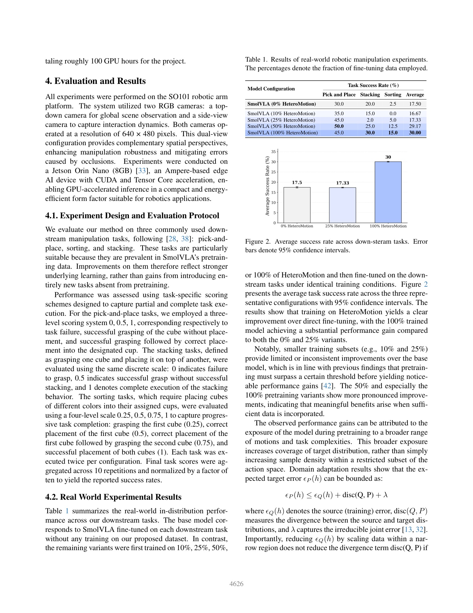

*原论文 Figure 2，PDF 第 4 页；整页保真截图。[原文对应页](https://openaccess.thecvf.com/content/CVPR2026W/ScaleBot/papers/Eslami_Toward_Motion_Diverse_Community_Datasets_for_VLA-Based_Robot_Learning_CVPRW_2026_paper.pdf#page=4)。*

[截图来源清单](../assets/paper-screenshots/trajectory-diversity/manifest.json)。自动定位图号，裁切尚需人工逐图复核；第二图不一定是网络架构。

#### ⑤ 核心技术与算法细节

**行为类别设计。** 根据不同机器人运动类型构造覆盖多种操作行为的任务集合，使采集数据不只重复抓取放置。**真实采集。** 按任务类别采集动作与视觉数据，形成 HeteroMotion，保存不同任务的关节/运动统计。**运动覆盖分析。** 使用关节变化等指标与现有数据集比较，进一步在控制训练规模的子集上进行 VLA 微调。关节方差是一种易计算的代理，而不是接触语义或动力学质量的充分描述。

#### ⑥ 完整 Pipeline（中文归纳）

1. 从现有数据分析过度代表与缺失的运动类别。
2. 设计具有不同运动结构、可实际采集的任务，并记录行为类别。
3. 收集真实示教，统计关节及末端运动、任务覆盖和各类样本数量。
4. 构造相同或可比数据规模的训练子集，微调相同 VLA 基座。
5. 在真实任务评估，对比直接微调、较小子集及更丰富行为数据。

#### ⑦ 实验设计与主要结果

CVPRW ScaleBot 2026 论文介绍 HeteroMotion 数据集，原仓库记录五类行为、15 项任务、1050 条轨迹，作者报告相关真实 VLA 微调改善。应以论文中的样本规模和对照任务理解结果；没有单独验证同任务几何轨迹多样性引起的增益。[会议页面](https://openaccess.thecvf.com/content/CVPR2026W/ScaleBot/html/Eslami_Toward_Motion_Diverse_Community_Datasets_for_VLA-Based_Robot_Learning_CVPRW_2026_paper.html)。

#### ⑧ 方法特点、局限与可借鉴之处

**贡献**：从运动原语而非任务名称定义数据覆盖，为社区数采任务设计提供可执行标准。**局限**：关节方差易受本体、尺度和噪声影响，且无法表示相同末端路径不同接触效果。**研究建议**：构建动作原语×接触事件×对象关系变化的覆盖矩阵，与关节统计、H_G 和 Vendi 联合使用，找出数据池中缺失的运动类别。

**代码/数据状态**：会议论文入口。

## 7. 多样性与质量的统一评估框架（本综述建议，不是某篇论文的原始算法）

### 7.1 评价指标分层

| 指标 | 实现 | 衡量什么 | 主要限制 |
|---|---|---|---|
| 成功率 / 可行率 | 通过数 / 尝试数 | 生成效率、任务达成 | 只统计成功会遮蔽选择偏差 |
| 目标相对几何熵 H_G | 分阶段弧长重采样 + 目标对齐 + SVD | 自由空间路径形状 | 不含时序、接触、姿态；近零位移退化 |
| Vendi | RBF kernel 特征谱有效秩 | 指定表示下有效样本数 | 带宽、样本数与距离定义 |
| DTW / Fréchet / Chamfer | 路径相似度；前两者保留不同程度顺序 | 重复与不同路线 | Chamfer 忽略时序；DTW 会弱化速度差 |
| Occupancy coverage | 网格或 embedding 聚类占据率 | 状态空间/对象运动覆盖 | 网格维度敏感，静止长轨迹可能过权重 |
| 模式熵与均衡度 | 接触类别、抓法、顺序、双臂分工标签统计 | 离散行为策略覆盖 | 标签定义影响结论 |
| 速度/平滑度 | 路程、速度/加速度/jerk 分布、停顿占比 | 动作质量与速度多模态 | jerk 高不必然低质；频率需统一 |
| 接触事件质量 | 非法碰撞、峰值/持续力、对象滑移、接触序列 | 物理可执行性 | 仿真接触信号未必准确 |
| 条件歧义 / MI | H(A|O,c) 代理、kNN/embedding MI | 学生能否区分动作模式 | 估计偏差，真实多模态未必有害 |
| 目标分布覆盖 | 目标到训练 embedding 的 kNN 距离、MMD、任务条件分层 recall | 目标域相关性 | 特征与核敏感；低距离不保证控制可行 |
| 下游效用 | 等预算 SFT + 独立闭环成功/回报 | 对目标学生的实际价值 | 成本高；需多种子与盲测 |
| 学生模式保持率 | 生成器与学生在相同初态重复 rollout 的模式频率与 JSD | 学生是否学到多解 | 只在成功样本上测会漏掉模式失败 |

### 7.2 关键公式和实现注意事项

**Geometric Entropy。** 对每个阶段的末端位置进行目标坐标系对齐：

$$
\xi_i = \operatorname{vec}\left(\frac{R_i^\top(p_{ik}-p_{iT})}{\|p_{i1}-p_{iT}\|+\epsilon}\right)_{k=1}^T.
$$

若样本协方差特征值为 λ，则

$$
H_G=-\sum_j q_j\ln q_j+\ln\sum_j\lambda_j,\qquad q_j=\frac{\lambda_j}{\sum_k\lambda_k}.
$$

实际实现使用 SVD，不必求完整协方差；全重复数据应单列零方差情况，而不是伪造有限熵；近零位移、接触轨迹单独分析。弧长重采样不用于速度统计，时间对齐的数据需另存。

**Vendi。** 使用单位对角的 RBF 核，令归一化 K/n 的非负谱为 λ：

$$
V=\exp(-\sum_j\lambda_j\log\lambda_j).
$$

固定样本数 N 与核带宽，重复随机子采样给置信区间。至少分别计算末端位置、物体运动、关节、接触序列 embedding；不能只用 RGB 或把它们无权重拼接。报告两类分组指标：固定初态的 solution diversity，以及跨初态的 coverage。Vendi/N 可作为附加统计，但不能替代相同 N 下的 Vendi 比较。

**状态与动作差异。** 令生成器有条件变量 z，学生看不到 z；如果相同观测出现冲突动作，BC 的困难来自条件分布，而不是单纯样本条数。以 I(A;O|c) 或估计 H(A|O,c) 检测歧义，并用指令、历史、技能标签条件化后重新计算。连续动作熵受单位与估计器影响，不能跨不同控制频率和归一化直接比较。对于真正合理的多模态，使用分布模型和闭环模式统计而不是简单过滤。

**建议的集合目标**（综合 TUCO/QD 的研究假设）：

$$
\max_{S\subseteq D,\,|S|=B}\left[\sum_{i\in S}u_i+\alpha\log\det(I+\sum_{i\in S}v_iv_i^\top)-\beta\sum_{i\in S}r_i\right].
$$

其中 u_i 为目标效用估计、v_i 为归一后的行为或影响特征、r_i 为风险代价。先以成功、安全、标签一致性为硬门控，再优化软目标。注意这里是建议构造，不声称等同于 TUCO 原公式。与随机、utility-only、diversity-only、质量过滤后随机四种基线等量比较。若不具备目标域 rollout，可先以 target-like 仿真验证集建立代理，不能把代理效用宣称为真实收益。

### 7.3 评价协议：先检验数据本身，再验证学生

1. **控制初态**：每个固定初态重复 K 次 latent 或随机种子采样；另设初态池，跨初态每类等量。场景、对象和相机随机化单独记录。
2. **控制生成预算**：同时报告同尝试数、同生成 GPU 时间、同最终成功条数三种对照。过滤前后均计算各模式通过率和多样性。
3. **控制学生预算**：同一预训练 checkpoint、训练 steps、batch、action horizon、分辨率、归一化和模型结构；按条数、总帧/有效动作 token 双重报告。改变数据分布而不是一起改变训练方法。
4. **防止泄漏**：按场景/初态家族/对象/源示教 lineage 划分，而非随机帧切分；目标评分集和最终测试集独立。
5. **闭环测试**：ID、未见初态、未见物体、扰动恢复分别报告。成功率、碰撞率、完成时间、模式覆盖；至少 3 个训练 seed（预算允许），固定评估初态，报告区间。
6. **解释失败**：区分生成器没探索到、探索到但失败、过滤丢失、学生没学会、以及真机域偏差五个环节。不要以训练 loss 下降替代闭环成功率。

## 8. 可进一步切入的研究方向

| 研究问题 | 可控变量 | 推荐指标/对照 | 价值与风险 |
|---|---|---|---|
| 成功解如何出现 | z 维数、分布、奖励权重、课程位置、训练步数、随机种子 | 固定初态 Vendi/H_G、模式数、成功率；普通 RL | 从生成过程而非仅最终数据解释多样性；需控制探索预算 |
| 多样性在何时产生 | approach/contact/transport/release/recovery | 分阶段模式熵、接触变化、路径形状 | 可定位哪些阶段应增加/降低差异；需可靠事件分割 |
| 质量筛选是否扼杀长尾 | 安全阈值、过滤条件、过滤顺序 | 每模式接受率、Pareto 前沿、拒绝原因 | 避免把安全与保守路径混为一谈；不可用放松安全换成功 |
| 多样性是否可控 | 连续 z 插值、离散技能、接触标签、语言条件 | z→描述符可预测性、跨种子稳定性、同初态模式覆盖 | 由随机生成走向指定需求的生成 |
| 生成器—学生信息差 | 特权状态、历史、对象位姿、技能标签 | 条件歧义、模式保持、闭环表现 | 解释生成器成功而学生失败；部署不能使用不可获取信息 |
| 结构化长程多样性 | 合法子任务拓扑顺序、替代接触、双臂分工 | 任务图覆盖、顺序熵、错误恢复 | KnowDemo/SkillWeaver 指向组合式数据引擎；验证复杂 |
| 真机相关的多样性 | 源数据域、目标评分 rollout、摩擦/位置误差 | TUCO/CUPID 影响、真实 OOD 益处 | 最终价值应由目标域评估决定 |
| 失败及恢复覆盖 | 干预时机、错误类型、纠正策略 | 扰动后恢复率、恢复模式覆盖 | 区分坏动作与好纠正；避免失败标签混入成功 BC |
| 自适应数据预算 | 场景数、每场景解数、每解重复数 | FSC、边际成功率/GPU-hour | 有限预算下针对性生产；因素交互需验证 |
| 多样性与训练阶段 | scratch/预训练、模型容量、数据量、课程顺序 | H_G–性能曲线、学生模式 JSD | 检验 mastery–entropy 假说，寻找模型依赖的最优分布 |
| 跨本体的行为不变量 | 对象效果、相对位姿、末端路径、关节/底盘 | 同对象轨迹匹配、本体特有模式 | 统一语义又不丢全身运动差异 |

### 8.1 建议优先实验：DiscoDemo 多样性形成机制

已有公开 Stage 2 数据时可以开展离线度量，但**仅有最终导出的成功轨迹无法识别探索过程**。需从训练 checkpoint 或在线生成器按可控协议采集原始 rollout，保留失败与拒绝样本。原仓库已有 [DiscoDemo 深度调研](DiscoDemo_轨迹多样性_深度调研_2026-11-23.md)，这里扩展研究设计。

| 阶段 | 实验 | 输出 |
|---|---|---|
| E0 数据审计 | 读取 StackCube 等官方数据的字段；统一坐标、时间、夹爪事件；若仅有视频/动作则明确哪些对象状态不可得 | 字段覆盖表、有效 episode 及分段 |
| E1 离线统计 | 相同样本数计算 H_G、Vendi、接触/速度模式；固定初态组需要初始状态元数据，否则不声称已分离 | 多样性画像、稳定性/样本量曲线 |
| E2 过程采集 | 普通 RL 与 success-gated RL；多个训练 checkpoint；相同初态和 latent 池；记录所有 rollout | 成功率、课程进展、latent/初态方差分解 |
| E3 因素消融 | 固定课程与训练预算，先改 α，再改 z 维数/采样方式；必要时测试独立动作噪声 | 多样性-成功-风险曲线 |
| E4 筛选 | 随机等量、质量优先、Vendi/H_G 分层、质量+覆盖、目标效用+覆盖 | 过滤保留率与分布漂移 |
| E5 SFT | 相同 checkpoint 和预算；低/中/高多样性子集，每组匹配初态、成功率、安全程度、帧数 | 下游 ID/OOD 与模式保持 |
| E6 闭环 | 仿真和真机固定测试协议；扰动、未见对象/布局及恢复单列 | 最终证据及统计区间 |

建议初次 E2 采用 20 个固定初态 × 16 个 latent × 2 个重复 seed 作为试验起点（建议值，不是作者设置），随后依据有效样本数扩展。初态与潜变量采用交叉设计，估计描述符方差来源；若策略本身确定且固定 z 后重复无差异，重复 seed 的作用是验证环境随机性。连续描述符可用方差分解、回归/混合效应模型；离散模式可用条件熵和占据统计。按 initial_state_id 分组 bootstrap，不能把同一初态多条轨迹当作完全独立实验单位。

建议保存如下 schema（按现有可得字段实现，不凭空补值）：

~~~text
episode_id, source_demo_id, generator_version, checkpoint_step,
task_id, initial_state_id, object_id, scene_id, latent_z, seed,
phase_id, action_space, fps, ee_pose, joint_pos, object_pose,
gripper_state, contact_events, task_success, safety_pass,
reject_reason, rollout_steps, collection_cost, split
~~~

**解释 DiscoDemo 和 Geometric Entropy 的表面冲突**：前者改变成功行为覆盖，后者强调去除外在因素后的 transit 形状。两者的被操纵变量、筛选规则、数据量与学习器并不相同。建议使用同一个生成池分层采样形成低/中/高 H_G，同时匹配初态覆盖、接触模式、安全指标；反过来固定 H_G 改变目标状态覆盖，形成二维 factorial design。这样才能区分路径形状与成功状态覆盖对 π0.5 的贡献，而不是先验认定某一方错误。

### 8.2 推荐阅读与执行顺序

| 优先级 | 论文组合 | 直接产出 |
|---|---|---|
| 第一组 | DiscoDemo + Geometric Entropy + Vendi + D3IL | 定义轨迹描述符、阶段和教师/学生多样性指标 |
| 第二组 | QDTraj + SOE + FieldGen + SymmGrid | 比较 QD、latent、分阶段几何和对称增强 |
| 第三组 | CUPID + TUCO + MI + SCIZOR | 质量与集合互补选择，建立训练效用评估 |
| 第四组 | SkillWeaver + KnowDemo + AutoMoMa + DROM | 长程、移动操作和组合策略多样性 |
| 第五组 | FSC + Data Scaling Laws + What Matters + Is Diversity All You Need? | 因素控制、预算优化、模型依赖的多样性 |

## 9. 补充阅读（跨领域方法与既有仓库）

- [Gen2Act](https://proceedings.mlr.press/v305/bharadhwaj25a.html)：生成的人类视频用于条件化机器人执行，区别于直接产生机器人动作标签。
- [CAST](https://cast-vla.github.io/)：反事实轨迹与指令重标注，研究同观测下的细粒度任务语义差异；合成标签必须可执行。
- [HumanoidMimicGen](https://humanoidmimicgen.github.io/)：少量全身示教经 whole-body planning 扩展到 G1 移动操作，适合与 AutoMoMa 比较。
- [RoboMIND](https://x-humanoid-robomind.github.io/)：107k 真实轨迹、四本体、479 任务、96 类对象，含失败示教；是数据组成而非自动生成器参照。
- [RoboDream、Real2Render2Real、SimFoundry Digital Cousins](chapters/04-diversity.md)：已有综述涉及组合式视觉生成、人类对象运动重定向和数字近邻场景；可作动作覆盖与外在上下文覆盖的对照。原章节排除 DemoGen 的决定保持不变，本专题未将其重新列为核心论文。
- [人类视频到机器人操作综述](https://ijcai.org/proceedings/2026/871)：区分 latent action、世界模型、显式 2D 与显式 3D 表示。
- [VLA 数据引擎索引](https://github.com/AIDASLab/Awesome-VLA-Data-Collection-Synthesis-Curation)：用于后续扩大检索范围；不是本文所有条目实验事实的独立证明。

## 10. 结论与调研边界

轨迹多样性研究的关键不是无条件最大化某种距离，而是辨认生成过程中的可控因素、找出具有任务相关性和可学习性的不同成功模式，再以闭环收益验证数据价值。最直接的路线是 **成功解生成 → 多层条件度量 → 质量与互补性选择 → 固定学生验证 → 依据边际收益反馈生成器**。从现有生成器输出开始，可以先解决测量和归因，再逐步改变生成算法；这比一开始重做整套仿真数据引擎更容易建立可靠对照。

证据边界：以上为截至 2026-11-26 的非穷尽叙述性专题检索，以 arXiv 原文/摘要、作者项目及会议页面为主，优先近期论文并保留必要的经典方法。无新实测、无完整代码审计、未统一不同论文实验口径；截图补充：本专题 34 篇核心论文，复用 3 篇的 6 张原图；新增已保存 62 张原论文截图（31/31 篇新增论文具备双图）。图源清单记录失败、图号、PDF 页码及截取坐标；自动裁切未逐图人工复核。研究方案、指标组合、样本规模和优先级为本综述建议，不是既有论文已验证结论。旧仓库的综述和图源不改动。
