# 轨迹多样性专题｜原论文截图核验总览

> 截至 2026-11-26：34 篇 × 2 图。31 篇新收录论文的 62 张图片来自来源 PDF，经按 Figure 图注自动局部裁切（脚本 v2）；另 3 篇复用旧综述的 6 张截图。此页用于目视检查**图像完整性、Figure 编号、对应页面、是否混入附近正文**。自动裁切不等于原作者已确认的独立图资产，不应未经核对作为正式引用。图源：[新截图 manifest](../assets/paper-screenshots/trajectory-diversity/manifest.json)｜[旧截图 manifest](../assets/paper-screenshots/manifest.json)。

## 1. MimicGen

[原论文 PDF](https://arxiv.org/pdf/2310.17596) · SHA-256: `7345661fb8e85819…`

<table><tr><th>原论文主图</th><th>第二张关键图（不一定为架构）</th></tr><tr>
<td>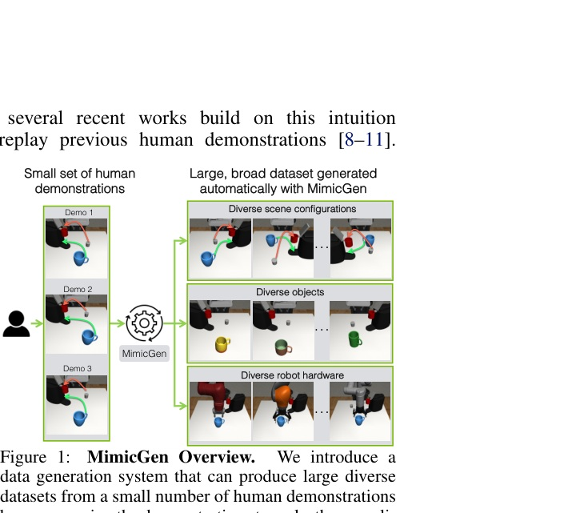</td><td>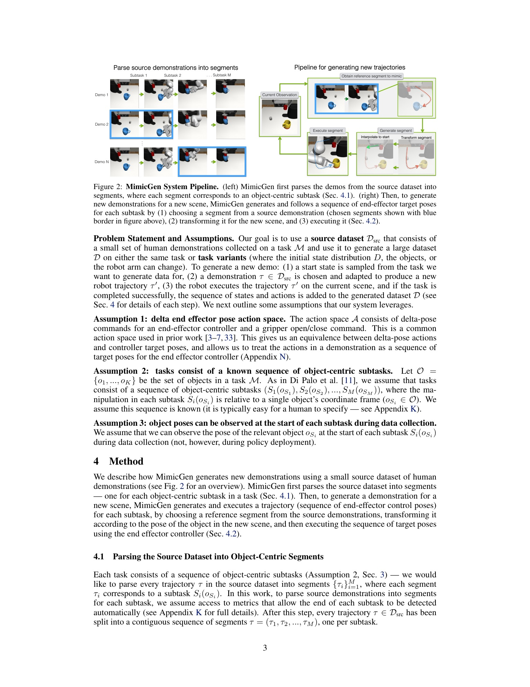</td>
</tr><tr><td>Figure 1 · PDF p.2 · right_column_anchored_crop</td><td>Figure 2 · PDF p.3 · full_width_anchored_crop</td></tr></table>

**原图图注节选：** Figure 1: MimicGen Overview. We introduce a data generation system that can produce large diverse；第二图：Figure 2: MimicGen System Pipeline. (left) MimicGen first parses the demos from the source dataset into segments, where each segment corresponds 。

## 2. DexMimicGen

[原论文 PDF](https://arxiv.org/pdf/2410.24185) · SHA-256: `96349aac2708b563…`

<table><tr><th>原论文主图</th><th>第二张关键图（不一定为架构）</th></tr><tr>
<td>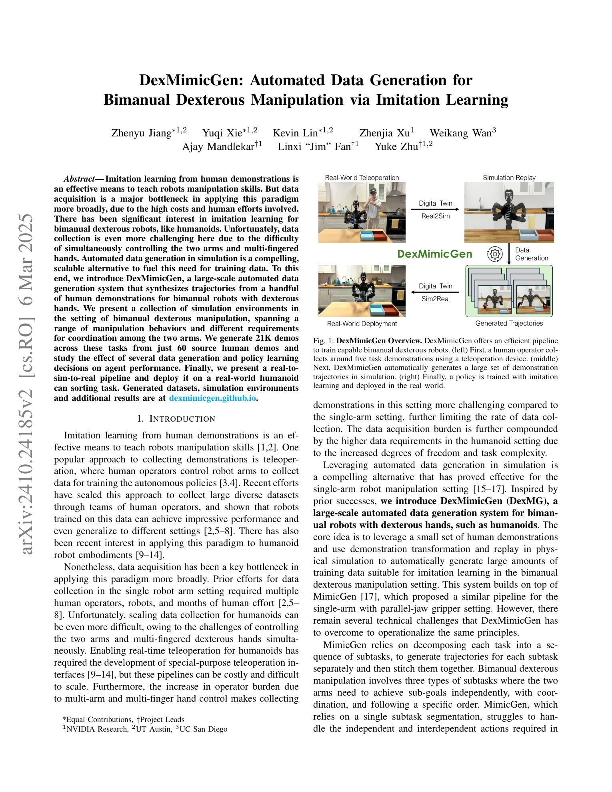</td><td>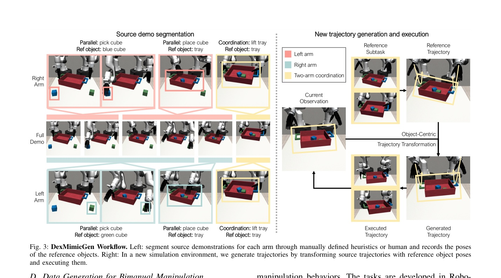</td>
</tr><tr><td>Figure 1 · PDF p.1 · right_column_anchored_crop</td><td>Figure 3 · PDF p.4 · full_width_anchored_crop</td></tr></table>

**原图图注节选：** Fig. 1: DexMimicGen Overview. DexMimicGen offers an efficient pipeline to train capable bimanual dexterous robots. (left) First, a human operator；第二图：Fig. 3: DexMimicGen Workflow. Left: segment source demonstrations for each arm through manually defined heuristics or human and records the poses。

## 3. SkillMimicGen / SkillGen

[原论文 PDF](https://arxiv.org/pdf/2410.18907) · SHA-256: `2bdf9e56f6b7f598…`

<table><tr><th>原论文主图</th><th>第二张关键图（不一定为架构）</th></tr><tr>
<td>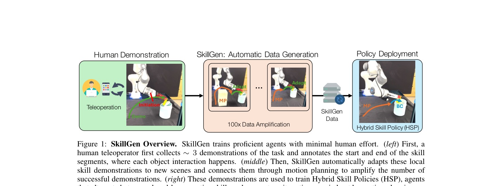</td><td>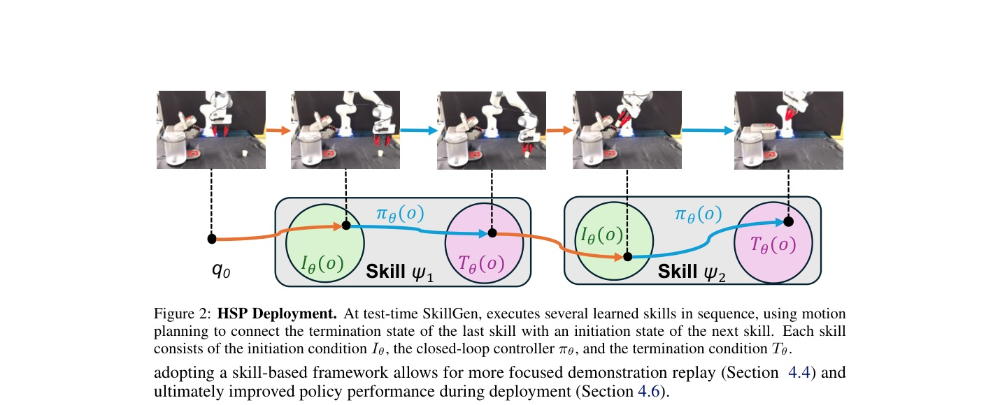</td>
</tr><tr><td>Figure 1 · PDF p.2 · full_width_anchored_crop</td><td>Figure 2 · PDF p.4 · full_width_anchored_crop</td></tr></table>

**原图图注节选：** Figure 1: SkillGen Overview. SkillGen trains proficient agents with minimal human effort. (left) First, a human teleoperator first collects ∼3 de；第二图：Figure 2: HSP Deployment. At test-time SkillGen, executes several learned skills in sequence, using motion planning to connect the termination st。

## 4. AutoMoMa

[原论文 PDF](https://arxiv.org/pdf/2604.12565) · SHA-256: `61479754db6909cf…`

<table><tr><th>原论文主图</th><th>第二张关键图（不一定为架构）</th></tr><tr>
<td>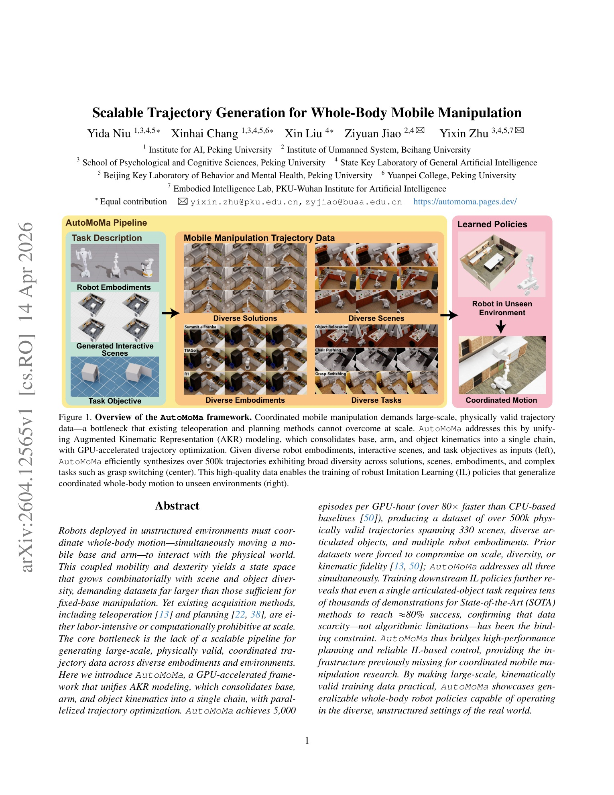</td><td>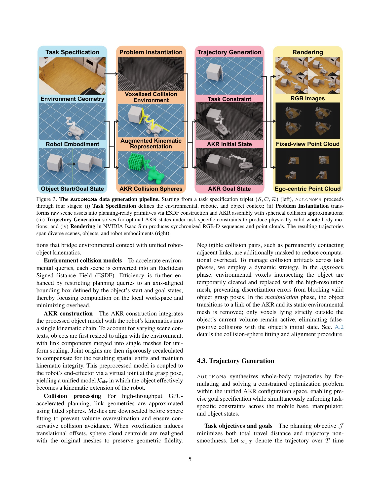</td>
</tr><tr><td>Figure 1 · PDF p.1 · full_width_anchored_crop</td><td>Figure 3 · PDF p.5 · full_width_anchored_crop</td></tr></table>

**原图图注节选：** Figure 1. Overview of the AutoMoMa framework. Coordinated mobile manipulation demands large-scale, physically valid trajectory data—a bottleneck ；第二图：Figure 3. The AutoMoMa data generation pipeline. Starting from a task specification triplet pS, O, Rq (left), AutoMoMa proceeds through four stag。

## 5. AffordGen

[原论文 PDF](https://arxiv.org/pdf/2604.10579) · SHA-256: `5a09d77acf94de28…`

<table><tr><th>原论文主图</th><th>第二张关键图（不一定为架构）</th></tr><tr>
<td>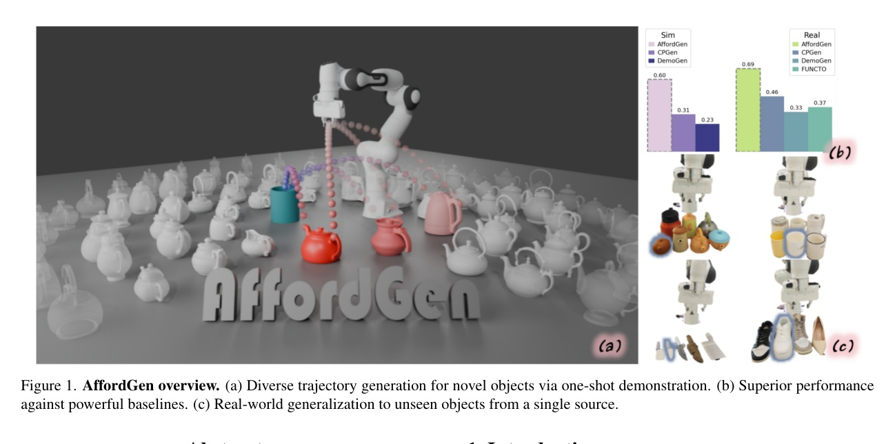</td><td>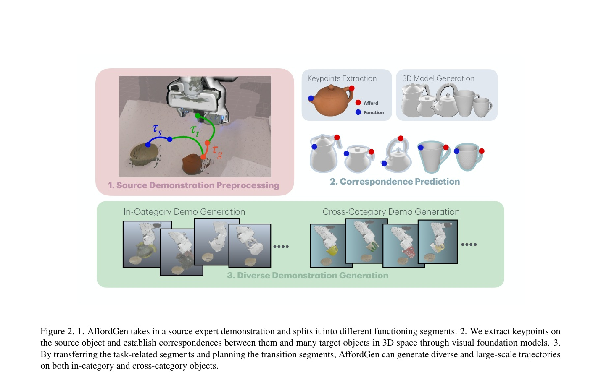</td>
</tr><tr><td>Figure 1 · PDF p.1 · caption_adjacent_raster_crop</td><td>Figure 2 · PDF p.3 · full_width_anchored_crop</td></tr></table>

**原图图注节选：** Figure 1. AffordGen overview. (a) Diverse trajectory generation for novel objects via one-shot demonstration. (b) Superior performance against po；第二图：Figure 2. 1. AffordGen takes in a source expert demonstration and splits it into different functioning segments. 2. We extract keypoints on the s。

## 6. FieldGen

[原论文 PDF](https://arxiv.org/pdf/2510.20774) · SHA-256: `d68eebef4e673a63…`

<table><tr><th>原论文主图</th><th>第二张关键图（不一定为架构）</th></tr><tr>
<td>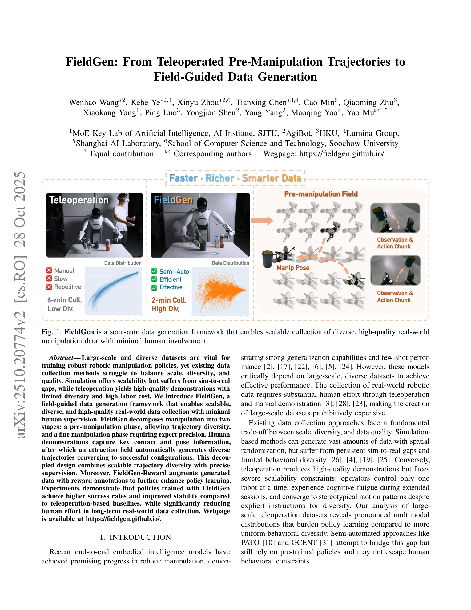</td><td>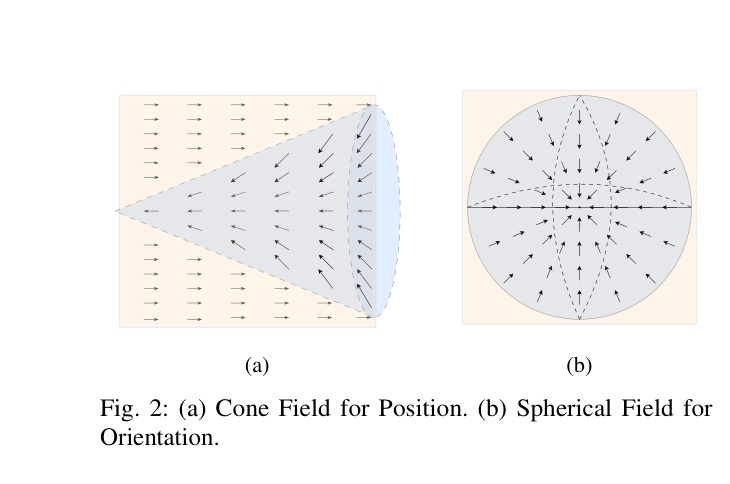</td>
</tr><tr><td>Figure 1 · PDF p.1 · full_width_anchored_crop</td><td>Figure 2 · PDF p.3 · left_column_anchored_crop</td></tr></table>

**原图图注节选：** Fig. 1: FieldGen is a semi-auto data generation framework that enables scalable collection of diverse, high-quality real-world manipulation data ；第二图：Fig. 2: (a) Cone Field for Position. (b) Spherical Field for Orientation.。

## 7. DiscoDemo

[原论文 PDF](https://arxiv.org/pdf/2610.32093) · SHA-256: `891fc5b4a6d2a153…`

<table><tr><th>原论文主图</th><th>第二张关键图（不一定为架构）</th></tr><tr>
<td>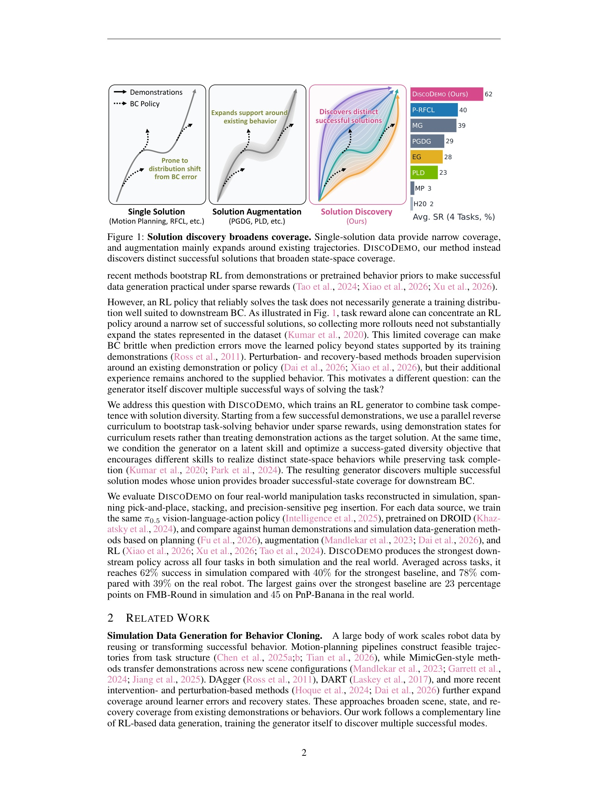</td><td>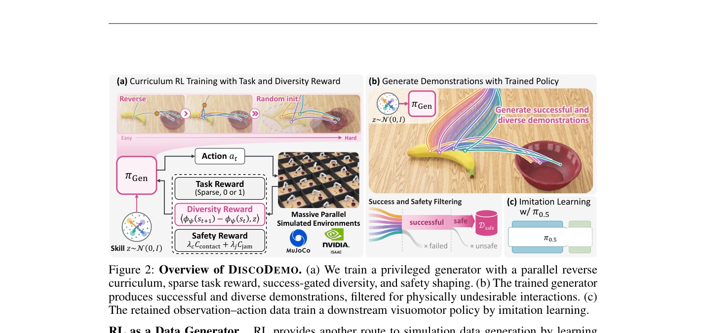</td>
</tr><tr><td>Figure 1 · PDF p.2 · full_width_anchored_crop</td><td>Figure 2 · PDF p.3 · full_width_anchored_crop</td></tr></table>

**原图图注节选：** Figure 1: Solution discovery broadens coverage. Single-solution data provide narrow coverage, and augmentation mainly expands around existing tra；第二图：Figure 2: Overview of DISCODEMO. (a) We train a privileged generator with a parallel reverse curriculum, sparse task reward, success-gated divers。

## 8. QDTraj

[原论文 PDF](https://arxiv.org/pdf/2604.22551) · SHA-256: `e81c2e2e6a8b4f47…`

<table><tr><th>原论文主图</th><th>第二张关键图（不一定为架构）</th></tr><tr>
<td>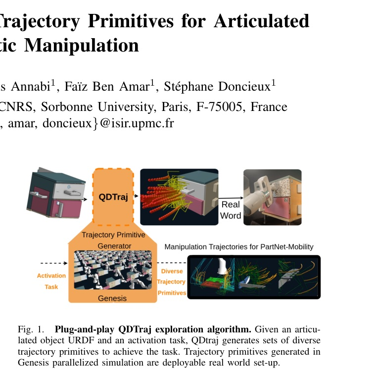</td><td>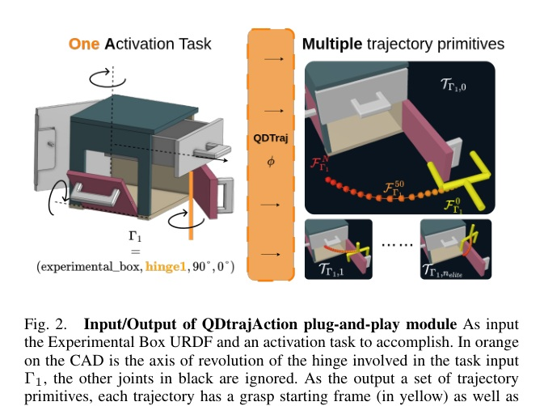</td>
</tr><tr><td>Figure 1 · PDF p.1 · caption_adjacent_raster_crop</td><td>Figure 2 · PDF p.2 · caption_adjacent_raster_crop</td></tr></table>

**原图图注节选：** Fig. 1. Plug-and-play QDTraj exploration algorithm. Given an articu- lated object URDF and an activation task, QDtraj generates sets of diverse t；第二图：Fig. 2. Input/Output of QDtrajAction plug-and-play module As input the Experimental Box URDF and an activation task to accomplish. In orange on t。

## 9. SOE

[原论文 PDF](https://arxiv.org/pdf/2509.19292) · SHA-256: `b93683822ba27eee…`

<table><tr><th>原论文主图</th><th>第二张关键图（不一定为架构）</th></tr><tr>
<td>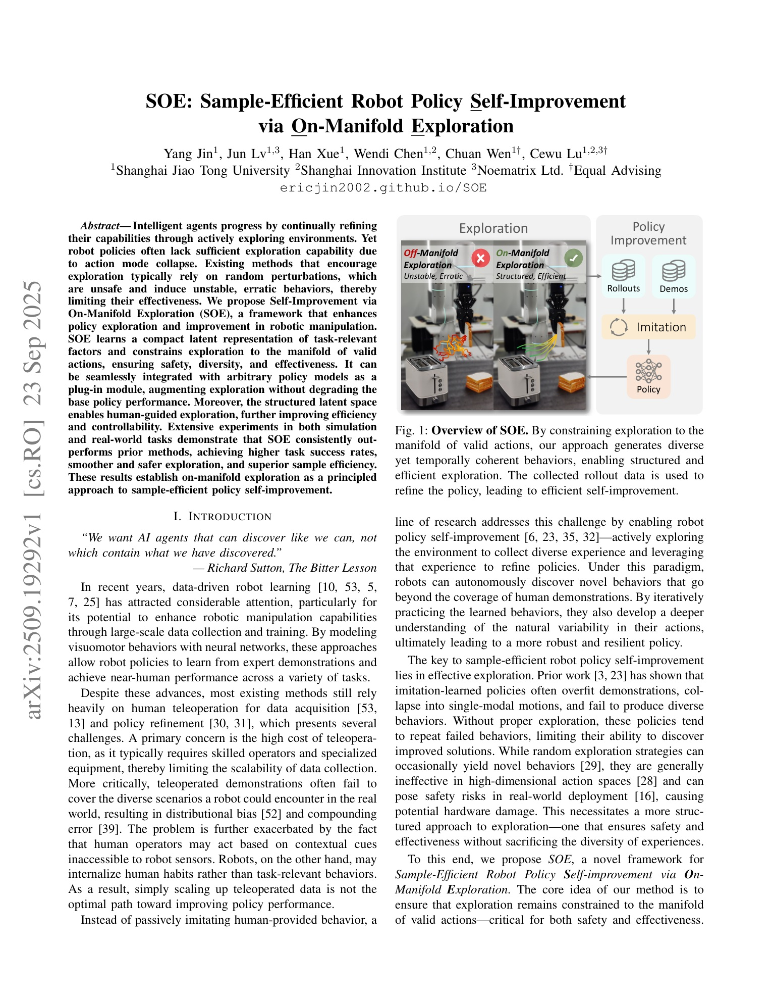</td><td>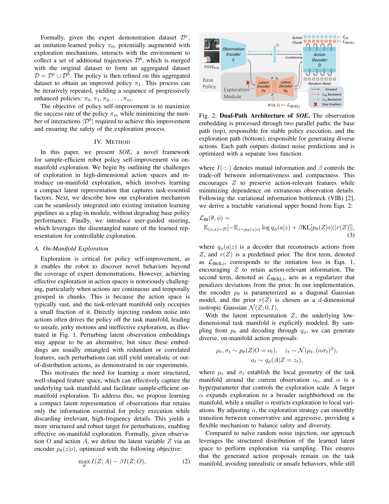</td>
</tr><tr><td>Figure 1 · PDF p.1 · right_column_anchored_crop</td><td>Figure 2 · PDF p.3 · right_column_anchored_crop</td></tr></table>

**原图图注节选：** Fig. 1: Overview of SOE. By constraining exploration to the manifold of valid actions, our approach generates diverse yet temporally coherent beh；第二图：Fig. 2: Dual-Path Architecture of SOE. The observation embedding is processed through two parallel paths: the base path (top), responsible for st。

## 10. RDGen

[原论文 PDF](https://arxiv.org/pdf/2605.30957) · SHA-256: `047a9442a2e5860b…`

<table><tr><th>原论文主图</th><th>第二张关键图（不一定为架构）</th></tr><tr>
<td>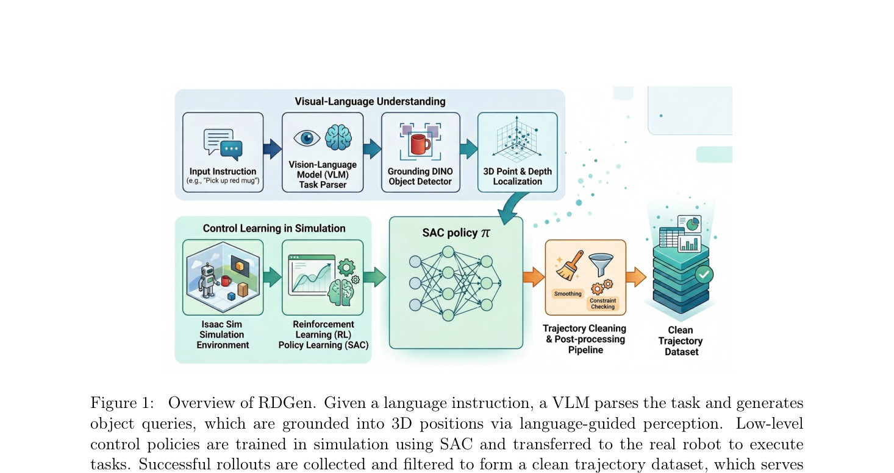</td><td>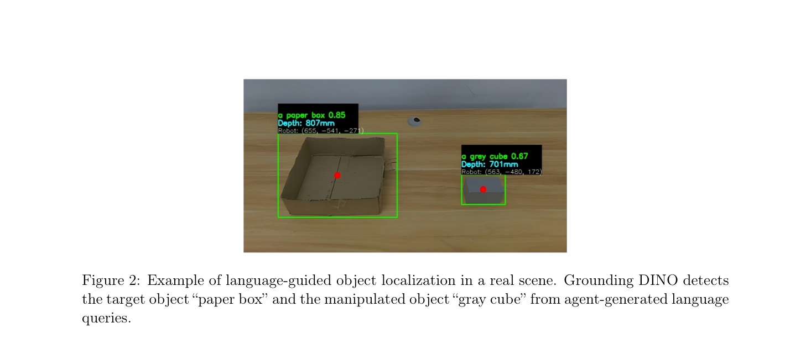</td>
</tr><tr><td>Figure 1 · PDF p.2 · caption_adjacent_raster_crop</td><td>Figure 2 · PDF p.6 · caption_adjacent_raster_crop</td></tr></table>

**原图图注节选：** Figure 1: Overview of RDGen. Given a language instruction, a VLM parses the task and generates object queries, which are grounded into 3D positio；第二图：Figure 2: Example of language-guided object localization in a real scene. Grounding DINO detects the target object “paper box” and the manipulate。

## 11. URSA

[原论文 PDF](https://raw.githubusercontent.com/mlresearch/v305/main/assets/grillotti25a/grillotti25a.pdf) · SHA-256: `b3347c9bc7d31f14…`

<table><tr><th>原论文主图</th><th>第二张关键图（不一定为架构）</th></tr><tr>
<td>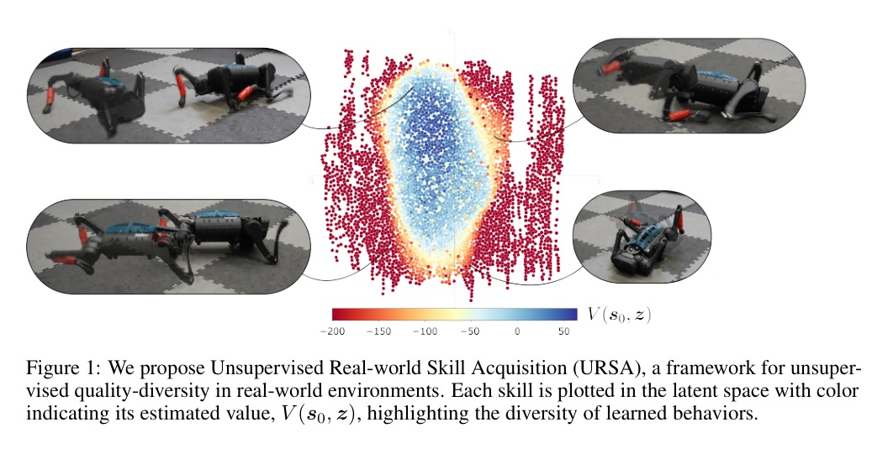</td><td>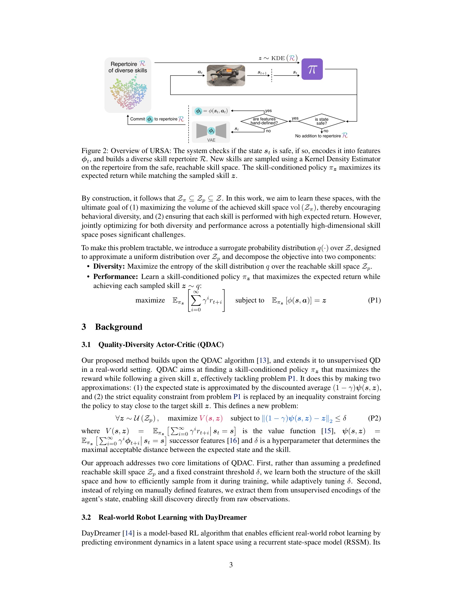</td>
</tr><tr><td>Figure 1 · PDF p.1 · caption_adjacent_raster_crop</td><td>Figure 2 · PDF p.3 · full_width_anchored_crop</td></tr></table>

**原图图注节选：** Figure 1: We propose Unsupervised Real-world Skill Acquisition (URSA), a framework for unsuper- vised quality-diversity in real-world environment；第二图：Figure 2: Overview of URSA: The system checks if the state st is safe, if so, encodes it into features ϕt, and builds a diverse skill repertoire 。

## 12. SymmGrid

[原论文 PDF](https://arxiv.org/pdf/2607.26985) · SHA-256: `edd22c69f486a67f…`

<table><tr><th>原论文主图</th><th>第二张关键图（不一定为架构）</th></tr><tr>
<td>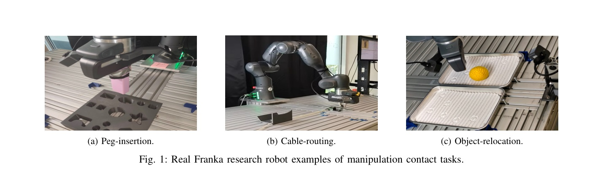</td><td>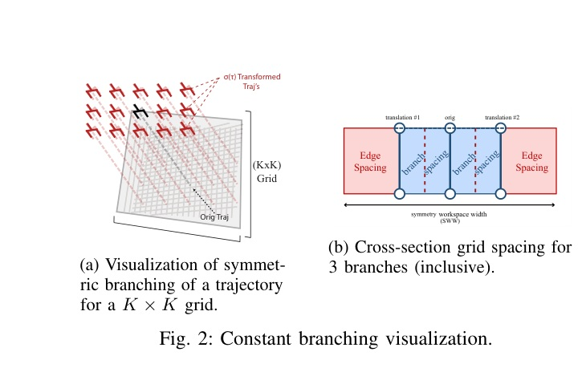</td>
</tr><tr><td>Figure 1 · PDF p.2 · full_width_anchored_crop</td><td>Figure 2 · PDF p.4 · left_column_anchored_crop</td></tr></table>

**原图图注节选：** Fig. 1: Real Franka research robot examples of manipulation contact tasks.；第二图：Fig. 2: Constant branching visualization.。

## 13. SkillWeaver

[原论文 PDF](https://arxiv.org/pdf/2609.36171) · SHA-256: `29ddc32168eb6327…`

<table><tr><th>原论文主图</th><th>第二张关键图（不一定为架构）</th></tr><tr>
<td>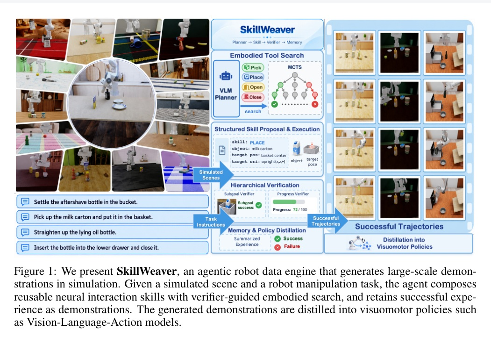</td><td>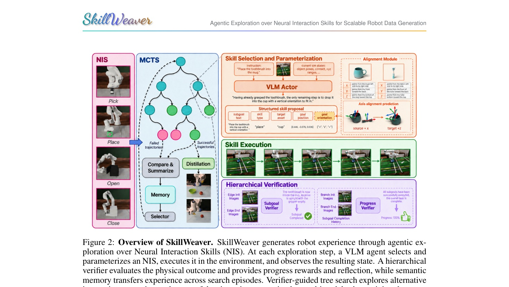</td>
</tr><tr><td>Figure 1 · PDF p.1 · caption_adjacent_raster_crop</td><td>Figure 2 · PDF p.4 · caption_adjacent_raster_crop</td></tr></table>

**原图图注节选：** Figure 1: We present SkillWeaver, an agentic robot data engine that generates large-scale demon- strations in simulation. Given a simulated scene；第二图：Figure 2: Overview of SkillWeaver. SkillWeaver generates robot experience through agentic ex- ploration over Neural Interaction Skills (NIS). At 。

## 14. KnowDemo

[原论文 PDF](https://arxiv.org/pdf/2609.21229) · SHA-256: `124c7b72a370f09f…`

<table><tr><th>原论文主图</th><th>第二张关键图（不一定为架构）</th></tr><tr>
<td>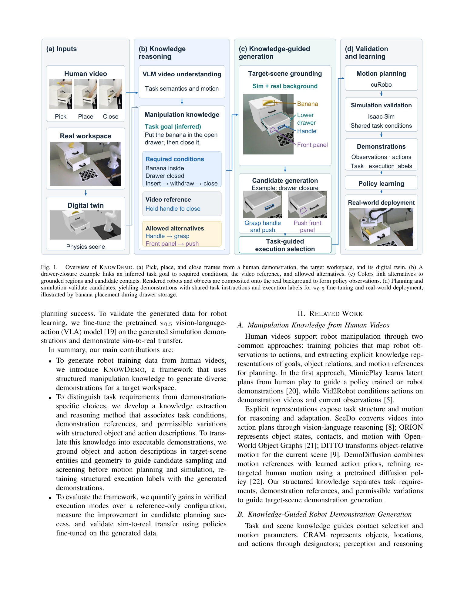</td><td>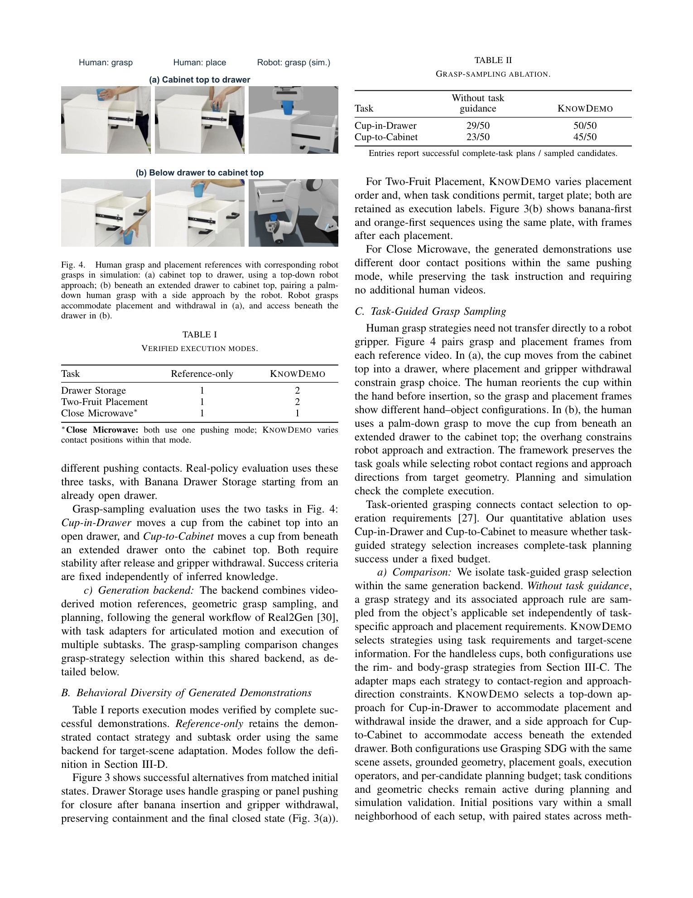</td>
</tr><tr><td>Figure 1 · PDF p.2 · full_width_anchored_crop</td><td>Figure 4 · PDF p.6 · left_column_anchored_crop</td></tr></table>

**原图图注节选：** Fig. 1. Overview of KNOWDEMO. (a) Pick, place, and close frames from a human demonstration, the target workspace, and its digital twin. (b) A dra；第二图：Fig. 4. Human grasp and placement references with corresponding robot grasps in simulation: (a) cabinet top to drawer, using a top-down robot app。

## 15. DROM

[原论文 PDF](https://arxiv.org/pdf/2609.37348) · SHA-256: `9c0ddef3080de20d…`

<table><tr><th>原论文主图</th><th>第二张关键图（不一定为架构）</th></tr><tr>
<td>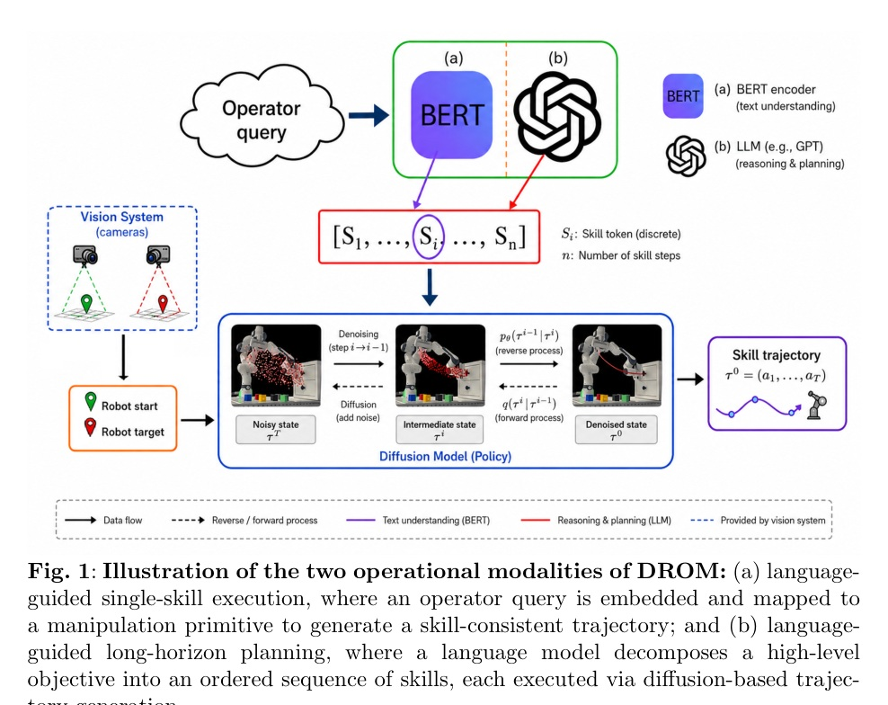</td><td>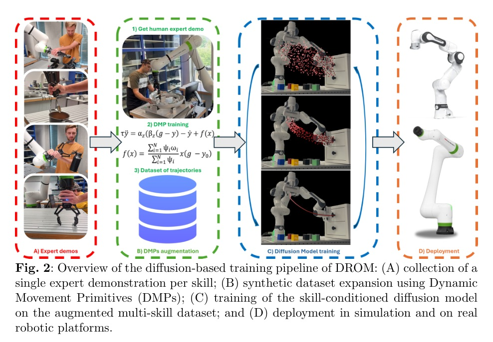</td>
</tr><tr><td>Figure 1 · PDF p.2 · caption_adjacent_raster_crop</td><td>Figure 2 · PDF p.6 · caption_adjacent_raster_crop</td></tr></table>

**原图图注节选：** Fig. 1: Illustration of the two operational modalities of DROM: (a) language- guided single-skill execution, where an operator query is embedded ；第二图：Fig. 2: Overview of the diffusion-based training pipeline of DROM: (A) collection of a single expert demonstration per skill; (B) synthetic datas。

## 16. RoboGene

[原论文 PDF](https://arxiv.org/pdf/2602.16444) · SHA-256: `6635860be999c3f5…`

<table><tr><th>原论文主图</th><th>第二张关键图（不一定为架构）</th></tr><tr>
<td>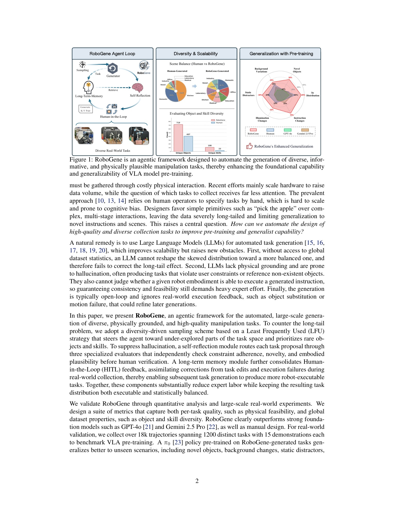</td><td>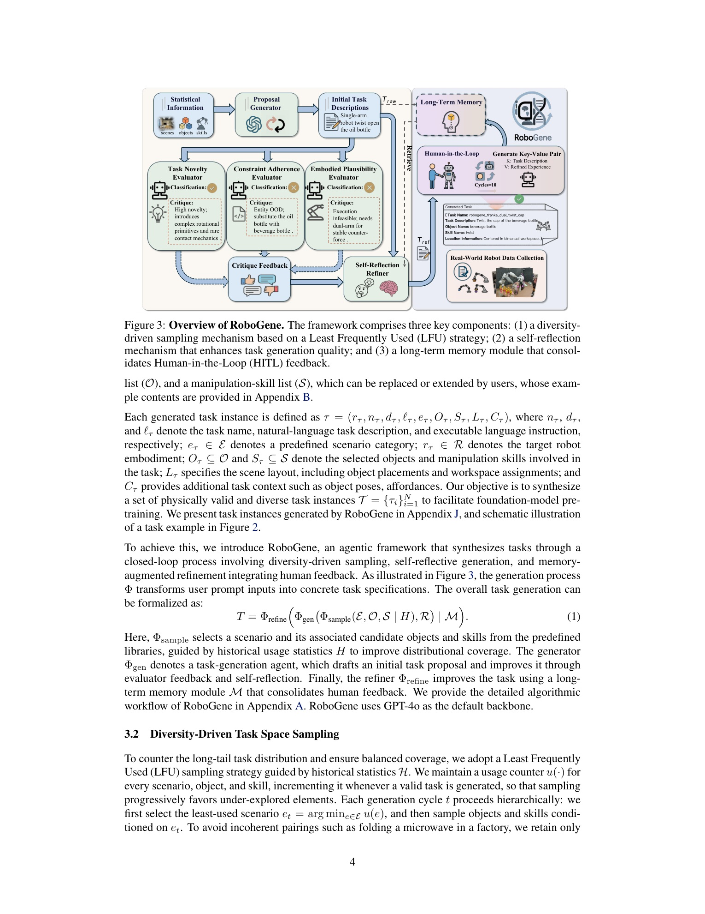</td>
</tr><tr><td>Figure 1 · PDF p.2 · full_width_anchored_crop</td><td>Figure 3 · PDF p.4 · full_width_anchored_crop</td></tr></table>

**原图图注节选：** Figure 1: RoboGene is an agentic framework designed to automate the generation of diverse, infor- mative, and physically plausible manipulation t；第二图：Figure 3: Overview of RoboGene. The framework comprises three key components: (1) a diversity- driven sampling mechanism based on a Least Frequen。

## 17. DreamGen

[原论文 PDF](https://raw.githubusercontent.com/mlresearch/v305/main/assets/jang25a/jang25a.pdf) · SHA-256: `d2103c9f0384e167…`

<table><tr><th>原论文主图</th><th>第二张关键图（不一定为架构）</th></tr><tr>
<td>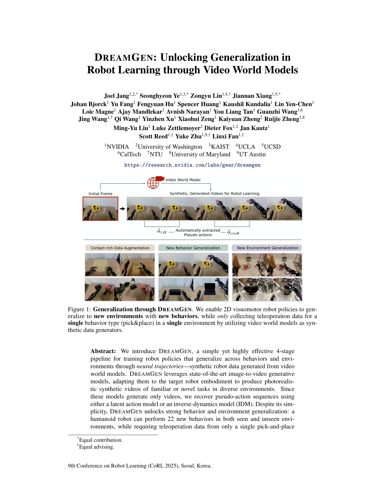</td><td>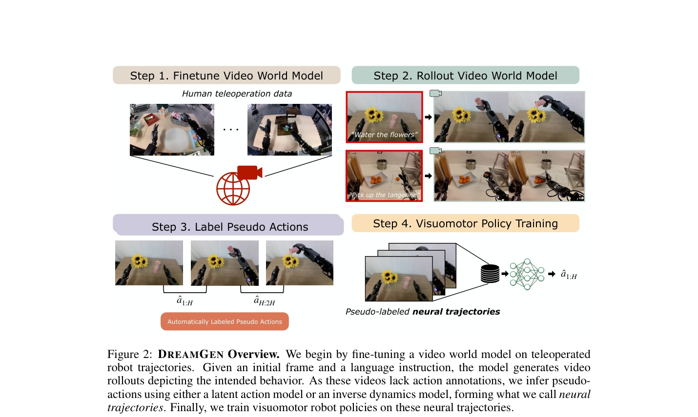</td>
</tr><tr><td>Figure 1 · PDF p.1 · full_width_anchored_crop</td><td>Figure 2 · PDF p.2 · full_width_anchored_crop</td></tr></table>

**原图图注节选：** Figure 1: Generalization through DREAMGEN. We enable 2D visuomotor robot policies to gen- eralize to new environments with new behaviors, while o；第二图：Figure 2: DREAMGEN Overview. We begin by fine-tuning a video world model on teleoperated robot trajectories. Given an initial frame and a languag。

## 18. RoboCurate

[原论文 PDF](https://arxiv.org/pdf/2602.18742) · SHA-256: `dc96dce369358154…`

<table><tr><th>原论文主图</th><th>第二张关键图（不一定为架构）</th></tr><tr>
<td>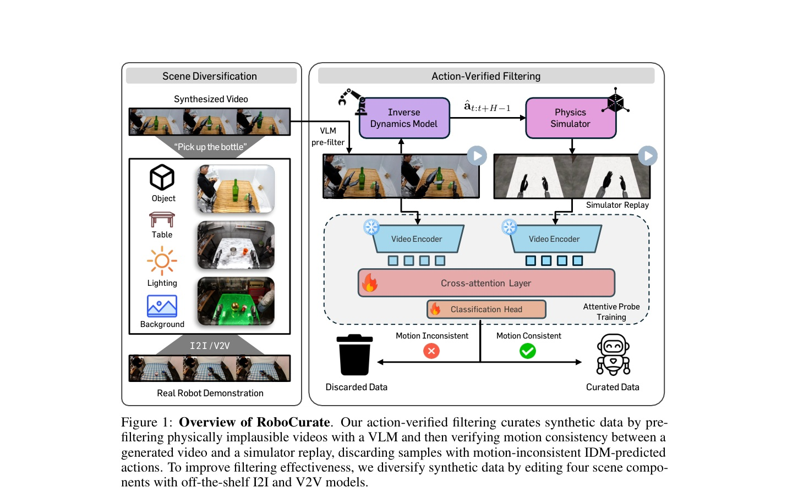</td><td>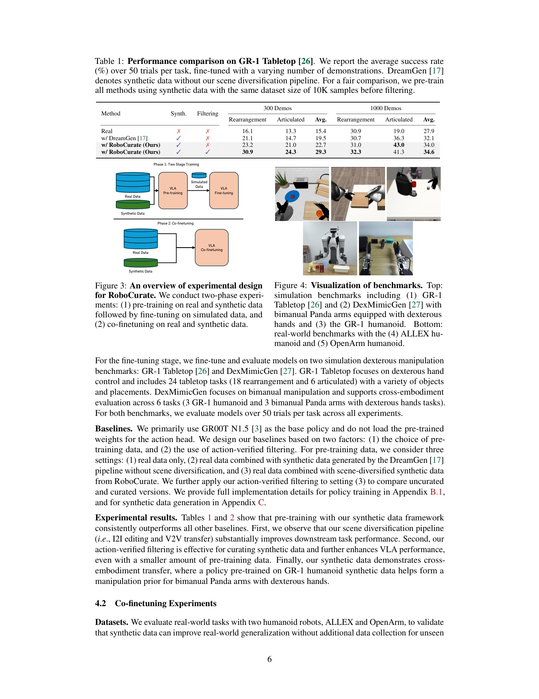</td>
</tr><tr><td>Figure 1 · PDF p.2 · full_width_anchored_crop</td><td>Figure 3 · PDF p.6 · left_column_anchored_crop</td></tr></table>

**原图图注节选：** Figure 1: Overview of RoboCurate. Our action-verified filtering curates synthetic data by pre- filtering physically implausible videos with a VLM；第二图：Figure 3: An overview of experimental design for RoboCurate. We conduct two-phase experi- ments: (1) pre-training on real and synthetic data foll。

## 19. IntervenGen

[原论文 PDF](https://arxiv.org/pdf/2405.01472) · SHA-256: `f48937379bc49480…`

<table><tr><th>原论文主图</th><th>第二张关键图（不一定为架构）</th></tr><tr>
<td>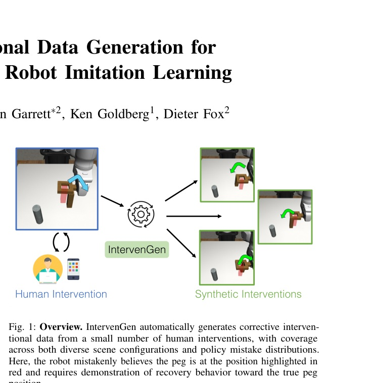</td><td>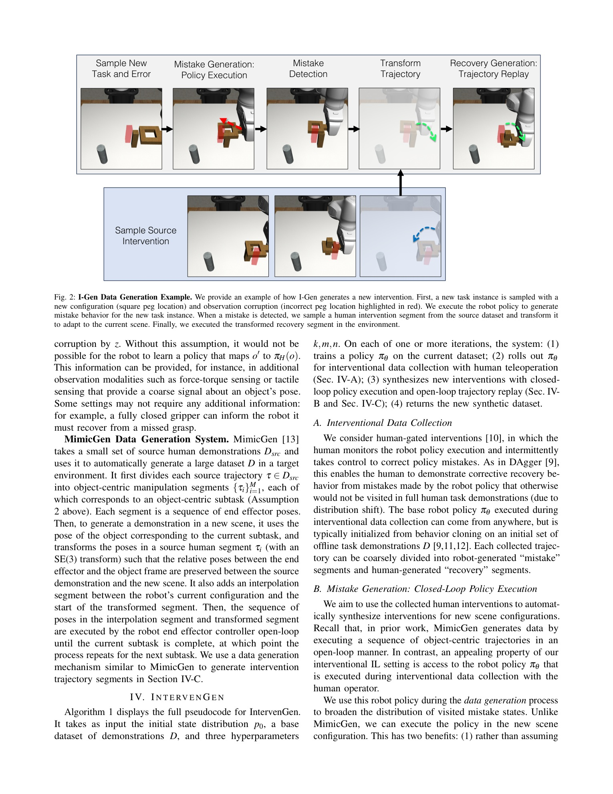</td>
</tr><tr><td>Figure 1 · PDF p.1 · right_column_anchored_crop</td><td>Figure 2 · PDF p.3 · full_width_anchored_crop</td></tr></table>

**原图图注节选：** Fig. 1: Overview. IntervenGen automatically generates corrective interven- tional data from a small number of human interventions, with coverage ；第二图：Fig. 2: I-Gen Data Generation Example. We provide an example of how I-Gen generates a new intervention. First, a new task instance is sampled wit。

## 20. MOVE

[原论文 PDF](https://arxiv.org/pdf/2512.04813) · SHA-256: `8129443706db38d2…`

<table><tr><th>原论文主图</th><th>第二张关键图（不一定为架构）</th></tr><tr>
<td>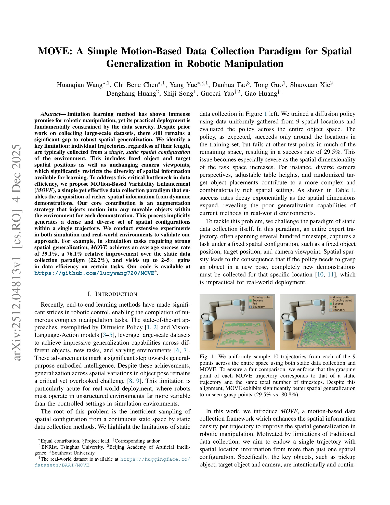</td><td>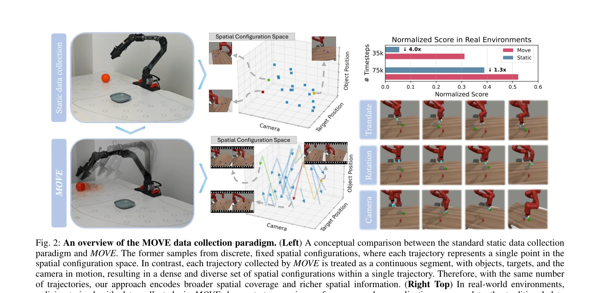</td>
</tr><tr><td>Figure 1 · PDF p.1 · right_column_anchored_crop</td><td>Figure 2 · PDF p.2 · full_width_anchored_crop</td></tr></table>

**原图图注节选：** Fig. 1: We uniformly sample 10 trajectories from each of the 9 points across the entire space using both static data collection and MOVE. To ensu；第二图：Fig. 2: An overview of the MOVE data collection paradigm. (Left) A conceptual comparison between the standard static data collection paradigm and。

## 21. Geometric Entropy

[原论文 PDF](https://arxiv.org/pdf/2606.20871v2) · SHA-256: `a3fda6fe8a72cfaf…`

<table><tr><th>原论文主图</th><th>第二张关键图（不一定为架构）</th></tr><tr>
<td>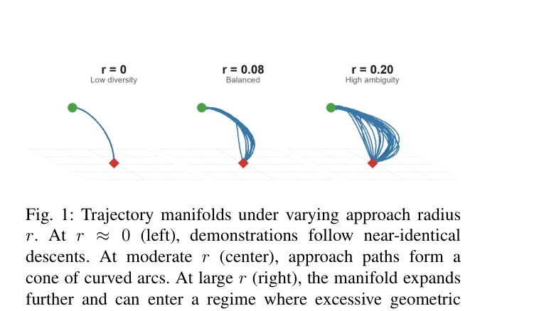</td><td>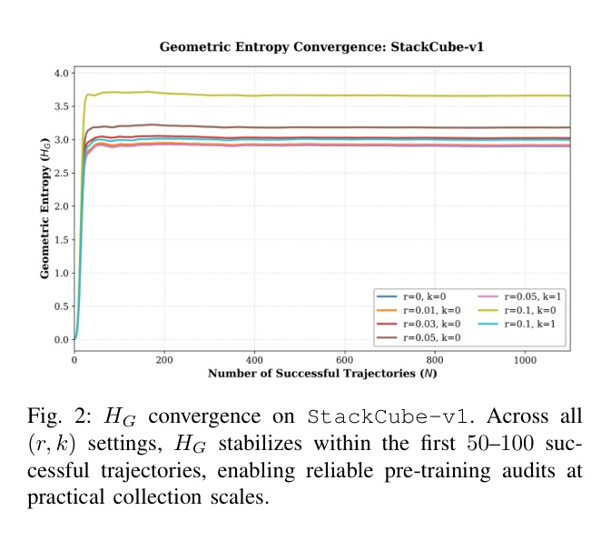</td>
</tr><tr><td>Figure 1 · PDF p.4 · caption_adjacent_raster_crop</td><td>Figure 2 · PDF p.4 · caption_adjacent_raster_crop</td></tr></table>

**原图图注节选：** Fig. 1: Trajectory manifolds under varying approach radius r. At r ≈0 (left), demonstrations follow near-identical descents. At moderate r (cente；第二图：Fig. 2: HG convergence on StackCube-v1. Across all (r, k) settings, HG stabilizes within the first 50–100 suc- cessful trajectories, enabling rel。

## 22. Vendi Score

[原论文 PDF](https://arxiv.org/pdf/2210.02410) · SHA-256: `6882e9fd9c43326b…`

<table><tr><th>原论文主图</th><th>第二张关键图（不一定为架构）</th></tr><tr>
<td>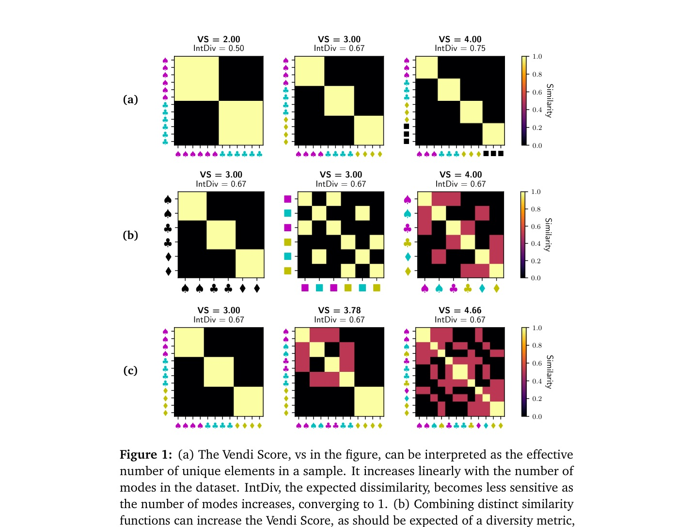</td><td>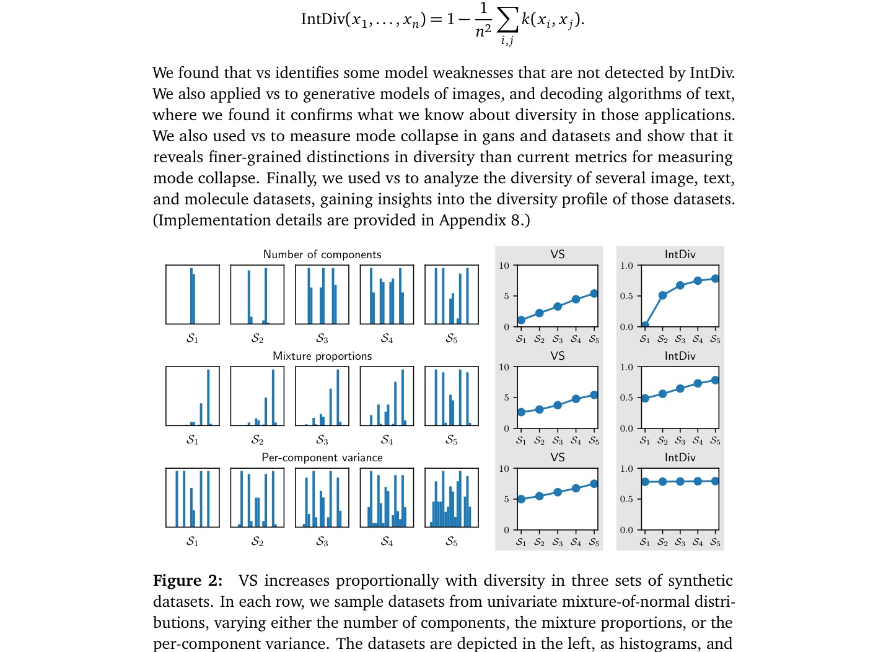</td>
</tr><tr><td>Figure 1 · PDF p.2 · full_width_anchored_crop</td><td>Figure 2 · PDF p.9 · full_width_anchored_crop</td></tr></table>

**原图图注节选：** Figure 1: (a) The Vendi Score, vs in the figure, can be interpreted as the effective number of unique elements in a sample. It increases linearly；第二图：Figure 2: VS increases proportionally with diversity in three sets of synthetic datasets. In each row, we sample datasets from univariate mixture。

## 23. Data Quality in Imitation Learning

[原论文 PDF](https://arxiv.org/pdf/2306.02437) · SHA-256: `a6aded39474c30a4…`

<table><tr><th>原论文主图</th><th>第二张关键图（不一定为架构）</th></tr><tr>
<td>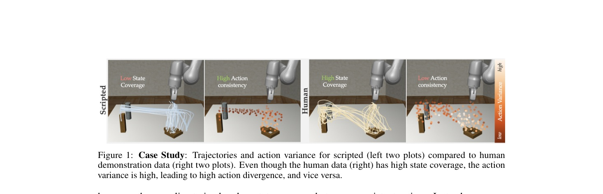</td><td>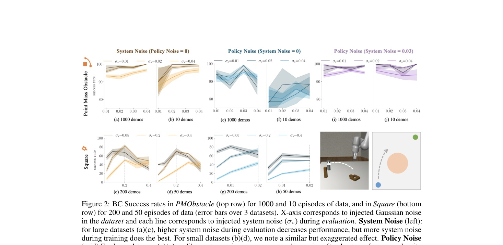</td>
</tr><tr><td>Figure 1 · PDF p.7 · caption_adjacent_raster_crop</td><td>Figure 2 · PDF p.8 · caption_adjacent_raster_crop</td></tr></table>

**原图图注节选：** Figure 1: Case Study: Trajectories and action variance for scripted (left two plots) compared to human demonstration data (right two plots). Even；第二图：Figure 2: BC Success rates in PMObstacle (top row) for 1000 and 10 episodes of data, and in Square (bottom row) for 200 and 50 episodes of data (。

## 24. Robot Data Curation with Mutual Information Estimators

[原论文 PDF](https://arxiv.org/pdf/2502.08623) · SHA-256: `d4c1a5fcf262c5ce…`

<table><tr><th>原论文主图</th><th>第二张关键图（不一定为架构）</th></tr><tr>
<td>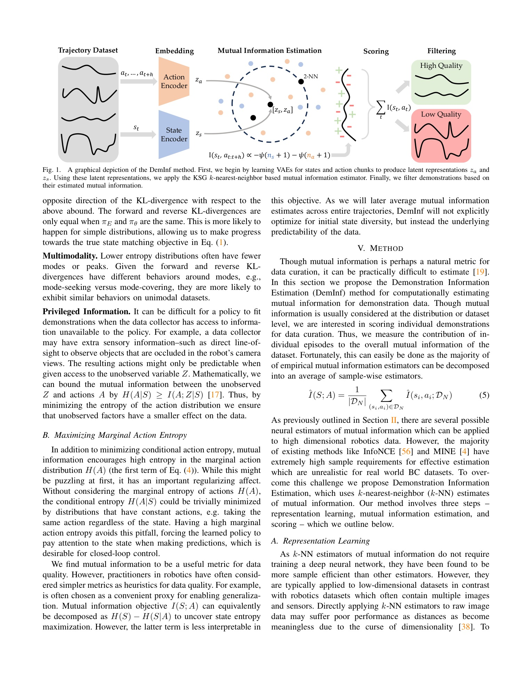</td><td>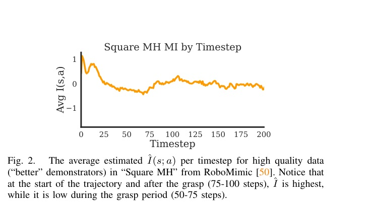</td>
</tr><tr><td>Figure 1 · PDF p.4 · full_width_anchored_crop</td><td>Figure 2 · PDF p.5 · right_column_anchored_crop</td></tr></table>

**原图图注节选：** Fig. 1. A graphical depiction of the DemInf method. First, we begin by learning VAEs for states and action chunks to produce latent representatio；第二图：Fig. 2. The average estimated Iˆ(s; a) per timestep for high quality data (“better” demonstrators) in “Square MH” from RoboMimic [50]. Notice tha。

## 25. CUPID

[原论文 PDF](https://arxiv.org/pdf/2506.19121) · SHA-256: `ecc67dcdf296c39f…`

<table><tr><th>原论文主图</th><th>第二张关键图（不一定为架构）</th></tr><tr>
<td>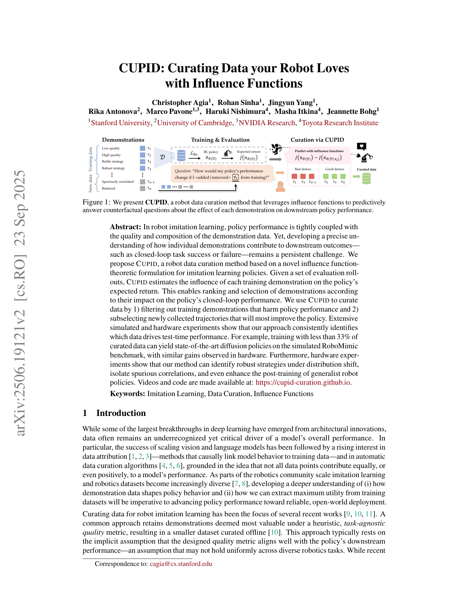</td><td>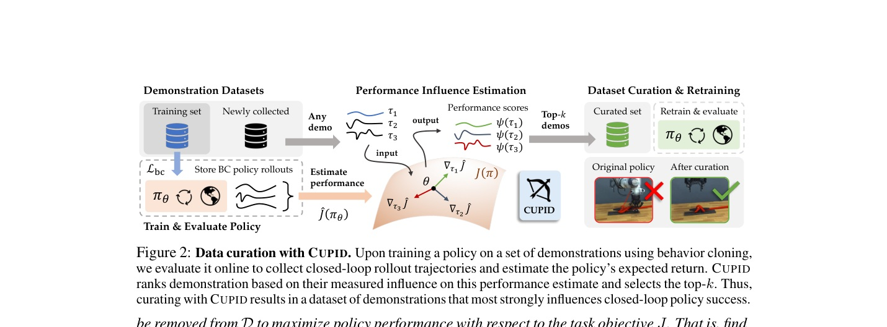</td>
</tr><tr><td>Figure 1 · PDF p.1 · full_width_anchored_crop</td><td>Figure 2 · PDF p.4 · full_width_anchored_crop</td></tr></table>

**原图图注节选：** Figure 1: We present CUPID, a robot data curation method that leverages influence functions to predictively answer counterfactual questions about；第二图：Figure 2: Data curation with CUPID. Upon training a policy on a set of demonstrations using behavior cloning, we evaluate it online to collect cl。

## 26. D3IL

[原论文 PDF](https://arxiv.org/pdf/2402.14606) · SHA-256: `a560eab947cab067…`

<table><tr><th>原论文主图</th><th>第二张关键图（不一定为架构）</th></tr><tr>
<td></td><td></td>
</tr><tr><td>Figure 1 · PDF p.8 · full_width_anchored_crop</td><td>Figure 3 · PDF p.13 · full_width_anchored_crop</td></tr></table>

**原图图注节选：** Figure 1: Ablation study for different history lengths and prediction horizons on the Aligning task.；第二图：Figure 3: D3IL Visualizations. This figure provides an overview of various tasks and behaviors within our dataset. The top row demonstrates one o。

## 27. Data Scaling Laws

[原论文 PDF](https://arxiv.org/pdf/2410.18647) · SHA-256: `e3ee296bdf1b34dd…`

<table><tr><th>原论文主图</th><th>第二张关键图（不一定为架构）</th></tr><tr>
<td></td><td></td>
</tr><tr><td>Figure 1 · PDF p.2 · caption_adjacent_raster_crop</td><td>Figure 2 · PDF p.6 · full_width_anchored_crop</td></tr></table>

**原图图注节选：** Figure 1: Illustrations of all tasks. We derive the data scaling laws through extensive experiments on Pour Water and Mouse Arrangement, and furt；第二图：Figure 2: Object generalization. Each curve corresponds to a different fraction of demonstrations used, with normalized scores shown as a functio。

## 28. Factored Scaling Curves

[原论文 PDF](https://arxiv.org/pdf/2505.07728) · SHA-256: `1b2b190ce27184b6…`

<table><tr><th>原论文主图</th><th>第二张关键图（不一定为架构）</th></tr><tr>
<td></td><td></td>
</tr><tr><td>Figure 1 · PDF p.1 · full_width_anchored_crop</td><td>Figure 2 · PDF p.4 · right_column_anchored_crop</td></tr></table>

**原图图注节选：** Figure 1: To efficiently collect demonstrations so as to maximize policy performance under a fixed data bud- get, we propose factored scaling cur；第二图：Figure 2: Illustration of factored scaling curves used to inform data allocation. For the distractor fac- tor, points are used to construct the s。

## 29. What Matters

[原论文 PDF](https://arxiv.org/pdf/2506.13536) · SHA-256: `6486ddeed533a7d2…`

<table><tr><th>原论文主图</th><th>第二张关键图（不一定为架构）</th></tr><tr>
<td></td><td></td>
</tr><tr><td>Figure 1 · PDF p.2 · full_width_anchored_crop</td><td>Figure 2 · PDF p.3 · full_width_anchored_crop</td></tr></table>

**原图图注节选：** Figure 1: MimicLabs overview. Our framework encompasses: (1) A procedural dataset generator that creates diverse datasets with controlled composi；第二图：Figure 2: Characterizing Co-Training Settings: (a) We consider four co-training settings character- ized by the diversity of their co-training da。

## 30. Is Diversity All You Need?

[原论文 PDF](https://arxiv.org/pdf/2507.06219) · SHA-256: `609956e716ed3d16…`

<table><tr><th>原论文主图</th><th>第二张关键图（不一定为架构）</th></tr><tr>
<td></td><td></td>
</tr><tr><td>Figure 1 · PDF p.1 · full_width_anchored_crop</td><td>Figure 2 · PDF p.3 · right_column_anchored_crop</td></tr></table>

**原图图注节选：** Fig. 1: We investigate critical aspects of data diversity for robotic manipulation systematically, i.e., task, embodiment, and expert diversity. ；第二图：Fig. 2: Illustration of the multimodal expert behavior in task Push-T [32]. The robot (blue circle) needs to move the gray T to the green target 。

## 31. HeteroMotion

[原论文 PDF](https://openaccess.thecvf.com/content/CVPR2026W/ScaleBot/papers/Eslami_Toward_Motion_Diverse_Community_Datasets_for_VLA-Based_Robot_Learning_CVPRW_2026_paper.pdf) · SHA-256: `f351d5cf48d5294b…`

<table><tr><th>原论文主图</th><th>第二张关键图（不一定为架构）</th></tr><tr>
<td></td><td></td>
</tr><tr><td>Figure 1 · PDF p.3 · full_width_anchored_crop</td><td>Figure 2 · PDF p.4 · caption_adjacent_raster_crop</td></tr></table>

**原图图注节选：** Figure 1. Overview of the proposed dataset, HeteroMotion, highlighting the robotic platform and five task categories designed to promote diverse ；第二图：Figure 2. Average success rate across down-steram tasks. Error bars denote 95% confidence intervals.。

## 32. RoboTwin 2.0（沿用旧综述图）

<table><tr><th>原论文主图</th><th>第二关键图</th></tr><tr><td></td><td></td></tr></table>

图号/页面及截图裁切依据请参阅[旧 manifest](../assets/paper-screenshots/manifest.json)。

## 33. SCIZOR（沿用旧综述图）

<table><tr><th>原论文主图</th><th>第二关键图</th></tr><tr><td></td><td></td></tr></table>

图号/页面及截图裁切依据请参阅[旧 manifest](../assets/paper-screenshots/manifest.json)。

## 34. TUCO（沿用旧综述图）

<table><tr><th>原论文主图</th><th>第二关键图</th></tr><tr><td></td><td></td></tr></table>

图号/页面及截图裁切依据请参阅[旧 manifest](../assets/paper-screenshots/manifest.json)。

## 建议人工验收表

- [ ] 每图主体完整、没有截去重要子图与图例
- [ ] 主图与对应论文的 Figure 编号一致
- [ ] 第二图确实提供方法或有独立价值，若不是架构图必须明确说明
- [ ] 没有把整页正文或论文标题误当作独立主图的一部分
- [ ] 原图图注、PDF 页码和截图来源一致

如某图出现截断，请到对应 PDF 原文核对，然后对该篇的裁切坐标进行人工指定，不建议用不相关的第二图凑数。
